# Digital Transformation & Platform Business Strategy

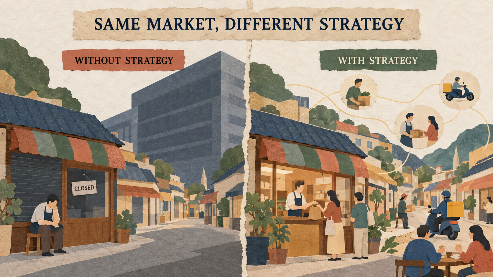

![Course roadmap: Module 1 Platform Foundations (1.1 Platform Business Fundamentals, 1.2 Network Effects, 1.3 Two-Sided Markets, 1.4 Scale and Winner-Takes-All); Module 2 Data and Monetization (2.1 Data Feedback Loop, 2.2 Asymmetric Pricing, 2.3 Up-Sell and Cross-Sell, 2.4 Module 2 Review); Module 3 Competition and Innovation (3.1 Platform Envelopment, 3.2 Strategic Cannibalization, 3.3 Disruptive Innovation, 3.4 Open Innovation and Ecosystems); Module 4 Cases and Synthesis (4.1 Case Study: Amazon, 4.2 Case Study: Apple, 4.3 Industry Evidence, 4.4 Capstone Defense)](assets/course_roadmap.png)

## Course Overview

This course delivers an analytical and practical examination of digital transformation and platform business strategy. Students examine how digital platform architectures alter industry structures, redefine competitive boundaries, and reorganize value creation. Theoretical frameworks are paired with empirical corporate analysis, requiring students to evaluate strategic initiatives, platform mechanics, and operating models. Case studies and longitudinal analyses of publicly traded companies provide concrete grounding for strategic decision-making. Students develop the analytical capabilities required to navigate, evaluate, and execute digital transformation initiatives in complex market environments.


---

## Standardized 3-Hour (180-Minute) Session Blueprint

Every classroom session is structured into four sequential phases to balance conceptual understanding, practical business application, and hands-on spreadsheet strategy modeling:

| Phase | Time Allocation | Pedagogical Objective | Core Activities & Student Deliverables |
| :--- | :--- | :--- | :--- |
| **Phase 1: Concepts & Foundations** | 45 Minutes (0:00 - 0:45) | Theory & Terminology | Introduce keywords, core economic frameworks, and accessible definitions. Review 2-3 cross-industry micro-examples. Rapid student identification of local equivalents. |
| **Phase 2: Strategic Case Dissection** | 45 Minutes (0:45 - 1:30) | Business Case Analysis | In-depth examination of the real-world business case. Analyze historical strategic choices, market tradeoffs, unit economics, and competitive turning points. |
| **Phase 3: Applied Lab & Data Modeling** | 60 Minutes (1:30 - 2:30) | Spreadsheet Data Analysis | Step-by-step extraction and analysis of financial disclosures from audited filings. Complete the **Foundational Exercise (Exercise 1)** in Excel using provided CSV datasets. |
| **Phase 4: Strategic Decision Lab** | 30 Minutes (2:30 - 3:00) | Executive Synthesis & Decision-Making | Complete the **Strategic Decision Challenge (Exercise 2+)**: analyze executive dilemmas, evaluate strategic tradeoffs, stress-test business models, and present concise strategic recommendations. |

---

<a id="table-of-contents"></a>
## Table of Contents

* [**Module 1: Foundations of Platform Business & Network Dynamics**](#module-1)
  * [Session 1.1: Course Orientation & The Fundamentals of Platform Businesses](#session-1-1)
  * [Session 1.2: Network Effects & The Penguin Effect](#session-1-2)
  * [Session 1.3: Two-Sided & Multi-Sided Networks](#session-1-3)
  * [Session 1.4: Scale Dynamics & Winner-Takes-All Markets](#session-1-4)
* [**Module 2: Platform Economics, Big Data & Monetization**](#module-2)
  * [Session 2.1: The Data Feedback Loop Strategy](#session-2-1)
  * [Session 2.2: The Asymmetric Pricing Strategy](#session-2-2)
  * [Session 2.3: The Up-Sell and Cross-Sell Strategy](#session-2-3)
  * [Session 2.4: Module 2 Review: Choosing the Right Strategy](#session-2-4)
* [**Module 3: Competitive Strategy & Innovation Frameworks**](#module-3)
  * [Session 3.1: Platform Envelopment Attacks](#session-3-1)
  * [Session 3.2: Strategic Cannibalization](#session-3-2)
  * [Session 3.3: Disruptive Innovation in the Digital Era](#session-3-3)
  * [Session 3.4: Open Innovation & Ecosystem Orchestration](#session-3-4)
* [**Module 4: Real-World Case Studies & Strategic Synthesis**](#module-4)
  * [Session 4.1: Comprehensive Case Study: Amazon](#session-4-1)
  * [Session 4.2: Comprehensive Case Study: Apple](#session-4-2)
  * [Session 4.3: Applied Digital Learning & Empirical Industry Evidence](#session-4-3)
  * [Session 4.4: Final Strategic Assessment & Capstone Defense](#session-4-4)

---

<a id="module-1"></a>
## Module 1: Foundations of Platform Business & Network Dynamics

<a id="session-1-1"></a>
### Session 1.1: Course Orientation & The Fundamentals of Platform Businesses

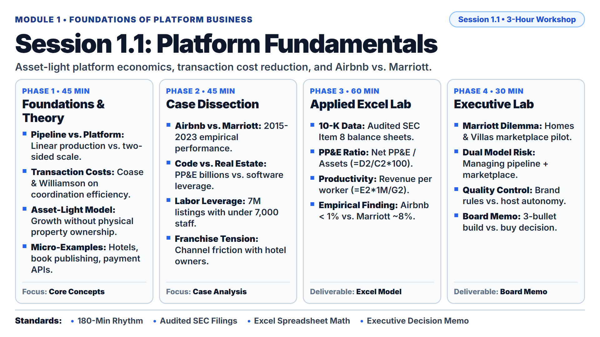

* **Lecture Presentation:** [Download Slides (PDF)](slides/session_1_1_lecture.pdf)

* **Keywords:** Pipeline Business, Platform Ecosystem, Network Effects, Transaction Cost Economics, Asset-Light Model, Fixed Asset Intensity (PP&E: Property, Plant, and Equipment).
* **Main Theories:**
  * [Pipeline versus Platform Models](https://hbr.org/2016/04/pipelines-platforms-and-the-new-rules-of-strategy) ([Platform Economy Overview](https://en.wikipedia.org/wiki/Platform_economy)): Marshall W. Van Alstyne, Geoffrey G. Parker, and Sangeet Paul Choudary (Harvard Business Review, 2016). Linear value chains step-by-step (controlling proprietary resources) versus multi-sided platform ecosystems that orchestrate external community interactions and unlock demand-side economies of scale.
  * [Transaction Cost Economics](https://en.wikipedia.org/wiki/Transaction_cost): [Ronald Coase (1937) The Nature of the Firm](https://en.wikipedia.org/wiki/The_Nature_of_the_Firm) and [Oliver Williamson (1981) The Economics of Organization](https://en.wikipedia.org/wiki/Oliver_E._Williamson). Why corporations exist and how digital networks reduce search costs (discovering trading partners), contracting costs (negotiating and escrow fees), and coordination costs (verifying performance and dispute arbitration) toward zero, enabling transactions to occur efficiently across open decentralized networks.
* **Micro-Examples:**
  * Traditional Hotel vs. Marketplace: Marriott International owns, leases, and manages physical hotel properties requiring billions in capital expenditures (pipeline model); Airbnb Inc. provides a decentralized software protocol matching property hosts with travelers worldwide without owning balance-sheet real estate (platform model).
  * Book Publisher vs. Self-Publishing Engine: Traditional publishers rely on centralized editorial review committees that reject 99% of unsolicited manuscripts, mandate 5,000-copy physical print batches, and carry warehouse inventory risk; Amazon Kindle Direct Publishing (KDP) provides automated print-on-demand software infrastructure, allowing global authors to publish worldwide in 24 hours with zero inventory carrying cost.
  * Retail Bank vs. Payment Gateway: Traditional commercial retail bank branches sink heavy capital into physical street corners, paper applications, and manual underwriting taking 3-6 weeks; Stripe Inc. provides developer cloud APIs allowing any business to accept global payments in minutes via seven lines of code across 135+ currencies.
* **Real Business Case:**
  * **Airbnb Inc. vs. Marriott International Inc. (2015-2023 Longitudinal Benchmark):** Marriott International expanded room capacity by investing billions of dollars in physical assets, culminating in its $13.6 billion cash-and-debt acquisition of Starwood Hotels in 2016. In contrast, Airbnb expanded globally by deploying cloud software protocols and onboarding independent property owners without purchasing land. By FY2023, Airbnb offered over 7.7 million active listings across 100,000 cities with only 6,889 corporate employees, generating ~$1.44 million in annual revenue per worker. Marriott managed ~1.6 million rooms across 30 brands while carrying $1,861 million in Net Property, Plant, and Equipment (Net PP&E: 7.4% of total balance-sheet assets) and employing ~411,000 managed operational associates (~$57,700 revenue per worker), demonstrating the 25x operational leverage advantage of software orchestration.
* **Lab Dataset:**
  * File Link: [data/session_1_1_asset_intensity.csv](data/session_1_1_asset_intensity.csv)
  * Columns: `Company`, `Fiscal_Year`, `Total_Assets_USD_M`, `Net_PPE_USD_M` (Net Property, Plant, and Equipment in millions of USD), `Total_Revenue_USD_M`, `Operating_Income_USD_M`, `Total_Employees`, `Physical_Units_Count`, `Filing_Source`.
* **Primary Filings & External References:**
  * [Airbnb Form 10-K Filings (SEC EDGAR CIK 0001559720)](https://www.sec.gov/edgar/browse/?CIK=0001559720)
  * [Marriott International Form 10-K Filings (SEC EDGAR CIK 0001048286)](https://www.sec.gov/edgar/browse/?CIK=0001048286)
  * [Pipelines, Platforms, and the New Rules of Strategy (Harvard Business Review)](https://hbr.org/2016/04/pipelines-platforms-and-the-new-rules-of-strategy)
* **Step-by-Step Lab Protocol (Exercise 1: Foundational Practice):**
  * **Step 1: Open the Dataset:** Launch Microsoft Excel or Google Sheets. Open the file [data/session_1_1_asset_intensity.csv](data/session_1_1_asset_intensity.csv). Confirm that audited balance sheet and operating data for Marriott International and Airbnb (FY2021 to FY2023) is visible across all columns.
  * **Step 2: Inspect Primary Sources:** Check the `Filing_Source` column. Confirm that all underlying financial metrics originate directly from Item 8 (Financial Statements and Supplementary Data) of Marriott's and Airbnb's respective SEC Form 10-K annual filings.
  * **Step 3: Calculate Fixed Asset Intensity (Property, Plant, and Equipment Ratio):**
    * Accounting Definition: In corporate balance sheets, **PP&E** stands for **Property, Plant, and Equipment** (tangible physical assets such as land, hotel properties, office buildings, and machinery). **Net PP&E** reflects historical purchase cost minus accumulated depreciation. Dividing Net PP&E by Total Assets reveals what percentage of a company's total capital is locked in physical, illiquid infrastructure.
    * In cell J1, enter the column header `PPE_to_Assets_Pct`.
    * In cell J2, enter the formula: `=D2/C2*100` (Net PP&E divided by Total Assets, multiplied by 100).
    * Copy the formula down through all data rows (rows 2 through 7).
  * **Step 4: Calculate Revenue per Employee (Labor Productivity):**
    * Context: Evaluates the operational leverage of corporate headcount. Linear pipelines scale headcount proportionally with revenue, while digital platform protocols decouple transaction volume from labor.
    * In cell K1, enter the column header `Revenue_Per_Employee_USD`.
    * In cell K2, enter the formula: `=(E2*1000000)/G2` (Total Revenue in millions converted to exact dollars, divided by Total Employees).
    * Copy the formula down through all data rows (rows 2 through 7). Format the cells as US Currency (`$#,##0`).
  * **Step 5: Compare Results & Interpret Business Meaning:**
    * Compare FY2023 performance: Airbnb's Net PP&E accounts for under 0.8% of total assets ($154M out of $20,598M), whereas Marriott's Net PP&E represents 7.4% of total assets ($1,861M out of $25,022M, excluding extensive capital leases).
    * Compare labor productivity: Airbnb generated ~$1,438,000 per corporate software employee, whereas Marriott generated ~$57,700 per managed associate. Quantify the 25x operational labor leverage advantage of digital platform orchestration.
* **Step-by-Step Strategic Decision Challenge (Exercise 2+: Advanced Problem Solving):**
  * **Strategic Problem:** Traditional hotel operators face heavy capital expenditure constraints (CapEx: funds used to acquire, upgrade, and maintain physical buildings and land) when expanding room capacity. In response to Airbnb's rapid market penetration, Marriott launched "Homes & Villas by Marriott Bonvoy" to test an asset-light marketplace model.
  * **Student Task:**
    1. Using the financial ratios calculated in Exercise 1, evaluate whether an established pipeline hotel operator can successfully operate an asset-light software marketplace alongside its legacy capital-intensive business.
    2. Identify two critical operational conflicts: (a) brand quality control and guest safety standards vs. rapid external host onboarding, and (b) franchisee channel conflict (existing hotel owners protesting marketplace competition).
    3. Draft a structured, three-bullet decision brief addressed to Marriott's Board of Directors: Formulate an actionable executive recommendation on whether Marriott should build its own vacation rental software internally or acquire an established marketplace competitor.

---

<a id="session-1-2"></a>
### Session 1.2: Network Effects & The Penguin Effect

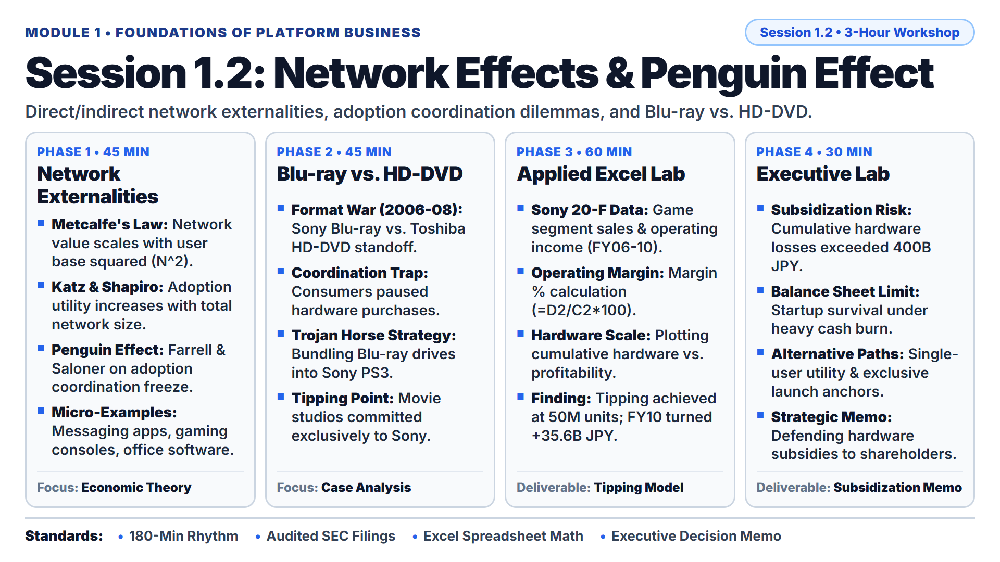

* **Lecture Presentation:** [Download Slides (PDF)](slides/session_1_2_lecture.pdf)

* **Keywords:** Direct Network Effects, Indirect Network Effects, Critical Mass, The Penguin Effect, Coordination Dilemma, Hardware Subsidies (PS3: PlayStation 3).
* **Main Theories:**
  * [Metcalfe's Law](https://en.wikipedia.org/wiki/Metcalfe%27s_law): Formulated by Robert Metcalfe (1980). The economic value of a telecommunications or software network is proportional to the square of the number of connected users (Value = N^2). Each new participant adds exponential connection possibilities for all existing members.
  * [Katz and Shapiro (1985) Network Externalities](https://en.wikipedia.org/wiki/Network_effect): Michael L. Katz and Carl Shapiro. Positive consumption externalities where the private utility a consumer derives from a good or service expands directly as the total adoption base expands.
  * [Farrell and Saloner (1985) Coordination Failure & The Penguin Effect](https://en.wikipedia.org/wiki/Coordination_game): Joseph Farrell and Garth Saloner. The "Penguin Effect" models market paralysis where prospective adopters hesitate to embrace a new technology standard (like hungry penguins standing on an ice floe waiting for the first penguin to dive into predator-filled waters), fearing they will be stranded on an abandoned standard if others fail to follow.
* **Micro-Examples:**
  * Instant Messaging (Direct Network Effects): WhatsApp and WeChat deliver near-zero standalone value to a single isolated user; each additional family member, friend, or business partner who installs the application increases the daily communication utility for all existing network participants.
  * Video Game Hardware (Indirect Network Effects): Gamers purchase a Sony PlayStation or Nintendo Switch console because premier third-party game studios build blockbuster titles for it; independent game studios invest tens of millions of dollars in game development only if a massive installed base of console owners already exists.
  * Enterprise Document Collaboration (Direct and Indirect Standards): The Adobe Portable Document Format (PDF) and Microsoft Office standards create cross-firm interoperability; when enterprise clients and vendors share identical file protocols, document coordination friction falls toward zero.
* **Real Business Case:**
  * **Sony Blu-ray vs. Toshiba HD-DVD (2006-2008 Next-Generation DVD Format War):** When high-definition optical disc players launched in 2006, consumers refused to purchase expensive standalone players ($500 to $1,000) for fear of backing the losing format (the Penguin Effect). Sony resolved this consumer coordination paralysis by integrating an advanced Blu-ray drive into every PlayStation 3 (PS3) gaming console, absorbing an estimated $250 to $300 operating loss per console sold. By subsidizing initial hardware adoption, Sony established an active installed base of millions of Blu-ray players in living rooms worldwide. Major Hollywood movie studios (culminating in Warner Bros. in January 2008) abandoned HD-DVD to license exclusively with Blu-ray, causing Toshiba to officially terminate the HD-DVD format in February 2008.
* **Lab Dataset:**
  * File Link: [data/session_1_2_network_effects.csv](data/session_1_2_network_effects.csv)
  * Columns: `Fiscal_Year`, `Segment_Name`, `Sales_JPY_B` (Annual sales in billions of Japanese Yen), `Operating_Income_JPY_B` (Annual operating income in billions of Japanese Yen), `Cumulative_PS3_Hardware_M` (Cumulative hardware unit sales in millions), `Strategic_Phase`, `Filing_Source`.
* **Primary Filings & External References:**
  * [Sony Group Corporation Form 20-F Filings (SEC EDGAR CIK 0000313838)](https://www.sec.gov/edgar/browse/?CIK=0000313838)
  * [Strategies for Two-Sided Markets (Harvard Business Review)](https://hbr.org/2006/10/strategies-for-two-sided-markets)
* **Step-by-Step Lab Protocol (Exercise 1: Foundational Practice):**
  * **Step 1: Open the Dataset:** Launch Microsoft Excel. Open the file [data/session_1_2_network_effects.csv](data/session_1_2_network_effects.csv). Confirm that historical segment operating figures for Sony Game (FY2006 through FY2011) are visible.
  * **Step 2: Inspect Primary Sources & Financial Terminology:**
    * Regulatory Baseline: Review the `Filing_Source` column, which links to Item 18 (Financial Statements) of Sony's statutory SEC Form 20-F annual filings.
    * Acronym Definition: In international corporate finance, **SEC** stands for the **U.S. Securities and Exchange Commission** (the primary government regulator overseeing public securities markets). **JPY** represents **Japanese Yen** (the official statutory currency of Japan; figures are expressed in billions of Yen).
    * Notice the extreme operating losses in FY2006 (-232.3 billion yen) and FY2007 (-124.5 billion yen) during the hardware subsidization phase.
  * **Step 3: Calculate Operating Margin Percentage:**
    * In cell H1, enter the column header `Operating_Margin_Pct`.
    * In cell H2, enter the formula: `=(D2/C2)*100` (Operating Income divided by Sales, multiplied by 100).
    * Copy the formula down through row 7 (FY2011).
  * **Step 4: Create Cumulative Hardware vs. Profitability Chart:**
    * Select Column E (`Cumulative_PS3_Hardware_M`) and Column D (`Operating_Income_JPY_B`).
    * Insert a 2D Combo Chart: plot Cumulative Hardware as an Area chart on the primary axis, and Operating Income as a Clustered Line chart on the secondary axis.
  * **Step 5: Identify the Tipping Point & Business Interpretation:**
    * Observe how operating profitability turned positive in FY2010 (+35.6 billion yen) once cumulative hardware reached 50 million units.
    * Conclude how massive initial hardware subsidies solved the Penguin Effect by giving content developers guaranteed audience scale, eventually allowing Sony to recover losses through high-margin game licensing royalties.
* **Step-by-Step Strategic Decision Challenge (Exercise 2+: Advanced Problem Solving):**
  * **Strategic Problem:** Subsidizing hardware or user acquisition to overcome the Penguin Effect requires immense corporate balance-sheet strength. Between FY2006 and FY2009, Sony sustained over 400 billion yen in cumulative Game segment operating losses before achieving profitability.
  * **Student Task:**
    1. Using your spreadsheet, calculate the exact cumulative operating losses Sony sustained from FY2006 to FY2009 using the formula: `=SUM(D2:D5)`. Convert this figure to USD assuming an average exchange rate of 100 JPY per USD.
    2. Evaluate whether an early-stage, venture-backed digital startup without a diversified corporate balance sheet could survive this scale of subsidization.
    3. Draft a structured, three-bullet decision brief addressed to the Chief Strategy Officer of an early-stage platform: Formulate an actionable executive recommendation detailing two non-subsidized launch strategies (e.g., single-user standalone utility, exclusive anchor partnerships) that attract the first 10,000 active users without incurring negative operating margins on every transaction.

---

<a id="session-1-3"></a>
### Session 1.3: Two-Sided & Multi-Sided Networks

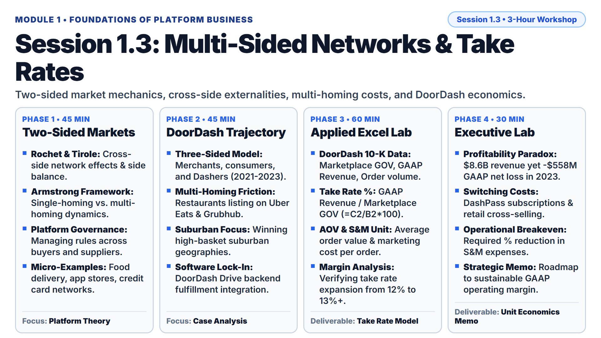

* **Lecture Presentation:** [Download Slides (PDF)](slides/session_1_3_lecture.pdf)

* **Keywords:** Two-Sided Market, Cross-Side Network Effects, Same-Side Network Effects, Multi-Homing, Take Rate, GOV (Gross Order Volume), GAAP (Generally Accepted Accounting Principles).
* **Main Theories:**
  * [Rochet and Tirole (2003, 2006) Platform Competition in Two-Sided Markets](https://en.wikipedia.org/wiki/Two-sided_market#Platform_competition): Jean-Charles Rochet and Jean Tirole (Nobel Laureate 2014). Two-sided platforms must balance pricing across interdependent user groups; volume depends not only on the total price charged, but on how that price is apportioned between the two sides.
  * [Armstrong (2006) Competition in Two-Sided Markets](https://en.wikipedia.org/wiki/Multi-homing): Mark Armstrong. Mathematical framework detailing how multi-homing (users maintaining active accounts on multiple competing platforms) destroys platform pricing power, whereas single-homing on one side creates a "competitive bottleneck" that allows the platform to extract high rents from the other side.
* **Micro-Examples:**
  * On-Demand Food Delivery: Three-sided network coordinating hungry eaters (consumer side), restaurants/merchants (supply side), and couriers (fulfillment logistics side).
  * Smartphone Application Stores: Two-sided ecosystem connecting third-party mobile developers (software side) with smartphone device owners (consumer side).
  * Credit Card Networks: Multi-sided payment infrastructure linking merchant retail stores (accepting terminal fees) with consumer cardholders (enjoying cashback and interest-free grace periods).
* **Real Business Case:**
  * **DoorDash Inc. (2021-2023 Multi-Sided Platform Economics):** DoorDash operates a multi-sided marketplace coordinating consumers, local merchants, and independent delivery couriers ("Dashers"). In dense urban centers, restaurants frequently multi-home by listing menus simultaneously across DoorDash, Uber Eats, and Grubhub, which limits marketplace pricing power. To build a defensible competitive moat, DoorDash expanded aggressively into suburban geographies with larger family basket sizes and launched "DoorDash Drive" (white-label delivery software for merchant websites). By FY2023, DoorDash processed $66.8 billion in Marketplace Gross Order Volume (GOV) across 2.16 billion orders, achieving $8.6 billion in GAAP revenue while managing marketing subsidies to approach operating profitability.
* **Lab Dataset:**
  * File Link: [data/session_1_3_platform_margins.csv](data/session_1_3_platform_margins.csv)
  * Columns: `Fiscal_Year`, `Marketplace_GOV_USD_M` (Marketplace Gross Order Volume in millions of USD), `GAAP_Revenue_USD_M` (Statutory GAAP Revenue in millions of USD), `Total_Orders_M` (Total completed orders in millions), `Cost_of_Revenue_USD_M`, `Sales_Marketing_USD_M`, `GAAP_Net_Loss_USD_M`, `Filing_Source`.
* **Primary Filings & External References:**
  * [DoorDash Inc. Form 10-K Filings (SEC EDGAR CIK 0001792789)](https://www.sec.gov/edgar/browse/?CIK=0001792789)
  * [SEC EDGAR Company Search Database](https://www.sec.gov/edgar/searchedgar/companysearch)
* **Step-by-Step Lab Protocol (Exercise 1: Foundational Practice):**
  * **Step 1: Open the Dataset:** Launch Microsoft Excel. Open [data/session_1_3_platform_margins.csv](data/session_1_3_platform_margins.csv). Confirm that DoorDash operating data for fiscal years 2021, 2022, and 2023 is loaded.
  * **Step 2: Inspect Primary Sources & Financial Terminology:**
    * Regulatory Baseline: Review the `Filing_Source` column (Item 8 of DoorDash Form 10-K).
    * Acronym Expansion: In corporate financial statements, **GOV** stands for **Gross Order Volume** (the total retail dollar value of all merchandise and food purchased across the marketplace, including taxes, delivery fees, and tips, before platform refunds). **GAAP** stands for **Generally Accepted Accounting Principles** (standard statutory legal rules that every US public corporation must follow when reporting revenues and net income). **AOV** stands for **Average Order Value** (the average dollar basket size per transaction).
  * **Step 3: Calculate Platform Take Rate:**
    * Context: Take rate measures the percentage of total gross marketplace transaction volume that the platform retains as recognized corporate revenue.
    * In cell I1, enter the column header `Take_Rate_Pct`.
    * In cell I2, enter the formula: `=(C2/B2)*100` (GAAP Revenue divided by Marketplace GOV, multiplied by 100).
    * Copy the formula down through row 4 (2021 to 2023).
  * **Step 4: Calculate Average Order Value (AOV):**
    * In cell J1, enter the column header `Average_Order_Value_USD`.
    * In cell J2, enter the formula: `=B2/D2` (Marketplace GOV in millions divided by Total Orders in millions).
    * Copy the formula down through row 4. Format as US Currency (`$#,##0.00`).
  * **Step 5: Calculate Marketing Spend per Completed Order:**
    * In cell K1, enter the column header `Marketing_Spend_Per_Order_USD`.
    * In cell K2, enter the formula: `=F2/D2` (Sales and Marketing Expense in millions divided by Total Orders in millions).
    * Copy the formula down through row 4. Format as US Currency (`$#,##0.00`).
  * **Step 6: Interpret Operating Leverage:**
    * Note that while DoorDash expanded its Take Rate from 11.66% in 2021 to 12.92% in 2023, its Marketing Spend per Order dropped from $1.18 to $0.90, proving that increasing brand awareness and consumer habituation yield operational leverage over multi-sided network participants.
* **Step-by-Step Strategic Decision Challenge (Exercise 2+: Advanced Problem Solving):**
  * **Strategic Problem:** Despite generating $8.635 billion in revenue and processing $66.8 billion in transactions in 2023, DoorDash still recorded a statutory GAAP Net Loss of -$558 million. Because consumers and restaurants can multi-home at near-zero friction, platforms are forced into ongoing marketing incentives and driver pay guarantees.
  * **Student Task:**
    1. Using your spreadsheet model, calculate the exact dollar reduction in Sales and Marketing expenses (`Column F`) DoorDash would have required in FY2023 to eliminate its -$558 million GAAP Net Loss and reach operational break-even.
    2. Analyze the operational vulnerability of two-sided food delivery platforms: if DoorDash unilaterally increases merchant commission fees from 15% to 25%, evaluate how restaurants respond via multi-homing or passing fees to consumers.
    3. Draft a structured, three-bullet decision brief addressed to DoorDash's Chief Executive Officer: Formulate an actionable strategic roadmap detailing three proprietary software initiatives (such as DashPass subscription locking, point-of-sale hardware integration, or advertising auction tools) that increase multi-homing switching costs for restaurants and eaters.

---

<a id="session-1-4"></a>
### Session 1.4: Scale Dynamics & Winner-Takes-All Markets

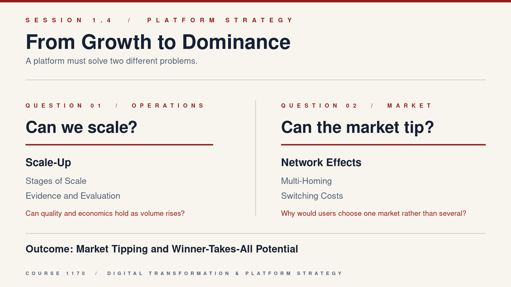

* **Lecture Presentation:** [Download Slides (PDF)](slides/session_1_4_lecture.pdf)

* **Session Challenge:** A startup's graph can rise while its service, team, or supply base cannot keep up. Decide whether growth can become scalable value, then determine whether that value can make one platform the market's preferred place to meet.


* **Keywords:** Scale Dynamics, Winner-Takes-All (WTA), Market Tipping, Switching Costs, Homogeneous Demand, Multi-Homing Costs, and Cross-Side Network Effects.
* **Main Theories:**
  * [W. Brian Arthur (1989) Competing Technologies, Increasing Returns, and Lock-In by Historical Events](https://en.wikipedia.org/wiki/Path_dependence) ([Economic Lock-In](https://en.wikipedia.org/wiki/Vendor_lock-in)): **Scale dynamics** means that a larger user base can make a platform better, which attracts still more users. Think of a busy marketplace: more sellers create more choice, and more buyers make the marketplace worth joining for sellers.
  * [Eisenmann, Parker, and Van Alstyne (2006) Strategies for Two-Sided Markets](https://hbr.org/2006/10/strategies-for-two-sided-markets) ([Winner-Takes-All Market Conditions](https://en.wikipedia.org/wiki/Winner-take-all_market)): A market is more likely to **tip** toward one winner when users get much more value from the largest network, find it costly to use several alternatives, and do not need sharply different products. A market can stay competitive when users can easily use several apps at once.
* **Easy Concept Check: Read the Illustration from Left to Right:**
  * **Scale dynamics, left panel:** The founder sees a rising user chart, but also a limited operations team and a queue. Scale is not simply "more users." It is the ability to serve more users without quality, speed, trust, or unit economics collapsing.
  * **Network effect, center panel:** More buyers and sellers join the central market because each additional participant makes it easier to find a better match. This is a reinforcing loop: more choice attracts demand, and more demand attracts supply.
  * **Winner-takes-all, right panel:** A market tips only when the central platform becomes meaningfully better than alternatives. The two smaller platforms still exist because users can sometimes use more than one service.
  * **Multi-homing and switching cost:** Multi-homing means using several platforms at once. A switching cost is a real loss from leaving, such as trusted reviews, transaction history, workflows, or integrations. The strategic question is whether users stay because the service is better, not because leaving is unfairly difficult.
  * **Winner-takes-all test:** Ask three questions: Can the business serve growth without harming quality? Does each added user improve the experience for others? Is there a meaningful reason to stay after discounts disappear?
* **Core Concept 1: What Does Scale-Up Mean?**
  * **Definition:** A business has begun to scale up when it can increase customers, transactions, or revenue faster than it increases the people, capital, and manual work required to deliver a good experience. Growth is a volume outcome. Scale-up is a repeatable operating capability.
  * **Do not confuse scale-up with growth:** A food-delivery platform that doubles orders by doubling discounts and support staff has grown, but may not have scaled. A platform that doubles completed orders while maintaining delivery time, dispute rates, and contribution per order is closer to scale-up.
  * **Unit economics:** Unit economics asks whether one additional transaction creates enough value to cover the direct cost of serving it. For a marketplace, examine revenue per completed transaction, payment-processing cost, customer-support cost, fraud loss, and any delivery or fulfilment cost. A platform cannot scale sustainably if every additional transaction increases its loss.
* **Core Concept 2: The Four Scale-Up Stages:**
  * **Stage 1 - Problem-solution fit**
    * **Meaning:** A specific user group repeatedly uses the product because it solves a real problem.
    * **How to check:** Do users return without a new discount, recommend the product, or describe a clear alternative they would lose without it?
    * **Easy example:** Students use a campus resale service again because it finds a buyer faster and feels safer than posting in a general chat group.
    * **Do not mistake:** One download or one promotional purchase is not evidence of problem-solution fit.
  * **Stage 2 - Repeatable match**
    * **Meaning:** The platform reliably creates a useful interaction between its two user sides.
    * **How to check:** Observe match rate, time to first match, completion rate, cancellation rate, and whether both sides return.
    * **Easy example:** A student marketplace has repeatable match when buyers regularly find an item and sellers regularly complete a sale, rather than merely collecting many inactive listings.
  * **Stage 3 - Operational replication**
    * **Meaning:** The platform can serve a second campus, city, category, or customer segment without rebuilding its process from zero.
    * **How to check:** Compare the first and second launch location for onboarding time, support workload, service quality, and direct cost per completed transaction.
    * **Easy example:** After a resale marketplace works at one campus, the same identity-check and payment process works at a second campus with only local partner onboarding, not a new manual process for every sale.
  * **Stage 4 - Compounding advantage**
    * **Meaning:** Growth improves the service itself through data, reputation, complements, or network density.
    * **How to check:** Look for a mechanism where each additional active participant improves match quality, trust, selection, or speed for someone else.
    * **Easy example:** As more verified buyers and sellers join one campus marketplace, students find relevant listings faster and sellers receive more credible demand. More activity therefore improves the next user's experience.
  * **Important sequence:** A platform may have Stage 1 without Stage 2, or Stage 3 without Stage 4. Do not assume that a large user number proves the later stages.
* **Core Concept 3: The Scale-Up Evaluation Scorecard:**
  * **Demand quality:** Are users returning and completing transactions without large repeated discounts? Look for repeat use, completed transactions, and referrals. **Example:** score `1` if users appear only during a coupon campaign; score `3` if a defined student group returns; score `5` if repeated use remains strong after promotions end.
  * **Capacity and quality:** Can the platform handle more activity while protecting response time, reliability, trust, and customer support? Look for match time, cancellation rate, dispute rate, and service response time. **Example:** score `1` if each new transaction creates a longer support queue; score `3` if the service works at one location; score `5` if quality remains stable in additional locations.
  * **Unit economics:** Does the contribution from each additional completed transaction exceed the direct cost of serving it? Look for revenue per transaction, direct service cost, and contribution per transaction. **Example:** score `1` if every sale requires more support or subsidy than it earns; score `3` if one category can cover its direct cost; score `5` if the economics remain positive as the platform expands.
  * **Network density:** Are the right users concentrated enough to find each other quickly? Look for active buyers and sellers in the same market, match rate, and time to first successful match. **Example:** score `1` if a buyer sees few relevant listings; score `3` if one campus has enough activity for frequent matches; score `5` if density creates faster matching and better selection as participation grows.
  * **Defensibility:** Does the platform create superior value that is hard to recreate quickly? Look for multi-homing rate, retention after promotions end, repeat use of integrations, and partner loyalty. **Example:** score `1` if users can move to a similar app without losing anything; score `3` if some users value verified reviews or saved history; score `5` if several valuable relationships, workflows, or complements make the leading platform clearly better.
  * **Scoring rule:** Give each dimension a score from `1` to `5`: `1` means no evidence or a serious weakness; `3` means the mechanism works in one limited setting; `5` means it is repeatable and supported by clear evidence. The score exposes assumptions. It is not a substitute for judgment.
* **Worked Example: How to Diagnose One Platform:**
  * **Campus resale marketplace:** Students return because secure payments and verified identities reduce the risk of being scammed. This is evidence for problem-solution fit, not yet proof of scale-up.
  * **Stage decision:** If buyers usually find an item, sellers complete a sale, and both sides return, the platform has evidence of a repeatable match. If the same trust process works at a second campus without a new manual team, it has evidence of operational replication.
  * **Scorecard example:** A new marketplace may score `3` for demand quality, `2` for capacity and quality, `2` for unit economics, `2` for network density, and `1` for defensibility. The weak scores indicate that the founder should first concentrate activity at one campus and improve reliable matching, rather than spend immediately on five-campus growth.
  * **Winner-takes-all decision:** It may later tip if verified reputation and transaction safety improve as more local students join. It is likely to remain contested if sellers can list in other groups at no cost and buyers do not value the platform's additional trust features.
* **Micro-Application Cards for the First 60 Minutes:**
  * **How to use the cards:** Students work alone for eight minutes. For each card, they write one short answer using the named concept and one cited fact from the card. These are reasoning checks, not calculations.
  * **Card 1 - Growth or scale-up?** A campus marketplace grows from `100` to `1,000` registered users in one month after a referral campaign. Customer-support replies slow from one day to five days, and there is no evidence that new users complete transactions. **Student prompt:** Is this growth, scale-up, or insufficient evidence? Name one operating measure that must improve before you call it scale-up.
  * **Card 2 - Which stage is supported?** A student marketplace has three observations: `A` - many students download the app using a discount but rarely return; `B` - buyers and sellers complete exchanges every week and both sides return; `C` - a second campus uses the same identity-check and payment process with similar completion rates. **Student prompt:** Label `A`, `B`, and `C` with the highest scale-up stage supported. Explain why `A` is not evidence of a repeatable match.
  * **Card 3 - Score network density.** At one campus, `60` buyers open the marketplace each week but only `8` sellers list items. Most buyers see fewer than two relevant listings, and a successful match takes about six days. **Student prompt:** Give network density a score from `1` to `5`. What one action could improve the score without expanding to another campus?
  * **Card 4 - Will the market tip?** Use the illustration's central marketplace and smaller alternatives. **Student prompt:** What feature would make buyers and sellers choose the central market? What would make them continue using several markets instead?
  * **Instructor debrief:** Card 1 shows growth but not scale-up. Card 2 supports no confirmed stage for `A`, repeatable match for `B`, and operational replication for `C`. Card 3 is likely a `2`: activity exists, but supply is too thin for reliable matching. Card 4 should identify a user benefit such as trusted reputation or faster matching, and a multi-homing route such as zero-cost cross-listing.
* **Core Concept 4: When Can Scale-Up Become Winner-Takes-All?**
  * **What market tipping means:** Market tipping occurs when most users increasingly choose one leading platform because it is clearly more useful. It does not mean that every rival disappears. The question is whether users gain enough extra value from the leading network to prefer it over using several alternatives.
  * Scale-up becomes a winner-takes-all opportunity only when a larger network gives users a clearly better experience and rivals cannot easily reproduce that advantage.
  * The four conditions are: strong cross-side network effects, enough local density to improve matching, meaningful but fair switching costs, and limited need for differentiated alternatives.
  * If users can multi-home at low cost, or if each city, category, or user segment needs a different product, the likely outcome is a competitive multi-platform market rather than one winner.
* **Success Cases: Scale Became a Durable Advantage:**
  * **Case 1: Google Search.** As users made more queries, Google could refine search relevance; reliable relevance attracted more searches and advertisers. The lesson is not merely that Google grew. It is that the core service could improve as usage grew, creating a reinforcing feedback loop.
  * **Case 2: Microsoft Windows and its software ecosystem.** More organizations using Windows attracted more developers. More compatible software then made Windows more useful for organizations. The lesson is that scalable growth can come from an ecosystem of complements, not only from the focal product.
* **Failure Cases: Scale Did Not Create a Single Winner:**
  * **Case 3: Uber China vs. Didi (2014-2016).** Both firms could add riders and drivers through discounts, but riders and drivers could compare more than one app. The lesson is that growth purchased with incentives does not become winner-takes-all if a rival can offer a similar match tomorrow.
  * **Case 4: Clubhouse and social-audio competitors.** Early attention created rapid growth, but creators and listeners could maintain audiences across competing services, while rivals could add similar features. The lesson is that a growing community does not automatically create a durable market tip.
* **Pre-Exercise Bridge: Diagnose a Contested Case Before Exercise 1:**
  * **Uber China-Didi with the instructor:** Students first underline the evidence of multi-homing: riders compare fares across apps and drivers receive work from more than one platform. They then name one scorecard condition that incentives can improve temporarily and one condition that incentives cannot solve.
  * **Clubhouse individually:** Students write: "The weakest condition is ______ because ______." They select `network effects`, `defensibility`, `operational replication`, or more than one, then cite the relevant evidence. This uses the same evidence → condition → explanation sequence required in Exercise 1.
* **Four-Case Evidence Cards: Use These Inputs for Exercise 1:**
  * **Google Search:** Search is delivered as software rather than through a human service team for each query. Search queries and user interactions can provide signals that improve result relevance. Users can try alternative search engines, but a reliably useful result experience gives them a reason to return. **Diagnosis prompt:** Which evidence supports compounding advantage, and what evidence about cost per additional search would you still need before assigning a `5` for unit economics?
  * **Microsoft Windows:** Organizations use Windows with compatible business applications, trained employees, and established information-technology processes. More developers can create compatible applications when a large installed base exists. Moving to another operating system can require retraining and software migration. **Diagnosis prompt:** Is the ecosystem evidence of operational replication, compounding advantage, or both? What makes the switching cost a user benefit rather than a barrier alone?
  * **Uber China-Didi:** Both platforms added riders and drivers through price incentives. Riders could compare fares and wait times across apps, and drivers could receive work from more than one platform. Reliable matching still required local supply and demand in each city. **Diagnosis prompt:** Which scorecard dimensions can subsidies improve temporarily, and which dimensions do they leave unresolved?
  * **Clubhouse:** The service attracted early attention around live social audio, but creators could build audiences on several services and competing platforms could add similar live-audio features. The value of a specific room depended on which hosts and listeners joined at that time. **Diagnosis prompt:** Does this show a weak network effect, weak defensibility, insufficient operational replication, or a combination? Identify the evidence before deciding.
* **Individual Strategy Workbook:**
  * File Link: [data/session_1_4_platform_strategy_workbook.csv](data/session_1_4_platform_strategy_workbook.csv)
  * Columns: `Student_Name`, `Scenario_Selected`, `User_Side_A`, `User_Side_B`, `Scale_Stage_Observed`, `Demand_Quality_Score_1_to_5`, `Capacity_Quality_Score_1_to_5`, `Unit_Economics_Score_1_to_5`, `Network_Density_Score_1_to_5`, `Defensibility_Score_1_to_5`, `Strategy_Chosen`, `First_90_Day_Action`, `Success_Metric`, `Presentation_Claim`.
* **Primary Filings & External References:**
  * [Uber Technologies, Inc. SEC Filings](https://www.sec.gov/edgar/browse/?CIK=0001543151)
  * [StatCounter Global Search Engine & Mobile Operating System Market Statistics](https://gs.statcounter.com/search-engine-market-share)
* **Class Rhythm: Concept-Application Cycles + Strategy Studio:**
  * **0-15 minutes - Scale-Up Definition:** The instructor distinguishes simple growth from scale-up: growth adds volume, while scale-up preserves customer value and operating quality as volume rises. **Micro-application:** Students use Card 1 to decide whether the evidence shows growth, scale-up, or insufficient evidence.
  * **15-30 minutes - Four Scale-Up Stages:** The instructor explains problem-solution fit, repeatable match, operational replication, and compounding advantage using the campus resale example. **Micro-application:** Students use Card 2 to label the highest stage supported by each observation, then compare their answer with the stage definitions before the instructor debrief.
  * **30-45 minutes - Scale-Up Evaluation Scorecard:** The instructor explains demand quality, capacity and quality, unit economics, network density, and defensibility, including the `1`, `3`, and `5` score anchors. **Micro-application:** Students use Card 3 to score network density, state one reason, and identify an action that would improve the score.
  * **45-60 minutes - Winner-Takes-All Conditions:** The instructor explains market tipping, multi-homing, and fair switching costs through the illustration. **Micro-application:** Students use Card 4 to identify one mechanism that could cause tipping and one mechanism that would keep the market contested.
  * **60-110 minutes - Four-Case Diagnosis:** Students use the Evidence Cards and Scorecard to diagnose Google Search, Microsoft Windows, Uber China-Didi, and Clubhouse. This is Exercise 1.
  * **110-180 minutes - Strategy Choice and Presentation:** Each student chooses Scenario A or Scenario B, builds a strategy around the weakest scale-up condition, defines a success metric, and gives a three-minute presentation. This is Exercise 2.
* **Step-by-Step Lab Protocol (Exercise 1: Four-Case Diagnosis, 50 Minutes):**
  * **Step 1: Create a Case Grid:** In a notebook or spreadsheet, make four rows named `Google Search`, `Microsoft Windows`, `Uber China-Didi`, and `Clubhouse`. Copy the relevant facts from the Four-Case Evidence Cards into each row. You are not expected to research facts outside the provided cards.
  * **Step 2: Identify the Scale Stage:** For each case, label the highest observable stage from `Problem-solution fit`, `Repeatable match`, `Operational replication`, or `Compounding advantage`. Write one sentence explaining the evidence.
  * **Step 3: Score the Scale-Up Conditions:** Give each case a `1` to `5` score for demand quality, capacity and quality, unit economics, network density, and defensibility. Use the score anchors above. Mark one score as `Insufficient evidence` when the Evidence Card does not support a defensible number, then state the information you would need.
  * **Step 4: Identify the Tipping Question:** Write one sentence answering: "When one more user joined, whose experience became better, and could that user also use a rival?"
  * **Step 5: Make the Verdict:** Label each case `Scalable and likely to tip`, `Scalable but likely contested`, or `Growth without durable advantage`. Support the label with one scale-dynamics observation and one multi-homing or switching-cost observation.
  * **Step 6: Compare the Four Cases:** Write a 100-word conclusion explaining why a rising growth curve alone is neither proof of scalable operations nor proof of a winner-takes-all market.
* **Individual Applied Practice (Exercise 2: Choose a Strategy and Present It, 70 Minutes):**
  * **Scenario A: Campus resale marketplace.** Your university has a popular informal resale group, but students report scams, missed meet-ups, and low-quality listings. You can use the launch budget to enter five campuses quickly with referral discounts, or launch at one campus with verified identity, secure payments, and reliable meet-up locations. Choose one strategy. Explain whether you are solving a scale problem, a market-tipping problem, or both.
  * **Scenario B: Student project-workspace.** Students coordinate group work through chat, cloud storage, calendars, and generative artificial intelligence tools. You can offer a lower price and recruit individual users widely, or work with three large courses to integrate project history, instructor feedback, deadlines, and team tasks in one workflow. Choose one strategy. Explain how the strategy makes the product scale without making student exit unfairly difficult.
  * **Step 1: Select One Scenario:** In the workbook, enter `Scenario A` or `Scenario B` in cell `B2`. Identify the two user sides in cells `C2` and `D2`.
  * **Step 2: Score the Current Position:** In cells `E2` through `J2`, enter the current stage and the five `1` to `5` scorecard ratings. Add a short note beside your workbook explaining the lowest score.
  * **Step 3: Build Your Strategy:** In cells `K2` and `L2`, state your chosen strategy and the first action to complete within 90 days. The action must improve the lowest score without damaging another score.
  * **Step 4: Define a Success Metric:** In cell `M2`, choose one measurable signal that tests your scale claim, such as dispute-free exchanges, matching time, repeat transactions, active project teams, or weekly return use.
  * **Step 5: Present Your Decision:** Deliver a 3-minute individual presentation with three slides or one visual page: `The weakest scale-up condition`, `why this market may or may not tip`, and `the strategy and metric that would make me change my mind`.
* **Debrief Standard:** A strong presentation makes a clear strategic choice, separates scalable operations from market tipping, recognizes multi-homing risk, and names measurable evidence that could disprove the recommendation.

---

<a id="module-2"></a>
## Module 2: Platform Economics, Big Data & Monetization

<a id="session-2-1"></a>
### Session 2.1: The Data Feedback Loop Strategy

**Strategy of this session: Data Feedback Loop Strategy**


* **Lecture Presentation:** [Download Slides (PDF)](slides/session_2_1_lecture.pdf)

* **Duration:** 3 hours: 50-minute lesson, 10-minute break, Exercise 1 (20 min) and Exercise 2 (30 min), 10-minute break, Exercise 3 with short presentations (50 min), and 10-minute wrap-up.
* **Situation:** Jun runs StreamWise, a new streaming service for university students. The root problem is that members cancel and Jun does not know why. He has a dashboard full of numbers, and an advertiser has offered to buy detailed viewer profiles. Jun must decide which signals to use, what to change, and whether selling the data would hurt students' trust.

  | Measure (one month) | Value |
  |---|---|
  | Members at the start of the month | 12,000 |
  | Plays started | 48,000 |
  | Plays finished | 9,600 |
  | Titles saved to "My List" | 3,100 |
  | Members who cancelled | 420 |
  | Monthly price per member | $5.00 |

* **The strategy in one paragraph:** The data feedback loop strategy is a company's plan for which customer signals to collect, which business decision each signal will improve, and how to keep customers' trust while it does this. A **customer signal** is a recorded action, such as a viewer finishing a show or a shopper saving an item. Collecting more data does not make a company stronger by itself. A company gains an advantage when a small set of useful signals changes a decision, the company measures the result, and the next decision becomes better. This repeating cycle is called a **data feedback loop**, and it gives the strategy its name. Use this strategy when a business can see many customer actions but does not know which ones show a real need, or when it is tempted to collect everything "just in case" and sell or store it without a clear purpose.

* **Goal:** Apply the Data Feedback Loop Strategy: choose useful customer signals, connect each signal to one business decision, measure the result, and protect customer trust.

* **Words you need first: signals and three questions to ask about them:**
  * **Signal:** One recorded customer action. Example: a viewer presses "Save" on a show.
  * **Question 1 - How clear is it? (strong or weak):** A **strong signal** has one clear meaning because the customer spent time or effort. A **weak signal** can mean many things. Example: finishing a 40-minute episode is strong; opening a title for 3 seconds is weak (the viewer may have clicked by mistake).
  * **Question 2 - What does it tell us? (like or unhappy):** Some signals show what customers **like**, so the business knows what to offer more of. Others show that customers are **unhappy**, so the business knows what to fix. Example: saving a show shows liking; cancelling shows that the member is unhappy.
  * **Question 3 - Does it come early or late?** An **early signal** arrives while the business can still act. A **late signal** arrives after the customer is already gone. Example: a member who finishes fewer shows each week gives an early signal; a member who cancels gives a late signal.

* **Quick practice: read the StreamWise signals (5 min):** Look at the StreamWise table in the Situation. For each number, answer: Is it a signal (yes or no)? If yes, Q1: strong or weak? Q2: like or unhappy? Q3: early or late?
  * **Check your answer:**

    | StreamWise data (one month) | Signal? (yes or no) | Q1: How clear? (strong or weak) | Q2: Tells us? (like or unhappy) | Q3: When? (early or late) |
    |---|---|---|---|---|
    | Members at the start: 12,000 | No (a count of customers, not an action) | - | - | - |
    | Plays started: 48,000 | Yes | Weak (only 20% were finished: 9,600 / 48,000) | Like (but only weakly) | Early |
    | Plays finished: 9,600 | Yes | Strong | Like | Early |
    | Titles saved to "My List": 3,100 | Yes | Strong | Like | Early |
    | Members who cancelled: 420 | Yes | Strong | Unhappy | Late |
    | Monthly price: $5.00 | No (the company sets it) | - | - | - |

    Cancellations are a strong signal, and they help predict future churn, but they come too late to keep those members and do not say why they left. Jun should also watch early signals, such as members finishing fewer shows, so he can act before members leave.

* **More words you need first:**
  * **Churn rate:** The percentage of members who cancel in a period. Churn rate = members who cancelled / members at the start x 100. Example: 420 / 12,000 x 100 = 3.5% per month.
  * **ARPU (Average Revenue Per User):** The average money earned from one member in a period. Example: StreamWise charges $5.00 per month, so ARPU is $5.00 per member per month.
  * **Consent:** A customer's clear permission to collect and use their data for a stated purpose.

* **The four rules of the Data Feedback Loop Strategy (Hour 1 - 50 minutes):**
  * **Rule 1: Start with the decision, not the data.** First name the decision you want to improve. Then collect only the signals that can change it.
    * **Example:** A campus cafe app wants to decide "which drink to promote on rainy days." It needs two signals: the weather and the drinks ordered that day. It does not need customers' contact lists or browsing history.
    * **Common mistake:** "Let's collect everything and find something later." Data with no decision costs money to store and adds privacy risk, but it does not improve anything.
  * **Rule 2: Use strong signals, and check weak signals before you act.** Prefer actions that show effort or repeat behavior: finishing, saving, buying again, searching for a specific item.
    * **Example:** At StreamWise, 48,000 plays were started but only 9,600 were finished, so only 20% of plays were finished (9,600 / 48,000 x 100). A play started is a weak signal of interest; a play finished is a stronger one.
    * **Common mistake:** Treating a weak signal as proof. A viewer who stops after 10 seconds may dislike the show, or may have received a phone call.
  * **Rule 3: Close the feedback loop and measure one result.** The loop has five steps: collect a signal, interpret it, change one action, measure the result, and learn for the next decision.
    * **Example:** StreamWise sees that students who finish a cooking show often save other cooking shows. It adds a "More easy cooking" row for those students and measures their churn rate for one month. If churn falls from 3.5% to 2.5% for that group, the row is kept; if not, the team changes it.
    * **Common mistake:** Changing something but never measuring the result. Without the measure step, the company cannot learn whether the data helped.
  * **Rule 4: Earn trust: ask permission, collect only what you need, and give value back.** Customers share data more willingly when they understand the purpose and receive something useful in return, such as better recommendations.
    * **Example:** A sign-up screen says, "We use what you finish and save to recommend shows. We never sell your viewing history." The member can turn this off at any time.
    * **Common mistake:** Collecting or selling data in ways customers would not expect. Even accurate data can damage the brand if customers feel watched.

* **Good examples (real companies):**
  * **Good example 1: Netflix recommendations.** Netflix uses what members watch, finish, and search for to decide which titles and which artwork to show each member. It tests a change on a group of members and keeps it only if viewing improves. Netflix researchers reported that recommendations influence about 80% of the hours members stream (Gomez-Uribe and Hunt, 2015).
    * **Why it is good:**
      * It starts with a clear decision: which titles to show on each member's home screen (Rule 1).
      * It relies on strong signals such as finished titles, not only clicks (Rule 2).
      * It tests each change and measures the result before keeping it, which closes the loop (Rule 3).
  * **Good example 2: Spotify Discover Weekly.** Since 2015, Spotify has given each listener a new personalized playlist every Monday. It is built from songs the listener plays, saves, adds to playlists, and skips.
    * **Why it is good:**
      * Saves and repeated plays are strong signals; quick skips tell Spotify what to avoid (Rule 2).
      * The listener receives clear value from the data: new music chosen for them (Rule 4).
      * Every week, the listener's reaction to the new playlist becomes new data for the next playlist (Rule 3).

* **Bad examples (real companies):**
  * **Bad example 1: Google Flu Trends.** From 2008, Google tried to estimate how many people had the flu by counting flu-related searches. In February 2013, it estimated more than twice the share of flu doctor visits that the U.S. Centers for Disease Control and Prevention (CDC) later reported (Lazer and others, 2014). Google stopped publishing the estimates in 2015.
    * **Why it is bad:**
      * A search is a weak signal: people search about the flu because of news stories or curiosity, not only because they are sick (Rule 2).
      * The model was not regularly checked against real doctor-visit data and corrected, so the loop was not closed (Rule 3).
      * Big data volume created confidence without accuracy. Many signals are not the same as useful signals.
  * **Bad example 2: Target's pregnancy prediction.** The New York Times reported in 2012 that the retailer Target used shopping signals, such as buying unscented lotion and certain vitamins, to predict which customers were pregnant and then mailed them baby-product coupons. A father complained after his teenage daughter received these coupons.
    * **Why it is bad:**
      * The signals were strong and the prediction was often accurate, but customers did not expect a store to know this (Rule 4).
      * Customers had not agreed to have sensitive personal facts guessed from their purchases, so the practice lacked clear consent.
      * The business lesson: accurate data can still damage trust and the brand. Target reportedly responded by mixing baby coupons with unrelated offers so they looked random, which hid the practice instead of fixing it.

* **Before the exercises: three tools you will use:**
  * **Tool 1 - Test group and comparison group:** To know whether a change worked, try it on one group (the **test group**) and not on a similar group (the **comparison group**). Then compare the same number for both groups.
    * **Example:** A cafe app sends a coupon to 500 members and no coupon to another 500 members. This week, 75 of the coupon group order (15 of every 100) and 50 of the other group order (10 of every 100). The coupon added about 5 orders for every 100 members.
    * **Why it matters:** Without the comparison group, you cannot tell whether orders rose because of the coupon or because of something else, such as rainy weather.
  * **Tool 2 - From churn to money:** Lower churn means more members stay, and every member who stays keeps paying.
    * Members kept per month = members x (old churn rate - new churn rate)
    * Revenue kept per month = members kept x monthly price
    * **Example:** A cafe subscription has 1,000 members who pay $10.00 a month. If churn falls from 6% to 4%, then 1,000 x 2% = 20 more members stay, and the cafe keeps 20 x $10.00 = $200.00 that month. The gain grows every month, because the members who stayed keep paying next month too.
  * **Tool 3 - Trade-off and decision rule:**
    * A **trade-off** is what you give up to get something you value more. **Example:** a fitness app refuses $2.00 per user from an advertiser (gives up money) to protect users' trust and its subscriptions (gains).
    * A **decision rule** is a promise, written before you start, about which result would make you change your decision. **Example:** "If churn does not fall below 4% in 90 days, we will try a different plan." It means the result, not opinion, decides.

* **Exercise 1 - Easy: Choose the strongest signal (20 min):**
  * **Scenario:** CampusEats is a food-delivery app for students. The manager wants to decide **which restaurants to show at the top of the app at lunchtime**. The app records these signals: (a) a student opens a restaurant page for 2 seconds; (b) a student orders from the same restaurant three times in one month; (c) a student gives a restaurant 5 stars after an order; (d) a student scrolls past a restaurant; (e) a student adds a restaurant to "Favorites."
  * **Template:**

    ```text
    Decision: [the decision the business wants to improve]
    Strongest signal: [letter and action], because [what effort or repeat behavior it shows].
    Weakest signal: [letter and action], because [two different things it could mean].
    ```

  * **Worked example (a music app, deciding which songs to put in a "Study Focus" playlist):**

    ```text
    Decision: Which songs to put in the "Study Focus" playlist.
    Strongest signal: a student plays the same song five times during study hours,
    because repeating a song takes effort and shows a clear preference.
    Weakest signal: a student opens a song for 2 seconds, because it could mean
    the student disliked it or simply clicked by mistake.
    ```

  * **Your turn:** Fill in the template for CampusEats.
  * **Check your answer:** The strongest signal is (b), three orders in one month, because the student paid money again and again. (e) "Favorites" and (c) 5 stars are also useful but show less effort than repeat orders. The weakest signals are (a) and (d): a 2-second view or a scroll can mean dislike, a mistake, or simply that the student was not hungry.

* **Exercise 2 - Medium: Build a feedback loop (30 min):**
  * **Scenario:** FitU is a campus gym app with 2,000 members. Last month 160 members cancelled. The app shows that many members **book** a fitness class but do **not attend** it.
  * **Step 1 - Calculate churn:** Churn rate = 160 / 2,000 x 100 = ______ %.
  * **Step 2 - Complete the loop:** Use the five-step loop from Rule 3 and the test group and comparison group from Tool 1.
  * **Template:**

    ```text
    1. Collect: [the signal we record]
    2. Interpret: [what the signal may mean, and one other possible meaning]
    3. Act: [one change we will test on a test group, and who is the comparison group]
    4. Measure: [one number we will compare before and after, and our target]
    5. Learn: If [the result], we will [keep / change] the action.
    ```

  * **Worked example (a campus events app where students save events but do not attend):**

    ```text
    1. Collect: students who save an event but do not check in at the door.
    2. Interpret: they may forget the event, or they may save events they never planned to attend.
    3. Act: send a reminder 2 hours before saved events to half of these students;
       the other half gets no reminder (comparison group).
    4. Measure: attendance rate of saved events; target: from 20% to 30%.
    5. Learn: If attendance rises to 30% only in the reminded group, we will keep reminders for everyone.
    ```

  * **Your turn:** Fill in the template for FitU.
  * **Check your answer:** Churn rate = 160 / 2,000 x 100 = **8%**. A good loop records "booked but did not attend," gives two possible meanings (for example, the class time is inconvenient, or the member forgot), tests one change on a test group and compares it with a comparison group (for example, a reminder for half of these members, or an easy one-click cancel that frees the spot for others), and measures one number, such as attendance rate or next month's churn rate, with a target (for example, churn from 8% to 6%).

* **Exercise 3 - Hard: Choose a data strategy for StreamWise (50 min, including 2-minute presentations):**
  * **Scenario:** Return to Jun and StreamWise (12,000 members, $5.00 per month, churn 3.5%). Jun has two options.
    * **Option A - Sell viewer profiles:** An advertiser will pay $1.00 per member per month for detailed viewing histories. In a StreamWise survey, 30% of members said they would cancel if their viewing history were sold.
    * **Option B - Permission-based recommendations:** Ask members for permission to use three signals (finished titles, saved titles, and searches) only to improve recommendations, and never sell them. Jun's goal is to lower monthly churn from 3.5% to 2.5%.
  * **Step 1 - Calculate (use Tool 2 for Option B):**
    * Option A extra revenue per month = 12,000 x $1.00 = $______.
    * If 30% of members cancel because of Option A: members lost = 12,000 x 30% = ______; revenue lost per month = members lost x $6.00 (the $5.00 subscription plus the $1.00 advertiser payment) = $______.
    * Option B: members kept per month = 12,000 x (3.5% - 2.5%) = ______; revenue kept per month = members kept x $5.00 = $______.
  * **Step 2 - Write a 3-bullet memo to the CEO.** Use Tool 3 for the trade-off and the decision rule.
  * **Template:**

    ```text
    To: [CEO name], [company]
    1. Decision and evidence: We should choose [option] because [the rule it follows]
       and [one number from your calculation].
    2. Biggest risk and trade-off: The weakest point is [risk]. We give up [what we lose]
       to gain [what we protect or win].
    3. Next step and decision rule: In the next 90 days we will [one action] and measure [one number].
       We will change this decision if [result].
    ```

  * **Worked example (FitTrack, a running app; an insurance company offers $2.00 per user per month for users' location history):**

    ```text
    To: Mia Park, CEO, FitTrack
    1. Decision and evidence: We should refuse to sell location history and instead ask
       permission to use running data only for training plans, because users expect
       privacy (Rule 4) and 25% of surveyed users said they would leave if we sold it.
    2. Biggest risk and trade-off: The weakest point is that we do not yet know whether
       better training plans will keep users. We give up $2.00 per user per month in
       insurance revenue to protect our users' trust and our subscription revenue.
    3. Next step and decision rule: In the next 90 days we will offer personalized plans
       to users who give permission and measure their monthly churn. We will change this
       decision if churn does not fall below 4%.
    ```

  * **Your turn:** Write the memo for StreamWise. Then give a 2-minute presentation using your three bullets.
  * **Check your answer:**
    * Option A brings $12,000 per month. If 3,600 members (30%) cancel, StreamWise loses 3,600 x $6.00 = $21,600 per month, which is more than the $12,000 gained.
    * Option B keeps 12,000 x 1% = 120 members per month, or $600 per month, and this grows every month that churn stays lower.
    * A strong memo usually chooses Option B (or a version of it), uses at least one number from Step 1, names a real risk (for example, members may refuse permission, or recommendations may not lower churn), and states a clear rule for changing the decision. A memo that chooses Option A can still be strong if it explains how to get real consent and gives a decision rule.

* **Success check:** You can (1) name one strong and one weak signal for a business decision and explain the difference, (2) complete all five steps of a feedback loop with one measurable result, and (3) explain why selling customer data can cost more than it earns.

* **References:**
  * Gomez-Uribe, C. A., and Hunt, N. (2015). [The Netflix Recommender System: Algorithms, Business Value, and Innovation](https://dl.acm.org/doi/10.1145/2843948). ACM Transactions on Management Information Systems.
  * Lazer, D., Kennedy, R., King, G., and Vespignani, A. (2014). [The Parable of Google Flu: Traps in Big Data Analysis](https://www.science.org/doi/10.1126/science.1248506). Science.
  * Duhigg, C. (2012). [How Companies Learn Your Secrets](https://www.nytimes.com/2012/02/19/magazine/shopping-habits.html). The New York Times Magazine.
  * Hagiu, A., and Wright, J. (2020). [When Data Creates Competitive Advantage](https://hbr.org/2020/01/when-data-creates-competitive-advantage). Harvard Business Review.

---

<a id="session-2-2"></a>
### Session 2.2: The Asymmetric Pricing Strategy

**Strategy of this session: Asymmetric Pricing Strategy**


* **Lecture Presentation:** [Download Slides (PDF)](slides/session_2_2_lecture.pdf)

* **Duration:** 3 hours: 50-minute lesson, 10-minute break, Exercise 1 (20 min) and Exercise 2 (30 min), 10-minute break, Exercise 3 with short presentations (50 min), and 10-minute wrap-up.
* **Situation:** Ravi runs CampusJobs, a free app that connects university students who want part-time jobs with local shops that need workers. The root problem is that the app earns nothing, but it costs $4,000 a month to run. A friend suggests charging everyone $2.00 a month, students and shops alike. Ravi is not sure who should pay, or whether charging students would make the app useless for shops.

  | CampusJobs (one month) | Value |
  |---|---|
  | Students using the app | 6,000 |
  | Shops posting jobs | 120 |
  | Job posts | 300 |
  | Applications from students | 9,000 |
  | Price for students / for shops | $0 / $0 |
  | Monthly costs | $4,000 |

* **The strategy in one paragraph:** The asymmetric pricing strategy means a platform with two groups of users charges them different prices: one group pays little or nothing, and the other group pays. A **platform** is a business that connects two groups who need each other, such as students who want jobs and shops that need workers. The group that is free or cheap is the **subsidy side**: the platform keeps it free because its presence attracts the other group. The group that pays is the **money side**: it gains the most value, often money, from meeting the first group. Use this strategy when a business connects two groups, one group is easily driven away by a price, and the other group would gladly pay to reach it.

* **Goal:** Apply the Asymmetric Pricing Strategy: identify the two sides of a platform, decide which side to subsidize and which side to charge, and check that the money side covers the cost of the subsidy.

* **Words you need first:**
  * **Two-sided platform:** A business that connects two groups of users who need each other. Example: CampusJobs connects students and shops.
  * **Subsidy side:** The side that pays little or nothing because the platform needs many of them. Example: students use CampusJobs for free.
  * **Money side:** The side that pays because reaching the other side is worth money to them. Example: a shop pays to post a job and find workers.
  * **Price sensitivity:** How much a group's use drops when the price rises. Example: if a $2.00 fee makes 60 of every 100 students leave, students are very price sensitive.
  * **Subsidy:** Value the platform gives away to attract a side. Example: free use, or a $5.00 sign-up bonus.
  * **Cross-subsidy:** Using money from one side to pay for the free service given to the other side. Example: shop fees pay the costs of serving students for free.

* **The four rules of the Asymmetric Pricing Strategy (Hour 1 - 50 minutes):**
  * **Rule 1: Subsidize the side that the other side comes for.** Ask: "Which group does the other group want to reach?" Keep that group free or cheap.
    * **Example:** Shops join CampusJobs because 6,000 students are there. Without students, no shop would post a job, so students should stay free.
    * **Common mistake:** Charging the side that attracts everyone else. When it leaves, the other side leaves too.
  * **Rule 2: Charge the side that gains the most from the match.** The money side usually earns money or saves time because of the other side.
    * **Example:** A shop that fills a job quickly saves days of searching and keeps its store running. That is worth more to a shop than a job search is worth to a student in cash.
    * **Common mistake:** Charging both sides the same price because it looks fair. Equal prices ignore that the two sides value the platform very differently.
  * **Rule 3: Check price sensitivity before you set a price.** Find out which side leaves when the price rises, and keep the price low for that side.
    * **Example:** A CampusJobs survey finds that a $2.00 fee would make 60% of students leave, but shops would pay $25.00 per job post if each post gets at least 20 applications.
    * **Common mistake:** Guessing. A price that looks small to the business ($2.00) can be large for a student budget.
  * **Rule 4: Make sure the money side covers the subsidy, and protect the free side.** The money side must pay enough to cover the cost of serving both sides, and it must not be allowed to harm the free side.
    * **Example:** CampusJobs checks that job-post fees are more than its $4,000 monthly costs, and it removes fake or unpaid "job" posts so students keep trusting the app.
    * **Common mistake:** Giving away free service with no plan for who will pay, or letting the paying side flood the free side with low-quality offers.

* **Good examples (real companies):**
  * **Good example 1: Adobe Acrobat Reader.** In the 1990s, Adobe gave away the Reader program for opening PDF files for free, and sold the Acrobat software that creates and edits PDF files to businesses.
    * **Why it is good:**
      * Millions of free readers made PDF the format that businesses wanted to use (Rule 1).
      * Businesses that create documents gained the most from the format, so they were charged (Rule 2).
      * Readers would not have paid just to open a file, so keeping Reader free matched their price sensitivity (Rule 3).
  * **Good example 2: Google Search.** People search on Google for free. Advertisers pay Google to show labeled ads next to search results.
    * **Why it is good:**
      * Advertisers come to Google because billions of people search there, so searchers are the subsidy side (Rule 1).
      * Advertisers earn money from the customers they reach, so they are the money side (Rule 2).
      * Ad revenue pays for the free service, and ads are labeled so searchers can still trust the results (Rule 4).

* **Bad examples (real companies):**
  * **Bad example 1: Unity's 2023 Runtime Fee.** Unity sells tools that game developers use to build games. In September 2023, Unity announced a new fee charged to developers each time a game was installed, including for some games already released. Developers protested and some said they would switch to other tools. Unity changed the plan within weeks, and its CEO left the company the following month.
    * **Why it is bad:**
      * Developers are the side that brings the games that make Unity valuable; a sudden fee pushed the most important side away (Rule 1).
      * Unity did not first check how developers would react to a fee based on installs they could not control (Rule 3).
      * Changing prices for games already released broke developers' trust in the platform.
  * **Bad example 2: Groupon and local merchants.** Groupon sold deep-discount deals, often 50% off, from local businesses to its many shoppers, and took a share of the deal price. Many small businesses found that the deal cost them more than it earned, because most deal buyers did not return at full price.
    * **Why it is bad:**
      * The money side (merchants) paid for a large subsidy (half-price deals) but did not gain enough from the match (Rule 2).
      * The subsidy was not covered by real value: shoppers came for the discount, not for the merchant (Rule 4).
      * Merchants who lost money did not run a second deal, so the platform lost the side that supplied its offers.

* **Before the exercises: three tools you will use:**
  * **Tool 1 - Revenue from each side:** Calculate revenue separately for each side, then add them.
    * Revenue = (users on side A x price for side A) + (users on side B x price for side B)
    * **Example:** A campus events app has 2,000 students who pay $0 and 40 clubs that pay $10.00 a month: 2,000 x $0 + 40 x $10.00 = $400 a month.
  * **Tool 2 - Value per match for the money side:** The money side pays only if it gets enough matches. Matches per post = total matches / number of posts.
    * **Example:** A tutoring app gets 800 student requests for 100 tutor listings: 800 / 100 = 8 requests per listing. If tutors pay only when they get at least 10 requests, 8 is not enough yet.
  * **Tool 3 - Trade-off and decision rule (from Session 2.1):** A **trade-off** is what you give up to get something you value more. A **decision rule** is a promise, written before you start, about which result would make you change your decision.

* **Exercise 1 - Easy: Find the subsidy side and the money side (20 min):**
  * **Scenario:** Name the subsidy side and the money side for three platforms: (a) a free campus newspaper that is paid for by local businesses' ads; (b) a credit card that gives shoppers cash back, while stores pay a fee on each card payment; (c) a video game console that is sold at a low price, while game companies pay the console maker a fee on every game sold.
  * **Template:**

    ```text
    Platform [letter]: The subsidy side is [group], because [the other side comes for them].
    The money side is [group], because [what they gain from the match].
    ```

  * **Worked example (a campus radio app where students listen free and local sponsors pay):**

    ```text
    The subsidy side is students, because sponsors pay to reach the students who listen.
    The money side is local sponsors, because they gain customers from the students who hear their messages.
    ```

  * **Your turn:** Fill in the template for (a), (b), and (c).
  * **Check your answer:** (a) Subsidy side: readers, because advertisers want to reach them; money side: local businesses, which gain customers. (b) Subsidy side: shoppers, who even receive cash back; money side: stores, which gain sales from card users. (c) Subsidy side: players, who buy a low-priced console; money side: game companies, which earn money from players who own the console.

* **Exercise 2 - Medium: Can the money side cover the subsidy? (30 min):**
  * **Scenario:** GameNight is an app that lists board-game nights at campus cafes. Players use it for free and receive a $2.00 snack voucher for each event they attend; GameNight pays for the vouchers. Cafes pay $30.00 to list each event. This month there are 40 events, and 15 players attend each event.
  * **Step 1 - Calculate (use Tool 1):** Cafe revenue = 40 x $30.00 = $______. Voucher cost = 40 x 15 x $2.00 = $______. Profit or loss = revenue - voucher cost = $______.
  * **Step 2 - Improve the plan:** Change one price or one subsidy so that the money side covers the subsidy, and use Rules 1 to 4 to explain why players will still come.
  * **Template:**

    ```text
    Subsidy side: [group], and what we give them: [subsidy].
    Money side: [group], and what they pay: [price].
    Change: [one change to a price or a subsidy].
    New numbers: revenue $[amount] - subsidy cost $[amount] = $[result].
    Why the subsidy side will still come: [reason linked to a rule].
    ```

  * **Worked example (a campus book-swap app; students list books free and get a $1.00 credit per swap; publishers pay $50.00 a month to advertise; 10 publishers; 600 swaps):**

    ```text
    Subsidy side: students, and what we give them: free listings and a $1.00 credit per swap.
    Money side: publishers, and what they pay: $50.00 a month to reach readers.
    Change: lower the swap credit from $1.00 to $0.50, because free listing is the main reason students come.
    New numbers: revenue 10 x $50.00 = $500 - subsidy cost 600 x $0.50 = $300 = $200.
    Why the subsidy side will still come: listing stays free, so the main value for students does not change (Rule 1).
    ```

  * **Your turn:** Fill in the template for GameNight.
  * **Check your answer:** Cafe revenue = **$1,200**. Voucher cost = 40 x 15 x $2.00 = **$1,200**. Profit = **$0**: the money side only just covers the subsidy. A good change keeps the app free for players (Rule 1) and either raises the cafe fee a little (for example, to $40.00: 40 x $40.00 = $1,600, so $1,600 - $1,200 = $400) or lowers the voucher to $1.00 (40 x 15 x $1.00 = $600, so $1,200 - $600 = $600), and explains why players will still come, for example because the cafes and games, not the voucher, are the main reason to attend.

* **Exercise 3 - Hard: Choose a pricing plan for CampusJobs (50 min, including 2-minute presentations):**
  * **Scenario:** Return to Ravi and CampusJobs (6,000 students, 120 shops, 300 job posts, 9,000 applications, costs $4,000 a month). Ravi has two options.
    * **Option A - Charge everyone $2.00 a month:** A survey shows that 60% of students would leave if they had to pay. Shops would also pay $2.00 a month each.
    * **Option B - Students free, shops pay per post:** Students stay free. Shops pay $25.00 per job post. Shops say they will pay only if each post gets at least 20 applications.
  * **Step 1 - Calculate (use Tools 1 and 2):**
    * Option A: students who stay = 6,000 x 40% = ______; revenue = students who stay x $2.00 + 120 x $2.00 = $______.
    * Option A: if applications fall in the same way, applications = 9,000 x 40% = ______; applications per post = applications / 300 = ______.
    * Option B: revenue = 300 x $25.00 = $______; applications per post = 9,000 / 300 = ______.
    * Which option covers the $4,000 costs, and in which option do shops get the 20 applications they need?
  * **Step 2 - Write a 3-bullet memo to the CEO (use Tool 3):**
  * **Template:**

    ```text
    To: [CEO name], [company]
    1. Decision and evidence: We should choose [option] because [the rule it follows]
       and [one number from your calculation].
    2. Biggest risk and trade-off: The weakest point is [risk]. We give up [what we lose]
       to gain [what we protect or win].
    3. Next step and decision rule: In the next 60 days we will [one action] and measure [one number].
       We will change this decision if [result].
    ```

  * **Worked example (TutorLink, a tutoring app choosing between charging students and charging tutors):**

    ```text
    To: Ana Lopez, CEO, TutorLink
    1. Decision and evidence: We should keep students free and charge tutors 10% of each
       lesson, because tutors come for the students (Rule 1) and 1,000 lessons at $20
       give us 1,000 x $2 = $2,000 a month.
    2. Biggest risk and trade-off: The weakest point is that tutors may leave if they get
       too few lessons. We give up student fees to keep the students that tutors want to reach.
    3. Next step and decision rule: In the next 60 days we will measure lessons per tutor.
       We will change this decision if tutors average fewer than 4 lessons a month.
    ```

  * **Your turn:** Write the memo for CampusJobs. Then give a 2-minute presentation using your three bullets.
  * **Check your answer:**
    * Option A: 6,000 x 40% = 2,400 students stay; revenue = 2,400 x $2.00 + 120 x $2.00 = $4,800 + $240 = **$5,040**. But applications fall to 9,000 x 40% = 3,600, or 3,600 / 300 = **12 per post**, below the 20 shops need, so shops are likely to leave next.
    * Option B: revenue = 300 x $25.00 = **$7,500**, which covers the $4,000 costs, and each post gets 9,000 / 300 = **30 applications**, above the 20 shops need.
    * A strong memo chooses Option B, uses at least one number from Step 1, names a real risk (for example, shops may post fewer jobs once they must pay, or the survey may be wrong), and states a clear decision rule (for example, "If applications per post fall below 20, we will lower the post fee or add student promotions").

* **Success check:** You can (1) name the subsidy side and the money side of a platform and explain why, (2) check whether the money side covers the cost of a subsidy, and (3) explain why charging both sides the same price can make a platform earn less.

* **References:**
  * Parker, G. G., and Van Alstyne, M. W. (2005). [Two-Sided Network Effects: A Theory of Information Product Design](https://pubsonline.informs.org/doi/10.1287/mnsc.1050.0400). Management Science.
  * Eisenmann, T., Parker, G., and Van Alstyne, M. W. (2006). [Strategies for Two-Sided Markets](https://hbr.org/2006/10/strategies-for-two-sided-markets). Harvard Business Review.
  * Unity Technologies (2023). [An open letter to our community](https://blog.unity.com/news/open-letter-on-runtime-fee). Unity Blog.

---

<a id="session-2-3"></a>
### Session 2.3: The Up-Sell and Cross-Sell Strategy

**Strategy of this session: Up-Sell and Cross-Sell Strategy**


* **Lecture Presentation:** [Download Slides (PDF)](slides/session_2_3_lecture.pdf)

* **Duration:** 3 hours: 50-minute lesson, 10-minute break, Exercise 1 (20 min) and Exercise 2 (30 min), 10-minute break, Exercise 3 with short presentations (50 min), and 10-minute wrap-up.
* **Situation:** Hana runs StudyNest, a note-taking and study app for university students. The root problem is that the app does not earn enough to pay its costs: most students use the free plan, and monthly revenue is below monthly costs. A teammate suggests raising every price by 30%. Hana worries that students will leave. She needs a way to earn more that students will accept.

  | StudyNest plan | Price per month | Users |
  |---|---|---|
  | Free (500 MB of notes storage) | $0 | 20,000 |
  | Plus (10 GB storage, exam planner) | $4.00 | 1,000 |
  | Pro (unlimited storage, exam planner, group study rooms) | $9.00 | 200 |

  Monthly revenue = 1,000 x $4.00 + 200 x $9.00 = $5,800. Monthly costs = $9,000. StudyNest loses $3,200 each month.

* **The strategy in one paragraph:** The up-sell and cross-sell strategy earns more from customers who already use a product by offering them more value, not by charging everyone more for the same thing. **Up-selling** means offering a customer a higher, better version of what they already use, such as moving from a free plan to a paid plan. **Cross-selling** means offering a related product that helps the customer finish the same goal, such as an exam note pack for a student who uses a study app. Both work only when the price matches the value the customer sees and the offer comes at the right moment. Use this strategy when many customers already use a product but few pay, or when a company wants more revenue without simply raising prices for everyone.

* **Goal:** Apply the Up-Sell and Cross-Sell Strategy: design price tiers, choose the right moment and offer for an up-sell, choose a related product for a cross-sell, and calculate whether the plan covers the business's costs.

* **Words you need first:**
  * **Price tier:** One level of a product at one price. Example: StudyNest has three tiers: Free, Plus, and Pro.
  * **Willingness to pay:** The highest price a customer would accept for something they value. Example: a student who saves 3 hours a week with the exam planner may happily pay $4.00 a month, but not $15.00.
  * **Up-sell:** Offering a higher tier or a bigger version of the same product. Example: a free user who runs out of storage is offered Plus.
  * **Cross-sell:** Offering a different but related product. Example: a Plus user is offered an exam note pack for $6.00.
  * **Conversion rate (upgrade rate):** The percentage of users who move to a paid tier. Conversion rate = users who upgraded / users who could upgrade x 100. Example: 1,000 Plus users / 20,000 free users x 100 = 5%.
  * **Attach rate:** The percentage of customers who also buy the cross-sold product. Attach rate = buyers of the add-on / customers who saw the offer x 100. Example: 30 of 200 Pro users buy the exam pack: 30 / 200 x 100 = 15%.

* **The four rules of the Up-Sell and Cross-Sell Strategy (Hour 1 - 50 minutes):**
  * **Rule 1: Price by the value the customer sees, not only by your cost.** Ask what problem each tier solves and how much that is worth to the customer.
    * **Example:** The exam planner saves a student about 3 hours a week before exams. That value explains why students pay $4.00 for Plus, even though storage itself costs StudyNest very little.
    * **Common mistake:** Raising every price by the same amount because costs went up. Customers do not see more value, so many leave.
  * **Rule 2: Build tiers for different customer groups (good, better, best).** Each tier should fit one group: a free tier to try, a middle tier for most paying customers, and a top tier for heavy users.
    * **Example:** Free for students who take a few notes, Plus for students preparing for exams, Pro for study groups. The middle tier often sells best because it looks like good value next to the top tier.
    * **Common mistake:** Tiers that are too similar, so customers cannot see why they should pay more, or so many tiers that customers get confused.
  * **Rule 3: Up-sell at the moment of need, and show the extra value.** The best time to offer a higher tier is when the customer feels the limit of the current tier.
    * **Example:** When a free user's storage is full, StudyNest shows: "Your notes are full. Plus gives you 20 times more space and an exam planner for $4.00 a month."
    * **Common mistake:** Showing upgrade pop-ups to every new user on the first day, before they know whether the app is useful.
  * **Rule 4: Cross-sell products that help the customer finish the same goal.** A good cross-sell feels like help, not like an extra sales push.
    * **Example:** In the two weeks before exams, StudyNest offers Plus and Pro users an exam note pack for $6.00. It fits what they are already trying to do.
    * **Common mistake:** Offering unrelated products, such as phone cases inside a study app, or pushing products the customer does not need just to hit a sales target.

* **Good examples (real companies):**
  * **Good example 1: Dropbox storage plans.** Dropbox gives a free Basic plan with 2 GB of storage. When users fill their space, Dropbox shows them how much more space the paid Plus plan gives.
    * **Why it is good:**
      * The free tier lets people try the product and learn its value before paying (Rule 2).
      * The upgrade offer appears exactly when the user feels the limit: the storage is full (Rule 3).
      * The paid plan offers clearly more of what the user already values: space for their files (Rule 1).
  * **Good example 2: Amazon "Frequently bought together."** On a product page, Amazon shows items that other customers often buy with that product, such as a memory card with a camera, and lets the shopper add them in one click.
    * **Why it is good:**
      * The suggested items help the customer use the main product, so the offer feels like help (Rule 4).
      * The offer appears while the customer is already deciding to buy (Rule 3).
      * The customer can easily ignore it, so it does not damage trust.

* **Bad examples (real companies):**
  * **Bad example 1: Netflix's 2011 price change.** In July 2011, Netflix split its plan for streaming plus DVDs by mail into two separate plans. A customer who wanted both now paid $15.98 a month instead of $9.99, a 60% increase. Netflix lost about 800,000 U.S. subscribers in the following quarter, and its CEO later apologized.
    * **Why it is bad:**
      * Customers paid much more for the same service; they received no new value (Rule 1).
      * It was a price increase for everyone, not an up-sell that customers could choose.
      * The change hit all customers at once, including those who did not want both services, so many left instead of paying more.
  * **Bad example 2: Wells Fargo's cross-selling targets.** In 2016, U.S. regulators found that Wells Fargo employees had opened about 2 million bank and credit card accounts without customers' permission. Employees were under pressure to meet high cross-selling targets. The bank paid $185 million in fines.
    * **Why it is bad:**
      * The products did not help customers reach their own goals; they helped employees reach sales targets (Rule 4).
      * Customers did not choose the products, so it was not a real cross-sell at all.
      * The bank damaged its trust and brand, and the cost of fines and lost customers was far larger than the extra sales.

* **Before the exercises: three tools you will use:**
  * **Tool 1 - Revenue after a price change:** When prices rise, some customers may leave. Calculate revenue with the customers who stay.
    * Revenue = customers who stay x new price
    * **Example:** A gym has 100 members paying $20.00 a month: revenue is $2,000. It raises the price to $25.00 and 20 members leave: 80 x $25.00 = $2,000. The gym charged more but earned nothing extra, and it now has fewer members.
  * **Tool 2 - Revenue from up-selling and cross-selling:**
    * Extra revenue from an up-sell = users who upgrade x price of the new tier
    * Extra revenue from a cross-sell = customers who see the offer x attach rate x price of the add-on
    * **Example:** A music app has 5,000 free users. If 3% upgrade to a $6.00 plan: 5,000 x 3% = 150 users, and 150 x $6.00 = $900 a month. If 10% of 1,000 paying users buy a $3.00 concert playlist pack: 1,000 x 10% = 100 buyers, and 100 x $3.00 = $300.
  * **Tool 3 - Trade-off and decision rule (from Session 2.1):** A **trade-off** is what you give up to get something you value more. A **decision rule** is a promise, written before you start, about which result would make you change your decision. Example: "If fewer than 2% of free users upgrade in 60 days, we will change the offer."

* **Exercise 1 - Easy: Up-sell, cross-sell, or neither? (20 min):**
  * **Scenario:** BrewBox is a coffee kiosk on campus with an ordering app. It is considering six actions: (a) offer a large size for $0.80 more when a student orders a medium coffee; (b) suggest a muffin with a morning coffee; (c) raise the price of every drink by $0.50; (d) offer a monthly coffee pass instead of single cups; (e) sell phone cases at the counter; (f) sell a reusable cup that gives $0.30 off every refill.
  * **Template:**

    ```text
    Action [letter]: [up-sell / cross-sell / neither], because [what the customer gets,
    and whether it is a higher version of the same product, a related product, or neither].
    ```

  * **Worked example (a campus bookstore):**

    ```text
    Action: offer a hardcover edition for $8 more to a student buying the paperback.
    Up-sell, because it is a better version of the same book.
    Action: suggest a highlighter set to a student buying a textbook.
    Cross-sell, because it is a related product that helps the student study the book.
    ```

  * **Your turn:** Fill in the template for all six BrewBox actions.
  * **Check your answer:** (a) up-sell: a bigger version of the same drink. (b) cross-sell: a related product for the same moment. (c) neither: a price increase gives no extra value or choice. (d) up-sell: a higher plan that gives more coffee for a monthly price. (e) neither: phone cases do not help the coffee customer's goal (Rule 4). (f) cross-sell: a related product that also gives the customer value back.

* **Exercise 2 - Medium: Design an up-sell offer (30 min):**
  * **Scenario:** LingoLeap is a language-learning app with 10,000 free users and 400 Premium users who pay $8.00 a month. Free users can take 5 lessons per day. Each week, 2,000 free users reach the 5-lesson limit.
  * **Step 1 - Calculate:** Conversion rate = 400 / 10,000 x 100 = ______ %. Monthly Premium revenue = 400 x $8.00 = $______.
  * **Step 2 - Design the offer:** Use Rules 1 and 3. Use the template.
  * **Template:**

    ```text
    Who: [which users see the offer]
    When: [the moment of need that triggers the offer]
    Message: [the extra value, in one sentence, and the price]
    Measure: [one number we compare between a test group and a comparison group, and our target]
    Money: If [number] users upgrade, extra revenue = [number] x $[price] = $[amount] per month.
    ```

  * **Worked example (a photo app; free users can store 100 photos; Premium costs $3.00 a month):**

    ```text
    Who: free users who have stored 100 photos.
    When: the moment they try to save photo number 101.
    Message: "Keep every memory: Premium stores unlimited photos for $3.00 a month."
    Measure: upgrade rate of users who see this message vs. users who see the old message; target 6%.
    Money: If 300 users upgrade, extra revenue = 300 x $3.00 = $900 per month.
    ```

  * **Your turn:** Fill in the template for LingoLeap.
  * **Check your answer:** Conversion rate = 400 / 10,000 x 100 = **4%**. Premium revenue = 400 x $8.00 = **$3,200** per month. A good offer targets the 2,000 users who hit the limit, appears when they finish lesson 5, names the extra value (for example, unlimited lessons) and the price, and sets one measurable target. Example of the money line: if 10% of the 2,000 users upgrade, 200 x $8.00 = $1,600 more per month.

* **Exercise 3 - Hard: Choose a revenue plan for StudyNest (50 min, including 2-minute presentations):**
  * **Scenario:** Return to Hana and StudyNest (20,000 Free, 1,000 Plus at $4.00, 200 Pro at $9.00; revenue $5,800; costs $9,000). Hana has two options.
    * **Option A - Raise all prices by 30%:** Plus becomes $5.20 and Pro becomes $11.70. In a survey, 25% of paying users said they would cancel if prices rose.
    * **Option B - Up-sell and cross-sell:** Show the Plus offer when a free user's storage is full; the team expects 2% of free users to upgrade to Plus. In exam season, offer all paying users an exam note pack for $6.00; the team expects an attach rate of 20%.
  * **Step 1 - Calculate (use Tools 1 and 2):**
    * Option A, if nobody leaves: 1,000 x $5.20 + 200 x $11.70 = $______.
    * Option A, if 25% of paying users leave: Plus users who stay = 1,000 x 75% = ______; Pro users who stay = 200 x 75% = ______; revenue = Plus users x $5.20 + Pro users x $11.70 = $______.
    * Option B up-sell: new Plus users = 20,000 x 2% = ______; extra revenue = new Plus users x $4.00 = $______.
    * Option B cross-sell: paying users after the up-sell = 1,000 + 200 + new Plus users = ______; pack buyers = paying users x 20% = ______; extra revenue = buyers x $6.00 = $______.
    * Option B total revenue in exam season = $5,800 + up-sell revenue + cross-sell revenue = $______.
  * **Step 2 - Write a 3-bullet memo to the CEO (use Tool 3):**
  * **Template:**

    ```text
    To: [CEO name], [company]
    1. Decision and evidence: We should choose [option] because [the rule it follows]
       and [one number from your calculation].
    2. Biggest risk and trade-off: The weakest point is [risk]. We give up [what we lose]
       to gain [what we protect or win].
    3. Next step and decision rule: In the next 60 days we will [one action] and measure [one number].
       We will change this decision if [result].
    ```

  * **Worked example (FitClub, a gym app; the choice is between raising the monthly fee and selling personal-training add-ons):**

    ```text
    To: Leo Kim, CEO, FitClub
    1. Decision and evidence: We should sell a $15 personal-training add-on instead of
       raising every fee, because it matches what members want (Rule 4) and 10% of
       1,500 members buying it adds 150 x $15 = $2,250 a month.
    2. Biggest risk and trade-off: The weakest point is that members may not buy the
       add-on after the first month. We give up a fast, certain fee increase to keep
       members who would leave over a higher price.
    3. Next step and decision rule: In the next 60 days we will offer the add-on to
       half of our members and measure the attach rate. We will change this decision
       if fewer than 5% of them buy it.
    ```

  * **Your turn:** Write the memo for StudyNest. Then give a 2-minute presentation using your three bullets.
  * **Check your answer:**
    * Option A brings $7,540 if nobody leaves. If 25% leave, 750 Plus and 150 Pro users stay: 750 x $5.20 + 150 x $11.70 = $3,900 + $1,755 = **$5,655**, which is less than today's $5,800.
    * Option B: 20,000 x 2% = 400 new Plus users, or 400 x $4.00 = $1,600. Paying users become 1,000 + 200 + 400 = 1,600; 1,600 x 20% = 320 pack buyers, or 320 x $6.00 = $1,920. Total = $5,800 + $1,600 + $1,920 = **$9,320**, which covers the $9,000 costs in exam season.
    * A strong memo usually chooses Option B, uses at least one number from Step 1, names a real risk (for example, the 2% upgrade rate is only the team's estimate, and pack sales happen mainly in exam season), and states a clear decision rule. A memo that chooses a small price increase for one tier can still be strong if it explains the value customers get and gives a decision rule.

* **Success check:** You can (1) explain the difference between an up-sell, a cross-sell, and a simple price increase, (2) design an up-sell offer with a moment of need and a measurable target, and (3) calculate whether an up-sell and cross-sell plan earns more than raising all prices.

* **References:**
  * Dropbox. [Dropbox plans](https://www.dropbox.com/plans). Basic plan storage and upgrade options.
  * Netflix (2011). [Letter to shareholders, third quarter 2011](https://ir.netflix.net/financials/quarterly-earnings/default.aspx). Netflix Investor Relations.
  * Consumer Financial Protection Bureau (2016). [Consumer Financial Protection Bureau Fines Wells Fargo $100 Million for Widespread Illegal Practice of Secretly Opening Unauthorized Accounts](https://www.consumerfinance.gov/about-us/newsroom/consumer-financial-protection-bureau-fines-wells-fargo-100-million-widespread-illegal-practice-secretly-opening-unauthorized-accounts/).

---

<a id="session-2-4"></a>
### Session 2.4: Module 2 Review: Choosing the Right Strategy

**Strategy of this session: Choosing among the Module 2 strategies (Data Feedback Loop, Asymmetric Pricing, Up-Sell and Cross-Sell)**


* **Lecture Presentation:** [Download Slides (PDF)](slides/session_2_4_lecture.pdf)

* **Duration:** 3 hours: 50-minute review lesson, 10-minute break, Exercise 1 (20 min) and Exercise 2 (30 min), 10-minute break, Exercise 3 with short presentations (50 min), and 10-minute wrap-up.
* **Situation:** Sora runs FreshBox, a service that sends university students weekly meal-kit boxes with fresh vegetables from local farms. FreshBox keeps $3.00 from each box. The root problem is that FreshBox loses money every month. Sora has learned three strategies in Module 2, and each one suggests a different plan. She must decide which strategy to use first.

  | FreshBox (one month) | Value |
  |---|---|
  | Students who signed up | 3,000 |
  | Local farms that supply vegetables | 25 |
  | Boxes ordered per week | 900 |
  | Money FreshBox keeps per box | $3.00 |
  | Monthly revenue (900 x $3.00 x 4 weeks) | $10,800 |
  | Monthly costs | $12,000 |
  | Monthly loss | $1,200 |

* **The strategy in one paragraph:** Choosing the right strategy means diagnosing the business problem first and then using the Module 2 strategy that fits it. The **Data Feedback Loop Strategy** (Session 2.1) fits when a business does not know which customer actions show a real need. The **Asymmetric Pricing Strategy** (Session 2.2) fits when a business connects two groups and must decide who pays. The **Up-Sell and Cross-Sell Strategy** (Session 2.3) fits when many customers already use a product but spend too little. A strong manager checks the evidence for each strategy, compares the options with the same numbers, and starts with one strategy while planning the next. Use this skill whenever a business has several possible plans and limited time and money.

* **Goal:** Diagnose a business problem, choose the Module 2 strategy that fits it, compare options with numbers, and decide which strategy to use first.

* **Words you need first:**
  * **Diagnosis:** Naming the real problem before choosing a solution. Example: "Students stop ordering after two weeks" is a diagnosis; "we need more ads" is a solution.
  * **Condition:** Something that must be true for a strategy to work. Example: up-selling needs a higher tier that customers value.
  * **Time to result:** How long a plan takes before it changes the numbers. Example: a data feedback loop may need three months of signals before it improves recommendations.
  * **Sequence:** The order in which a business uses strategies. Example: first up-sell to cover costs, then use a data loop to learn which premium items students want.

* **Module 2 strategies at a glance:**

  | Strategy | The problem it solves | Key condition | Main number to watch |
  |---|---|---|---|
  | Data Feedback Loop (2.1) | We do not know what customers really want | Strong signals and customer permission | Churn rate or repeat rate |
  | Asymmetric Pricing (2.2) | Two groups need each other; who should pay? | One side is price sensitive, the other gains money from the match | Revenue from the money side vs. cost of the subsidy |
  | Up-Sell and Cross-Sell (2.3) | Many users, but they spend too little | A higher tier or related product that customers value | Conversion rate and attach rate |

* **The four rules for choosing a strategy (Hour 1 - 50 minutes):**
  * **Rule 1: Name the problem before you choose a strategy.** Write the problem in one sentence that does not include a solution.
    * **Example:** "Students order a box for two weeks and then stop" points to a customer-knowledge problem (Session 2.1), not a pricing problem.
    * **Common mistake:** Starting with a favorite strategy ("let's add a premium box") before knowing what is wrong.
  * **Rule 2: Check the conditions of the strategy with evidence.** Each strategy works only when its key condition in the table above is true.
    * **Example:** Asymmetric pricing needs a side that is not price sensitive. If most farms say they would leave over a $200 fee, the condition is weak.
    * **Common mistake:** Using a strategy's words without its conditions, such as calling a business a "platform" when it does not connect two groups.
  * **Rule 3: Compare the options with the same numbers.** For each option, write the change in the monthly result, the time to result, and the main risk.
    * **Example:** One plan adds $1,800 a month but needs three months; another adds $3,240 a month and can start next week.
    * **Common mistake:** Comparing one option's best case with another option's worst case.
  * **Rule 4: Start with one strategy and plan the next.** Use the strategy that fixes the most urgent problem first, then plan which strategy comes next and why.
    * **Example:** First up-sell and cross-sell to stop the monthly loss, then use a data feedback loop to learn which premium items students want.
    * **Common mistake:** Trying all three strategies at once, so the team cannot tell which one worked.

* **Good examples (real companies):**
  * **Good example 1: Spotify.** Spotify keeps a free tier paid for by advertisers, uses listening signals to build personal playlists, and up-sells free listeners to Premium, Duo, and Family plans.
    * **Why it is good:**
      * Each strategy fits a clear problem: who pays (free listeners and advertisers), what listeners want (signals), and how to earn more per listener (Premium) (Rule 1).
      * The free tier gives Spotify the listening data and the large audience that the other strategies need (Rule 4).
      * The up-sell works because Premium gives clear extra value, such as no ads and offline listening (Rule 2).
  * **Good example 2: LinkedIn.** Members create profiles for free. Recruiters and companies pay to search and contact members, and some members pay for Premium features.
    * **Why it is good:**
      * Members are the subsidy side that recruiters come for, so they stay free (Rule 2, using Session 2.2).
      * Recruiters gain the most from the match, so they are the main money side.
      * Premium is an up-sell for members who need more, such as job seekers, without charging all members (Rule 1).

* **Bad examples (real companies):**
  * **Bad example 1: WeWork's 2019 IPO.** WeWork rented office space on long leases and rented desks to members on short contracts. Before its planned stock market listing (IPO) in 2019, it described itself as a technology platform and was valued at about $47 billion by private investors. When its financial filings were published, investors questioned that description, and WeWork withdrew the IPO in September 2019.
    * **Why it is bad:**
      * WeWork used platform words, but it did not meet the conditions: it did not mainly connect two groups who need each other (Rule 2).
      * The numbers showed a property-rental business with large losses, not the results of a platform strategy (Rule 3).
      * Investors who checked the evidence lost trust, and the company's value fell sharply.
  * **Bad example 2: MoviePass.** In 2017, MoviePass cut its price to $9.95 a month for up to one movie a day, while it paid theaters close to the full ticket price for each movie. Its managers hoped to earn money later from subscriber data and partnerships. The losses grew with every movie watched, and the service shut down in 2019.
    * **Why it is bad:**
      * It gave a huge subsidy with no money side that covered it (Session 2.2, Rule 4).
      * The data plan was only a hope; there was no proven feedback loop that turned data into revenue (Rule 2).
      * Simple numbers would have shown the problem: one movie ticket could cost more than a whole month's fee (Rule 3).

* **Before the exercises: three tools you will use:**
  * **Tool 1 - Diagnosis questions:** Ask three questions in order. (1) Do we know what customers want? If not, use the Data Feedback Loop. (2) Do we connect two groups and need to decide who pays? If yes, use Asymmetric Pricing. (3) Do many customers use the product but spend too little? If yes, use Up-Sell and Cross-Sell.
  * **Tool 2 - Option comparison table:** For each option, write three things: change in the monthly result ($), time to result, and main risk.
    * **Example:** A bakery app compares a cake up-sell (+$600 a month, 2 weeks, customers may not want cake) with a data loop on favorite breads (+$900 a month, 3 months, customers may refuse permission).
  * **Tool 3 - Trade-off and decision rule (from Session 2.1):** A **trade-off** is what you give up to get something you value more. A **decision rule** is a promise, written before you start, about which result would make you change your decision.

* **Exercise 1 - Easy: Match the problem to the strategy (20 min):**
  * **Scenario:** Four businesses describe their problems: (a) a fitness app has 8,000 free users, but only 200 pay; (b) a campus marketplace connects buyers and sellers and does not know which side to charge; (c) a news app gets many clicks but does not know which articles make readers come back; (d) a bakery app wants each customer to spend more on each order.
  * **Template:**

    ```text
    Business [letter]: The problem is [problem in one sentence, with no solution].
    The best strategy is [strategy], because [the key condition is true].
    ```

  * **Worked example (a music school app whose students quit after the first month, and the school does not know why):**

    ```text
    The problem is that students quit after one month and the school does not know why.
    The best strategy is the Data Feedback Loop, because the school can collect strong
    signals, such as missed lessons and practice time, with students' permission.
    ```

  * **Your turn:** Fill in the template for (a) to (d).
  * **Check your answer:** (a) Up-Sell and Cross-Sell: many users, few paying. (b) Asymmetric Pricing: two groups, and the question is who pays. (c) Data Feedback Loop: the business does not know which signals show a real need. (d) Up-Sell and Cross-Sell: the goal is more spending per order, for example with a cross-sold drink or a larger size.

* **Exercise 2 - Medium: Diagnose and plan one strategy (30 min):**
  * **Scenario:** PetPal is an app that connects pet owners with student pet sitters. It has 1,000 pet owners. Only 300 of them book a second time. PetPal does not know why owners do not come back. Sitters are happy and many are waiting for bookings.
  * **Step 1 - Calculate:** Repeat booking rate = 300 / 1,000 x 100 = ______ %.
  * **Step 2 - Plan:** Use Tool 1 to choose a strategy, then fill in the template.
  * **Template:**

    ```text
    Problem: [one sentence, no solution]
    Strategy: [one Module 2 strategy]
    Evidence the condition is met: [what we know or can collect]
    First action: [one action, tested on a test group]
    Measure: [one number and a target]
    ```

  * **Worked example (a laundry pickup app; many students use the free pickup but few pay for ironing):**

    ```text
    Problem: many students use the free pickup, but few pay for ironing.
    Strategy: Up-Sell and Cross-Sell.
    Evidence the condition is met: 40% of students say ironed shirts would save them time before interviews.
    First action: offer ironing for $1.00 per shirt at checkout to half of the students.
    Measure: attach rate of the ironing offer; target 15%.
    ```

  * **Your turn:** Fill in the template for PetPal.
  * **Check your answer:** Repeat booking rate = **30%**. The best strategy is the **Data Feedback Loop**, because PetPal does not know why owners leave (Tool 1, question 1). Pricing is not the main problem: sitters are happy and waiting. A good plan collects strong signals with permission (for example, owner ratings, photos the sitter sent, and whether the owner booked again), tests one change on a test group (for example, a photo update during each visit), and measures the repeat booking rate with a target (for example, from 30% to 40%).

* **Exercise 3 - Hard: Choose FreshBox's first strategy (50 min, including 2-minute presentations):**
  * **Scenario:** Return to Sora and FreshBox (900 boxes a week, FreshBox keeps $3.00 per box, monthly loss $1,200). Her team proposes three options, one from each strategy. Use 4 weeks per month.
    * **Option A - Data Feedback Loop:** With students' permission, collect which recipes they cook and rate. The team expects better recipes to raise orders from 900 to 1,050 boxes a week, but it will take about 3 months.
    * **Option B - Asymmetric Pricing:** Charge each farm $200 a month to sell through FreshBox. In a survey, 40% of farms said they would leave if charged.
    * **Option C - Up-Sell and Cross-Sell:** Offer a Premium box from which FreshBox keeps $5.00 instead of $3.00; the team expects 20% of boxes to be Premium. Also cross-sell a spice kit from which FreshBox keeps $2.00; the team expects 25% of boxes to include one. Both can start next week.
  * **Step 1 - Calculate (use Tool 2):**
    * Option A: extra boxes per week = 1,050 - 900 = ______; extra revenue per month = extra boxes x $3.00 x 4 = $______.
    * Option B: farms that stay = 25 x 60% = ______; revenue per month = farms that stay x $200 = $______.
    * Option C up-sell: Premium boxes per week = 900 x 20% = ______; extra revenue per month = Premium boxes x $2.00 x 4 = $______.
    * Option C cross-sell: spice kits per week = 900 x 25% = ______; extra revenue per month = kits x $2.00 x 4 = $______.
    * Fill in a comparison table: change in the monthly result, time to result, and main risk for each option.
  * **Step 2 - Write a 3-bullet memo to the CEO (use Tool 3):**
  * **Template:**

    ```text
    To: [CEO name], [company]
    1. Decision and evidence: We should start with [option] because [the rule it follows]
       and [one number from your calculation]. Next, we will use [second strategy] because [reason].
    2. Biggest risk and trade-off: The weakest point is [risk]. We give up [what we lose]
       to gain [what we protect or win].
    3. Next step and decision rule: In the next 60 days we will [one action] and measure [one number].
       We will change this decision if [result].
    ```

  * **Worked example (CampusPrint, a printing app that loses $500 a month; options: a data loop on print habits, or a $1.00 binding cross-sell):**

    ```text
    To: Ben Cho, CEO, CampusPrint
    1. Decision and evidence: We should start with the binding cross-sell because it fits a clear
       need before exams (Rule 1) and 30% of 2,000 orders x $1.00 = $600 a month covers our $500 loss.
       Next, we will use a data feedback loop to learn which students print most.
    2. Biggest risk and trade-off: The weakest point is that binding sales may drop after exams.
       We give up a slower, deeper data plan for now to stop the monthly loss quickly.
    3. Next step and decision rule: In the next 60 days we will offer binding at checkout to half
       of our users and measure the attach rate. We will change this decision if it is below 20%.
    ```

  * **Your turn:** Write the memo for FreshBox. Then give a 2-minute presentation using your three bullets.
  * **Check your answer:**
    * Option A: 150 extra boxes x $3.00 x 4 = **$1,800** a month, but only after about 3 months.
    * Option B: 25 x 60% = 15 farms x $200 = **$3,000** a month, but 10 farms leave, so students get fewer vegetables and may order fewer boxes. Farms supply the food students come for, so they are a poor money side (Session 2.2, Rule 1).
    * Option C: 180 Premium boxes x $2.00 x 4 = $1,440, plus 225 spice kits x $2.00 x 4 = $1,800, for **$3,240** a month, starting next week.
    * A strong memo usually starts with Option C, because it covers the $1,200 loss quickly with low risk, and plans Option A next to learn which premium recipes students want (Rule 4). It names a real risk (for example, fewer students may choose Premium than expected) and states a clear decision rule.

* **Success check:** You can (1) match a business problem to the Module 2 strategy that fits it, (2) check a strategy's key condition with evidence, and (3) compare options with the same numbers and choose which strategy to use first.

* **References:**
  * Hagiu, A., and Wright, J. (2020). [When Data Creates Competitive Advantage](https://hbr.org/2020/01/when-data-creates-competitive-advantage). Harvard Business Review.
  * Eisenmann, T., Parker, G., and Van Alstyne, M. W. (2006). [Strategies for Two-Sided Markets](https://hbr.org/2006/10/strategies-for-two-sided-markets). Harvard Business Review.
  * The We Company (2019). [Form S-1 Registration Statement, SEC EDGAR filings (CIK 0001533523)](https://www.sec.gov/edgar/browse/?CIK=0001533523). U.S. Securities and Exchange Commission.

---

<a id="module-3"></a>
## Module 3: Competitive Strategy & Innovation Frameworks

<a id="session-3-1"></a>
### Session 3.1: Platform Envelopment Attacks

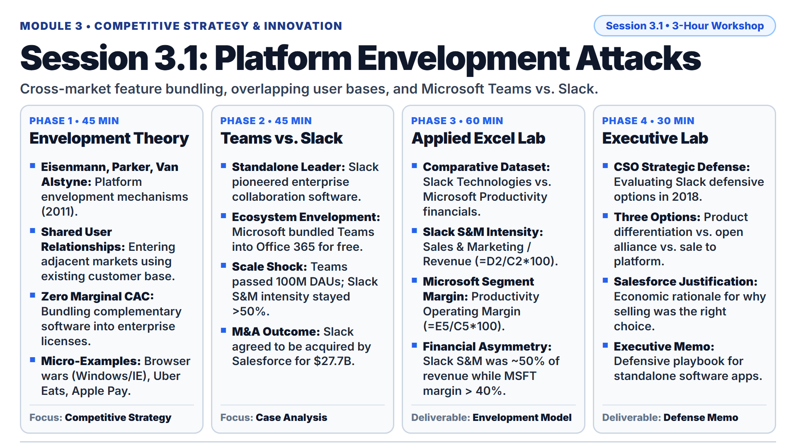

* **Lecture Presentation:** [Download Slides (PDF)](slides/session_3_1_lecture.pdf)

* **Keywords:** Platform Envelopment, Overlapping User Bases, Functionality Bundling, Customer Foreclosure, Ecosystem Enclosure, S&M Intensity (Sales and Marketing Intensity), ISV (Independent Software Vendor).
* **Main Theories:**
  * [Thomas R. Eisenmann, Geoffrey G. Parker, and Marshall W. Van Alstyne (2011) Platform Envelopment](https://en.wikipedia.org/wiki/Platform_envelopment): Strategic Management Journal. An established platform owner in one market enters an adjacent market by bundling functionality into its existing multi-sided platform, leveraging shared user relationships and common components to foreclose standalone competitors.
  * [Tying, Bundling and Antitrust Foreclosure in Digital Ecosystems](https://en.wikipedia.org/wiki/Tying_(commerce)): Economic mechanisms where zero-marginal-cost software distribution eliminates a standalone competitor's ability to finance customer acquisition, forcing exit or acquisition.
* **Micro-Examples:**
  * Operating System Envelopment of Web Browsers: Microsoft bundling Internet Explorer directly into the Windows operating system in the late 1990s, devastating standalone market pioneer Netscape Navigator.
  * Ride-Hailing Envelopment of Food Delivery: Uber embedding Uber Eats directly within its primary consumer ride-hailing application, sharing stored credit cards, GPS routing data, and driver networks to envelop standalone delivery apps.
  * Smartphone Envelopment of Contactless Payments: Apple integrating Apple Pay and the Wallet application directly into iOS hardware secure elements, enveloping standalone mobile payment applications.
* **Real Business Case:**
  * **Microsoft Teams vs. Slack Technologies (2018-2021 Enterprise Platform Envelopment):** In 2018, Slack Technologies was the premier standalone enterprise workplace messaging application, experiencing rapid organic adoption. In 2017, Microsoft launched Microsoft Teams and bundled it into existing commercial Microsoft 365 / Office 365 enterprise subscriptions at zero incremental license cost. While Slack had to spend over 50% of its annual revenue on sales and marketing to acquire corporate customers, Microsoft deployed its existing enterprise sales relationships and multi-product bundle. By 2020, Microsoft Teams surged past 115 million daily active users, while Slack's widening GAAP losses forced its board to accept a $27.7 billion acquisition by Salesforce in December 2020.
* **Lab Dataset:**
  * File Link: [data/session_3_1_envelopment_slack_msft.csv](data/session_3_1_envelopment_slack_msft.csv)
  * Columns: `Company_Entity`, `Fiscal_Year`, `Revenue_USD_M`, `Sales_Marketing_USD_M`, `Operating_Income_USD_M`, `Net_Income_USD_M`, `Filing_Source`.
* **Primary Filings & External References:**
  * [Slack Technologies Inc. Form 10-K Filings (SEC EDGAR CIK 0001764925)](https://www.sec.gov/edgar/browse/?CIK=0001764925)
  * [Microsoft Corporation Form 10-K Filings (SEC EDGAR CIK 0000789019)](https://www.sec.gov/edgar/browse/?CIK=0000789019)
* **Step-by-Step Lab Protocol (Exercise 1: Foundational Practice):**
  * **Step 1: Open the Dataset:** Launch Microsoft Excel. Open [data/session_3_1_envelopment_slack_msft.csv](data/session_3_1_envelopment_slack_msft.csv). Verify comparative financial numbers for Slack Technologies (FY2018-FY2020) and Microsoft Productivity Segment (FY2018-FY2020).
  * **Step 2: Inspect Primary Sources & Financial Terminology:**
    * Regulatory Baseline: Review the `Filing_Source` column (Item 8 of Slack Form 10-K and Microsoft Form 10-K).
    * Acronym Expansion: In enterprise software analysis, **S&M Intensity** represents **Sales and Marketing spending divided by Total Revenue** (the percentage of top-line revenue consumed by customer acquisition). **ISV** stands for **Independent Software Vendor** (third-party software companies developing applications for a broader platform ecosystem).
  * **Step 3: Calculate Slack Sales & Marketing Intensity:**
    * In cell H1, enter the column header `Sales_Marketing_Pct_Revenue`.
    * In cell H2, enter the formula: `=(D2/C2)*100` (Sales & Marketing divided by Revenue, multiplied by 100).
    * Copy the formula down for all Slack rows (rows 2, 3, and 4).
  * **Step 4: Calculate Microsoft Productivity Segment Operating Margin:**
    * In cell I1, enter the column header `Operating_Margin_Pct`.
    * In cell I5, enter the formula: `=(E5/C5)*100` (Operating Income divided by Revenue, multiplied by 100).
    * Copy the formula down for all Microsoft rows (rows 5, 6, and 7).
  * **Step 5: Synthesize Envelopment Asymmetry:**
    * Observe that Slack spent 58.2% (2018), 51.0% (2019), and 49.6% (2020) of its total revenue on sales and marketing just to stay competitive, resulting in heavy annual GAAP net losses (-$567M in FY2020).
    * In contrast, Microsoft's Productivity and Business Processes segment generated operating margins consistently exceeding 38% to 40%.
    * Conclude how bundling functionality allows an incumbent platform to distribute software at zero incremental customer acquisition cost, foreclosing standalone rivals.
* **Step-by-Step Strategic Decision Challenge (Exercise 2+: Advanced Problem Solving):**
  * **Strategic Problem:** Standalone software applications face structural disadvantages when an adjacent platform giant bundles equivalent functionality for free to an overlapping enterprise user base.
  * **Student Task:**
    1. Review Slack's financial numbers in your spreadsheet. Explain why product quality alone was insufficient to counter Microsoft Teams' free bundling strategy.
    2. Evaluate three strategic options available to Slack's executive leadership in 2020:
       * Option A: Continue competing independently by expanding marketing debt.
       * Option B: Form an open interoperability alliance with Zoom, Box, and Dropbox.
       * Option C: Sell the company to an enterprise cloud aggregator (Salesforce).
    3. Draft a structured, three-bullet decision brief addressed to Slack's Board of Directors: Justify why selling to Salesforce for $27.7 billion was the economically rational decision for shareholders, and outline how Salesforce should integrate Slack into its broader CRM cloud platform.

---

<a id="session-3-2"></a>
### Session 3.2: Strategic Cannibalization

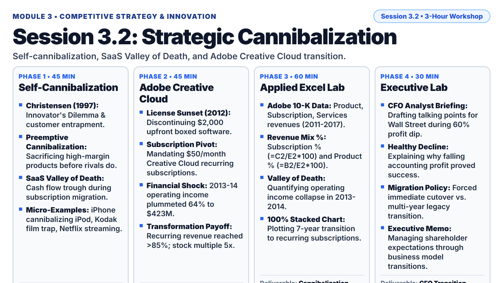

* **Lecture Presentation:** [Download Slides (PDF)](slides/session_3_2_lecture.pdf)

* **Keywords:** Cannibalization, The Innovator's Dilemma, SaaS Valley of Death, Perpetual License, Recurring Subscription, SaaS (Software as a Service), CFO (Chief Financial Officer).
* **Main Theories:**
  * [Clayton M. Christensen (1997) The Innovator's Dilemma: When New Technologies Cause Great Firms to Fail](https://en.wikipedia.org/wiki/The_Innovator%27s_Dilemma): Established industry leaders fail because their resource allocation processes listen to their most profitable legacy customers, rejecting lower-margin, disruptive business models until external competitors capture the market.
  * [Strategic Self-Cannibalization](https://en.wikipedia.org/wiki/Cannibalization_(marketing)): The deliberate introduction of a new digital platform or business model that destroys sales of existing highly profitable products, executed proactively to preempt competitor entry and dominate long-term market architecture.
* **Micro-Examples:**
  * Smartphone Cannibalization of Dedicated Hardware: Apple deliberately integrated music playback into the iPhone, rendering its own standalone iPod business obsolete while securing mobile computing dominance.
  * Physical Media vs. Digital Streaming: Netflix launched online streaming in 2007, actively undermining its core profitable DVD-by-mail rental business to preempt digital video disruption.
  * Photographic Film vs. Digital Cameras: Eastman Kodak invented the digital camera in 1975 but suppressed commercialization to protect its high-margin chemical film and printing paper manufacturing monopoly, leading to bankruptcy in 2012.
* **Real Business Case:**
  * **Adobe Inc. Creative Cloud Transformation (2011-2017 SaaS Transition):** In 2012, Adobe announced it would permanently cease selling perpetual boxed licenses for Creative Suite (which sold for $1,500 to $2,500 upfront per license). Instead, Adobe forced customers into a $50/month recurring subscription model called Creative Cloud. During 2013 and 2014 (the "SaaS Valley of Death"), Adobe's total revenue declined and GAAP operating income plummeted by 64% (from $1,180M in 2012 down to $423M in 2013) as upfront license cash vanished before monthly recurring payments accumulated. Wall Street punished the stock. However, by 2017, subscription revenue exceeded 85% of total revenues, operating income expanded to $2.17 billion, and Adobe's market valuation increased five-fold.
* **Lab Dataset:**
  * File Link: [data/session_3_2_cannibalization_adobe.csv](data/session_3_2_cannibalization_adobe.csv)
  * Columns: `Fiscal_Year`, `Product_Revenue_USD_M` (Perpetual license revenue in millions of USD), `Subscription_Revenue_USD_M` (Cloud subscription revenue in millions of USD), `Services_Support_Revenue_USD_M`, `Total_Revenue_USD_M`, `Operating_Income_USD_M`, `Filing_Source`.
* **Primary Filings & External References:**
  * [Adobe Inc. Form 10-K Filings (SEC EDGAR CIK 0000796343)](https://www.sec.gov/edgar/browse/?CIK=0000796343)
  * [SEC EDGAR Company Search Database](https://www.sec.gov/edgar/searchedgar/companysearch)
* **Step-by-Step Lab Protocol (Exercise 1: Foundational Practice):**
  * **Step 1: Open the Dataset:** Launch Microsoft Excel. Open [data/session_3_2_cannibalization_adobe.csv](data/session_3_2_cannibalization_adobe.csv). Verify Adobe audited figures for fiscal years 2011 through 2017.
  * **Step 2: Inspect Primary Sources & Financial Terminology:**
    * Regulatory Baseline: Review the `Filing_Source` column (Item 8 of Adobe Form 10-K).
    * Acronym Expansion: In software finance, **SaaS** stands for **Software as a Service** (cloud delivery where applications are hosted centrally and licensed on a recurring monthly/annual subscription rather than installed via perpetual license). **CFO** stands for **Chief Financial Officer** (the top corporate executive responsible for capital structure, financial planning, and Wall Street communications).
  * **Step 3: Calculate Revenue Mix Percentages:**
    * In cell H1, enter the column header `Subscription_Pct_Total`.
    * In cell H2, enter the formula: `=(C2/E2)*100` (Subscription Revenue divided by Total Revenue, multiplied by 100).
    * In cell I1, enter the column header `Product_Pct_Total`.
    * In cell I2, enter the formula: `=(B2/E2)*100` (Perpetual Product Revenue divided by Total Revenue, multiplied by 100).
    * Copy both formulas down through row 8 (2011 to 2017).
  * **Step 4: Identify the "SaaS Valley of Death":**
    * In your spreadsheet, inspect Total Revenue (`Column E`) and Operating Income (`Column F`) between 2012 and 2014.
    * Note how Operating Income collapsed from $1,180 million (2012) to $423 million (2013) and $413 million (2014) before exploding to $2,168 million in 2017.
  * **Step 5: Construct a 100% Stacked Area Transition Chart:**
    * Select Fiscal Year, Subscription Revenue, and Product Revenue.
    * Insert a 100% Stacked Area chart illustrating the complete crossover where subscription software expanded from 13.7% of revenues in 2012 to 85.9% in 2017.
* **Step-by-Step Strategic Decision Challenge (Exercise 2+: Advanced Problem Solving):**
  * **Strategic Problem:** Transitioning from upfront capital purchases to recurring subscriptions creates a multi-year cash flow trough (the SaaS Valley of Death) that invites hostile activist shareholder pressure and analyst downgrades.
  * **Student Task:**
    1. Imagine you are Adobe's CFO in late 2012 preparing guidance for Wall Street equity analysts. Operating income is projected to drop by over 60% in fiscal 2013.
    2. Using your spreadsheet numbers, draft three defensible communication points explaining why this temporary accounting collapse is proof of a successful platform transformation.
    3. Draft a structured, three-bullet decision brief addressed to Adobe's Chief Executive Officer: Formulate an actionable executive policy on whether to offer legacy customers a discounted multi-year grace period or execute an immediate hard cut-off of legacy perpetual licenses.

---

<a id="session-3-3"></a>
### Session 3.3: Disruptive Innovation in the Digital Era

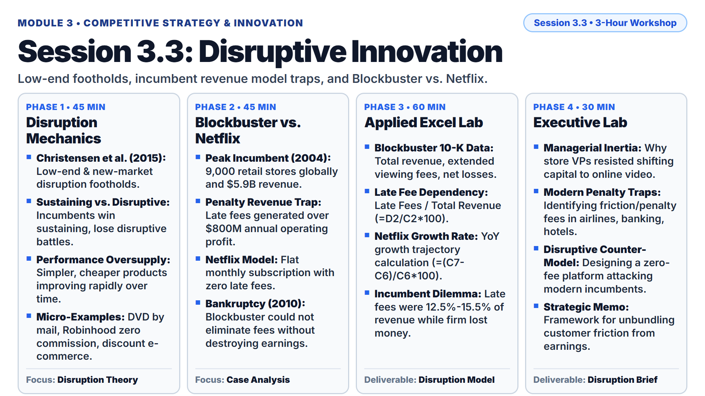

* **Lecture Presentation:** [Download Slides (PDF)](slides/session_3_3_lecture.pdf)

* **Keywords:** Disruptive Innovation, Low-End Disruption, New-Market Disruption, Incumbent Inertia, Trajectory of Performance, YoY (Year-over-Year), VHS (Video Home System).
* **Main Theories:**
  * [Clayton M. Christensen, Michael E. Raynor, and Rory McDonald (2015) What Is Disruptive Innovation?](https://hbr.org/2015/12/what-is-disruptive-innovation): Harvard Business Review. Disruptive innovation originates in low-end footholds (unattractive, low-margin segments ignored by incumbents) or new-market footholds (non-consumers). The entrant's product is initially simpler and cheaper, but improves along a rapid performance trajectory until it displaces established incumbents.
  * [Sustaining versus Disruptive Trajectories](https://en.wikipedia.org/wiki/Disruptive_innovation): Established incumbents consistently defeat entrants in sustaining technological battles (improving existing products for demanding profitable customers), but almost always lose disruptive battles against simpler, low-cost platform alternatives.
* **Micro-Examples:**
  * Video Rental vs. DVD by Mail: Blockbuster invested in expensive prime retail real estate with vast physical VHS and DVD selection; early Netflix offered slow mail delivery with limited titles but completely eliminated punitive late fees.
  * Retail Stock Brokerage: Traditional brokerages charged $30 to $50 per trade via human telephone brokers; Robinhood introduced smartphone-based, zero-commission fractional share trading for novice retail investors.
  * Enterprise Compute Hosting: Traditional IT hardware vendors sold multi-million dollar on-premise mainframe servers to corporate CIOs; early Amazon Web Services (AWS) launched primitive cloud storage for individual web developers at pennies per gigabyte.
* **Real Business Case:**
  * **Blockbuster Entertainment Inc. vs. Netflix Inc. (2001-2005 Incumbent Profit Trap):** In 2004, Blockbuster was the global video rental giant, operating over 9,000 physical retail stores and generating $5.9 billion in annual revenue. A substantial portion of its operating profit derived from "extended viewing fees" (late fees charged to customers who returned video tapes late). Early Netflix charged a predictable monthly subscription with no late fees. Blockbuster management could not copy Netflix's subscription model quickly because eliminating late fees would have immediately eliminated hundreds of millions in retail operating cash flow. Blockbuster filed for bankruptcy in September 2010.
* **Lab Dataset:**
  * File Link: [data/session_3_3_disruption_blockbuster.csv](data/session_3_3_disruption_blockbuster.csv)
  * Columns: `Company_Name`, `Fiscal_Year`, `Total_Revenue_USD_M`, `Extended_Viewing_Fees_USD_M` (Late fees in millions of USD), `Operating_Costs_USD_M`, `Net_Income_USD_M`, `Filing_Source`.
* **Primary Filings & External References:**
  * [Blockbuster Inc. Form 10-K Filings (SEC EDGAR CIK 0001086342)](https://www.sec.gov/edgar/browse/?CIK=0001086342)
  * [What Is Disruptive Innovation? (Harvard Business Review)](https://hbr.org/2015/12/what-is-disruptive-innovation)
* **Step-by-Step Lab Protocol (Exercise 1: Foundational Practice):**
  * **Step 1: Open the Dataset:** Launch Microsoft Excel. Open [data/session_3_3_disruption_blockbuster.csv](data/session_3_3_disruption_blockbuster.csv). Verify financial figures for Blockbuster (2001-2004) and Netflix (2001-2004).
  * **Step 2: Inspect Primary Sources & Financial Terminology:**
    * Regulatory Baseline: Review the `Filing_Source` column (Item 8 of Blockbuster Form 10-K).
    * Acronym Expansion: In corporate strategy analysis, **YoY** stands for **Year-over-Year** (a percentage calculation measuring the growth of a metric compared to the exact same period one year prior). **VHS** stands for **Video Home System** (analog magnetic tape cassettes used for physical home video playback prior to DVDs).
  * **Step 3: Calculate Late Fee Contribution for Blockbuster:**
    * In cell H1, enter the column header `Late_Fees_Pct_Revenue`.
    * In cell H2, enter the formula: `=(D2/C2)*100` (Extended Viewing Fees divided by Total Revenue, multiplied by 100).
    * Copy the formula down through row 5 (2001 to 2004).
  * **Step 4: Calculate Netflix Year-over-Year (YoY) Revenue Growth:**
    * In cell I6, enter the column header `Netflix_YoY_Growth_Pct`.
    * In cell I7, enter the formula: `=(C7-C6)/C6*100`.
    * Copy the formula down through row 9 (2002 to 2004).
  * **Step 5: Synthesize the Incumbent Dilemma:**
    * Note that late fees contributed between 12.5% and 15.5% of Blockbuster's total revenue ($741M to $854M annually). Because Blockbuster was already reporting net losses, eliminating late fees would have immediately triggered debt covenant defaults.
    * Contrast this with Netflix's YoY revenue growth rates of 249% (2002), 99% (2003), and 92% (2004).
* **Step-by-Step Strategic Decision Challenge (Exercise 2+: Advanced Problem Solving):**
  * **Strategic Problem:** Incumbent corporations are trapped by their existing profit engines: senior executives cannot voluntarily eliminate customer friction fees when corporate operating profits depend directly on those fees.
  * **Student Task:**
    1. Using your spreadsheet numbers, explain why Blockbuster's store managers and regional franchise owners resisted shifting capital into Netflix-style digital mail delivery.
    2. Identify an established industry today where an incumbent earns substantial profits from customer friction fees (e.g., airline baggage change fees, commercial banking overdraft fees, hotel resort fees).
    3. Draft a structured, three-bullet decision brief addressed to the Board of Directors of an incumbent institution: Formulate an actionable plan to launch a separate, autonomous digital platform unit unencumbered by legacy profit requirements to preempt low-end disruptors.

---

<a id="session-3-4"></a>
### Session 3.4: Open Innovation & Ecosystem Orchestration

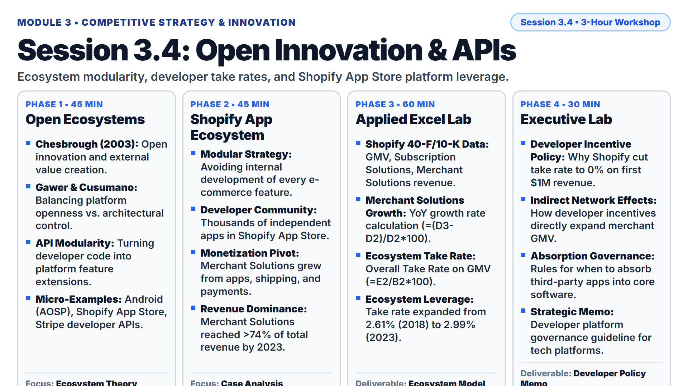

* **Lecture Presentation:** [Download Slides (PDF)](slides/session_3_4_lecture.pdf)

* **Keywords:** Open Innovation, API (Application Programming Interface), Modularity, Value Co-Creation, Developer Governance, GMV (Gross Merchandise Volume), ISV (Independent Software Vendor).
* **Main Theories:**
  * [Henry Chesbrough (2003) Open Innovation: The New Imperative for Creating and Profiting from Technology](https://en.wikipedia.org/wiki/Open_innovation): Harvard Business School Press. Valuable commercial ideas can come from inside or outside the corporation and can go to market from inside or outside the company. Platform firms must open their technical boundaries to external innovators to capture distributed talent.
  * [Annabelle Gawer and Michael A. Cusumano (2014) Industry Platforms and Ecosystem Innovation](https://en.wikipedia.org/wiki/Software_ecosystem): Journal of Product Innovation Management. Architectural governance of platforms: how platform sponsors resolve the core tension between openness (stimulating external developer complementor innovation) and control (appropriating economic returns and safeguarding quality standards).
* **Micro-Examples:**
  * Mobile Operating Systems: Google releases Android source code via the Android Open Source Project (AOSP), allowing hardware OEMs (Samsung, Xiaomi) to manufacture devices while standardizing on proprietary Google Mobile Services (GMS) APIs.
  * Cloud Payment Infrastructure: Stripe opens developer-friendly payment APIs, enabling any software programmer to embed global banking and card acceptance into a website using seven lines of code.
  * E-Commerce Storefront Extensions: Shopify provides modular APIs, allowing over 10,000 independent app developers to sell inventory management, marketing, and cross-border shipping plugins to merchants.
* **Real Business Case:**
  * **Shopify Inc. (2018-2023 Developer Ecosystem Orchestration):** Rather than attempting to build every e-commerce feature internally, Shopify designed an open modular software architecture powered by public APIs. Independent software vendors (ISVs) build specialized applications (tax calculation, loyalty programs, email automation) and distribute them via the Shopify App Store. To attract premier global developers, Shopify instituted a developer-friendly fee policy in 2021: 0% revenue share on a developer's first $1,000,000 in annual gross app revenue (compared to Apple's and Google's standard 30% take rates). By FY2023, Shopify's Gross Merchandise Volume (GMV) reached $235.9 billion, and Merchant Solutions revenue grew to $5.22 billion (74% of total revenues), driven by partner integrations.
* **Lab Dataset:**
  * File Link: [data/session_3_4_open_apis_shopify.csv](data/session_3_4_open_apis_shopify.csv)
  * Columns: `Fiscal_Year`, `GMV_USD_M` (Gross Merchandise Volume in millions of USD), `Subscription_Solutions_USD_M`, `Merchant_Solutions_USD_M`, `Total_Revenue_USD_M`, `Merchant_Solutions_Pct_Total`, `Filing_Source`.
* **Primary Filings & External References:**
  * [Shopify Inc. Form 40-F/10-K Filings (SEC EDGAR CIK 0001594805)](https://www.sec.gov/edgar/browse/?CIK=0001594805)
  * [Shopify Developer API Platform Architecture Documentation](https://shopify.dev/docs/api)
* **Step-by-Step Lab Protocol (Exercise 1: Foundational Practice):**
  * **Step 1: Open the Dataset:** Launch Microsoft Excel. Open [data/session_3_4_open_apis_shopify.csv](data/session_3_4_open_apis_shopify.csv). Verify Shopify financial numbers for fiscal years 2018 through 2023.
  * **Step 2: Inspect Primary Sources & Financial Terminology:**
    * Regulatory Baseline: Review the `Filing_Source` column (Item 8 of Shopify Form 40-F / Form 10-K).
    * Acronym Expansion: In software architecture, **API** stands for **Application Programming Interface** (standardized code protocols that allow external software applications to communicate and exchange data with a platform). **GMV** stands for **Gross Merchandise Volume** (the total dollar value of all orders processed across all merchant storefronts). **ISV** stands for **Independent Software Vendor**.
  * **Step 3: Calculate Merchant Solutions Year-over-Year Growth:**
    * In cell H1, enter the column header `Merchant_Solutions_YoY_Growth_Pct`.
    * In cell H3, enter the formula: `=(D3-D2)/D2*100`.
    * Copy the formula down through row 7 (2019 to 2023).
  * **Step 4: Calculate Total Platform Take Rate on GMV:**
    * In cell I1, enter the column header `Overall_Take_Rate_Pct`.
    * In cell I2, enter the formula: `=(E2/B2)*100` (Total Revenue divided by GMV, multiplied by 100).
    * Copy the formula down through row 7.
  * **Step 5: Analyze Ecosystem Leverage:**
    * Observe that Shopify's overall take rate expanded from 2.61% (2018) to 2.99% (2023) as GMV expanded from $41.1B to $235.9B.
    * Conclude how open APIs allow a platform owner to generate billions in transaction revenue from complementary software developed and maintained entirely at external developer expense.
* **Step-by-Step Strategic Decision Challenge (Exercise 2+: Advanced Problem Solving):**
  * **Strategic Problem:** Platform owners face a delicate governance balance: if the platform absorbs (sherlocks) the most profitable third-party apps into core software, developers lose trust and migrate; if it absorbs nothing, user experience becomes fragmented and inconsistent.
  * **Student Task:**
    1. Using your spreadsheet numbers, evaluate why Shopify surrendered developer commission fees on the first $1M in revenue to stimulate indirect network effects on total GMV.
    2. Analyze the strategic risks of platform "enclosure": when Apple or Shopify clones a successful third-party developer's feature, evaluate the impact on external venture capital investment in the developer ecosystem.
    3. Draft a structured, three-bullet decision brief addressed to Shopify's Chief Product Officer: Formulate clear architectural governance rules defining exactly when the platform should build a feature into its core offering versus when it should preserve the category for external independent software vendors.

---

<a id="module-4"></a>
## Module 4: Real-World Case Studies & Strategic Synthesis

<a id="session-4-1"></a>
### Session 4.1: Comprehensive Case Study: Amazon

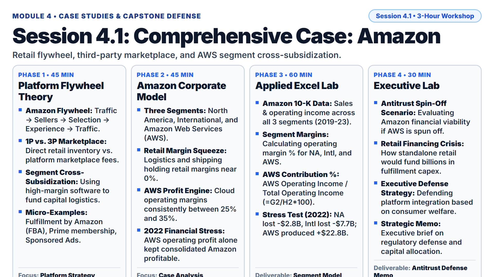

* **Lecture Presentation:** [Download Slides (PDF)](slides/session_4_1_lecture.pdf)

* **Keywords:** Retail Flywheel, AWS (Amazon Web Services), 3P (Third-Party Marketplace), 1P (First-Party Retail), Cross-Subsidization, Segment Operating Margin, FBA (Fulfillment by Amazon).
* **Main Theories:**
  * [The Platform Flywheel and Virtuous Feedback Loops](https://en.wikipedia.org/wiki/Virtuous_circle_and_vicious_circle) ([Amazon Flywheel Architecture](https://en.wikipedia.org/wiki/Platform_economy)): Jim Collins and Jeff Bezos. Lower cost structure enables lower prices; lower prices attract more customer visits; increased traffic attracts independent third-party (3P) merchants; expanded merchant selection enhances customer experience, spinning the flywheel faster.
  * [Multi-Segment Cross-Subsidization in Enterprise Platforms](https://en.wikipedia.org/wiki/Cross_subsidization): Deploying high-margin enterprise cloud infrastructure cash flows (AWS) to subsidize capital-intensive, low-margin physical logistics networks (1P retail and FBA).
* **Micro-Examples:**
  * Fulfillment by Amazon (FBA): Amazon transformed its internal warehousing cost center into a paid, high-margin platform service for millions of third-party merchants.
  * Amazon Prime Membership: An annual consumer subscription that eliminates shipping friction, doubling average annual member spending while sharply increasing multi-homing switching costs.
  * Amazon Retail Media Advertising: High-margin sponsored product search ads embedded directly into the shopping catalog, generating over $46 billion in high-margin advertising cash.
* **Real Business Case:**
  * **Amazon.com, Inc. (2019-2023 Segment Cross-Subsidization):** Amazon operates three reporting segments: North America Retail, International Retail, and Amazon Web Services (AWS). In FY2022, global macroeconomic headwinds, surging shipping costs, and excess post-pandemic warehouse capacity produced massive retail operating losses: North America lost -$2.85 billion, and International lost -$7.75 billion (total retail operating loss of -$10.59 billion). However, AWS generated $22.84 billion in operating profit (28.8% operating margin), single-handedly keeping Amazon profitable. By FY2023, retail logistics efficiencies recovered, but AWS continued to provide over 67% of Amazon's $36.85 billion consolidated operating income.
* **Lab Dataset:**
  * File Link: [data/session_4_1_case_amazon.csv](data/session_4_1_case_amazon.csv)
  * Columns: `Fiscal_Year`, `North_America_Sales_USD_M`, `North_America_Op_Income_USD_M`, `International_Sales_USD_M`, `International_Op_Income_USD_M`, `AWS_Sales_USD_M`, `AWS_Op_Income_USD_M`, `Consolidated_Op_Income_USD_M`, `Filing_Source`.
* **Primary Filings & External References:**
  * [Amazon.com, Inc. Form 10-K Filings (SEC EDGAR CIK 0001018724)](https://www.sec.gov/edgar/browse/?CIK=0001018724)
  * [SEC EDGAR Company Search Database](https://www.sec.gov/edgar/searchedgar/companysearch)
* **Step-by-Step Lab Protocol (Exercise 1: Foundational Practice):**
  * **Step 1: Open the Dataset:** Launch Microsoft Excel. Open [data/session_4_1_case_amazon.csv](data/session_4_1_case_amazon.csv). Verify segment operating results for Amazon (FY2019 through FY2023).
  * **Step 2: Inspect Primary Sources & Financial Terminology:**
    * Regulatory Baseline: Review the `Filing_Source` column (Item 8, Note 10 - Segment Information of Amazon Form 10-K).
    * Acronym Expansion: In corporate strategy, **AWS** stands for **Amazon Web Services** (Amazon's cloud infrastructure division providing on-demand computing power, storage, and databases). **1P** stands for **First-Party Retail** (where Amazon buys inventory wholesale and sells directly to consumers). **3P** stands for **Third-Party Marketplace** (where external merchants sell directly to consumers, paying Amazon commission and fulfillment fees). **FBA** stands for **Fulfillment by Amazon** (Amazon's warehousing, packing, and delivery service for merchants).
  * **Step 3: Calculate Segment Operating Margins:**
    * In cell J1, enter header `NA_Op_Margin_Pct`. In cell J2: `=(C2/B2)*100`.
    * In cell K1, enter header `Intl_Op_Margin_Pct`. In cell K2: `=(E2/D2)*100`.
    * In cell L1, enter header `AWS_Op_Margin_Pct`. In cell L2: `=(G2/F2)*100`.
    * Copy down through row 6 (2019 to 2023).
  * **Step 4: Calculate AWS Profit Contribution Percentage:**
    * In cell M1, enter header `AWS_Pct_Total_Operating_Profit`.
    * In cell M2, enter the formula: `=(G2/H2)*100` (AWS Operating Income divided by Consolidated Operating Income, multiplied by 100).
    * Copy down through row 6.
  * **Step 5: Examine the 2022 Stress Test:**
    * Observe that in 2022, consolidated operating income was $12,248M. AWS generated $22,841M, meaning AWS accounted for over 186% of Amazon's total net operating profits while retail absorbed billions in expansion losses.
* **Step-by-Step Strategic Decision Challenge (Exercise 2+: Advanced Problem Solving):**
  * **Strategic Problem:** Antitrust regulatory authorities in the US and EU have proposed structural separation remedies, arguing that Amazon uses monopoly cloud profits from AWS to unfairly subsidize predatory pricing and below-cost logistics in its retail marketplace.
  * **Student Task:**
    1. Using your spreadsheet model, simulate a regulatory scenario where AWS is legally spun off as an entirely independent public corporation. Calculate the standalone operating margin of Amazon Retail in 2022 without AWS cash flows.
    2. How would an independent Amazon Retail business finance its $50+ billion annual capital expenditure commitments in automated fulfillment centers and delivery vans without AWS profits?
    3. Draft a structured, three-bullet legal and strategic memorandum addressed to the Federal Trade Commission (FTC): Formulate a rigorous economic defense demonstrating how Amazon's integrated platform structure generates lower prices, faster delivery, and billions in infrastructure investments that benefit independent small businesses and consumers.

---

<a id="session-4-2"></a>
### Session 4.2: Comprehensive Case Study: Apple

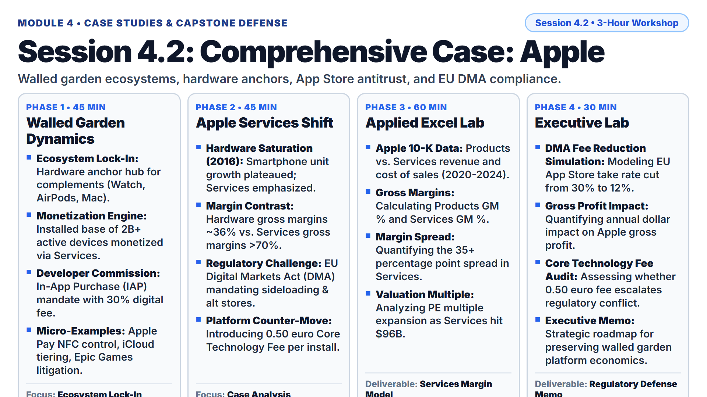

* **Lecture Presentation:** [Download Slides (PDF)](slides/session_4_2_lecture.pdf)

* **Keywords:** Walled Garden, App Store Take Rate, Services Segment, Architectural Lock-In, Platform Antitrust, IAP (In-App Purchase), DMA (Digital Markets Act), EU (European Union).
* **Main Theories:**
  * [Platform Ecosystem Complements and Architectural Control](https://en.wikipedia.org/wiki/Complementary_good): Controlling proprietary hardware, operating systems, and developer monetization rules to capture extraordinary economic rents from third-party complementary software developers.
  * [Two-Sided Platform Antitrust and Contestability](https://en.wikipedia.org/wiki/Digital_Markets_Act): Regulatory enforcement of gatekeeper obligations (such as the European Union Digital Markets Act and Epic Games v. Apple), examining whether closed "walled gardens" protect user privacy or extract monopolistic anti-steering rents.
* **Micro-Examples:**
  * Hardware Anchor Hub: The iPhone acts as the central biometric identity and transaction hub for high-margin complementary devices (Apple Watch, AirPods, iPad, Mac).
  * Services Installed Base Monetization: Apple monetizes its global installed base of over 2.2 billion active devices through iCloud storage, Apple Music, Apple Pay, and the App Store.
  * Strict In-App Purchase Rules: Mandating that all digital goods and services purchased inside iOS apps must utilize Apple's In-App Purchase (IAP) engine, paying a 30% commission (15% for small developers).
* **Real Business Case:**
  * **Apple Inc. Services Transformation (2020-2024 Margin Expansion):** As global smartphone hardware shipments reached market maturity around 2016, Apple transitioned its primary investor narrative toward its high-margin "Services" division. While Products (hardware) deliver gross margins between 35% and 37%, Services generates gross margins between 66% and 74%. In 2020, Epic Games filed antitrust lawsuits challenging Apple's 30% fee, leading to worldwide regulatory scrutiny. In March 2024, the European Union's Digital Markets Act (DMA) forced Apple to allow alternative app stores and third-party payment processing in the EU, prompting Apple to introduce a new "Core Technology Fee" of 0.50 euros per annual install to protect its ecosystem revenues.
* **Lab Dataset:**
  * File Link: [data/session_4_2_case_apple.csv](data/session_4_2_case_apple.csv)
  * Columns: `Fiscal_Year`, `Products_Revenue_USD_M`, `Products_Cost_of_Sales_USD_M`, `Services_Revenue_USD_M`, `Services_Cost_of_Sales_USD_M`, `Total_Net_Sales_USD_M`, `Filing_Source`.
* **Primary Filings & External References:**
  * [Apple Inc. Form 10-K Filings (SEC EDGAR CIK 0000320193)](https://www.sec.gov/edgar/browse/?CIK=0000320193)
  * [European Commission Digital Markets Act Gatekeeper Legislation](https://digital-markets-act.ec.europa.eu/index_en)
* **Step-by-Step Lab Protocol (Exercise 1: Foundational Practice):**
  * **Step 1: Open the Dataset:** Launch Microsoft Excel. Open [data/session_4_2_case_apple.csv](data/session_4_2_case_apple.csv). Verify Apple revenue and cost data for fiscal years 2020 through 2024.
  * **Step 2: Inspect Primary Sources & Financial Terminology:**
    * Regulatory Baseline: Review the `Filing_Source` column (Item 8 of Apple Form 10-K).
    * Acronym Expansion: In platform antitrust, **IAP** stands for **In-App Purchase** (Apple's proprietary billing protocol). **DMA** stands for the **Digital Markets Act** (European Union legislation regulating large tech gatekeepers). **EU** stands for the **European Union**.
  * **Step 3: Calculate Products (Hardware) Gross Margin Percentage:**
    * In cell H1, enter the column header `Products_Gross_Margin_Pct`.
    * In cell H2, enter the formula: `=((B2-C2)/B2)*100` (Hardware Revenue minus Hardware Cost, divided by Hardware Revenue, multiplied by 100).
    * Copy the formula down through row 6 (2020 to 2024).
  * **Step 4: Calculate Services Gross Margin Percentage:**
    * In cell I1, enter the column header `Services_Gross_Margin_Pct`.
    * In cell I2, enter the formula: `=((D2-E2)/D2)*100` (Services Revenue minus Services Cost, divided by Services Revenue, multiplied by 100).
    * Copy the formula down through row 6.
  * **Step 5: Calculate the Margin Spread:**
    * In cell J1, enter header `Margin_Spread_Pct`. In cell J2: `=I2-H2`.
    * Observe that Services gross margin (73.9% in 2024) is approximately 37 percentage points higher than hardware gross margin (36.9%).
    * Conclude why Apple's equity market valuation multiple expanded from ~15x P/E to ~30x P/E as Services revenue reached $96.17 billion in 2024.
* **Step-by-Step Strategic Decision Challenge (Exercise 2+: Advanced Problem Solving):**
  * **Strategic Problem:** Antitrust regulatory mandates in Europe (EU DMA) and Department of Justice lawsuits threaten to dismantle Apple's 30% App Store commission structure and walled-garden exclusivity.
  * **Student Task:**
    1. Using your spreadsheet model, simulate a scenario where regulatory mandates force Apple to lower its global App Store take rate from 30% to 12%. If App Store commissions represent 35% of total Services revenue, calculate the estimated annual dollar impact on Apple's gross profit.
    2. Evaluate Apple's strategic counter-measure in the EU: introducing a 0.50 euro "Core Technology Fee" per annual app install over 1 million downloads. Does this fee comply with the spirit of the DMA, or does it invite multi-billion euro regulatory fines?
    3. Draft a structured, three-bullet decision brief addressed to Apple's Chief Executive Officer: Formulate an actionable executive strategy detailing how Apple should restructure its developer monetization terms globally to maximize revenue retention while resolving ongoing antitrust litigation.

---

<a id="session-4-3"></a>
### Session 4.3: Applied Digital Learning & Empirical Industry Evidence

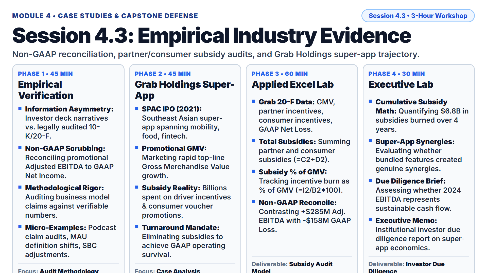

* **Lecture Presentation:** [Download Slides (PDF)](slides/session_4_3_lecture.pdf)

* **Keywords:** Empirical Evidence, Primary Source Fact-Checking, Video Lecture Audit, Non-GAAP Reconciliation, SPAC (Special Purpose Acquisition Company), EBITDA (Earnings Before Interest, Taxes, Depreciation, and Amortization).
* **Main Theories:**
  * [Statutory Disclosure Integrity and Regulatory Compliance](https://en.wikipedia.org/wiki/Regulatory_compliance): Distinguishing promotional corporate narratives (podcast interviews, conference keynote presentations) from legally binding, audited regulatory disclosures (SEC Form 10-K, Form 20-F, Form S-4).
  * [Empirical Methodology in Corporate Strategy & Non-GAAP Reconciliation](https://en.wikipedia.org/wiki/Financial_statement_analysis): Rigorously auditing non-GAAP financial adjustments (such as "Adjusted EBITDA" and stock-based compensation add-backs) to identify underlying cash burn and operational sustainability.
* **Micro-Examples:**
  * Podcast Fact-Checking: A startup founder announces on a technology podcast that their platform has "achieved operational profitability"; auditing the 10-K reveals positive "Adjusted EBITDA" achieved only by adding back $300 million in executive stock grants while reporting a substantial GAAP Net Loss.
  * Active User Metric Definitions: A corporate marketing deck announces 60 million "Registered Members"; the SEC filing footnote reveals that transacting "Active Users" in the past 90 days totaled only 11 million.
* **Real Business Case:**
  * **Grab Holdings Limited (2021-2024 Southeast Asian Super-App Audit):** Southeast Asian super-app Grab went public in December 2021 via a SPAC merger, pitching public investors on an integrated multi-sided platform combining ride-hailing, food delivery, and digital financial payments. In promotional roadshows, management highlighted hyper-growth in Gross Merchandise Value (GMV). However, financial statement audits of its Form 20-F filings revealed that Grab spent hundreds of millions of dollars annually on partner incentives (driver bonuses) and consumer incentives (discount vouchers), resulting in cumulative net losses exceeding $6.8 billion between 2021 and 2024. Under public market pressure, management curtailed subsidies, reporting positive Adjusted EBITDA in 2024 (+ $285M) while still reporting a GAAP Net Loss of -$158 million.
* **Lab Dataset:**
  * File Link: [data/session_4_3_empirical_audit_grab.csv](data/session_4_3_empirical_audit_grab.csv)
  * Columns: `Fiscal_Year`, `Gross_Merchandise_Value_USD_M`, `Partner_Incentives_USD_M`, `Consumer_Incentives_USD_M`, `GAAP_Revenue_USD_M`, `Adjusted_EBITDA_USD_M`, `GAAP_Net_Loss_USD_M`, `Filing_Source`.
* **Primary Filings & External References:**
  * [Grab Holdings Limited Form 20-F Filings (SEC EDGAR CIK 0001855612)](https://www.sec.gov/edgar/browse/?CIK=0001855612)
  * [SEC EDGAR Company Search Database](https://www.sec.gov/edgar/searchedgar/companysearch)
* **Step-by-Step Lab Protocol (Exercise 1: Foundational Practice):**
  * **Step 1: Open the Dataset:** Launch Microsoft Excel. Open [data/session_4_3_empirical_audit_grab.csv](data/session_4_3_empirical_audit_grab.csv). Verify Grab financial numbers across fiscal years 2021 through 2024.
  * **Step 2: Inspect Primary Sources & Financial Terminology:**
    * Regulatory Baseline: Review the `Filing_Source` column (Item 18 of Grab Form 20-F).
    * Acronym Expansion: In corporate finance, **SPAC** stands for **Special Purpose Acquisition Company** (a publicly traded shell company formed specifically to merge with a private operational company, bypassing the traditional IPO underwriting process). **EBITDA** stands for **Earnings Before Interest, Taxes, Depreciation, and Amortization** (a widely utilized non-GAAP operational cash proxy that excludes non-cash depreciation and financing expenses).
  * **Step 3: Calculate Total Annual Subsidies and Incentives:**
    * In cell I1, enter the column header `Total_Incentives_USD_M`.
    * In cell I2, enter the formula: `=C2+D2` (Partner Incentives plus Consumer Incentives).
    * Copy the formula down through row 5 (2021 to 2024).
  * **Step 4: Calculate Subsidies as a Percentage of GMV:**
    * In cell J1, enter the column header `Incentives_Pct_GMV`.
    * In cell J2, enter the formula: `=(I2/B2)*100` (Total Incentives divided by GMV, multiplied by 100).
    * Copy the formula down through row 5.
  * **Step 5: Reconcile Non-GAAP EBITDA with Statutory GAAP Net Loss:**
    * Contrast Column F (`Adjusted_EBITDA`) with Column G (`GAAP_Net_Loss`).
    * In 2024, Grab reported positive Adjusted EBITDA of +$285M, but sustained an audited statutory GAAP Net Loss of -$158M.
    * Conclude why strategic analysts must audit statutory GAAP reconciliations rather than relying on non-GAAP management metrics.
* **Step-by-Step Strategic Decision Challenge (Exercise 2+: Advanced Problem Solving):**
  * **Strategic Problem:** Super-apps in developing markets frequently disguise operational unprofitability by reporting Adjusted EBITDA figures that add back stock-based compensation, lease expenses, and restructuring charges.
  * **Student Task:**
    1. In your spreadsheet, calculate the cumulative cash spent on partner and consumer incentives by Grab between 2021 and 2024 using the formula: `=SUM(C2:D5)`. Note that incentives totaled over $6.8 billion across four years.
    2. Evaluate whether Grab's "super-app" architecture generated true cross-selling operational synergies or merely accumulated multiple capital-intensive, low-margin businesses under a single corporate umbrella.
    3. Draft a structured, three-bullet institutional investment memorandum addressed to an investment committee: Formulate an actionable due diligence assessment on whether Grab's positive 2024 Adjusted EBITDA represents sustainable long-term cash generation or an artificial accounting artifact.

---

<a id="session-4-4"></a>
### Session 4.4: Final Strategic Assessment & Capstone Defense

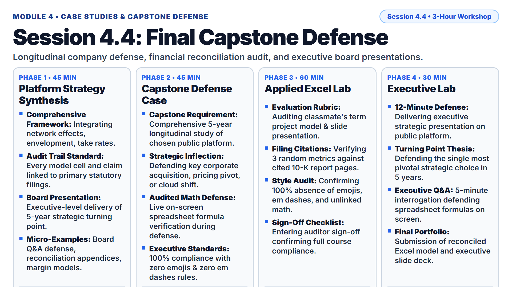

* **Lecture Presentation:** [Download Slides (PDF)](slides/session_4_4_lecture.pdf)

* **Keywords:** Capstone Defense, Longitudinal Analysis, Business Model Evaluation, Financial Audit Trail, Executive Presentation, Q&A (Question and Answer).
* **Main Theories:**
  * [Comprehensive Platform Business Model Synthesis](https://en.wikipedia.org/wiki/Business_model): Integrating network dynamics, multi-homing barriers, asset intensity, asymmetric pricing, competitive envelopment, and regulatory compliance into a unified executive strategic evaluation.
  * [Corporate Capital Allocation and Valuation in Digital Platforms](https://en.wikipedia.org/wiki/Corporate_finance): Defending an executive-level strategic turnaround or growth recommendation supported by reconciled spreadsheet financial exhibits.
* **Micro-Examples:**
  * Professional Boardroom Presentations: Presenting a 5-year strategic transformation to a corporate Board of Directors with precise financial reconciliation exhibits.
  * Live Financial Appendix Auditing: Defending every formula and primary regulatory filing citation during high-stakes executive questioning.
* **Real Business Case:**
  * **Final Project Capstone Defense (Longitudinal Enterprise Platform Defense):** Students deliver their final oral defense and submit their reconciled spreadsheet models analyzing a publicly traded platform corporation over a 5-year longitudinal historical period. Presentations synthesize how the firm resolved network effects, managed asset intensity, executed pricing discrimination, and defended against competitive envelopment, concluding with an actionable 3-bullet strategic mandate for senior leadership.
* **Lab Dataset:**
  * File Link: [data/session_4_4_capstone_audit_checklist.csv](data/session_4_4_capstone_audit_checklist.csv)
  * Columns: `Audit_Category`, `Audit_Inspection_Item`, `Primary_Filing_Requirement`, `Spreadsheet_Formula_Requirement`, `Pass_Fail_Threshold`.
* **Primary Filings & External References:**
  * [Term Project Guidelines & Capstone Scoring Rubric (Project.md)](Project.md)
  * [SEC EDGAR Company Search Database](https://www.sec.gov/edgar/searchedgar/companysearch)
* **Step-by-Step Lab Protocol (Exercise 1: Foundational Practice):**
  * **Step 1: Open the Evaluation Rubric:** Launch Microsoft Excel. Open [data/session_4_4_capstone_audit_checklist.csv](data/session_4_4_capstone_audit_checklist.csv).
  * **Step 2: Inspect Primary Sources & Financial Terminology:**
    * Acronym Expansion: In academic and corporate capstone evaluations, **Q&A** stands for **Question and Answer** (the formal defense period where examiners interrogate the student's methodology, formulas, and strategic recommendations).
    * Review the 5 core audit categories: Editorial Constraints, Primary Filing Citations, Formula Integrity, Strategic Framework Application, and Executive Brief Quality.
  * **Step 3: Conduct Pre-Defense Peer Audit:**
    * Open a classmate's term project presentation slide deck and companion Excel financial model.
    * Verify 100% compliance with course editorial constraints: confirm zero emojis and zero em/en dashes across all slides and tables (Pass/Fail).
  * **Step 4: Verify Three Primary Regulatory Citations:**
    * Select three random financial figures in the classmate's presentation deck.
    * Cross-reference each number against the cited Form 10-K or Form 20-F filing page in the companion spreadsheet model. Verify zero discrepancy.
  * **Step 5: Sign Off Capstone Audit Checklist:**
    * In the audit checklist workbook, record your name and student ID, certifying that the peer's capstone deliverables satisfy all standards established in [Term Project Guidelines (Project.md)](Project.md).
* **Step-by-Step Strategic Decision Challenge (Exercise 2+: Advanced Problem Solving):**
  * **Strategic Problem:** Executive presentations must synthesize complex financial modeling and platform economics into an authoritative, actionable strategic defense.
  * **Student Task (Final Capstone Defense Execution):**
    1. Deliver your 12-minute executive presentation analyzing your chosen publicly traded platform company across its 5-year longitudinal historical trajectory (satisfying all oral presentation criteria in [Project.md](Project.md)).
    2. Identify the single most critical strategic inflection point in the company's 5-year history (e.g., an aggressive pricing restructure, major cloud transition, or entry into an adjacent ecosystem).
    3. Defend your findings during an intensive 5-minute executive Q&A examination:
       * Demonstrate live on screen the mathematical formula link connecting your spreadsheet model to Item 8 of the company's audited SEC Form 10-K.
       * Conclude with your structured, three-bullet strategic recommendation addressed to the company's Board of Directors, providing an actionable roadmap for the next 24 months.

---
