# Digital Transformation & Platform Business Strategy

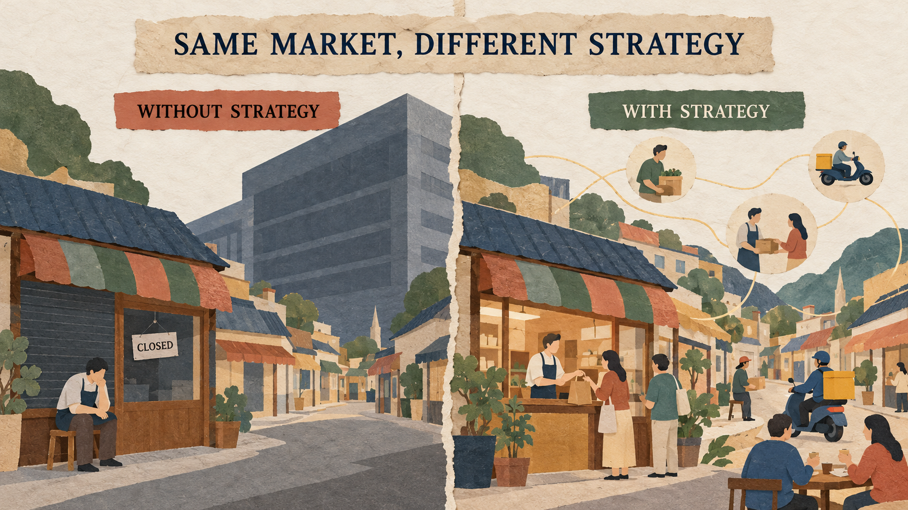

![Course roadmap: the same business owner climbs four steps as the business grows from a small stall to a hub that connects many shops. Module 1 Platform Foundations (1.1 Platform Model, 1.2 Network Effect, 1.3 Two-Sided Market, 1.4 Winner-Takes-All); Module 2 Data and Monetization (2.1 Data Feedback Loop, 2.2 Asymmetric Pricing, 2.3 Up-Sell and Cross-Sell, 2.4 Module 2 Review); Module 3 Competition and Innovation (3.1 Platform Envelopment, 3.2 Cannibalization, 3.3 Disruption, 3.4 Open Ecosystem); Module 4 Cases and Synthesis (4.1 Flywheel (Amazon), 4.2 Ecosystem Lock-In (Apple), 4.3 Super-App (Grab), 4.4 Final Review)](assets/course_roadmap.png)

## Course Overview

This course delivers an analytical and practical examination of digital transformation and platform business strategy. Students examine how digital platform architectures alter industry structures, redefine competitive boundaries, and reorganize value creation. Theoretical frameworks are paired with empirical corporate analysis, requiring students to evaluate strategic initiatives, platform mechanics, and operating models. Case studies and longitudinal analyses of publicly traded companies provide concrete grounding for strategic decision-making. Students develop the analytical capabilities required to navigate, evaluate, and execute digital transformation initiatives in complex market environments.


---

## Standardized 3-Hour (180-Minute) Session Blueprint

Every classroom session is structured into four sequential phases to balance conceptual understanding, practical business application, and hands-on spreadsheet strategy modeling:

| Phase | Time Allocation | Pedagogical Objective | Core Activities & Student Deliverables |
| :--- | :--- | :--- | :--- |
| **Phase 1: Concepts & Foundations** | 45 Minutes (0:00 - 0:45) | Theory & Terminology | Introduce keywords, core economic frameworks, and accessible definitions. Review 2-3 cross-industry micro-examples. Rapid student identification of local equivalents. |
| **Phase 2: Strategic Case Dissection** | 45 Minutes (0:45 - 1:30) | Business Case Analysis | In-depth examination of the real-world business case. Analyze historical strategic choices, market tradeoffs, unit economics, and competitive turning points. |
| **Phase 3: Applied Lab & Data Modeling** | 60 Minutes (1:30 - 2:30) | Spreadsheet Data Analysis | Step-by-step extraction and analysis of financial disclosures from audited filings. Complete the **Foundational Exercise (Exercise 1)** in Excel using provided CSV datasets. |
| **Phase 4: Strategic Decision Lab** | 30 Minutes (2:30 - 3:00) | Executive Synthesis & Decision-Making | Complete the **Strategic Decision Challenge (Exercise 2+)**: analyze executive dilemmas, evaluate strategic tradeoffs, stress-test business models, and present concise strategic recommendations. |

---

<a id="table-of-contents"></a>
## Table of Contents

* [**Module 1: Foundations of Platform Business & Network Dynamics**](#module-1)
  * **Week 1** · [Session 1.1: The Platform Model Strategy](#session-1-1)
  * **Week 2** · [Session 1.2: The Network Effect Strategy](#session-1-2)
  * **Week 3** · [Session 1.3: The Two-Sided Market Strategy](#session-1-3)
  * **Week 4** · [Session 1.4: The Winner-Takes-All Strategy](#session-1-4)
* [**Module 2: Platform Economics, Big Data & Monetization**](#module-2)
  * **Week 5** · [Session 2.1: The Data Feedback Loop Strategy](#session-2-1)
  * **Week 6** · [Session 2.2: The Asymmetric Pricing Strategy](#session-2-2)
  * **Week 7** · [Session 2.3: The Up-Sell and Cross-Sell Strategy](#session-2-3)
  * **Week 8** · [Session 2.4: Module 2 Review: Choosing the Right Strategy](#session-2-4)
* [**Module 3: Competitive Strategy & Innovation Frameworks**](#module-3)
  * **Week 9** · [Session 3.1: The Platform Envelopment Strategy](#session-3-1)
  * **Week 10** · [Session 3.2: The Cannibalization Strategy](#session-3-2)
  * **Week 11** · [Session 3.3: The Disruption Strategy](#session-3-3)
  * **Week 12** · [Session 3.4: The Open Ecosystem Strategy](#session-3-4)
* [**Module 4: Real-World Case Studies & Strategic Synthesis**](#module-4)
  * **Week 13** · [Session 4.1: The Flywheel Strategy (Case Study: Amazon)](#session-4-1)
  * **Week 14** · [Session 4.2: The Ecosystem Lock-In Strategy (Case Study: Apple)](#session-4-2)
  * **Week 15** · [Session 4.3: The Super-App Strategy (Case Study: Grab)](#session-4-3)
  * **Week 16** · [Session 4.4: Final Review: Choosing the Right Strategy](#session-4-4)

---

<a id="module-1"></a>
## Module 1: Foundations of Platform Business & Network Dynamics

<a id="session-1-1"></a>
### Session 1.1: The Platform Model Strategy

**Strategy of this session: Platform Model Strategy**


* **Lecture Presentation:** [Download Slides (PDF)](slides/session_1_1_lecture.pdf)

* **Duration:** 3 hours: 10-minute course orientation, 40-minute lesson, 10-minute break, Exercise 1 (20 min) and Exercise 2 (30 min), 10-minute break, Exercise 3 with short presentations (50 min), and 10-minute wrap-up.
* **Course orientation (first 10 minutes):** In this course you are the owner of a growing business. Every session follows the same steps: a business situation, one strategy, four rules, real companies that used the strategy well or badly, tools, and three exercises (easy, medium, hard). At the end of the course you will use these strategies in your final project.
* **Situation:** Leo runs CampusBikes, a bike rental shop next to campus. Students rent a bike for $5 a day. CampusBikes owns 50 bikes, and for most of the year that is enough. But in busy months (the start of each semester and exam weeks, about 4 months a year), about 120 students a day want a bike, and 70 of them go home without one. A survey shows that 800 students own a bike that they rarely ride. Leo wonders whether to buy more bikes, or to let students rent out the bikes they already own through CampusBikes.

  | CampusBikes | Value |
  |---|---|
  | Bikes CampusBikes owns | 50 |
  | Rental price | $5 a day |
  | Busy months each year | 4 |
  | Students who want a bike on a busy day | 120 |
  | Students turned away on a busy day | 70 |
  | Students who own a bike they rarely ride | 800 |
  | Cost of one new bike | $300 |
  | Repair and storage, per bike | $15 a month |

* **The strategy in one paragraph:** The platform model strategy means growing by connecting people instead of owning everything you sell. A traditional business (a **pipeline**) makes or buys a product and sells it to customers, so to grow it must buy more. A **platform** connects people who already have something (providers) with people who need it (users), and earns a small fee on each match. It grows by adding providers, not by buying more things, so it can grow faster and with less money at risk. In return, the platform must do new jobs well: help strangers trust each other, make finding and paying easy, and keep quality high without owning the product. Use this strategy when many people already own something useful that sits idle, and when you can make the match safe and easy.

* **Goal:** Apply the Platform Model Strategy: tell a pipeline from a platform, compare the cost of growing by buying with the cost of growing by connecting, and decide which model fits a business.

* **Words you need first:**
  * **Pipeline business:** A business that makes or buys a product and sells it to customers, step by step, like water through a pipe. Example: a bakery bakes bread and sells it.
  * **Platform business:** A business that connects two groups so they can trade with each other, and earns a fee on each match. Example: Airbnb connects people who have a spare room with travelers.
  * **Provider and user:** The **provider** has something to offer (a bike, a room, a video); the **user** wants it. Example: a student who rents out a bike is a provider; a student who rents it is a user.
  * **Asset:** Something a business owns that it uses to earn money, such as a building, a machine, or a bike. Example: CampusBikes' 50 bikes are its assets.
  * **Idle resource:** Something people already own but rarely use. Example: a bike that sits in a dorm most of the week.
  * **Fee per match and take rate:** The money the platform keeps from each trade, and that fee as a share of the price. Take rate = fee / price x 100. Example: CampusBikes keeps $1 of a $5 rental: $1 / $5 x 100 = 20%.
  * **Transaction cost:** The time, money, and worry needed to make a trade happen: finding a partner, agreeing and paying, and checking that the other person keeps the promise. Example: meeting a stranger to hand over cash for a bike takes time and feels risky.
  * **Trust tools:** Things a platform uses so strangers can trust each other, such as ID checks, ratings, deposits, and insurance. Example: a $50 deposit held by the app until the bike comes back.

* **The four rules of the Platform Model Strategy (Hour 1 - 40 minutes):**
  * **Rule 1: Connect what others already own, instead of buying it all.** Look for useful things that sit idle. When you connect them, you can grow without paying for every new unit.

    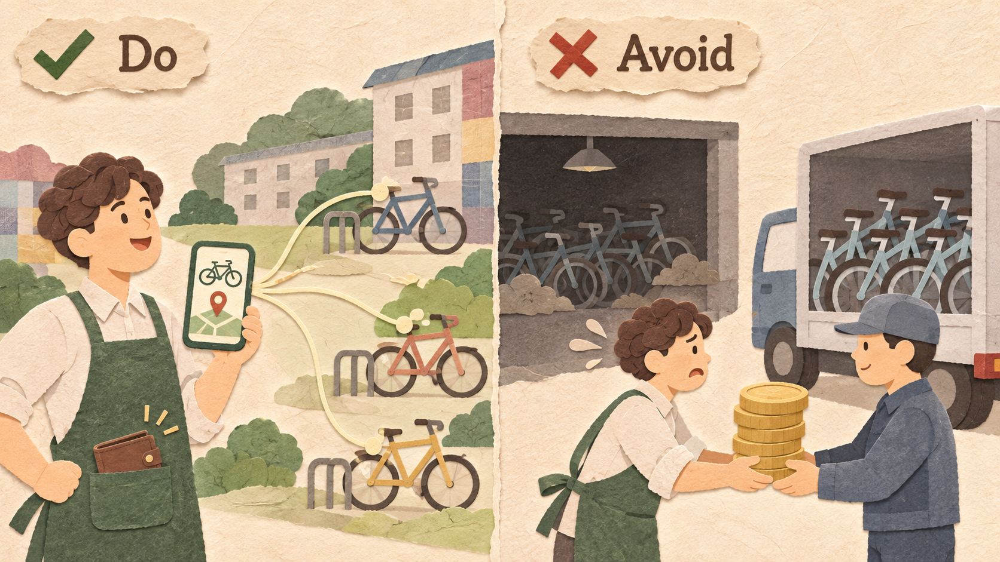

    * **Example:** 800 student bikes sit unused most of the week. CampusBikes lists them in its app instead of buying 70 new bikes.
    * **Common mistake:** Calling your business a platform but still buying or renting every asset yourself. You carry all the costs of a pipeline, even when customers stop coming.
  * **Rule 2: Help strangers trust each other.** A user will not rent a stranger's bike, and an owner will not lend it, unless both feel safe. Trust is the platform's first job.

    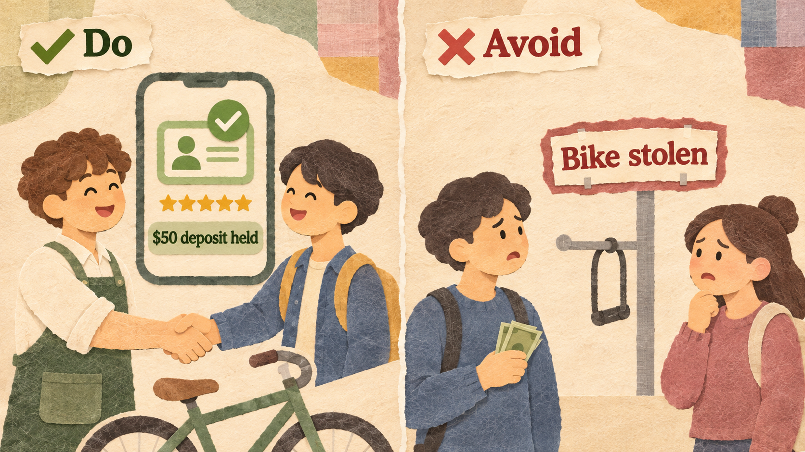

    * **Example:** CampusBikes checks every student ID, shows ratings for owners and riders, holds a $50 deposit until the bike comes back, and pays for repairs if a bike is damaged.
    * **Common mistake:** Posting a list of phone numbers and leaving the rest to users. After the first stolen bike, owners stop listing and riders stop trusting.
  * **Rule 3: Make finding, paying, and checking easy.** Each trade has costs: finding a partner, paying, and checking. The platform wins when it makes these costs much smaller than doing the trade alone.

    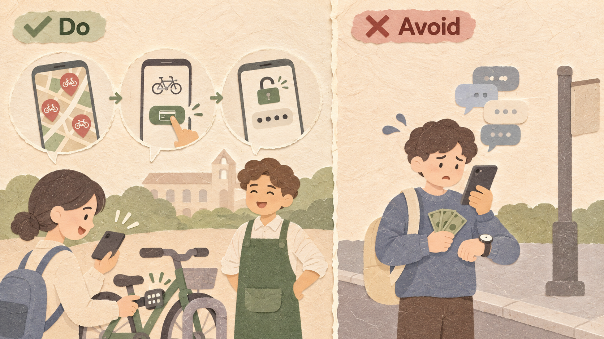

    * **Example:** The app shows nearby bikes on a map, takes payment in one tap, and gives a code for the bike lock. No meeting is needed.
    * **Common mistake:** Making users message owners, agree on a time, and meet to hand over cash. The trade takes so long that students give up.
  * **Rule 4: Keep quality high with simple rules for providers.** You do not own the product, but users blame you when it is bad. Set a few clear rules and remove providers who break them.

    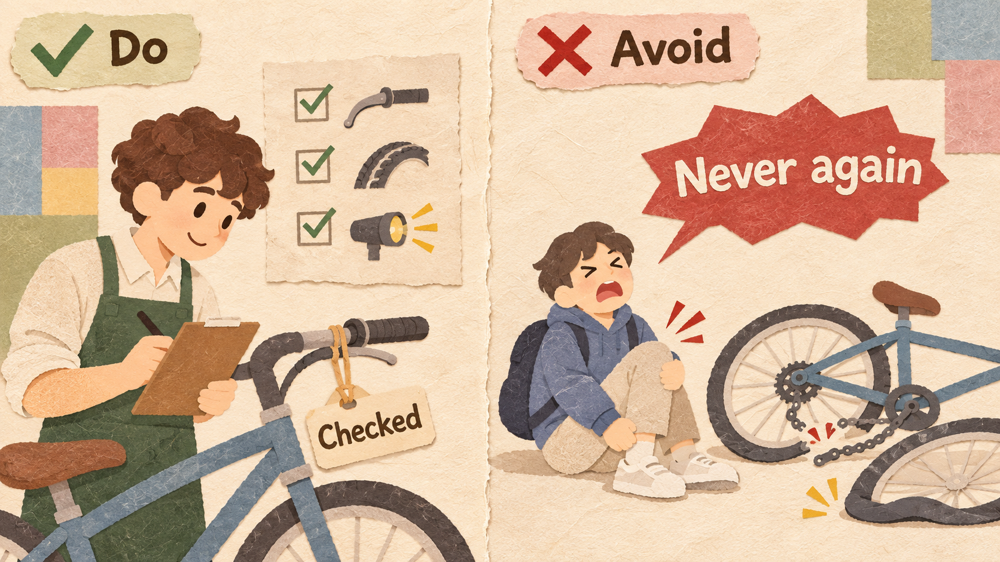

    * **Example:** Every listed bike must pass a 3-point check (brakes, tires, lights). Owners with two bad ratings are removed.
    * **Common mistake:** Letting anyone list anything. One broken bike and one angry review hurt trust in every bike on the platform.

* **Good examples (real companies):**
  * **Good example 1: Airbnb.** Airbnb owns almost no homes. It connects people who have a spare room or home with travelers. At the end of 2023 it had about 7.7 million active listings, with about 6,900 employees. A hotel company grows differently: Marriott, for example, paid about $13 billion in 2016 to buy Starwood Hotels to add more hotels.
    * **Why it is good:**
      * Hosts already owned the rooms, so Airbnb grew without buying buildings (Rule 1).
      * Reviews for hosts and guests, ID checks, and payment through the app helped strangers trust each other (Rule 2).
      * Searching, booking, and paying happen in one app (Rule 3).
  * **Good example 2: YouTube.** YouTube does not make most of its videos. People and companies upload them, and YouTube connects them with viewers and shares ad money with many creators. In 2019, YouTube said that more than 500 hours of video were uploaded every minute.
    * **Why it is good:**
      * Creators bring the videos, so YouTube grows without paying for each video up front (Rule 1).
      * Uploading and finding videos is fast and free (Rule 3).
      * Community rules remove harmful videos so viewers and advertisers keep trusting the platform (Rule 4).

* **Bad examples (real companies):**
  * **Bad example 1: WeWork.** WeWork rented office space to companies and called itself a technology company. But it signed long leases (often 10 to 15 years) on the buildings it used, while its members could leave after a month. When demand for offices fell, WeWork still had to pay rent. In November 2023 it filed for bankruptcy protection, with more than $13 billion in lease payments still owed.
    * **Why it is bad:**
      * It owned the costs like a pipeline: it rented every building itself instead of connecting space that others owned (Rule 1).
      * Its income could disappear in a month, but its costs lasted for years.
      * Calling itself a platform did not change how its business worked.
  * **Bad example 2: Bird.** Bird put electric scooters on city streets and let people rent them with an app. Bird bought or paid for the scooters itself, and many were damaged, stolen, or wore out quickly. Some cities limited or removed scooters left blocking sidewalks. In December 2023, Bird filed for bankruptcy protection.
    * **Why it is bad:**
      * Bird paid for every scooter, so each new ride area needed more money (Rule 1).
      * Scooters left lying on sidewalks angered cities and people who walk, and Bird did not control this well enough (Rule 4).
      * The app was easy to use, but an easy app could not cover the cost of owning every scooter.

* **Before the exercises: four tools you will use:**
  * **Tool 1 - Take rate:**
    * Take rate = fee per match / price x 100
    * **Example:** A parking app keeps $2 of each $10 parking booking: $2 / $10 x 100 = 20%.
  * **Tool 2 - Cost to grow: buying or connecting:**
    * Pipeline: cost to grow = number of new units x cost per unit. Platform: cost to grow = one-time cost to set up the platform (app, checks, insurance).
    * **Example:** A tool shop needs 20 more drills. Buying: 20 x $80 = $1,600. Connecting neighbors' drills: $500 once for a listing page and insurance. Buying costs $1,600 / $500 = 3.2 times more.
  * **Tool 3 - Profit over several periods:**
    * Profit = revenue per period x number of periods - one-time cost - running cost per period x number of periods
    * **Example:** A shop buys a $1,000 machine. It earns $400 a month and costs $100 a month to run. After 6 months: 6 x $400 - $1,000 - 6 x $100 = $2,400 - $1,000 - $600 = $800.
  * **Tool 4 - Trade-off and decision rule:** A **trade-off** is what you give up to get something you value more. A **decision rule** is a promise, written before you start, about which result would make you change your decision. Example: "If fewer than 30 students list a bike in the first month, we will buy 20 bikes instead."

* **Exercise 1 - Easy: Pipeline or platform? (20 min):**
  * **Scenario:** Six businesses. (a) A bakery bakes bread and sells it in its shop. (b) An app connects drivers with people who rent out their empty parking spaces. (c) A TV channel makes its own shows and sells ads. (d) A website lets students sell used clothes to each other and keeps 10% of each sale. (e) A car maker builds cars and sells them through dealers. (f) An app lets home cooks sell meals to their neighbors.
  * **Template:**

    ```text
    Business [letter]: [pipeline / platform], because it [makes or buys / connects]
    [what], and earns money from [selling its own product / a fee on each match].
    ```

  * **Worked example (two other businesses):**

    ```text
    Business: a hotel company builds hotels and rents rooms to travelers.
    Pipeline, because it builds hotels, and earns money from selling its own rooms.
    Business: a ride-hailing app connects riders with drivers who use their own cars.
    Platform, because it connects riders and drivers, and earns money from a fee on each ride.
    ```

  * **Your turn:** Fill in the template for all six businesses.
  * **Check your answer:** (a) pipeline: makes and sells its own bread. (b) platform: connects drivers with space owners and takes a fee. (c) pipeline: makes its own shows. (d) platform: connects student sellers and buyers, 10% fee. (e) pipeline: builds and sells its own cars. (f) platform: connects home cooks with neighbors.

* **Exercise 2 - Medium: Buy more, or connect? (30 min):**
  * **Scenario:** CamPro rents cameras to art students for $20 a day. It owns 20 cameras, but in project season it needs 30 more. A survey shows that 150 students own a good camera they use less than once a month. **Buying:** 30 new cameras at $400 each. **Connecting:** students list their own cameras in CamPro's app; the owner gets $15 and CamPro keeps $5 of each $20 day. Setting up the listing page, ID checks, and damage insurance costs $2,000 once.
  * **Step 1 - Calculate (Tools 1 and 2):** Take rate = $5 / $20 x 100 = ______ %. Cost to grow by buying = 30 x $400 = $______. Cost to grow by connecting = $______. Buying costs ______ times more.
  * **Step 2 - Check the four rules:** Use the template.
  * **Template:**

    ```text
    Rule 1 (idle resources): [number] people own [what] they rarely use. [strong / weak], because [reason].
    Rule 2 (trust): we will use [trust tools].
    Rule 3 (easy trade): finding, paying, and checking will be easy because [how].
    Rule 4 (quality): every [item] must [simple rule].
    Verdict: [connect / buy], because [one sentence with a number].
    ```

  * **Worked example (ToolTown, a hardware store that rents drills for $10 a day and needs 20 more; buying costs 20 x $80 = $1,600; connecting neighbors' drills costs $500 once, and ToolTown keeps $2 of each $10 day):**

    ```text
    Rule 1 (idle resources): 200 neighbors own a drill they use a few times a year.
    Strong, because most drills sit in a box almost all year.
    Rule 2 (trust): we will use ID checks, ratings, and a $30 deposit.
    Rule 3 (easy trade): finding, paying, and checking will be easy because renters
    book and pay in the app and pick up the drill at our store.
    Rule 4 (quality): every drill must be charged and tested at our counter.
    Verdict: connect, because it costs $500 instead of $1,600, and the take rate is 20%.
    ```

  * **Your turn:** Fill in the template for CamPro.
  * **Check your answer:** Take rate = **25%**. Buying = **$12,000**; connecting = **$2,000**; buying costs **6 times** more. Rule 1 is strong: 150 students own a camera they rarely use. A strong answer names trust tools (ID checks, ratings, a deposit, damage insurance), one way to make the trade easy (book and pay in the app, pick up at the shop), and one quality rule (for example, every camera is tested at the counter). A "connect" verdict is reasonable. A careful answer also names the risk: students may not want to lend an expensive camera, so the damage insurance must be clear.

* **Exercise 3 - Hard: Should CampusBikes buy bikes or become a platform? (50 min, including 2-minute presentations):**
  * **Scenario:** Return to Leo and CampusBikes. Over the next two years (24 months, of which 8 are busy months), Leo wants to serve the 70 students a day who are turned away. In a busy month, each extra bike is rented on about 20 days. Leo has two options.
    * **Option A - Buy 70 bikes (pipeline):** 70 new bikes at $300 each, plus $15 a month per bike for repair and storage, every month for 24 months. CampusBikes keeps the full $5 a day.
    * **Option B - Connect student bikes (platform):** Students list their own bikes in the CampusBikes app. The owner gets $4 and CampusBikes keeps $1 of each $5 day. Setting up ID checks, the deposit system, and insurance costs $3,000 once, plus $100 a month for insurance and support.
  * **Step 1 - Calculate (use Tools 1 and 3):**
    * Take rate in Option B = $1 / $5 x 100 = ______ %.
    * Bike-days in busy months = 70 x 20 x 8 = ______.
    * Option A: revenue = bike-days x $5 = $______; costs = 70 x $300 + 70 x $15 x 24 = $______; profit = $______.
    * Option B: revenue = bike-days x $1 = $______; costs = $3,000 + $100 x 24 = $______; profit = $______.
    * If only half as many students want a bike: Option A profit = $______; Option B profit = $______.
  * **Step 2 - Write a 3-bullet memo to Leo (use Tool 4):**
  * **Template:**

    ```text
    To: [owner name], [company]
    1. Decision and evidence: We should choose [option] because [the rule it follows]
       and [one number from your calculation].
    2. Biggest risk and trade-off: The weakest point is [risk]. We give up [what we lose]
       to gain [what we protect or win].
    3. Next step and decision rule: In the next busy month we will [one action] and measure [one number].
       We will change this decision if [result].
    ```

  * **Worked example (CamPro from Exercise 2):**

    ```text
    To: Mia Park, owner, CamPro
    1. Decision and evidence: We should connect students' cameras, because 150 students
       own a camera they rarely use (Rule 1) and connecting costs $2,000 against
       $12,000 for buying.
    2. Biggest risk and trade-off: The weakest point is that owners may fear damage
       to an expensive camera. We give up the full $20 a day on new cameras to avoid
       $12,000 of cameras that sit unused outside project season.
    3. Next step and decision rule: In the next project season we will open listings
       with damage insurance and measure how many cameras are listed. We will change
       this decision if fewer than 15 cameras are listed in the first two weeks.
    ```

  * **Your turn:** Write the memo for CampusBikes. Then give a 2-minute presentation using your three bullets.
  * **Check your answer:**
    * Take rate = **20%**. Bike-days = 70 x 20 x 8 = **11,200**.
    * Option A: revenue = 11,200 x $5 = $56,000; costs = $21,000 + $25,200 = $46,200; profit = **$9,800**.
    * Option B: revenue = 11,200 x $1 = $11,200; costs = $3,000 + $2,400 = $5,400; profit = **$5,800**.
    * Half the demand (5,600 bike-days): Option A = $28,000 - $46,200 = **-$18,200** (a large loss, because the bikes and repairs must be paid anyway). Option B = $5,600 - $5,400 = **$200** (still no loss).
    * Where Option A stops winning: Option A beats Option B only if demand is at least about 91% of the expected level, because A gains $44,800 more revenue at full demand but has $40,800 more costs ($46,200 - $5,400 = $40,800; $40,800 / $44,800 = 0.91).
    * Option A earns $4,000 more only if almost every expected rental happens; Option B earns a little less but cannot lose much, and it can grow beyond 70 bikes at no extra cost because 800 students own bikes. Both choices can be strong. A memo for Option B should point to the idle bikes (Rule 1) and the trust tools (Rule 2), name the risk that few students list bikes, and give a decision rule such as "If fewer than 70 bikes are listed by the second busy month, we will buy 30 bikes." A memo for Option A should explain why Leo is sure that demand will stay high.

* **Success check:** You can (1) explain the difference between a pipeline and a platform with the words provider, user, asset, and take rate, (2) compare the cost of growing by buying with the cost of growing by connecting, and (3) compare a pipeline plan with a platform plan over several periods and write a decision rule.

* **References:**
  * Van Alstyne, M. W., Parker, G. G., & Choudary, S. P. (2016). [Pipelines, platforms, and the new rules of strategy](https://hbr.org/2016/04/pipelines-platforms-and-the-new-rules-of-strategy). *Harvard Business Review*, 94(4), 54-62.
  * Coase, R. H. (1937). [The nature of the firm](https://doi.org/10.1111/j.1468-0335.1937.tb00002.x). *Economica*, 4(16), 386-405.
  * Airbnb (2024). [Fourth quarter and full-year 2023 financial results](https://investors.airbnb.com/). Active listings and employees.
  * Tubefilter (2019, May 7). [More than 500 hours of content are now being uploaded to YouTube every minute](https://www.tubefilter.com/2019/05/07/number-hours-video-uploaded-to-youtube-per-minute/).
  * CNBC (2023, December 20). [Electric scooter company Bird files for bankruptcy](https://www.cnbc.com/2023/12/20/electric-scooter-company-bird-files-for-bankruptcy-.html). WeWork: GlobeSt (2023, November 7). [WeWork files for Chapter 11](https://globest.com/2023/11/07/wework-files-for-chapter-11-continues-lease-negotiations-with-a-stronger-hand).

---

<a id="session-1-2"></a>
### Session 1.2: The Network Effect Strategy

**Strategy of this session: Network Effect Strategy**


* **Lecture Presentation:** [Download Slides (PDF)](slides/session_1_2_lecture.pdf)

* **Duration:** 3 hours: 50-minute lesson, 10-minute break, Exercise 1 (20 min) and Exercise 2 (30 min), 10-minute break, Exercise 3 with short presentations (50 min), and 10-minute wrap-up.
* **Situation:** Tomás runs ClassChat, a free app where students in the same class chat, share notes, and ask each other questions before exams. ClassChat has 3,000 users, but they are spread over 300 classes, so a class of 60 students has only about 10 users. Most students open the app, see an almost empty class, and leave. Last semester Tomás tested something: in 5 classes where at least 30 students joined, 80% of users came back every week. In classes with fewer than 30 users, only 15% came back. Tomás has $6,000 to spend on growth this semester.

  | ClassChat (this semester) | Value |
  |---|---|
  | Users | 3,000 |
  | Classes with at least one user | 300 |
  | Students in a typical class | 60 |
  | Users in a typical class | 10 |
  | Weekly active rate, classes with 30 or more users | 80% |
  | Weekly active rate, classes with fewer than 30 users | 15% |
  | Money to spend on growth | $6,000 |

* **The strategy in one paragraph:** The network effect strategy is a way to grow a product that becomes more useful for each user when more people use it. A chat app is useless if none of your friends use it and very useful if all of them do. This creates a problem: nobody wants to join first, and an almost empty product loses its first users. So the strategy is to **fill one small group first** until the product is clearly useful there (critical mass), give early users a reason to stay even before the group is full, help people join together, and check with data that each new user really makes the product better for others. Then you move on to the next group. Use this strategy when users get value from each other, not only from the product itself.

* **Goal:** Apply the Network Effect Strategy: find whether a product has a network effect, measure density and activity to find critical mass, and decide where to focus growth.

* **Words you need first:**
  * **Network effect:** When a product becomes more useful for each user as more people use it. Example: a chat app is more useful when more of your classmates use it.
  * **Direct network effect:** Users get value from other users of the **same** group. Example: chat app users want other chat app users. (Session 1.3 covers platforms with two different groups.)
  * **Critical mass:** The number of users at which a product becomes useful enough that people stay and invite others. Example: in ClassChat, about 30 of the 60 students in a class.
  * **Penguin problem:** Everyone waits for someone else to join first, so nobody joins. The name comes from penguins on the ice that wait for one penguin to jump into the water first.
  * **Density:** How full a group is. Density = users in the group / people in the group x 100. Example: 12 users in a class of 60: 12 / 60 x 100 = 20%.
  * **Standalone value:** The value a user gets even when no one else uses the product. Example: a note app that organizes your own class notes is useful even if no classmate joins.
  * **Weekly active rate:** The share of users who use the product at least once a week. Weekly active rate = weekly active users / all users x 100. Example: 45 of 300 users: 15%.

* **The four rules of the Network Effect Strategy (Hour 1 - 50 minutes):**
  * **Rule 1: Fill one small group first.** A product feels alive when a group is full, not when many groups each have a few users. Win one group, then the next.

    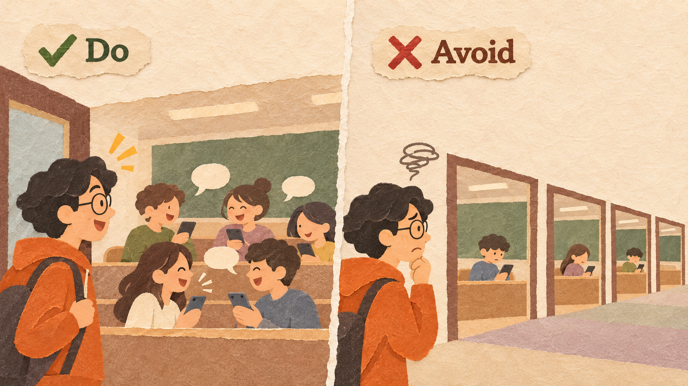

    * **Example:** ClassChat spends its budget on the 40 first-year business classes, so most students in those classes join at the same time.
    * **Common mistake:** Advertising to the whole campus. Users are spread thin (10 in every class), so no class feels alive, and new users leave.
  * **Rule 2: Give the first user value even when they are alone.** Early users join an almost empty product. Give them a reason to stay until their friends arrive.

    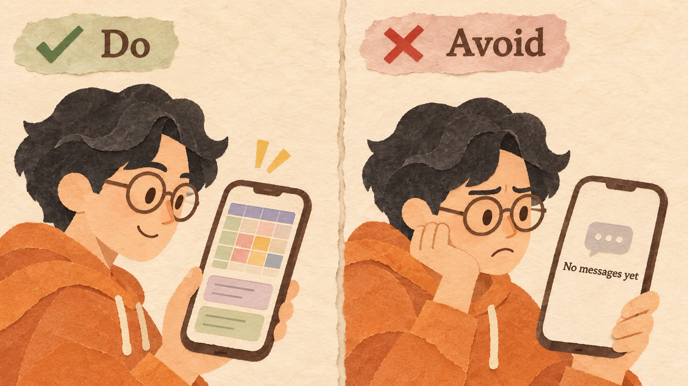

    * **Example:** ClassChat organizes each student's own class timetable and notes, so it is useful from the first day, even before classmates join.
    * **Common mistake:** A product that is useless until friends arrive. The first users find nothing to do and delete the app before their friends ever come.
  * **Rule 3: Help the first penguins jump together.** People join when they see others join. Bring a whole group in at the same moment, and make it easy to invite others.

    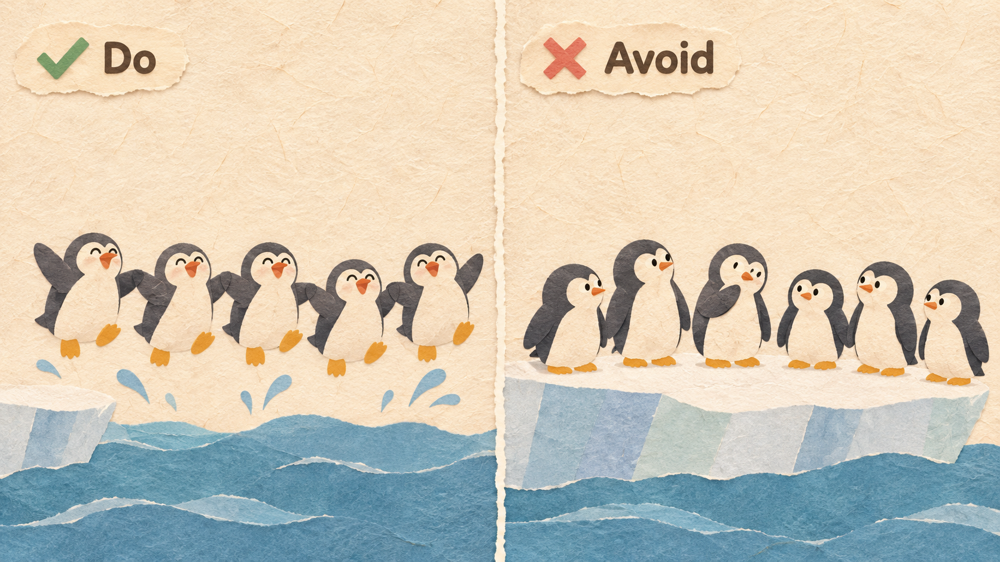

    * **Example:** A class ambassador asks everyone to join ClassChat in the first lecture of the semester, so 40 students join on the same day.
    * **Common mistake:** Letting people join one by one, or limiting invitations so that friends cannot get in. Each person waits for the others, and nobody stays.
  * **Rule 4: Check that each new user makes the product better for others.** Do not count downloads only. Measure whether fuller groups are more active. If they are not, there is no real network effect.

    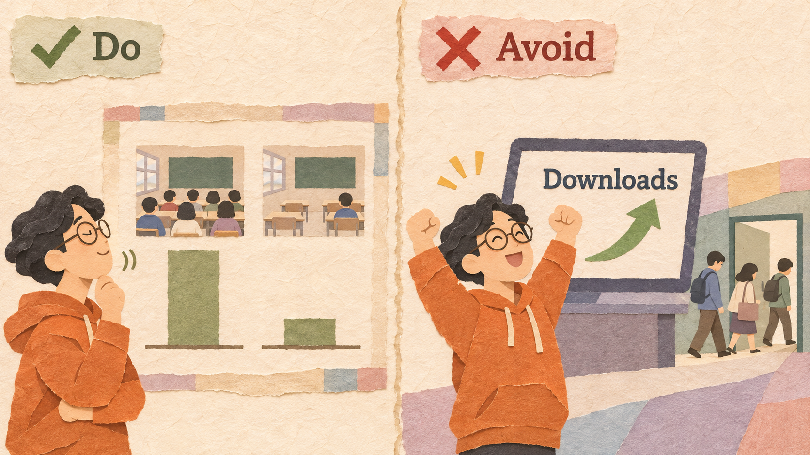

    * **Example:** ClassChat compares classes: 80% weekly active where 30 or more students joined, 15% where fewer joined. More users really do make it better.
    * **Common mistake:** Celebrating downloads. Many people may install the app once and never come back.

* **Good examples (real companies):**
  * **Good example 1: Facebook.** Facebook started on February 4, 2004, open only to Harvard students. A month later it opened to just three more universities (Columbia, Stanford, and Yale) and then to other universities one by one, before opening to everyone in 2006.
    * **Why it is good:**
      * It filled one university at a time, so each campus was quickly full of real friends (Rule 1).
      * Students at a campus joined together, often in the same week, because their friends had just joined (Rule 3).
      * It opened a new campus only when the earlier ones were active, so each new user found friends already there (Rule 4).
  * **Good example 2: Sony PlayStation 3 and Blu-ray.** Around 2006, two new movie-disc formats competed: Blu-ray (Sony) and HD DVD (Toshiba). Buyers and film studios waited to see which would win (a penguin problem). Sony put a Blu-ray player inside every PlayStation 3. About 10.5 million PS3s were sold by early 2008, Warner Bros. chose Blu-ray only, and in February 2008 Toshiba stopped making HD DVD.
    * **Why it is good:**
      * Every PS3 buyer became a Blu-ray owner at once, so millions jumped together (Rule 3).
      * The PS3 was useful as a game console even without Blu-ray movies (Rule 2).
      * More Blu-ray owners made film studios choose Blu-ray, which made Blu-ray more useful for every owner.

* **Bad examples (real companies):**
  * **Bad example 1: Google Wave.** Google Wave was a new tool for writing and chatting together online. In September 2009, Google opened it to about 100,000 invited users. Most people could not invite their friends or coworkers, so they had few people to use it with, and many did not understand what to use it for. In August 2010, Google stopped developing it.
    * **Why it is bad:**
      * Invitations were limited, so users could not bring the people they worked with (Rule 3).
      * A tool for working together is useless alone, and Wave gave little value to one user (Rule 2).
      * Users were spread over the whole world instead of whole teams joining together (Rule 1).
  * **Bad example 2: Clubhouse.** Clubhouse is an app for live audio conversations. In early 2021 it grew very fast; by mid-April 2021 it had about 14 million downloads. But many users found few good live rooms when they opened it, other apps quickly added live audio, and use fell sharply. In April 2023, Clubhouse cut more than half of its staff.
    * **Why it is bad:**
      * Growth was measured by downloads, not by whether users came back to better rooms (Rule 4).
      * When no interesting room was live, the app gave a user nothing to do (Rule 2).
      * Users could easily listen on other apps too, so a bigger network did not keep them (more in Session 1.4).

* **Before the exercises: four tools you will use:**
  * **Tool 1 - Density:**
    * Density = users in the group / people in the group x 100
    * **Example:** A dorm has 200 students, and 50 use a laundry-sharing app: 50 / 200 x 100 = 25%.
  * **Tool 2 - Weekly active rate:**
    * Weekly active rate = weekly active users / all users x 100
    * **Example:** 50 users, 35 use it every week: 35 / 50 x 100 = 70%.
  * **Tool 3 - Cost per new user:**
    * Cost per new user = money spent / new users
    * **Example:** A game spends $2,000 on ads and gets 500 new players: $2,000 / 500 = $4.00.
  * **Tool 4 - Trade-off and decision rule (from Session 1.1):** A **trade-off** is what you give up to get something you value more. A **decision rule** is a promise, written before you start, about which result would make you change your decision. Example: "If fewer than 30 students in a class join by week 3, we will stop spending in that class."

* **Exercise 1 - Easy: Is there a network effect? (20 min):**
  * **Scenario:** Six products. (a) A messaging app. (b) A calculator app. (c) An online game where players play against each other. (d) A flashlight app. (e) A language-exchange app that matches learners who teach each other. (f) A paid photo-editing app.
  * **Template:**

    ```text
    Product [letter]: [network effect / no network effect], because when one more user joins,
    [who gains what / nobody else gains anything].
    ```

  * **Worked example (two other products):**

    ```text
    Product: a video-call app.
    Network effect, because when one more user joins, everyone who knows that person
    can now call them.
    Product: an alarm clock app.
    No network effect, because when one more user joins, nobody else gains anything.
    ```

  * **Your turn:** Fill in the template for all six products.
  * **Check your answer:** (a) network effect: more people you can message. (b) no network effect. (c) network effect: more players to play with, and faster matches. (d) no network effect. (e) network effect: more partners for each language. (f) no network effect: the app works the same for each user (a shared filter collection would be a weak exception).

* **Exercise 2 - Medium: Find critical mass (30 min):**
  * **Scenario:** GymBuddy is an app that helps gym members find a workout partner. It works in five gyms.

    | Gym | Members | GymBuddy users | Weekly active users |
    |---|---|---|---|
    | A | 400 | 40 | 6 |
    | B | 500 | 200 | 150 |
    | C | 300 | 150 | 105 |
    | D | 600 | 60 | 9 |
    | E | 200 | 30 | 6 |

  * **Step 1 - Calculate (Tools 1 and 2):** For each gym, density = users / members x 100 and weekly active rate = weekly active users / users x 100.
  * **Step 2 - Find critical mass:** At what density does the weekly active rate jump?
  * **Step 3 - Choose the next gym:** How many more users does each low gym need to reach that density? Which gym is cheapest to fill?
  * **Template:**

    ```text
    Critical mass is about [number]% density, because gyms above it have [number]% weekly active
    users and gyms below it have only [number]%.
    We should focus on [gym] next, because it needs only [number] more users to reach critical mass.
    We will use Rule [number]: [one action].
    ```

  * **Worked example (StudyBuddy, a study-partner app in four dorms: Dorm 1 has 300 students, 150 users, 120 weekly active; Dorm 2 has 400, 40 users, 8 weekly active; Dorm 3 has 100, 10 users, 2 weekly active; Dorm 4 has 200, 100 users, 75 weekly active):**

    ```text
    Critical mass is about 50% density, because dorms above it have 75-80% weekly active
    users and dorms below it have only 20%.
    We should focus on Dorm 3 next, because it needs only 40 more users to reach critical mass
    (Dorm 2 needs 160).
    We will use Rule 3: invite a whole floor to a study night on the same evening.
    ```

  * **Your turn:** Fill in the template for GymBuddy.
  * **Check your answer:**
    * Density: A **10%**, B **40%**, C **50%**, D **10%**, E **15%**. Weekly active rate: A **15%**, B **75%**, C **70%**, D **15%**, E **20%**.
    * Critical mass is about **40% density**: gyms at 40% or more have 70-75% weekly active users; gyms at 15% or less have 15-20%.
    * Users needed to reach 40%: A needs 160 - 40 = **120**; D needs 240 - 60 = **180**; E needs 80 - 30 = **50**. Focus on **Gym E**.
    * A strong answer names one action, such as a "find a partner" week where a whole class or team at Gym E joins together (Rule 3).

* **Exercise 3 - Hard: Where should ClassChat spend $6,000? (50 min, including 2-minute presentations):**
  * **Scenario:** Return to Tomás and ClassChat (3,000 users, 300 classes of 60 students, about 10 users in each class; 80% weekly active in classes with 30 or more users, 15% in classes with fewer). Both options cost $6,000 and are expected to bring 1,500 new users.
    * **Option A - Ads for the whole campus:** Online ads to all students. The 1,500 new users spread evenly over all 300 classes.
    * **Option B - Fill 40 classes first:** Pay a student ambassador $100 in each of the 40 first-year business classes ($4,000) and hold a launch event ($2,000). All 1,500 new users join in those 40 classes. The 40 classes now have 400 users (10 each).
  * **Step 1 - Calculate (use Tools 1, 2, and 3):**
    * Cost per new user in both options = $6,000 / 1,500 = $______.
    * Now: weekly active users = 3,000 x 15% = ______.
    * Option A: users per class = 4,500 / 300 = ______; density = ______ %; weekly active users = 4,500 x ______ % = ______.
    * Option B: users per class in the 40 classes = (400 + 1,500) / 40 = ______; weekly active users there = 1,900 x ______ % = ______; in the other 260 classes = 2,600 x 15% = ______; total = ______.
    * How many new users does Option B need so that the 40 classes reach 30 users each? 40 x 30 - 400 = ______.
  * **Step 2 - Write a 3-bullet memo to Tomás (use Tool 4):**
  * **Template:**

    ```text
    To: [founder name], [company]
    1. Decision and evidence: We should choose [option] because [the rule it follows]
       and [one number from your calculation].
    2. Biggest risk and trade-off: The weakest point is [risk]. We give up [what we lose]
       to gain [what we protect or win].
    3. Next step and decision rule: In the first weeks we will [one action] and measure [one number].
       We will change this decision if [result].
    ```

  * **Worked example (GymBuddy from Exercise 2):**

    ```text
    To: Sam Lee, founder, GymBuddy
    1. Decision and evidence: We should focus next month's budget on Gym E, because
       gyms at 40% density have 70-75% weekly active users (Rule 4) and Gym E needs
       only 50 more users to get there (Rule 1).
    2. Biggest risk and trade-off: The weakest point is that Gym E is small, so it adds
       few users. We give up faster growth in user numbers to make one more gym truly active.
    3. Next step and decision rule: In the next four weeks we will run a "find a partner"
       week at Gym E and measure density. We will change this decision if Gym E is still
       below 30% density after four weeks.
    ```

  * **Your turn:** Write the memo for ClassChat. Then give a 2-minute presentation using your three bullets.
  * **Check your answer:**
    * Cost per new user = **$4.00** in both options: the cost is the same, so the difference is where the users go.
    * Now: 3,000 x 15% = **450** weekly active users.
    * Option A: 4,500 / 300 = **15** users per class; density = 15 / 60 = **25%** (below critical mass); weekly active = 4,500 x 15% = **675**.
    * Option B: (400 + 1,500) / 40 = **47.5** users per class (above 30); 1,900 x 80% = 1,520; plus 2,600 x 15% = 390; total = **1,910** weekly active users, almost 3 times Option A.
    * Option B works only if the 40 classes reach 30 users each: 40 x 30 - 400 = **800** new users are needed there. If only 600 join, each class has 25 users, and weekly active users fall to 3,600 x 15% = 540, below Option A.
    * Option B is the stronger choice (Rules 1 and 3), as long as the ambassadors bring at least 800 new users. A strong memo names that risk and gives a decision rule such as "If fewer than 20 students in a class join by week 3, we will move that class's ambassador budget to another class."

* **Success check:** You can (1) explain network effects, critical mass, and the penguin problem, (2) measure density and weekly activity to find critical mass, and (3) compare a "spread wide" plan with a "fill one group first" plan and write a decision rule.

* **References:**
  * Katz, M. L., & Shapiro, C. (1985). [Network externalities, competition, and compatibility](https://www.jstor.org/stable/1814809). *American Economic Review*, 75(3), 424-440.
  * Farrell, J., & Saloner, G. (1986). [Installed base and compatibility: Innovation, product preannouncements, and predation](https://www.jstor.org/stable/1816461). *American Economic Review*, 76(5), 940-955. (The "penguin effect".)
  * Harvard Magazine (2019). [How Facebook escaped Harvard](https://www.harvardmagazine.com/technology/harvard-facebook-history-mark-zuckerberg-winklevoss).
  * The Japan Times (2008, February 20). [It's official: Toshiba pulls plug on HD DVD](https://www.japantimes.co.jp/news/2008/02/20/business/its-official-toshiba-pulls-plug-on-hd-dvd).
  * eWeek (2010, August). [Google cancels Wave, will port it to other apps](https://www.eweek.com/enterprise-apps/google-cancels-wave-will-port-it-to-other-apps/). CNBC (2023, April 27). [Clubhouse layoffs](https://www.cnbc.com/2023/04/27/clubhouse-layoffs-app-reached-4-billion-valuation-during-pandemic.html).

---

<a id="session-1-3"></a>
### Session 1.3: The Two-Sided Market Strategy

**Strategy of this session: Two-Sided Market Strategy**


* **Lecture Presentation:** [Download Slides (PDF)](slides/session_1_3_lecture.pdf)

* **Duration:** 3 hours: 50-minute lesson, 10-minute break, Exercise 1 (20 min) and Exercise 2 (30 min), 10-minute break, Exercise 3 with short presentations (50 min), and 10-minute wrap-up.
* **Situation:** Kenji runs RoomLink, an app that connects students who need a room near campus with local landlords. Students use it for free. When a room is rented through RoomLink, the landlord pays RoomLink a fee of $150. This semester, 2,000 students searched for a room, but only 40 rooms were listed, and 24 of them were rented. Most students found nothing and left the app. There are 300 landlords within 2 km of campus, but most of them still use a real-estate agent or a sign in the window. Kenji has $10,000 to spend over the next two semesters.

  | RoomLink (this semester) | Value |
  |---|---|
  | Students searching for a room | 2,000 |
  | Rooms listed | 40 |
  | Rooms rented through RoomLink | 24 (60% of listed rooms) |
  | Students who found nothing and left the app | 1,200 |
  | Landlords within 2 km of campus | 300 |
  | Fee the landlord pays per room rented | $150 |
  | Money to spend over two semesters | $10,000 |

* **The strategy in one paragraph:** The two-sided market strategy is a way to start and grow a platform that serves **two different groups who need each other**, such as students and landlords, or riders and drivers. Each group comes only if the other group is already there: students come for rooms, and landlords list rooms only where students look. This is the **chicken-and-egg problem**. The strategy solves it in order: first win the side that is harder to get, give that side value even before the other side arrives, do the hard work yourself in one small area at the start, and then give both sides a reason to finish their deal on your platform instead of going around it. Use this strategy when your business connects two groups and neither group comes without the other. (Who should pay, and how much, is the topic of Session 2.2.)

* **Goal:** Apply the Two-Sided Market Strategy: name the two sides, find the harder side, measure the balance between the sides, and decide which side to grow first.

* **Words you need first:**
  * **Two-sided market:** A market where a platform serves two different groups who need each other. Example: RoomLink serves students (one side) and landlords (the other side).
  * **Cross-side network effect:** When more users on one side make the platform more useful for the other side. Example: more rooms listed make RoomLink more useful for students. (In Session 1.2, users gained from users of the same group.)
  * **Chicken-and-egg problem:** Each side waits for the other side to come first, so neither comes. Example: students do not search where there are no rooms; landlords do not list where no students search.
  * **Harder side:** The side that is harder to win and that the other side comes for. Example: rooms are scarce; students are many. Landlords are the harder side.
  * **Seeding:** Doing the work of one side yourself at the start, so the other side finds something. Example: Kenji photographs rooms and writes the listings for landlords.
  * **Match rate:** The share of searches or listings that end in a deal. Match rate = deals / listings x 100. Example: 24 rooms rented / 40 rooms listed x 100 = 60%.
  * **Multi-homing:** Using several platforms at the same time. Example: a landlord lists a room on RoomLink and with a real-estate agent.
  * **Going around the platform:** When the two sides meet on the platform but finish the deal directly, so the platform earns nothing. Example: a student and a landlord exchange phone numbers and sign the lease without RoomLink.

* **The four rules of the Two-Sided Market Strategy (Hour 1 - 50 minutes):**
  * **Rule 1: Win the harder side first.** Ask: "Which side does the other side come for, and which side is harder to get?" Spend first on that side. More of the easy side does not help when the hard side is missing.

    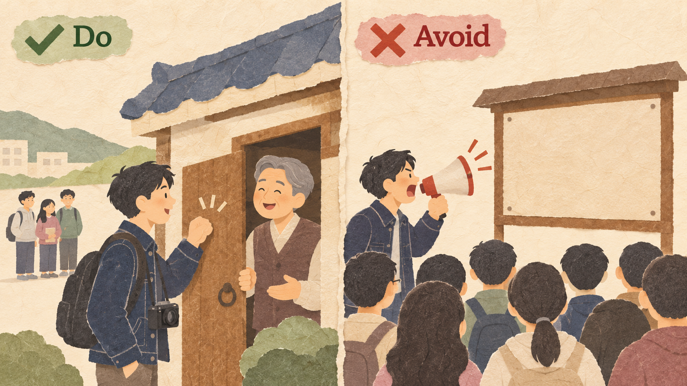

    * **Example:** Kenji spends his time and money on landlords, because 2,000 students already search but only 40 rooms are listed.
    * **Common mistake:** Buying ads to bring more students when there are almost no rooms. They find nothing, leave, and tell their friends the app is empty.
  * **Rule 2: Give the first side value even before the other side arrives.** The harder side will join if the platform helps them today, even with few users on the other side.

    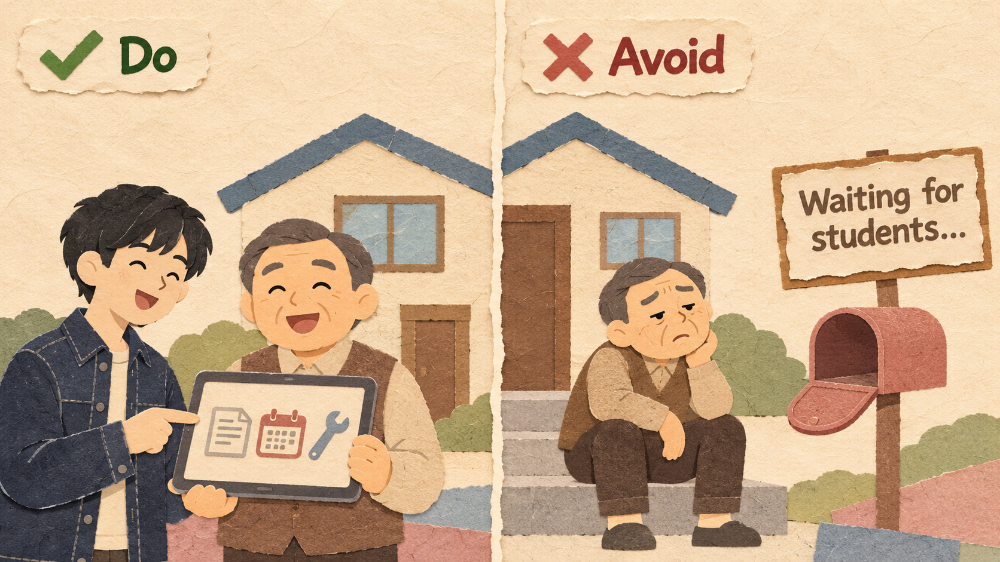

    * **Example:** RoomLink gives landlords a free tool for leases, rent reminders, and repair requests, which they can use for their current tenants, even before new students arrive.
    * **Common mistake:** Asking landlords to list a room and then wait. If no student contacts them soon, they forget the app.
  * **Rule 3: Do the hard work yourself, in one small area.** At the start, do what users will later do alone: write listings, take photos, answer questions. Start in one small area so both sides meet quickly.

    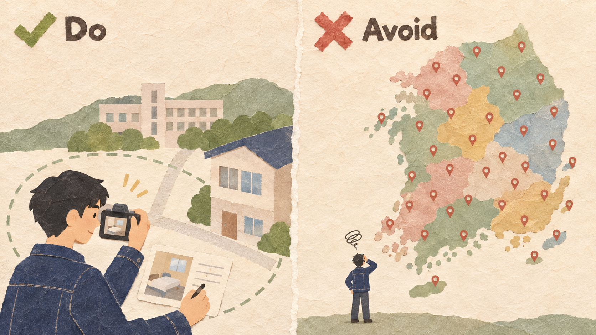

    * **Example:** Kenji visits landlords within 1 km of campus, takes the photos, and writes the listings himself.
    * **Common mistake:** Launching in the whole city at once. Rooms and students are spread so thin that few of them ever meet.
  * **Rule 4: Give both sides a reason to finish the deal on your platform.** If the platform only introduces people, they will go around it to skip the fee. Add value that works only when the deal is done on the platform.

    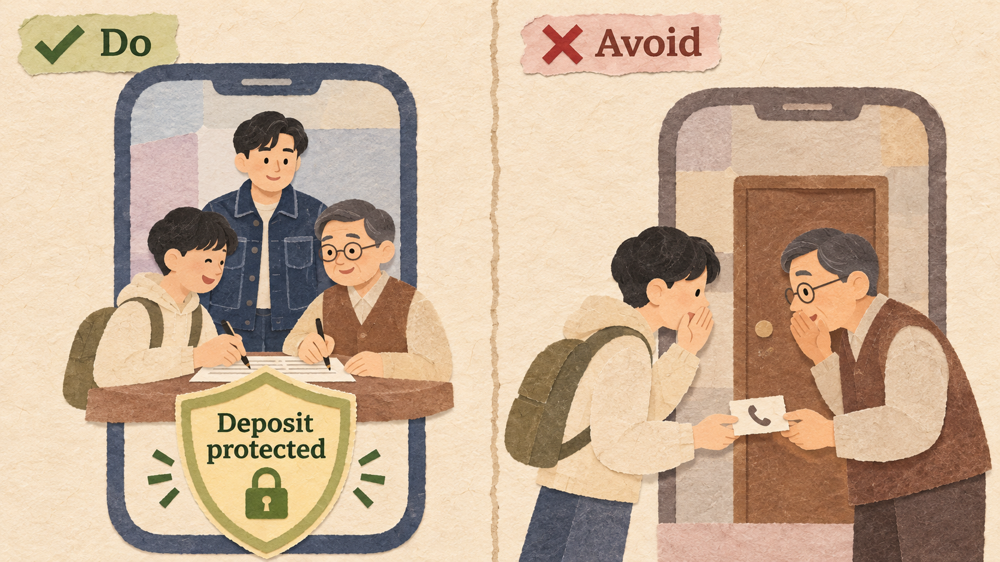

    * **Example:** When the lease is signed on RoomLink, the student's deposit is protected, the lease is checked, and repair requests are handled in the app.
    * **Common mistake:** Offering nothing after the introduction. Students and landlords exchange phone numbers and sign the lease without RoomLink.

* **Good examples (real companies):**
  * **Good example 1: OpenTable.** OpenTable started in San Francisco in 1998 to let diners book restaurant tables online. It first gave restaurants software to manage their own reservations and tables, which helped them even when few diners booked online. Diners book for free; restaurants pay OpenTable. In 2014, Priceline (now Booking Holdings) bought OpenTable for about $2.6 billion.
    * **Why it is good:**
      * It won restaurants first, because diners come where the restaurants are (Rule 1).
      * Its table software was useful to restaurants even with few online diners (Rule 2).
      * It started in one city before moving to others (Rule 3).
  * **Good example 2: DoorDash.** In January 2013, four Stanford students started a food-delivery website for Palo Alto, called PaloAltoDelivery.com. They put local restaurant menus online and delivered the first orders themselves. By 2023, DoorDash had become the largest food-delivery company in the United States.
    * **Why it is good:**
      * The founders did the work of the drivers themselves at the start (Rule 3).
      * They started in one small town, so restaurants, eaters, and drivers met quickly (Rule 3).
      * Restaurants got new orders without doing anything new, so they were happy to be listed (Rule 2).

* **Bad examples (real companies):**
  * **Bad example 1: Homejoy.** Homejoy connected people who wanted their home cleaned with cleaners. It attracted customers with very cheap first cleanings, but many did not book again at the normal price. Former employees said that good cleaners and regular customers often made private arrangements and stopped using the app. Homejoy also faced lawsuits about how it treated its workers. It closed in July 2015.
    * **Why it is bad:**
      * After the first match, customers and cleaners had little reason to keep using Homejoy, so they went around it (Rule 4).
      * Cheap first offers brought customers who did not stay (more in Session 1.4).
      * It expanded to many cities before each city worked well (Rule 3).
  * **Bad example 2: Google Helpouts.** In November 2013, Google launched Helpouts, where experts gave live video help (for example, cooking, guitar, or computer help) for a fee. It covered many different topics at once. In February 2015, Google said that Helpouts had not grown as fast as expected and closed it in April 2015.
    * **Why it is bad:**
      * Experts waited for customers who did not come, and the service gave experts little value while they waited (Rule 2).
      * It covered many topics at once, so in each topic there were few experts and few users (Rule 3).
      * Google did not first decide which side was harder to win in each topic (Rule 1).

* **Before the exercises: four tools you will use:**
  * **Tool 1 - Balance between the sides:**
    * Balance = users on the demand side / providers on the supply side
    * **Example:** A pet-sitting app has 300 pet owners searching and 60 sitters: 300 / 60 = 5 owners per sitter.
  * **Tool 2 - Match rate:**
    * Match rate = deals / searches (or listings) x 100
    * **Example:** 120 bookings from 300 pet owners searching: 120 / 300 x 100 = 40%.
  * **Tool 3 - Profit over several periods (from Session 1.1):**
    * Profit = extra revenue per period x number of periods - cost
    * **Example:** A plan costs $3,000 and adds $1,000 a month. After 6 months: 6 x $1,000 - $3,000 = $3,000.
  * **Tool 4 - Trade-off and decision rule (from Session 1.1):** A **trade-off** is what you give up to get something you value more. A **decision rule** is a promise, written before you start, about which result would make you change your decision. Example: "If fewer than 30 new rooms are listed in the first two months, we will change the plan."

* **Exercise 1 - Easy: Name the two sides (20 min):**
  * **Scenario:** Six platforms. (a) A ride-hailing app. (b) A video game console. (c) A phone app store. (d) An online market for handmade goods. (e) A free newspaper. (f) A credit card.
  * **Template:**

    ```text
    Platform [letter]: side 1 = [group], side 2 = [group].
    More [side 1] attracts more [side 2] because [reason].
    Harder side to win first: [group], because [reason].
    ```

  * **Worked example (two other platforms):**

    ```text
    Platform: a hotel booking website.
    Side 1 = travelers, side 2 = hotels. More hotels attract more travelers because
    travelers want many choices. Harder side to win first: hotels, because travelers
    come only where many hotels are listed.
    Platform: a job website.
    Side 1 = job seekers, side 2 = employers. More job seekers attract more employers
    because employers want many candidates. Harder side to win first: employers,
    because there are many job seekers but few good job openings.
    ```

  * **Your turn:** Fill in the template for all six platforms.
  * **Check your answer:** (a) riders and drivers; harder side: drivers (riders come where cars arrive fast). (b) players and game makers; harder side: game makers (players buy a console for its games). (c) phone users and app developers; harder side: developers. (d) buyers and makers; harder side: makers (buyers come for products). (e) readers and advertisers; harder side: readers (advertisers pay to reach readers). (f) shoppers and stores; harder side: stores (a card is useful only where stores accept it). Other answers can be strong if the reason is clear.

* **Exercise 2 - Medium: Which side is missing? (30 min):**
  * **Scenario:** PetSit is an app that connects pet owners with student pet-sitters. It works in three areas of one city.

    | Area | Pet owners searching | Sitters listed | Bookings |
    |---|---|---|---|
    | North | 600 | 10 | 6 |
    | Center | 300 | 60 | 120 |
    | South | 100 | 80 | 20 |

  * **Step 1 - Calculate (Tools 1 and 2):** For each area, balance = owners / sitters, and match rate = bookings / owners searching x 100.
  * **Step 2 - Diagnose:** In each area, which side is missing?
  * **Step 3 - Act:** For each area, choose one action and the rule it follows.
  * **Template:**

    ```text
    [Area]: [number] owners per sitter, match rate [number]%.
    The missing side is [owners / sitters / none].
    Action: [one action] (Rule [number]).
    ```

  * **Worked example (BookSwap, a used-book app with two campuses: Campus 1 has 500 buyers searching, 20 sellers, 10 sales; Campus 2 has 50 buyers searching, 100 sellers, 30 sales):**

    ```text
    Campus 1: 25 buyers per seller, match rate 2%.
    The missing side is sellers.
    Action: before the semester starts, ask final-year students to list the books they
    no longer need, and write the listings for them (Rule 3).
    Campus 2: 0.5 buyers per seller, match rate 60%.
    The missing side is buyers.
    Action: put a poster with the book list in first-year classrooms (Rule 1).
    ```

  * **Your turn:** Fill in the template for the three PetSit areas.
  * **Check your answer:**
    * North: **60** owners per sitter, match rate **1%**. Missing side: **sitters**. Action: visit student dorms near North and help students create sitter profiles (Rule 3), or give sitters a free tool such as a pet-care checklist (Rule 2).
    * Center: **5** owners per sitter, match rate **40%**. Missing side: **none**; the area works. Action: add a reason to book on the app, such as payment protection (Rule 4).
    * South: **1.25** owners per sitter, match rate **20%**. Missing side: **owners**. Action: reach pet owners at local pet shops and vets (Rule 1 for this area).
    * The lesson: the same platform can be missing a different side in each area, so look at each area separately.

* **Exercise 3 - Hard: Students or landlords first? (50 min, including 2-minute presentations):**
  * **Scenario:** Return to Kenji and RoomLink (2,000 students searching, 40 rooms listed, 24 rented, $150 fee per room rented). About 60% of listed rooms are rented when many students are searching. Kenji has $10,000 for the next two semesters.
    * **Option A - Bring more students:** Spend $10,000 on student ads. 2,000 more students search. The number of rooms does not change, but rooms rent a little more often: 70% of listed rooms instead of 60%.
    * **Option B - Bring more landlords:** Spend $4,000 to build a free lease-and-rent tool for landlords, and $3,000 per semester on a student helper who visits landlords near campus and writes their listings. Expected result: 100 more rooms listed each semester; 60% of all listed rooms are rented.
  * **Step 1 - Calculate (use Tools 1, 2, and 3):**
    * Balance now = 2,000 / 40 = ______ students per room.
    * Option A: rooms rented per semester = 40 x 70% = ______; extra rooms rented = ______ - 24 = ______; extra fees over two semesters = extra x $150 x 2 = $______; profit = $______ - $10,000 = $______.
    * Option B: rooms rented per semester = (40 + 100) x 60% = ______; extra = ______ - 24 = ______; extra fees over two semesters = $______; profit = $______ - $10,000 = $______.
    * Option B, if only 50 new rooms are listed each semester: rooms rented = ______; profit = $______.
    * How many new rooms per semester does Option B need to pay back the $10,000? New rooms x 60% x $150 x 2 = $10,000, so new rooms = ______.
  * **Step 2 - Write a 3-bullet memo to Kenji (use Tool 4):**
  * **Template:**

    ```text
    To: [founder name], [company]
    1. Decision and evidence: We should choose [option] because [the rule it follows]
       and [one number from your calculation].
    2. Biggest risk and trade-off: The weakest point is [risk]. We give up [what we lose]
       to gain [what we protect or win].
    3. Next step and decision rule: In the next two months we will [one action] and measure [one number].
       We will change this decision if [result].
    ```

  * **Worked example (PetSit, North area, from Exercise 2):**

    ```text
    To: Lina Haddad, founder, PetSit
    1. Decision and evidence: We should spend this month's budget on sitters in North,
       not on owners, because North has 60 owners per sitter and a match rate of only
       1% (Rule 1).
    2. Biggest risk and trade-off: The weakest point is that students may not want to
       pet-sit during exams. We give up growth in owner numbers to make the owners we
       already have find a sitter.
    3. Next step and decision rule: In the next two months we will help students in
       three dorms create sitter profiles and measure the match rate in North. We will
       change this decision if the match rate is still below 10% after two months.
    ```

  * **Your turn:** Write the memo for RoomLink. Then give a 2-minute presentation using your three bullets.
  * **Check your answer:**
    * Balance now = **50** students per room: students are the easy side; rooms are the harder side.
    * Option A: 40 x 70% = **28** rooms rented; extra = 4; extra fees = 4 x $150 x 2 = $1,200; profit = $1,200 - $10,000 = **-$8,800**. More students cannot rent rooms that do not exist.
    * Option B: 140 x 60% = **84** rooms rented; extra = 60; extra fees = 60 x $150 x 2 = $18,000; profit = $18,000 - $10,000 = **$8,000**.
    * Option B with only 50 new rooms: 90 x 60% = 54 rooms rented; extra = 30; extra fees = $9,000; profit = **-$1,000** (a small loss).
    * Payback line: new rooms x 60% x $150 x 2 = $10,000, so new rooms = $10,000 / $180 = about **56** new rooms per semester.
    * Option B is the stronger choice (Rules 1, 2, and 3), but only if the helper can add at least about 56 rooms per semester. A strong memo names that risk and gives a decision rule such as "If fewer than 30 new rooms are listed in the first two months, we will change the plan." It also adds a reason to sign the lease on RoomLink, such as deposit protection (Rule 4), so new landlords do not go around the app.

* **Success check:** You can (1) explain a two-sided market with the words cross-side network effect, chicken-and-egg problem, and harder side, (2) measure the balance between the sides and the match rate to find the missing side, and (3) compare growing one side with growing the other over several periods and write a decision rule.

* **References:**
  * Rochet, J.-C., & Tirole, J. (2003). [Platform competition in two-sided markets](https://doi.org/10.1162/154247603322493212). *Journal of the European Economic Association*, 1(4), 990-1029.
  * Caillaud, B., & Jullien, B. (2003). [Chicken & egg: Competition among intermediation service providers](https://www.jstor.org/stable/1593720). *RAND Journal of Economics*, 34(2), 309-328.
  * OpenTable, Inc. (2014). [Schedule 14D-9: The Priceline Group to acquire OpenTable](https://www.sec.gov/Archives/edgar/data/0001125914/000110465914045817/a14-15392_2sc14d9c.htm). SEC EDGAR.
  * The Stanford Daily (2013, September 23). [Alumni-founded startup delivers local eatery goods to campus](https://stanforddaily.com/2013/09/23/alumni-founded-startup-caters-to-palo-alto-mountain-view-food-deliveries/).
  * Fortune (2015, July 17). [Homejoy is closing](https://fortune.com/2015/07/17/homejoy-closing-cleaning-google/). 9to5Google (2015, February 13). [Google Helpouts is shutting down on April 20](https://9to5google.com/2015/02/13/google-helpouts-is-shutting-down-on-april-20/).

---

<a id="session-1-4"></a>
### Session 1.4: The Winner-Takes-All Strategy

**Strategy of this session: Winner-Takes-All Strategy**


* **Lecture Presentation:** [Download Slides (PDF)](slides/session_1_4_lecture.pdf)

* **Duration:** 3 hours: 50-minute lesson, 10-minute break, Exercise 1 (20 min) and Exercise 2 (30 min), 10-minute break, Exercise 3 with short presentations (50 min), and 10-minute wrap-up.
* **Situation:** Omar runs LateBite, a food-delivery app for students on one campus. LateBite is open from 6 pm to 3 am, and it is the only app that delivers after 11 pm. A much bigger rival, QuickEats, is open from 10 am to 11 pm, works with more restaurants, and has money from large investors. This month QuickEats started giving $3 off every order. Omar's team wants to match the discount to "win the whole market before QuickEats does." A survey shows that 60% of LateBite users also have the QuickEats app on their phone.

  | Campus food delivery (one month) | LateBite | QuickEats |
  |---|---|---|
  | Orders | 6,000 | 9,000 |
  | Hours open | 6 pm - 3 am | 10 am - 11 pm |
  | Restaurants | 25 | 60 |
  | Orders after 11 pm | 2,500 | 0 |
  | Money left from each order (after food, driver, and app costs) | $2 | Not known |
  | Money in the bank | $40,000 | Large investor funding |

  60% of LateBite users also use QuickEats.

* **The strategy in one paragraph:** In some markets, one platform ends up with almost all the customers: the market **tips** toward one winner. This happens when a bigger network is clearly better for users (strong network effects), when it is hard or costly to use two platforms at once, and when most users want the same thing. In such a market it can make sense to race hard to become the leader, starting with one local market. But many markets do not tip: users can easily use two apps, or different users want different things. There, racing with discounts only burns money, and the better strategy is to **choose a part of the market (a niche) and be clearly different**. The winner-takes-all strategy therefore starts with a test: will this market tip? Then it decides whether to race or to be different.

* **Goal:** Apply the Winner-Takes-All Strategy: test whether a market can tip, measure market share, multi-homing, and months of cash, and decide whether to race or to choose a niche.

* **Words you need first:**
  * **Winner-takes-all market:** A market where one company ends up with almost all the customers. Example: most people in a country use one main search engine.
  * **Tipping:** The moment when users start moving to one leader faster and faster, because the bigger network keeps getting better. Example: once most of your friends are on one social network, the rest soon join too.
  * **Multi-homing (from Session 1.3):** Using several platforms at the same time. Example: a student has both LateBite and QuickEats on the phone.
  * **Switching cost:** What a user loses by moving to a rival: money, time, data, or friends. Example: leaving a social network means leaving your photos and friends behind.
  * **Market share:** A company's part of all sales in a market. Market share = our sales / all sales in the market x 100. Example: 6,000 / (6,000 + 9,000) x 100 = 40%.
  * **Niche:** A smaller part of a market with special needs that a company can serve better than anyone else. Example: late-night food delivery for students.
  * **Burn rate and months of cash:** The money a company loses each month, and how long its money will last. Months of cash = money in the bank / monthly loss. Example: $40,000 / $10,000 = 4 months.

* **The four rules of the Winner-Takes-All Strategy (Hour 1 - 50 minutes):**
  * **Rule 1: Check whether the market can tip before you race.** A market tips only when three things are true: a bigger network is clearly better, using two platforms is hard, and users want the same thing. If one is missing, there may be room for several winners.

    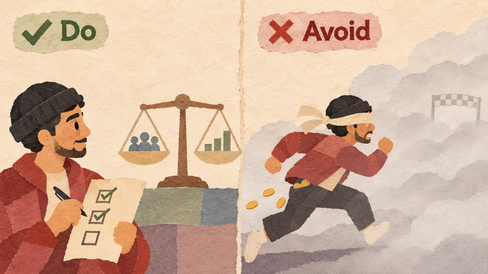

    * **Example:** Omar checks: 60% of his users already have both apps, and installing a second app is free. Using two apps is easy, so this market is unlikely to tip.
    * **Common mistake:** Believing that "the biggest always wins everything." In many markets, two or three companies live side by side for years.
  * **Rule 2: If the market can tip, win one local market first, and fast.** Tipping happens place by place. Be clearly the biggest in one city or campus before you spread out.

    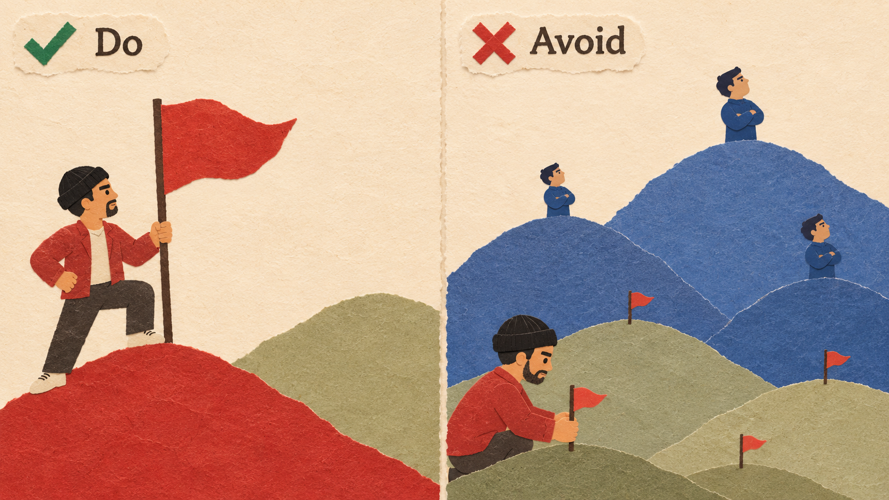

    * **Example:** On its home campus, LateBite already has 2,500 late-night orders a month and no rival after 11 pm. It becomes the clear leader there before it opens on a second campus.
    * **Common mistake:** Opening on ten campuses with a few users each. A rival that is the biggest on each single campus wins them one by one.
  * **Rule 3: Do not buy users with discounts alone.** Users who come only for a discount leave when the discount ends, especially when they also use a rival. Spend on things that stay: speed, choice, and quality.

    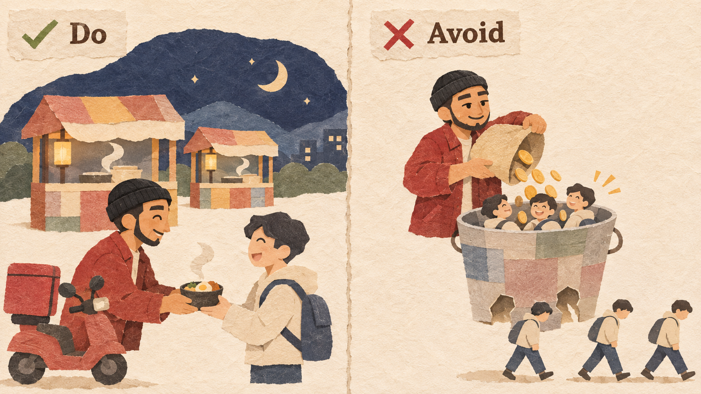

    * **Example:** Instead of $3 off every order, LateBite signs 10 more late-night restaurants and promises delivery in 20 minutes.
    * **Common mistake:** Matching a rich rival's discount. You lose money on every order, your cash runs out first, and users switch back as soon as the discount ends.
  * **Rule 4: If the market will not tip, choose a niche and be different.** Find the customers the leader serves badly, and become the best choice for them.

    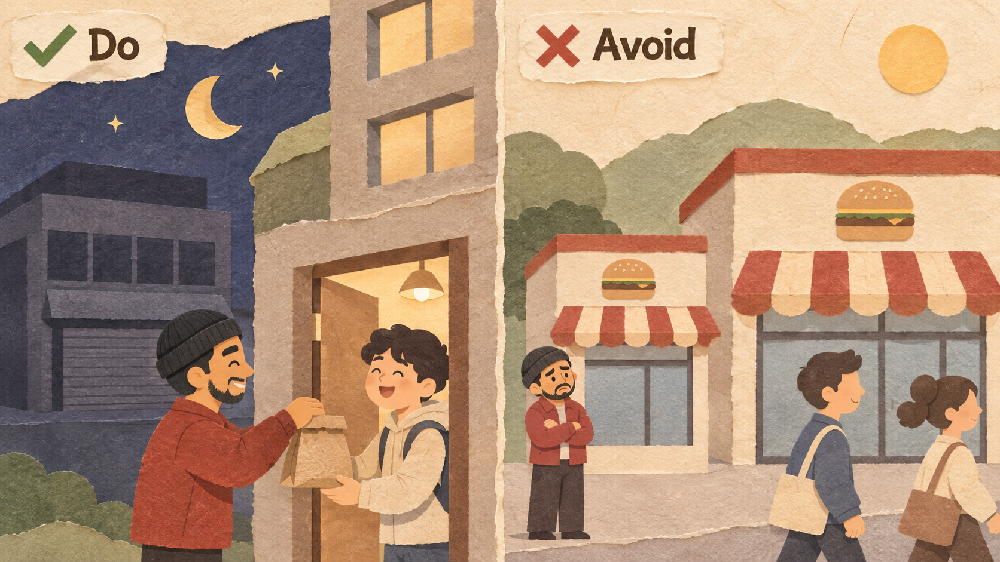

    * **Example:** LateBite focuses on late nights (11 pm to 3 am), when QuickEats is closed, and delivers to the dorm room door.
    * **Common mistake:** Copying the leader's product at a lower price. Users have no reason to choose the smaller copy.

* **Good examples (real companies):**
  * **Good example 1: Yahoo! Auctions in Japan.** Online auctions can tip: buyers go where most sellers are, and sellers go where most buyers are. Yahoo! Japan opened its auction site in 1999, a few months before eBay entered Japan, and grew quickly. By 2002 eBay had only about 3% of the Japanese online auction market, and it closed its Japanese site in March 2002.
    * **Why it is good:**
      * Auctions are a market that can tip, so being first and biggest mattered (Rule 1).
      * Yahoo! Japan became the clear leader in one country, fast, before eBay could catch up (Rule 2).
      * As more sellers joined, the site became more useful for every buyer, and the gap grew.
  * **Good example 2: Bumble.** Dating apps do not tip to one winner: many people use two or three apps at once, and different people want different things. Bumble, started in 2014, chose to be different: on Bumble, women send the first message. In February 2021 Bumble became a public company, and its Bumble app had about 1.1 million paying users.
    * **Why it is good:**
      * Bumble saw that the market would not tip, because people use several dating apps (Rule 1).
      * It did not copy the leader; it served women who wanted more control (Rule 4).
      * Users chose it for this difference, not for a discount (Rule 3).

* **Bad examples (real companies):**
  * **Bad example 1: Groupon.** Groupon sold daily discount deals from local shops. It grew very fast, and in December 2010 it reportedly turned down an offer of about $6 billion from Google. But copying it was easy: hundreds of similar deal sites appeared, and shoppers and shops used several of them. Groupon became a public company in November 2011 at $20 a share; a year later its shares had lost more than three-quarters of their value.
    * **Why it is bad:**
      * The market could not tip: shoppers and shops could easily use many deal sites, and a bigger Groupon was not much better for them (Rule 1).
      * It spent heavily on marketing and discounts to keep growing (Rule 3).
      * It acted like a future winner-takes-all leader in a market with many winners.
  * **Bad example 2: MoviePass.** In August 2017, MoviePass let members see one movie a day in theaters for $9.95 a month, and paid the theaters the full ticket price itself. Members rose to more than 3 million. The company hoped that being big would let it make theaters share their money. Instead, the largest US theater chain, AMC, started its own subscription in June 2018. MoviePass ran out of money, limited its offer, lost most of its members, and closed in September 2019.
    * **Why it is bad:**
      * It lost money on almost every member, buying users with a price it could not keep (Rule 3).
      * More members did not make the service better for other members: there was no network effect, so the market could not tip toward MoviePass (Rule 1).
      * When the low price ended, members left.

* **Before the exercises: four tools you will use:**
  * **Tool 1 - Market share:**
    * Market share = our sales / all sales in the market x 100
    * **Example:** Two scooter apps: 40,000 rides and 60,000 rides. The smaller app's share: 40,000 / 100,000 x 100 = 40%.
  * **Tool 2 - Multi-homing rate:**
    * Multi-homing rate = our users who also use a rival / our users x 100
    * **Example:** 14,000 of 20,000 users also use a rival scooter app: 14,000 / 20,000 x 100 = 70%. Above about 50%, using two apps is clearly easy.
  * **Tool 3 - Months of cash:**
    * Months of cash = money in the bank / monthly loss
    * **Example:** $100,000 in the bank, losing $20,000 a month: $100,000 / $20,000 = 5 months.
  * **Tool 4 - Profit over several periods (from Session 1.1), with a decision rule:**
    * Profit = monthly profit x number of months - one-time cost
    * **Example:** A plan costs $5,000 and the business earns $3,000 a month for 6 months: 6 x $3,000 - $5,000 = $13,000. A **decision rule** says which result would make you change the plan.

* **Exercise 1 - Easy: Will the market tip? (20 min):**
  * **Scenario:** Six markets. (a) A social network where friends share photos. (b) Taxi apps in a city where riders and drivers use several apps. (c) Operating systems for office computers, where files and software must work together. (d) Food-delivery apps. (e) An online auction site for rare collectibles. (f) Coffee shops in a city.
  * **Template:**

    ```text
    Market [letter]: network effects [strong / weak / none]; using two at once is [easy / hard];
    users want [the same thing / different things]. So the market is [likely / unlikely] to tip.
    ```

  * **Worked example (two other markets):**

    ```text
    Market: video-call apps for a company's staff.
    Network effects strong (everyone must be on the same app); using two at once is hard
    (staff would have to check two places); users want the same thing.
    So the market is likely to tip (inside each company).
    Market: online clothing stores.
    Network effects weak; using two at once is easy; users want different things.
    So the market is unlikely to tip.
    ```

  * **Your turn:** Fill in the template for all six markets.
  * **Check your answer:** (a) **likely**: strong network effects, and moving means leaving your friends behind. (b) **unlikely**: riders and drivers use several apps easily. (c) **likely**: files and software must work together, so switching is hard. (d) **unlikely**: installing a second app is free, and restaurants are on several apps. (e) **likely**: buyers and sellers of rare items want the one place where everyone else is. (f) **unlikely**: no network effect, and people want different coffee.

* **Exercise 2 - Medium: Race or niche? (30 min):**
  * **Scenario:** Two apps let students resell event tickets. You run SeatSwap. SeatSwap has 8,000 users, and 5,000 of them also use the rival, TicketGo. This month TicketGo had 3,000 trades and SeatSwap had 2,000. SeatSwap loses $5,000 a month and has $30,000 in the bank. Many students complain about fake tickets on both apps.
  * **Step 1 - Calculate (Tools 1, 2, and 3):** SeatSwap's market share = 2,000 / (2,000 + 3,000) x 100 = ______ %. Multi-homing rate = 5,000 / 8,000 x 100 = ______ %. Months of cash = $30,000 / $5,000 = ______.
  * **Step 2 - Check the three tipping conditions (Rule 1), then choose:** race or niche?
  * **Template:**

    ```text
    Market share [number]%, multi-homing [number]%, [number] months of cash.
    Tipping test: network effects [strong / weak]; using two apps is [easy / hard];
    users want [the same thing / different things]. The market is [likely / unlikely] to tip.
    Decision: [race / niche]. Our niche or plan: [one sentence] (Rule [number]).
    ```

  * **Worked example (RideOn, a scooter app: 40,000 of 100,000 rides in the city, 14,000 of its 20,000 users also use the rival BikeGo, losing $20,000 a month with $100,000 in the bank):**

    ```text
    Market share 40%, multi-homing 70%, 5 months of cash.
    Tipping test: network effects weak (riders want a scooter nearby, not more riders);
    using two apps is easy; users want different things (short trips vs. daily commuting).
    The market is unlikely to tip.
    Decision: niche. Our plan: monthly passes and reserved scooters for daily commuters
    near the train station (Rule 4).
    ```

  * **Your turn:** Fill in the template for SeatSwap.
  * **Check your answer:** Market share = **40%**. Multi-homing = **62.5%**. Months of cash = **6**. Network effects are real but moderate (buyers want many sellers), using two apps is easy (62.5% already do), and students have a special need (no fake tickets). The market is **unlikely to tip**, so a race with only 6 months of cash is risky. A strong answer chooses a **niche**, for example "only tickets from verified students, with money back if a ticket is fake" (Rule 4), and does not use discounts to win users (Rule 3).

* **Exercise 3 - Hard: Should LateBite race QuickEats? (50 min, including 2-minute presentations):**
  * **Scenario:** Return to Omar and LateBite (6,000 orders a month, $2 left from each order, $40,000 in the bank, 60% of users also use QuickEats, the only app open after 11 pm). Omar compares two plans for the next 6 months.
    * **Option A - Race:** Match QuickEats with $3 off every order. Orders are expected to rise to 10,000 a month while the discount lasts. When it ends, orders are expected to fall back to about 6,500, because most users also have QuickEats.
    * **Option B - Own the late night (niche):** Spend $12,000 once to sign 10 more late-night restaurants and to promise delivery to the dorm room door within 20 minutes. Late-night orders are expected to rise by 1,500 a month, from 2,500 to 4,000. No discount.
  * **Step 1 - Calculate (use Tools 1, 3, and 4):**
    * Market share now = 6,000 / (6,000 + 9,000) x 100 = ______ %.
    * No change: profit over 6 months = 6,000 x $2 x 6 = $______.
    * Option A: money left from each order = $2 - $3 = $______; monthly result = 10,000 x ______ = $______; months of cash = $40,000 / ______ = ______ months.
    * Option B: orders per month = 6,000 + 1,500 = ______; profit over 6 months = ______ x $2 x 6 - $12,000 = $______.
    * Option B if late-night orders rise by only 600: profit = $______.
    * How many extra orders a month does Option B need to beat "no change"? Extra orders x $2 x 6 = $12,000, so extra orders = ______.
  * **Step 2 - Write a 3-bullet memo to Omar (use Tool 4):**
  * **Template:**

    ```text
    To: [founder name], [company]
    1. Decision and evidence: We should choose [option] because [the rule it follows]
       and [one number from your calculation].
    2. Biggest risk and trade-off: The weakest point is [risk]. We give up [what we lose]
       to gain [what we protect or win].
    3. Next step and decision rule: In the next two months we will [one action] and measure [one number].
       We will change this decision if [result].
    ```

  * **Worked example (RideOn from Exercise 2):**

    ```text
    To: Daniel Kim, CEO, RideOn
    1. Decision and evidence: We should not race BikeGo with free rides. We should
       offer monthly passes for commuters near the train station, because 70% of our
       users already use both apps (Rule 1) and we have only 5 months of cash.
    2. Biggest risk and trade-off: The weakest point is that commuters may want more
       scooters than we have at 8 am. We give up the hope of becoming the biggest app in
       the city to become the best app for one group that stays.
    3. Next step and decision rule: In the next two months we will sell passes at one
       station and measure how many pass holders ride at least 15 days a month. We will
       change this decision if fewer than 300 passes are sold by the end of month two.
    ```

  * **Your turn:** Write the memo for LateBite. Then give a 2-minute presentation using your three bullets.
  * **Check your answer:**
    * Market share now = **40%**.
    * No change: 6,000 x $2 x 6 = **$72,000**.
    * Option A: $2 - $3 = **-$1** per order; 10,000 x -$1 = **-$10,000** a month; months of cash = $40,000 / $10,000 = **4 months**. LateBite runs out of money in month 4, before the 6-month race ends, and QuickEats has much more money. After the race, orders fall back to about 6,500 because users have both apps.
    * Option B: 7,500 orders a month; 7,500 x $2 x 6 - $12,000 = $90,000 - $12,000 = **$78,000**, which is $6,000 more than no change.
    * Option B with only 600 extra orders: 6,600 x $2 x 6 - $12,000 = **$67,200**, which is $4,800 less than no change.
    * Option B beats no change only if it adds at least $12,000 / ($2 x 6) = **1,000** extra orders a month.
    * Option A breaks Rules 1 and 3: the market is unlikely to tip (60% of users have both apps), and the discount buys users who leave. Option B follows Rule 4 and fits LateBite's strength (the only app after 11 pm). A strong memo chooses Option B, names the risk that late-night orders grow by less than 1,000 a month, and gives a decision rule such as "If late-night orders are below 3,000 a month after two months, we will stop adding restaurants and review the plan." It may also say what would make Omar race: only if the market showed signs of tipping, such as students deleting one of the two apps.

* **Success check:** You can (1) explain winner-takes-all markets, tipping, and multi-homing, (2) test whether a market can tip with the three conditions and measure market share, multi-homing, and months of cash, and (3) compare a race with a niche plan over several months and write a decision rule.

* **References:**
  * Eisenmann, T., Parker, G., & Van Alstyne, M. W. (2006). [Strategies for two-sided markets](https://hbr.org/2006/10/strategies-for-two-sided-markets). *Harvard Business Review*, 84(10), 92-101. (Conditions for winner-takes-all markets.)
  * Arthur, W. B. (1989). [Competing technologies, increasing returns, and lock-in by historical events](https://doi.org/10.2307/2234208). *The Economic Journal*, 99(394), 116-131.
  * Internet News (2002, February). [eBay enters Taiwan market, exits Japan](https://www.internetnews.com/small-business/ebay-enters-taiwan-market-exits-japan).
  * Fortune (2021, February 11). [Bumble IPO: CEO Whitney Wolfe Herd](https://fortune.com/2021/02/11/bumble-ipo-ceo-whitney-wolfe-herd-bmbl-stock-shares-interview-app-initial-public-offering/).
  * CNN Money (2010, December 3). [Groupon turns down Google](https://money.cnn.com/2010/12/03/technology/groupon_google/). NPR (2019, September 14). [MoviePass has officially shut down](https://www.npr.org/2019/09/14/760862605/moviepass-has-officially-shut-down-and-we-dont-know-if-there-will-be-a-sequel).

---

<a id="module-2"></a>
## Module 2: Platform Economics, Big Data & Monetization

<a id="session-2-1"></a>
### Session 2.1: The Data Feedback Loop Strategy

**Strategy of this session: Data Feedback Loop Strategy**


* **Lecture Presentation:** [Download Slides (PDF)](slides/session_2_1_lecture.pdf)

* **Duration:** 3 hours: 50-minute lesson, 10-minute break, Exercise 1 (20 min) and Exercise 2 (30 min), 10-minute break, Exercise 3 with short presentations (50 min), and 10-minute wrap-up.
* **Situation:** Jun runs StreamWise, a new streaming service for university students. The root problem is that members cancel and Jun does not know why. He has a dashboard full of numbers, and an advertiser has offered to buy detailed viewer profiles. Jun must decide which signals to use, what to change, and whether selling the data would hurt students' trust.

  | Measure (one month) | Value |
  |---|---|
  | Members at the start of the month | 12,000 |
  | Plays started | 48,000 |
  | Plays finished | 9,600 |
  | Titles saved to "My List" | 3,100 |
  | Members who cancelled | 420 |
  | Monthly price per member | $5.00 |

* **The strategy in one paragraph:** The data feedback loop strategy is a company's plan for which customer signals to collect, which business decision each signal will improve, and how to keep customers' trust while it does this. A **customer signal** is a recorded action, such as a viewer finishing a show or a shopper saving an item. Collecting more data does not make a company stronger by itself. A company gains an advantage when a small set of useful signals changes a decision, the company measures the result, and the next decision becomes better. This repeating cycle is called a **data feedback loop**, and it gives the strategy its name. Use this strategy when a business can see many customer actions but does not know which ones show a real need, or when it is tempted to collect everything "just in case" and sell or store it without a clear purpose.

* **Goal:** Apply the Data Feedback Loop Strategy: choose useful customer signals, connect each signal to one business decision, measure the result, and protect customer trust.

* **Words you need first: signals and three questions to ask about them:**
  * **Signal:** One recorded customer action. Example: a viewer presses "Save" on a show.
  * **Question 1 - How clear is it? (strong or weak):** A **strong signal** has one clear meaning because the customer spent time or effort. A **weak signal** can mean many things. Example: finishing a 40-minute episode is strong; opening a title for 3 seconds is weak (the viewer may have clicked by mistake).
  * **Question 2 - What does it tell us? (like or unhappy):** Some signals show what customers **like**, so the business knows what to offer more of. Others show that customers are **unhappy**, so the business knows what to fix. Example: saving a show shows liking; cancelling shows that the member is unhappy.
  * **Question 3 - Does it come early or late?** An **early signal** arrives while the business can still act. A **late signal** arrives after the customer is already gone. Example: a member who finishes fewer shows each week gives an early signal; a member who cancels gives a late signal.

* **Quick practice: read the StreamWise signals (5 min):** Look at the StreamWise table in the Situation. For each number, answer: Is it a signal (yes or no)? If yes, Q1: strong or weak? Q2: like or unhappy? Q3: early or late?
  * **Check your answer:**

    | StreamWise data (one month) | Signal? (yes or no) | Q1: How clear? (strong or weak) | Q2: Tells us? (like or unhappy) | Q3: When? (early or late) |
    |---|---|---|---|---|
    | Members at the start: 12,000 | No (a count of customers, not an action) | - | - | - |
    | Plays started: 48,000 | Yes | Weak (only 20% were finished: 9,600 / 48,000) | Like (but only weakly) | Early |
    | Plays finished: 9,600 | Yes | Strong | Like | Early |
    | Titles saved to "My List": 3,100 | Yes | Strong | Like | Early |
    | Members who cancelled: 420 | Yes | Strong | Unhappy | Late |
    | Monthly price: $5.00 | No (the company sets it) | - | - | - |

    Cancellations are a strong signal, and they help predict future churn, but they come too late to keep those members and do not say why they left. Jun should also watch early signals, such as members finishing fewer shows, so he can act before members leave.

* **More words you need first:**
  * **Churn rate:** The percentage of members who cancel in a period. Churn rate = members who cancelled / members at the start x 100. Example: 420 / 12,000 x 100 = 3.5% per month.
  * **ARPU (Average Revenue Per User):** The average money earned from one member in a period. Example: StreamWise charges $5.00 per month, so ARPU is $5.00 per member per month.
  * **Consent:** A customer's clear permission to collect and use their data for a stated purpose.

* **The four rules of the Data Feedback Loop Strategy (Hour 1 - 50 minutes):**
  * **Rule 1: Start with the decision, not the data.** First name the decision you want to improve. Then collect only the signals that can change it.
    * **Example:** A campus cafe app wants to decide "which drink to promote on rainy days." It needs two signals: the weather and the drinks ordered that day. It does not need customers' contact lists or browsing history.
    * **Common mistake:** "Let's collect everything and find something later." Data with no decision costs money to store and adds privacy risk, but it does not improve anything.
  * **Rule 2: Use strong signals, and check weak signals before you act.** Prefer actions that show effort or repeat behavior: finishing, saving, buying again, searching for a specific item.
    * **Example:** At StreamWise, 48,000 plays were started but only 9,600 were finished, so only 20% of plays were finished (9,600 / 48,000 x 100). A play started is a weak signal of interest; a play finished is a stronger one.
    * **Common mistake:** Treating a weak signal as proof. A viewer who stops after 10 seconds may dislike the show, or may have received a phone call.
  * **Rule 3: Close the feedback loop and measure one result.** The loop has five steps: collect a signal, interpret it, change one action, measure the result, and learn for the next decision.
    * **Example:** StreamWise sees that students who finish a cooking show often save other cooking shows. It adds a "More easy cooking" row for those students and measures their churn rate for one month. If churn falls from 3.5% to 2.5% for that group, the row is kept; if not, the team changes it.
    * **Common mistake:** Changing something but never measuring the result. Without the measure step, the company cannot learn whether the data helped.
  * **Rule 4: Earn trust: ask permission, collect only what you need, and give value back.** Customers share data more willingly when they understand the purpose and receive something useful in return, such as better recommendations.
    * **Example:** A sign-up screen says, "We use what you finish and save to recommend shows. We never sell your viewing history." The member can turn this off at any time.
    * **Common mistake:** Collecting or selling data in ways customers would not expect. Even accurate data can damage the brand if customers feel watched.

* **Good examples (real companies):**
  * **Good example 1: Netflix recommendations.** Netflix uses what members watch, finish, and search for to decide which titles and which artwork to show each member. It tests a change on a group of members and keeps it only if viewing improves. Netflix researchers reported that recommendations influence about 80% of the hours members stream (Gomez-Uribe and Hunt, 2015).
    * **Why it is good:**
      * It starts with a clear decision: which titles to show on each member's home screen (Rule 1).
      * It relies on strong signals such as finished titles, not only clicks (Rule 2).
      * It tests each change and measures the result before keeping it, which closes the loop (Rule 3).
  * **Good example 2: Spotify Discover Weekly.** Since 2015, Spotify has given each listener a new personalized playlist every Monday. It is built from songs the listener plays, saves, adds to playlists, and skips.
    * **Why it is good:**
      * Saves and repeated plays are strong signals; quick skips tell Spotify what to avoid (Rule 2).
      * The listener receives clear value from the data: new music chosen for them (Rule 4).
      * Every week, the listener's reaction to the new playlist becomes new data for the next playlist (Rule 3).

* **Bad examples (real companies):**
  * **Bad example 1: Google Flu Trends.** From 2008, Google tried to estimate how many people had the flu by counting flu-related searches. In February 2013, it estimated more than twice the share of flu doctor visits that the U.S. Centers for Disease Control and Prevention (CDC) later reported (Lazer and others, 2014). Google stopped publishing the estimates in 2015.
    * **Why it is bad:**
      * A search is a weak signal: people search about the flu because of news stories or curiosity, not only because they are sick (Rule 2).
      * The model was not regularly checked against real doctor-visit data and corrected, so the loop was not closed (Rule 3).
      * Big data volume created confidence without accuracy. Many signals are not the same as useful signals.
  * **Bad example 2: Target's pregnancy prediction.** The New York Times reported in 2012 that the retailer Target used shopping signals, such as buying unscented lotion and certain vitamins, to predict which customers were pregnant and then mailed them baby-product coupons. A father complained after his teenage daughter received these coupons.
    * **Why it is bad:**
      * The signals were strong and the prediction was often accurate, but customers did not expect a store to know this (Rule 4).
      * Customers had not agreed to have sensitive personal facts guessed from their purchases, so the practice lacked clear consent.
      * The business lesson: accurate data can still damage trust and the brand. Target reportedly responded by mixing baby coupons with unrelated offers so they looked random, which hid the practice instead of fixing it.

* **Before the exercises: three tools you will use:**
  * **Tool 1 - Test group and comparison group:** To know whether a change worked, try it on one group (the **test group**) and not on a similar group (the **comparison group**). Then compare the same number for both groups.
    * **Example:** A cafe app sends a coupon to 500 members and no coupon to another 500 members. This week, 75 of the coupon group order (15 of every 100) and 50 of the other group order (10 of every 100). The coupon added about 5 orders for every 100 members.
    * **Why it matters:** Without the comparison group, you cannot tell whether orders rose because of the coupon or because of something else, such as rainy weather.
  * **Tool 2 - From churn to money:** Lower churn means more members stay, and every member who stays keeps paying.
    * Members kept per month = members x (old churn rate - new churn rate)
    * Revenue kept per month = members kept x monthly price
    * **Example:** A cafe subscription has 1,000 members who pay $10.00 a month. If churn falls from 6% to 4%, then 1,000 x 2% = 20 more members stay, and the cafe keeps 20 x $10.00 = $200.00 that month. The gain grows every month, because the members who stayed keep paying next month too.
  * **Tool 3 - Trade-off and decision rule:**
    * A **trade-off** is what you give up to get something you value more. **Example:** a fitness app refuses $2.00 per user from an advertiser (gives up money) to protect users' trust and its subscriptions (gains).
    * A **decision rule** is a promise, written before you start, about which result would make you change your decision. **Example:** "If churn does not fall below 4% in 90 days, we will try a different plan." It means the result, not opinion, decides.

* **Exercise 1 - Easy: Choose the strongest signal (20 min):**
  * **Scenario:** CampusEats is a food-delivery app for students. The manager wants to decide **which restaurants to show at the top of the app at lunchtime**. The app records these signals: (a) a student opens a restaurant page for 2 seconds; (b) a student orders from the same restaurant three times in one month; (c) a student gives a restaurant 5 stars after an order; (d) a student scrolls past a restaurant; (e) a student adds a restaurant to "Favorites."
  * **Template:**

    ```text
    Decision: [the decision the business wants to improve]
    Strongest signal: [letter and action], because [what effort or repeat behavior it shows].
    Weakest signal: [letter and action], because [two different things it could mean].
    ```

  * **Worked example (a music app, deciding which songs to put in a "Study Focus" playlist):**

    ```text
    Decision: Which songs to put in the "Study Focus" playlist.
    Strongest signal: a student plays the same song five times during study hours,
    because repeating a song takes effort and shows a clear preference.
    Weakest signal: a student opens a song for 2 seconds, because it could mean
    the student disliked it or simply clicked by mistake.
    ```

  * **Your turn:** Fill in the template for CampusEats.
  * **Check your answer:** The strongest signal is (b), three orders in one month, because the student paid money again and again. (e) "Favorites" and (c) 5 stars are also useful but show less effort than repeat orders. The weakest signals are (a) and (d): a 2-second view or a scroll can mean dislike, a mistake, or simply that the student was not hungry.

* **Exercise 2 - Medium: Build a feedback loop (30 min):**
  * **Scenario:** FitU is a campus gym app with 2,000 members. Last month 160 members cancelled. The app shows that many members **book** a fitness class but do **not attend** it.
  * **Step 1 - Calculate churn:** Churn rate = 160 / 2,000 x 100 = ______ %.
  * **Step 2 - Complete the loop:** Use the five-step loop from Rule 3 and the test group and comparison group from Tool 1.
  * **Template:**

    ```text
    1. Collect: [the signal we record]
    2. Interpret: [what the signal may mean, and one other possible meaning]
    3. Act: [one change we will test on a test group, and who is the comparison group]
    4. Measure: [one number we will compare before and after, and our target]
    5. Learn: If [the result], we will [keep / change] the action.
    ```

  * **Worked example (a campus events app where students save events but do not attend):**

    ```text
    1. Collect: students who save an event but do not check in at the door.
    2. Interpret: they may forget the event, or they may save events they never planned to attend.
    3. Act: send a reminder 2 hours before saved events to half of these students;
       the other half gets no reminder (comparison group).
    4. Measure: attendance rate of saved events; target: from 20% to 30%.
    5. Learn: If attendance rises to 30% only in the reminded group, we will keep reminders for everyone.
    ```

  * **Your turn:** Fill in the template for FitU.
  * **Check your answer:** Churn rate = 160 / 2,000 x 100 = **8%**. A good loop records "booked but did not attend," gives two possible meanings (for example, the class time is inconvenient, or the member forgot), tests one change on a test group and compares it with a comparison group (for example, a reminder for half of these members, or an easy one-click cancel that frees the spot for others), and measures one number, such as attendance rate or next month's churn rate, with a target (for example, churn from 8% to 6%).

* **Exercise 3 - Hard: Choose a data strategy for StreamWise (50 min, including 2-minute presentations):**
  * **Scenario:** Return to Jun and StreamWise (12,000 members, $5.00 per month, churn 3.5%). Jun has two options.
    * **Option A - Sell viewer profiles:** An advertiser will pay $1.00 per member per month for detailed viewing histories. In a StreamWise survey, 30% of members said they would cancel if their viewing history were sold.
    * **Option B - Permission-based recommendations:** Ask members for permission to use three signals (finished titles, saved titles, and searches) only to improve recommendations, and never sell them. Jun's goal is to lower monthly churn from 3.5% to 2.5%.
  * **Step 1 - Calculate (use Tool 2 for Option B):**
    * Option A extra revenue per month = 12,000 x $1.00 = $______.
    * If 30% of members cancel because of Option A: members lost = 12,000 x 30% = ______; revenue lost per month = members lost x $6.00 (the $5.00 subscription plus the $1.00 advertiser payment) = $______.
    * Option B: members kept per month = 12,000 x (3.5% - 2.5%) = ______; revenue kept per month = members kept x $5.00 = $______.
  * **Step 2 - Write a 3-bullet memo to the CEO.** Use Tool 3 for the trade-off and the decision rule.
  * **Template:**

    ```text
    To: [CEO name], [company]
    1. Decision and evidence: We should choose [option] because [the rule it follows]
       and [one number from your calculation].
    2. Biggest risk and trade-off: The weakest point is [risk]. We give up [what we lose]
       to gain [what we protect or win].
    3. Next step and decision rule: In the next 90 days we will [one action] and measure [one number].
       We will change this decision if [result].
    ```

  * **Worked example (FitTrack, a running app; an insurance company offers $2.00 per user per month for users' location history):**

    ```text
    To: Mia Park, CEO, FitTrack
    1. Decision and evidence: We should refuse to sell location history and instead ask
       permission to use running data only for training plans, because users expect
       privacy (Rule 4) and 25% of surveyed users said they would leave if we sold it.
    2. Biggest risk and trade-off: The weakest point is that we do not yet know whether
       better training plans will keep users. We give up $2.00 per user per month in
       insurance revenue to protect our users' trust and our subscription revenue.
    3. Next step and decision rule: In the next 90 days we will offer personalized plans
       to users who give permission and measure their monthly churn. We will change this
       decision if churn does not fall below 4%.
    ```

  * **Your turn:** Write the memo for StreamWise. Then give a 2-minute presentation using your three bullets.
  * **Check your answer:**
    * Option A brings $12,000 per month. If 3,600 members (30%) cancel, StreamWise loses 3,600 x $6.00 = $21,600 per month, which is more than the $12,000 gained.
    * Option B keeps 12,000 x 1% = 120 members per month, or $600 per month, and this grows every month that churn stays lower.
    * A strong memo usually chooses Option B (or a version of it), uses at least one number from Step 1, names a real risk (for example, members may refuse permission, or recommendations may not lower churn), and states a clear rule for changing the decision. A memo that chooses Option A can still be strong if it explains how to get real consent and gives a decision rule.

* **Success check:** You can (1) name one strong and one weak signal for a business decision and explain the difference, (2) complete all five steps of a feedback loop with one measurable result, and (3) explain why selling customer data can cost more than it earns.

* **References:**
  * Gomez-Uribe, C. A., and Hunt, N. (2015). [The Netflix Recommender System: Algorithms, Business Value, and Innovation](https://dl.acm.org/doi/10.1145/2843948). ACM Transactions on Management Information Systems.
  * Lazer, D., Kennedy, R., King, G., and Vespignani, A. (2014). [The Parable of Google Flu: Traps in Big Data Analysis](https://www.science.org/doi/10.1126/science.1248506). Science.
  * Duhigg, C. (2012). [How Companies Learn Your Secrets](https://www.nytimes.com/2012/02/19/magazine/shopping-habits.html). The New York Times Magazine.
  * Hagiu, A., and Wright, J. (2020). [When Data Creates Competitive Advantage](https://hbr.org/2020/01/when-data-creates-competitive-advantage). Harvard Business Review.

---

<a id="session-2-2"></a>
### Session 2.2: The Asymmetric Pricing Strategy

**Strategy of this session: Asymmetric Pricing Strategy**


* **Lecture Presentation:** [Download Slides (PDF)](slides/session_2_2_lecture.pdf)

* **Duration:** 3 hours: 50-minute lesson, 10-minute break, Exercise 1 (20 min) and Exercise 2 (30 min), 10-minute break, Exercise 3 with short presentations (50 min), and 10-minute wrap-up.
* **Situation:** Ravi runs CampusJobs, a free app that connects university students who want part-time jobs with local shops that need workers. The root problem is that the app earns nothing, but it costs $4,000 a month to run. A friend suggests charging everyone $2.00 a month, students and shops alike. Ravi is not sure who should pay, or whether charging students would make the app useless for shops.

  | CampusJobs (one month) | Value |
  |---|---|
  | Students using the app | 6,000 |
  | Shops posting jobs | 120 |
  | Job posts | 300 |
  | Applications from students | 9,000 |
  | Price for students / for shops | $0 / $0 |
  | Monthly costs | $4,000 |

* **The strategy in one paragraph:** The asymmetric pricing strategy means a platform with two groups of users charges them different prices: one group pays little or nothing, and the other group pays. A **platform** is a business that connects two groups who need each other, such as students who want jobs and shops that need workers. The group that is free or cheap is the **subsidy side**: the platform keeps it free because its presence attracts the other group. The group that pays is the **money side**: it gains the most value, often money, from meeting the first group. Use this strategy when a business connects two groups, one group is easily driven away by a price, and the other group would gladly pay to reach it.

* **Goal:** Apply the Asymmetric Pricing Strategy: identify the two sides of a platform, decide which side to subsidize and which side to charge, and check that the money side covers the cost of the subsidy.

* **Words you need first:**
  * **Two-sided platform:** A business that connects two groups of users who need each other. Example: CampusJobs connects students and shops.
  * **Subsidy side:** The side that pays little or nothing because the platform needs many of them. Example: students use CampusJobs for free.
  * **Money side:** The side that pays because reaching the other side is worth money to them. Example: a shop pays to post a job and find workers.
  * **Price sensitivity:** How much a group's use drops when the price rises. Example: if a $2.00 fee makes 60 of every 100 students leave, students are very price sensitive.
  * **Subsidy:** Value the platform gives away to attract a side. Example: free use, or a $5.00 sign-up bonus.
  * **Cross-subsidy:** Using money from one side to pay for the free service given to the other side. Example: shop fees pay the costs of serving students for free.

* **The four rules of the Asymmetric Pricing Strategy (Hour 1 - 50 minutes):**
  * **Rule 1: Subsidize the side that the other side comes for.** Ask: "Which group does the other group want to reach?" Keep that group free or cheap.
    * **Example:** Shops join CampusJobs because 6,000 students are there. Without students, no shop would post a job, so students should stay free.
    * **Common mistake:** Charging the side that attracts everyone else. When it leaves, the other side leaves too.
  * **Rule 2: Charge the side that gains the most from the match.** The money side usually earns money or saves time because of the other side.
    * **Example:** A shop that fills a job quickly saves days of searching and keeps its store running. That is worth more to a shop than a job search is worth to a student in cash.
    * **Common mistake:** Charging both sides the same price because it looks fair. Equal prices ignore that the two sides value the platform very differently.
  * **Rule 3: Check price sensitivity before you set a price.** Find out which side leaves when the price rises, and keep the price low for that side.
    * **Example:** A CampusJobs survey finds that a $2.00 fee would make 60% of students leave, but shops would pay $25.00 per job post if each post gets at least 20 applications.
    * **Common mistake:** Guessing. A price that looks small to the business ($2.00) can be large for a student budget.
  * **Rule 4: Make sure the money side covers the subsidy, and protect the free side.** The money side must pay enough to cover the cost of serving both sides, and it must not be allowed to harm the free side.
    * **Example:** CampusJobs checks that job-post fees are more than its $4,000 monthly costs, and it removes fake or unpaid "job" posts so students keep trusting the app.
    * **Common mistake:** Giving away free service with no plan for who will pay, or letting the paying side flood the free side with low-quality offers.

* **Good examples (real companies):**
  * **Good example 1: Adobe Acrobat Reader.** In the 1990s, Adobe gave away the Reader program for opening PDF files for free, and sold the Acrobat software that creates and edits PDF files to businesses.
    * **Why it is good:**
      * Millions of free readers made PDF the format that businesses wanted to use (Rule 1).
      * Businesses that create documents gained the most from the format, so they were charged (Rule 2).
      * Readers would not have paid just to open a file, so keeping Reader free matched their price sensitivity (Rule 3).
  * **Good example 2: Google Search.** People search on Google for free. Advertisers pay Google to show labeled ads next to search results.
    * **Why it is good:**
      * Advertisers come to Google because billions of people search there, so searchers are the subsidy side (Rule 1).
      * Advertisers earn money from the customers they reach, so they are the money side (Rule 2).
      * Ad revenue pays for the free service, and ads are labeled so searchers can still trust the results (Rule 4).

* **Bad examples (real companies):**
  * **Bad example 1: Unity's 2023 Runtime Fee.** Unity sells tools that game developers use to build games. In September 2023, Unity announced a new fee charged to developers each time a game was installed, including for some games already released. Developers protested and some said they would switch to other tools. Unity changed the plan within weeks, and its CEO left the company the following month.
    * **Why it is bad:**
      * Developers are the side that brings the games that make Unity valuable; a sudden fee pushed the most important side away (Rule 1).
      * Unity did not first check how developers would react to a fee based on installs they could not control (Rule 3).
      * Changing prices for games already released broke developers' trust in the platform.
  * **Bad example 2: Groupon and local merchants.** Groupon sold deep-discount deals, often 50% off, from local businesses to its many shoppers, and took a share of the deal price. Many small businesses found that the deal cost them more than it earned, because most deal buyers did not return at full price.
    * **Why it is bad:**
      * The money side (merchants) paid for a large subsidy (half-price deals) but did not gain enough from the match (Rule 2).
      * The subsidy was not covered by real value: shoppers came for the discount, not for the merchant (Rule 4).
      * Merchants who lost money did not run a second deal, so the platform lost the side that supplied its offers.

* **Before the exercises: three tools you will use:**
  * **Tool 1 - Revenue from each side:** Calculate revenue separately for each side, then add them.
    * Revenue = (users on side A x price for side A) + (users on side B x price for side B)
    * **Example:** A campus events app has 2,000 students who pay $0 and 40 clubs that pay $10.00 a month: 2,000 x $0 + 40 x $10.00 = $400 a month.
  * **Tool 2 - Value per match for the money side:** The money side pays only if it gets enough matches. Matches per post = total matches / number of posts.
    * **Example:** A tutoring app gets 800 student requests for 100 tutor listings: 800 / 100 = 8 requests per listing. If tutors pay only when they get at least 10 requests, 8 is not enough yet.
  * **Tool 3 - Trade-off and decision rule (from Session 2.1):** A **trade-off** is what you give up to get something you value more. A **decision rule** is a promise, written before you start, about which result would make you change your decision.

* **Exercise 1 - Easy: Find the subsidy side and the money side (20 min):**
  * **Scenario:** Name the subsidy side and the money side for three platforms: (a) a free campus newspaper that is paid for by local businesses' ads; (b) a credit card that gives shoppers cash back, while stores pay a fee on each card payment; (c) a video game console that is sold at a low price, while game companies pay the console maker a fee on every game sold.
  * **Template:**

    ```text
    Platform [letter]: The subsidy side is [group], because [the other side comes for them].
    The money side is [group], because [what they gain from the match].
    ```

  * **Worked example (a campus radio app where students listen free and local sponsors pay):**

    ```text
    The subsidy side is students, because sponsors pay to reach the students who listen.
    The money side is local sponsors, because they gain customers from the students who hear their messages.
    ```

  * **Your turn:** Fill in the template for (a), (b), and (c).
  * **Check your answer:** (a) Subsidy side: readers, because advertisers want to reach them; money side: local businesses, which gain customers. (b) Subsidy side: shoppers, who even receive cash back; money side: stores, which gain sales from card users. (c) Subsidy side: players, who buy a low-priced console; money side: game companies, which earn money from players who own the console.

* **Exercise 2 - Medium: Can the money side cover the subsidy? (30 min):**
  * **Scenario:** GameNight is an app that lists board-game nights at campus cafes. Players use it for free and receive a $2.00 snack voucher for each event they attend; GameNight pays for the vouchers. Cafes pay $30.00 to list each event. This month there are 40 events, and 15 players attend each event.
  * **Step 1 - Calculate (use Tool 1):** Cafe revenue = 40 x $30.00 = $______. Voucher cost = 40 x 15 x $2.00 = $______. Profit or loss = revenue - voucher cost = $______.
  * **Step 2 - Improve the plan:** Change one price or one subsidy so that the money side covers the subsidy, and use Rules 1 to 4 to explain why players will still come.
  * **Template:**

    ```text
    Subsidy side: [group], and what we give them: [subsidy].
    Money side: [group], and what they pay: [price].
    Change: [one change to a price or a subsidy].
    New numbers: revenue $[amount] - subsidy cost $[amount] = $[result].
    Why the subsidy side will still come: [reason linked to a rule].
    ```

  * **Worked example (a campus book-swap app; students list books free and get a $1.00 credit per swap; publishers pay $50.00 a month to advertise; 10 publishers; 600 swaps):**

    ```text
    Subsidy side: students, and what we give them: free listings and a $1.00 credit per swap.
    Money side: publishers, and what they pay: $50.00 a month to reach readers.
    Change: lower the swap credit from $1.00 to $0.50, because free listing is the main reason students come.
    New numbers: revenue 10 x $50.00 = $500 - subsidy cost 600 x $0.50 = $300 = $200.
    Why the subsidy side will still come: listing stays free, so the main value for students does not change (Rule 1).
    ```

  * **Your turn:** Fill in the template for GameNight.
  * **Check your answer:** Cafe revenue = **$1,200**. Voucher cost = 40 x 15 x $2.00 = **$1,200**. Profit = **$0**: the money side only just covers the subsidy. A good change keeps the app free for players (Rule 1) and either raises the cafe fee a little (for example, to $40.00: 40 x $40.00 = $1,600, so $1,600 - $1,200 = $400) or lowers the voucher to $1.00 (40 x 15 x $1.00 = $600, so $1,200 - $600 = $600), and explains why players will still come, for example because the cafes and games, not the voucher, are the main reason to attend.

* **Exercise 3 - Hard: Choose a pricing plan for CampusJobs (50 min, including 2-minute presentations):**
  * **Scenario:** Return to Ravi and CampusJobs (6,000 students, 120 shops, 300 job posts, 9,000 applications, costs $4,000 a month). Ravi has two options.
    * **Option A - Charge everyone $2.00 a month:** A survey shows that 60% of students would leave if they had to pay. Shops would also pay $2.00 a month each.
    * **Option B - Students free, shops pay per post:** Students stay free. Shops pay $25.00 per job post. Shops say they will pay only if each post gets at least 20 applications.
  * **Step 1 - Calculate (use Tools 1 and 2):**
    * Option A: students who stay = 6,000 x 40% = ______; revenue = students who stay x $2.00 + 120 x $2.00 = $______.
    * Option A: if applications fall in the same way, applications = 9,000 x 40% = ______; applications per post = applications / 300 = ______.
    * Option B: revenue = 300 x $25.00 = $______; applications per post = 9,000 / 300 = ______.
    * Which option covers the $4,000 costs, and in which option do shops get the 20 applications they need?
  * **Step 2 - Write a 3-bullet memo to the CEO (use Tool 3):**
  * **Template:**

    ```text
    To: [CEO name], [company]
    1. Decision and evidence: We should choose [option] because [the rule it follows]
       and [one number from your calculation].
    2. Biggest risk and trade-off: The weakest point is [risk]. We give up [what we lose]
       to gain [what we protect or win].
    3. Next step and decision rule: In the next 60 days we will [one action] and measure [one number].
       We will change this decision if [result].
    ```

  * **Worked example (TutorLink, a tutoring app choosing between charging students and charging tutors):**

    ```text
    To: Ana Lopez, CEO, TutorLink
    1. Decision and evidence: We should keep students free and charge tutors 10% of each
       lesson, because tutors come for the students (Rule 1) and 1,000 lessons at $20
       give us 1,000 x $2 = $2,000 a month.
    2. Biggest risk and trade-off: The weakest point is that tutors may leave if they get
       too few lessons. We give up student fees to keep the students that tutors want to reach.
    3. Next step and decision rule: In the next 60 days we will measure lessons per tutor.
       We will change this decision if tutors average fewer than 4 lessons a month.
    ```

  * **Your turn:** Write the memo for CampusJobs. Then give a 2-minute presentation using your three bullets.
  * **Check your answer:**
    * Option A: 6,000 x 40% = 2,400 students stay; revenue = 2,400 x $2.00 + 120 x $2.00 = $4,800 + $240 = **$5,040**. But applications fall to 9,000 x 40% = 3,600, or 3,600 / 300 = **12 per post**, below the 20 shops need, so shops are likely to leave next.
    * Option B: revenue = 300 x $25.00 = **$7,500**, which covers the $4,000 costs, and each post gets 9,000 / 300 = **30 applications**, above the 20 shops need.
    * A strong memo chooses Option B, uses at least one number from Step 1, names a real risk (for example, shops may post fewer jobs once they must pay, or the survey may be wrong), and states a clear decision rule (for example, "If applications per post fall below 20, we will lower the post fee or add student promotions").

* **Success check:** You can (1) name the subsidy side and the money side of a platform and explain why, (2) check whether the money side covers the cost of a subsidy, and (3) explain why charging both sides the same price can make a platform earn less.

* **References:**
  * Parker, G. G., and Van Alstyne, M. W. (2005). [Two-Sided Network Effects: A Theory of Information Product Design](https://pubsonline.informs.org/doi/10.1287/mnsc.1050.0400). Management Science.
  * Eisenmann, T., Parker, G., and Van Alstyne, M. W. (2006). [Strategies for Two-Sided Markets](https://hbr.org/2006/10/strategies-for-two-sided-markets). Harvard Business Review.
  * Unity Technologies (2023). [An open letter to our community](https://blog.unity.com/news/open-letter-on-runtime-fee). Unity Blog.

---

<a id="session-2-3"></a>
### Session 2.3: The Up-Sell and Cross-Sell Strategy

**Strategy of this session: Up-Sell and Cross-Sell Strategy**


* **Lecture Presentation:** [Download Slides (PDF)](slides/session_2_3_lecture.pdf)

* **Duration:** 3 hours: 50-minute lesson, 10-minute break, Exercise 1 (20 min) and Exercise 2 (30 min), 10-minute break, Exercise 3 with short presentations (50 min), and 10-minute wrap-up.
* **Situation:** Hana runs StudyNest, a note-taking and study app for university students. The root problem is that the app does not earn enough to pay its costs: most students use the free plan, and monthly revenue is below monthly costs. A teammate suggests raising every price by 30%. Hana worries that students will leave. She needs a way to earn more that students will accept.

  | StudyNest plan | Price per month | Users |
  |---|---|---|
  | Free (500 MB of notes storage) | $0 | 20,000 |
  | Plus (10 GB storage, exam planner) | $4.00 | 1,000 |
  | Pro (unlimited storage, exam planner, group study rooms) | $9.00 | 200 |

  Monthly revenue = 1,000 x $4.00 + 200 x $9.00 = $5,800. Monthly costs = $9,000. StudyNest loses $3,200 each month.

* **The strategy in one paragraph:** The up-sell and cross-sell strategy earns more from customers who already use a product by offering them more value, not by charging everyone more for the same thing. **Up-selling** means offering a customer a higher, better version of what they already use, such as moving from a free plan to a paid plan. **Cross-selling** means offering a related product that helps the customer finish the same goal, such as an exam note pack for a student who uses a study app. Both work only when the price matches the value the customer sees and the offer comes at the right moment. Use this strategy when many customers already use a product but few pay, or when a company wants more revenue without simply raising prices for everyone.

* **Goal:** Apply the Up-Sell and Cross-Sell Strategy: design price tiers, choose the right moment and offer for an up-sell, choose a related product for a cross-sell, and calculate whether the plan covers the business's costs.

* **Words you need first:**
  * **Price tier:** One level of a product at one price. Example: StudyNest has three tiers: Free, Plus, and Pro.
  * **Willingness to pay:** The highest price a customer would accept for something they value. Example: a student who saves 3 hours a week with the exam planner may happily pay $4.00 a month, but not $15.00.
  * **Up-sell:** Offering a higher tier or a bigger version of the same product. Example: a free user who runs out of storage is offered Plus.
  * **Cross-sell:** Offering a different but related product. Example: a Plus user is offered an exam note pack for $6.00.
  * **Conversion rate (upgrade rate):** The percentage of users who move to a paid tier. Conversion rate = users who upgraded / users who could upgrade x 100. Example: 1,000 Plus users / 20,000 free users x 100 = 5%.
  * **Attach rate:** The percentage of customers who also buy the cross-sold product. Attach rate = buyers of the add-on / customers who saw the offer x 100. Example: 30 of 200 Pro users buy the exam pack: 30 / 200 x 100 = 15%.

* **The four rules of the Up-Sell and Cross-Sell Strategy (Hour 1 - 50 minutes):**
  * **Rule 1: Price by the value the customer sees, not only by your cost.** Ask what problem each tier solves and how much that is worth to the customer.
    * **Example:** The exam planner saves a student about 3 hours a week before exams. That value explains why students pay $4.00 for Plus, even though storage itself costs StudyNest very little.
    * **Common mistake:** Raising every price by the same amount because costs went up. Customers do not see more value, so many leave.
  * **Rule 2: Build tiers for different customer groups (good, better, best).** Each tier should fit one group: a free tier to try, a middle tier for most paying customers, and a top tier for heavy users.
    * **Example:** Free for students who take a few notes, Plus for students preparing for exams, Pro for study groups. The middle tier often sells best because it looks like good value next to the top tier.
    * **Common mistake:** Tiers that are too similar, so customers cannot see why they should pay more, or so many tiers that customers get confused.
  * **Rule 3: Up-sell at the moment of need, and show the extra value.** The best time to offer a higher tier is when the customer feels the limit of the current tier.
    * **Example:** When a free user's storage is full, StudyNest shows: "Your notes are full. Plus gives you 20 times more space and an exam planner for $4.00 a month."
    * **Common mistake:** Showing upgrade pop-ups to every new user on the first day, before they know whether the app is useful.
  * **Rule 4: Cross-sell products that help the customer finish the same goal.** A good cross-sell feels like help, not like an extra sales push.
    * **Example:** In the two weeks before exams, StudyNest offers Plus and Pro users an exam note pack for $6.00. It fits what they are already trying to do.
    * **Common mistake:** Offering unrelated products, such as phone cases inside a study app, or pushing products the customer does not need just to hit a sales target.

* **Good examples (real companies):**
  * **Good example 1: Dropbox storage plans.** Dropbox gives a free Basic plan with 2 GB of storage. When users fill their space, Dropbox shows them how much more space the paid Plus plan gives.
    * **Why it is good:**
      * The free tier lets people try the product and learn its value before paying (Rule 2).
      * The upgrade offer appears exactly when the user feels the limit: the storage is full (Rule 3).
      * The paid plan offers clearly more of what the user already values: space for their files (Rule 1).
  * **Good example 2: Amazon "Frequently bought together."** On a product page, Amazon shows items that other customers often buy with that product, such as a memory card with a camera, and lets the shopper add them in one click.
    * **Why it is good:**
      * The suggested items help the customer use the main product, so the offer feels like help (Rule 4).
      * The offer appears while the customer is already deciding to buy (Rule 3).
      * The customer can easily ignore it, so it does not damage trust.

* **Bad examples (real companies):**
  * **Bad example 1: Netflix's 2011 price change.** In July 2011, Netflix split its plan for streaming plus DVDs by mail into two separate plans. A customer who wanted both now paid $15.98 a month instead of $9.99, a 60% increase. Netflix lost about 800,000 U.S. subscribers in the following quarter, and its CEO later apologized.
    * **Why it is bad:**
      * Customers paid much more for the same service; they received no new value (Rule 1).
      * It was a price increase for everyone, not an up-sell that customers could choose.
      * The change hit all customers at once, including those who did not want both services, so many left instead of paying more.
  * **Bad example 2: Wells Fargo's cross-selling targets.** In 2016, U.S. regulators found that Wells Fargo employees had opened about 2 million bank and credit card accounts without customers' permission. Employees were under pressure to meet high cross-selling targets. The bank paid $185 million in fines.
    * **Why it is bad:**
      * The products did not help customers reach their own goals; they helped employees reach sales targets (Rule 4).
      * Customers did not choose the products, so it was not a real cross-sell at all.
      * The bank damaged its trust and brand, and the cost of fines and lost customers was far larger than the extra sales.

* **Before the exercises: three tools you will use:**
  * **Tool 1 - Revenue after a price change:** When prices rise, some customers may leave. Calculate revenue with the customers who stay.
    * Revenue = customers who stay x new price
    * **Example:** A gym has 100 members paying $20.00 a month: revenue is $2,000. It raises the price to $25.00 and 20 members leave: 80 x $25.00 = $2,000. The gym charged more but earned nothing extra, and it now has fewer members.
  * **Tool 2 - Revenue from up-selling and cross-selling:**
    * Extra revenue from an up-sell = users who upgrade x price of the new tier
    * Extra revenue from a cross-sell = customers who see the offer x attach rate x price of the add-on
    * **Example:** A music app has 5,000 free users. If 3% upgrade to a $6.00 plan: 5,000 x 3% = 150 users, and 150 x $6.00 = $900 a month. If 10% of 1,000 paying users buy a $3.00 concert playlist pack: 1,000 x 10% = 100 buyers, and 100 x $3.00 = $300.
  * **Tool 3 - Trade-off and decision rule (from Session 2.1):** A **trade-off** is what you give up to get something you value more. A **decision rule** is a promise, written before you start, about which result would make you change your decision. Example: "If fewer than 2% of free users upgrade in 60 days, we will change the offer."

* **Exercise 1 - Easy: Up-sell, cross-sell, or neither? (20 min):**
  * **Scenario:** BrewBox is a coffee kiosk on campus with an ordering app. It is considering six actions: (a) offer a large size for $0.80 more when a student orders a medium coffee; (b) suggest a muffin with a morning coffee; (c) raise the price of every drink by $0.50; (d) offer a monthly coffee pass instead of single cups; (e) sell phone cases at the counter; (f) sell a reusable cup that gives $0.30 off every refill.
  * **Template:**

    ```text
    Action [letter]: [up-sell / cross-sell / neither], because [what the customer gets,
    and whether it is a higher version of the same product, a related product, or neither].
    ```

  * **Worked example (a campus bookstore):**

    ```text
    Action: offer a hardcover edition for $8 more to a student buying the paperback.
    Up-sell, because it is a better version of the same book.
    Action: suggest a highlighter set to a student buying a textbook.
    Cross-sell, because it is a related product that helps the student study the book.
    ```

  * **Your turn:** Fill in the template for all six BrewBox actions.
  * **Check your answer:** (a) up-sell: a bigger version of the same drink. (b) cross-sell: a related product for the same moment. (c) neither: a price increase gives no extra value or choice. (d) up-sell: a higher plan that gives more coffee for a monthly price. (e) neither: phone cases do not help the coffee customer's goal (Rule 4). (f) cross-sell: a related product that also gives the customer value back.

* **Exercise 2 - Medium: Design an up-sell offer (30 min):**
  * **Scenario:** LingoLeap is a language-learning app with 10,000 free users and 400 Premium users who pay $8.00 a month. Free users can take 5 lessons per day. Each week, 2,000 free users reach the 5-lesson limit.
  * **Step 1 - Calculate:** Conversion rate = 400 / 10,000 x 100 = ______ %. Monthly Premium revenue = 400 x $8.00 = $______.
  * **Step 2 - Design the offer:** Use Rules 1 and 3. Use the template.
  * **Template:**

    ```text
    Who: [which users see the offer]
    When: [the moment of need that triggers the offer]
    Message: [the extra value, in one sentence, and the price]
    Measure: [one number we compare between a test group and a comparison group, and our target]
    Money: If [number] users upgrade, extra revenue = [number] x $[price] = $[amount] per month.
    ```

  * **Worked example (a photo app; free users can store 100 photos; Premium costs $3.00 a month):**

    ```text
    Who: free users who have stored 100 photos.
    When: the moment they try to save photo number 101.
    Message: "Keep every memory: Premium stores unlimited photos for $3.00 a month."
    Measure: upgrade rate of users who see this message vs. users who see the old message; target 6%.
    Money: If 300 users upgrade, extra revenue = 300 x $3.00 = $900 per month.
    ```

  * **Your turn:** Fill in the template for LingoLeap.
  * **Check your answer:** Conversion rate = 400 / 10,000 x 100 = **4%**. Premium revenue = 400 x $8.00 = **$3,200** per month. A good offer targets the 2,000 users who hit the limit, appears when they finish lesson 5, names the extra value (for example, unlimited lessons) and the price, and sets one measurable target. Example of the money line: if 10% of the 2,000 users upgrade, 200 x $8.00 = $1,600 more per month.

* **Exercise 3 - Hard: Choose a revenue plan for StudyNest (50 min, including 2-minute presentations):**
  * **Scenario:** Return to Hana and StudyNest (20,000 Free, 1,000 Plus at $4.00, 200 Pro at $9.00; revenue $5,800; costs $9,000). Hana has two options.
    * **Option A - Raise all prices by 30%:** Plus becomes $5.20 and Pro becomes $11.70. In a survey, 25% of paying users said they would cancel if prices rose.
    * **Option B - Up-sell and cross-sell:** Show the Plus offer when a free user's storage is full; the team expects 2% of free users to upgrade to Plus. In exam season, offer all paying users an exam note pack for $6.00; the team expects an attach rate of 20%.
  * **Step 1 - Calculate (use Tools 1 and 2):**
    * Option A, if nobody leaves: 1,000 x $5.20 + 200 x $11.70 = $______.
    * Option A, if 25% of paying users leave: Plus users who stay = 1,000 x 75% = ______; Pro users who stay = 200 x 75% = ______; revenue = Plus users x $5.20 + Pro users x $11.70 = $______.
    * Option B up-sell: new Plus users = 20,000 x 2% = ______; extra revenue = new Plus users x $4.00 = $______.
    * Option B cross-sell: paying users after the up-sell = 1,000 + 200 + new Plus users = ______; pack buyers = paying users x 20% = ______; extra revenue = buyers x $6.00 = $______.
    * Option B total revenue in exam season = $5,800 + up-sell revenue + cross-sell revenue = $______.
  * **Step 2 - Write a 3-bullet memo to the CEO (use Tool 3):**
  * **Template:**

    ```text
    To: [CEO name], [company]
    1. Decision and evidence: We should choose [option] because [the rule it follows]
       and [one number from your calculation].
    2. Biggest risk and trade-off: The weakest point is [risk]. We give up [what we lose]
       to gain [what we protect or win].
    3. Next step and decision rule: In the next 60 days we will [one action] and measure [one number].
       We will change this decision if [result].
    ```

  * **Worked example (FitClub, a gym app; the choice is between raising the monthly fee and selling personal-training add-ons):**

    ```text
    To: Leo Kim, CEO, FitClub
    1. Decision and evidence: We should sell a $15 personal-training add-on instead of
       raising every fee, because it matches what members want (Rule 4) and 10% of
       1,500 members buying it adds 150 x $15 = $2,250 a month.
    2. Biggest risk and trade-off: The weakest point is that members may not buy the
       add-on after the first month. We give up a fast, certain fee increase to keep
       members who would leave over a higher price.
    3. Next step and decision rule: In the next 60 days we will offer the add-on to
       half of our members and measure the attach rate. We will change this decision
       if fewer than 5% of them buy it.
    ```

  * **Your turn:** Write the memo for StudyNest. Then give a 2-minute presentation using your three bullets.
  * **Check your answer:**
    * Option A brings $7,540 if nobody leaves. If 25% leave, 750 Plus and 150 Pro users stay: 750 x $5.20 + 150 x $11.70 = $3,900 + $1,755 = **$5,655**, which is less than today's $5,800.
    * Option B: 20,000 x 2% = 400 new Plus users, or 400 x $4.00 = $1,600. Paying users become 1,000 + 200 + 400 = 1,600; 1,600 x 20% = 320 pack buyers, or 320 x $6.00 = $1,920. Total = $5,800 + $1,600 + $1,920 = **$9,320**, which covers the $9,000 costs in exam season.
    * A strong memo usually chooses Option B, uses at least one number from Step 1, names a real risk (for example, the 2% upgrade rate is only the team's estimate, and pack sales happen mainly in exam season), and states a clear decision rule. A memo that chooses a small price increase for one tier can still be strong if it explains the value customers get and gives a decision rule.

* **Success check:** You can (1) explain the difference between an up-sell, a cross-sell, and a simple price increase, (2) design an up-sell offer with a moment of need and a measurable target, and (3) calculate whether an up-sell and cross-sell plan earns more than raising all prices.

* **References:**
  * Dropbox. [Dropbox plans](https://www.dropbox.com/plans). Basic plan storage and upgrade options.
  * Netflix (2011). [Letter to shareholders, third quarter 2011](https://ir.netflix.net/financials/quarterly-earnings/default.aspx). Netflix Investor Relations.
  * Consumer Financial Protection Bureau (2016). [Consumer Financial Protection Bureau Fines Wells Fargo $100 Million for Widespread Illegal Practice of Secretly Opening Unauthorized Accounts](https://www.consumerfinance.gov/about-us/newsroom/consumer-financial-protection-bureau-fines-wells-fargo-100-million-widespread-illegal-practice-secretly-opening-unauthorized-accounts/).

---

<a id="session-2-4"></a>
### Session 2.4: Module 2 Review: Choosing the Right Strategy

**Strategy of this session: Choosing among the Module 2 strategies (Data Feedback Loop, Asymmetric Pricing, Up-Sell and Cross-Sell)**


* **Lecture Presentation:** [Download Slides (PDF)](slides/session_2_4_lecture.pdf)

* **Duration:** 3 hours: 50-minute review lesson, 10-minute break, Exercise 1 (20 min) and Exercise 2 (30 min), 10-minute break, Exercise 3 with short presentations (50 min), and 10-minute wrap-up.
* **Situation:** Sora runs FreshBox, a service that sends university students weekly meal-kit boxes with fresh vegetables from local farms. FreshBox keeps $3.00 from each box. The root problem is that FreshBox loses money every month. Sora has learned three strategies in Module 2, and each one suggests a different plan. She must decide which strategy to use first.

  | FreshBox (one month) | Value |
  |---|---|
  | Students who signed up | 3,000 |
  | Local farms that supply vegetables | 25 |
  | Boxes ordered per week | 900 |
  | Money FreshBox keeps per box | $3.00 |
  | Monthly revenue (900 x $3.00 x 4 weeks) | $10,800 |
  | Monthly costs | $12,000 |
  | Monthly loss | $1,200 |

* **The strategy in one paragraph:** Choosing the right strategy means diagnosing the business problem first and then using the Module 2 strategy that fits it. The **Data Feedback Loop Strategy** (Session 2.1) fits when a business does not know which customer actions show a real need. The **Asymmetric Pricing Strategy** (Session 2.2) fits when a business connects two groups and must decide who pays. The **Up-Sell and Cross-Sell Strategy** (Session 2.3) fits when many customers already use a product but spend too little. A strong manager checks the evidence for each strategy, compares the options with the same numbers, and starts with one strategy while planning the next. Use this skill whenever a business has several possible plans and limited time and money.

* **Goal:** Diagnose a business problem, choose the Module 2 strategy that fits it, compare options with numbers, and decide which strategy to use first.

* **Words you need first:**
  * **Diagnosis:** Naming the real problem before choosing a solution. Example: "Students stop ordering after two weeks" is a diagnosis; "we need more ads" is a solution.
  * **Condition:** Something that must be true for a strategy to work. Example: up-selling needs a higher tier that customers value.
  * **Time to result:** How long a plan takes before it changes the numbers. Example: a data feedback loop may need three months of signals before it improves recommendations.
  * **Sequence:** The order in which a business uses strategies. Example: first up-sell to cover costs, then use a data loop to learn which premium items students want.

* **Module 2 strategies at a glance:**

  | Strategy | The problem it solves | Key condition | Main number to watch |
  |---|---|---|---|
  | Data Feedback Loop (2.1) | We do not know what customers really want | Strong signals and customer permission | Churn rate or repeat rate |
  | Asymmetric Pricing (2.2) | Two groups need each other; who should pay? | One side is price sensitive, the other gains money from the match | Revenue from the money side vs. cost of the subsidy |
  | Up-Sell and Cross-Sell (2.3) | Many users, but they spend too little | A higher tier or related product that customers value | Conversion rate and attach rate |

* **The four rules for choosing a strategy (Hour 1 - 50 minutes):**
  * **Rule 1: Name the problem before you choose a strategy.** Write the problem in one sentence that does not include a solution.
    * **Example:** "Students order a box for two weeks and then stop" points to a customer-knowledge problem (Session 2.1), not a pricing problem.
    * **Common mistake:** Starting with a favorite strategy ("let's add a premium box") before knowing what is wrong.
  * **Rule 2: Check the conditions of the strategy with evidence.** Each strategy works only when its key condition in the table above is true.
    * **Example:** Asymmetric pricing needs a side that is not price sensitive. If most farms say they would leave over a $200 fee, the condition is weak.
    * **Common mistake:** Using a strategy's words without its conditions, such as calling a business a "platform" when it does not connect two groups.
  * **Rule 3: Compare the options with the same numbers.** For each option, write the change in the monthly result, the time to result, and the main risk.
    * **Example:** One plan adds $1,800 a month but needs three months; another adds $3,240 a month and can start next week.
    * **Common mistake:** Comparing one option's best case with another option's worst case.
  * **Rule 4: Start with one strategy and plan the next.** Use the strategy that fixes the most urgent problem first, then plan which strategy comes next and why.
    * **Example:** First up-sell and cross-sell to stop the monthly loss, then use a data feedback loop to learn which premium items students want.
    * **Common mistake:** Trying all three strategies at once, so the team cannot tell which one worked.

* **Good examples (real companies):**
  * **Good example 1: Spotify.** Spotify keeps a free tier paid for by advertisers, uses listening signals to build personal playlists, and up-sells free listeners to Premium, Duo, and Family plans.
    * **Why it is good:**
      * Each strategy fits a clear problem: who pays (free listeners and advertisers), what listeners want (signals), and how to earn more per listener (Premium) (Rule 1).
      * The free tier gives Spotify the listening data and the large audience that the other strategies need (Rule 4).
      * The up-sell works because Premium gives clear extra value, such as no ads and offline listening (Rule 2).
  * **Good example 2: LinkedIn.** Members create profiles for free. Recruiters and companies pay to search and contact members, and some members pay for Premium features.
    * **Why it is good:**
      * Members are the subsidy side that recruiters come for, so they stay free (Rule 2, using Session 2.2).
      * Recruiters gain the most from the match, so they are the main money side.
      * Premium is an up-sell for members who need more, such as job seekers, without charging all members (Rule 1).

* **Bad examples (real companies):**
  * **Bad example 1: WeWork's 2019 IPO.** WeWork rented office space on long leases and rented desks to members on short contracts. Before its planned stock market listing (IPO) in 2019, it described itself as a technology platform and was valued at about $47 billion by private investors. When its financial filings were published, investors questioned that description, and WeWork withdrew the IPO in September 2019.
    * **Why it is bad:**
      * WeWork used platform words, but it did not meet the conditions: it did not mainly connect two groups who need each other (Rule 2).
      * The numbers showed a property-rental business with large losses, not the results of a platform strategy (Rule 3).
      * Investors who checked the evidence lost trust, and the company's value fell sharply.
  * **Bad example 2: MoviePass.** In 2017, MoviePass cut its price to $9.95 a month for up to one movie a day, while it paid theaters close to the full ticket price for each movie. Its managers hoped to earn money later from subscriber data and partnerships. The losses grew with every movie watched, and the service shut down in 2019.
    * **Why it is bad:**
      * It gave a huge subsidy with no money side that covered it (Session 2.2, Rule 4).
      * The data plan was only a hope; there was no proven feedback loop that turned data into revenue (Rule 2).
      * Simple numbers would have shown the problem: one movie ticket could cost more than a whole month's fee (Rule 3).

* **Before the exercises: three tools you will use:**
  * **Tool 1 - Diagnosis questions:** Ask three questions in order. (1) Do we know what customers want? If not, use the Data Feedback Loop. (2) Do we connect two groups and need to decide who pays? If yes, use Asymmetric Pricing. (3) Do many customers use the product but spend too little? If yes, use Up-Sell and Cross-Sell.
  * **Tool 2 - Option comparison table:** For each option, write three things: change in the monthly result ($), time to result, and main risk.
    * **Example:** A bakery app compares a cake up-sell (+$600 a month, 2 weeks, customers may not want cake) with a data loop on favorite breads (+$900 a month, 3 months, customers may refuse permission).
  * **Tool 3 - Trade-off and decision rule (from Session 2.1):** A **trade-off** is what you give up to get something you value more. A **decision rule** is a promise, written before you start, about which result would make you change your decision.

* **Exercise 1 - Easy: Match the problem to the strategy (20 min):**
  * **Scenario:** Four businesses describe their problems: (a) a fitness app has 8,000 free users, but only 200 pay; (b) a campus marketplace connects buyers and sellers and does not know which side to charge; (c) a news app gets many clicks but does not know which articles make readers come back; (d) a bakery app wants each customer to spend more on each order.
  * **Template:**

    ```text
    Business [letter]: The problem is [problem in one sentence, with no solution].
    The best strategy is [strategy], because [the key condition is true].
    ```

  * **Worked example (a music school app whose students quit after the first month, and the school does not know why):**

    ```text
    The problem is that students quit after one month and the school does not know why.
    The best strategy is the Data Feedback Loop, because the school can collect strong
    signals, such as missed lessons and practice time, with students' permission.
    ```

  * **Your turn:** Fill in the template for (a) to (d).
  * **Check your answer:** (a) Up-Sell and Cross-Sell: many users, few paying. (b) Asymmetric Pricing: two groups, and the question is who pays. (c) Data Feedback Loop: the business does not know which signals show a real need. (d) Up-Sell and Cross-Sell: the goal is more spending per order, for example with a cross-sold drink or a larger size.

* **Exercise 2 - Medium: Diagnose and plan one strategy (30 min):**
  * **Scenario:** PetPal is an app that connects pet owners with student pet sitters. It has 1,000 pet owners. Only 300 of them book a second time. PetPal does not know why owners do not come back. Sitters are happy and many are waiting for bookings.
  * **Step 1 - Calculate:** Repeat booking rate = 300 / 1,000 x 100 = ______ %.
  * **Step 2 - Plan:** Use Tool 1 to choose a strategy, then fill in the template.
  * **Template:**

    ```text
    Problem: [one sentence, no solution]
    Strategy: [one Module 2 strategy]
    Evidence the condition is met: [what we know or can collect]
    First action: [one action, tested on a test group]
    Measure: [one number and a target]
    ```

  * **Worked example (a laundry pickup app; many students use the free pickup but few pay for ironing):**

    ```text
    Problem: many students use the free pickup, but few pay for ironing.
    Strategy: Up-Sell and Cross-Sell.
    Evidence the condition is met: 40% of students say ironed shirts would save them time before interviews.
    First action: offer ironing for $1.00 per shirt at checkout to half of the students.
    Measure: attach rate of the ironing offer; target 15%.
    ```

  * **Your turn:** Fill in the template for PetPal.
  * **Check your answer:** Repeat booking rate = **30%**. The best strategy is the **Data Feedback Loop**, because PetPal does not know why owners leave (Tool 1, question 1). Pricing is not the main problem: sitters are happy and waiting. A good plan collects strong signals with permission (for example, owner ratings, photos the sitter sent, and whether the owner booked again), tests one change on a test group (for example, a photo update during each visit), and measures the repeat booking rate with a target (for example, from 30% to 40%).

* **Exercise 3 - Hard: Choose FreshBox's first strategy (50 min, including 2-minute presentations):**
  * **Scenario:** Return to Sora and FreshBox (900 boxes a week, FreshBox keeps $3.00 per box, monthly loss $1,200). Her team proposes three options, one from each strategy. Use 4 weeks per month.
    * **Option A - Data Feedback Loop:** With students' permission, collect which recipes they cook and rate. The team expects better recipes to raise orders from 900 to 1,050 boxes a week, but it will take about 3 months.
    * **Option B - Asymmetric Pricing:** Charge each farm $200 a month to sell through FreshBox. In a survey, 40% of farms said they would leave if charged.
    * **Option C - Up-Sell and Cross-Sell:** Offer a Premium box from which FreshBox keeps $5.00 instead of $3.00; the team expects 20% of boxes to be Premium. Also cross-sell a spice kit from which FreshBox keeps $2.00; the team expects 25% of boxes to include one. Both can start next week.
  * **Step 1 - Calculate (use Tool 2):**
    * Option A: extra boxes per week = 1,050 - 900 = ______; extra revenue per month = extra boxes x $3.00 x 4 = $______.
    * Option B: farms that stay = 25 x 60% = ______; revenue per month = farms that stay x $200 = $______.
    * Option C up-sell: Premium boxes per week = 900 x 20% = ______; extra revenue per month = Premium boxes x $2.00 x 4 = $______.
    * Option C cross-sell: spice kits per week = 900 x 25% = ______; extra revenue per month = kits x $2.00 x 4 = $______.
    * Fill in a comparison table: change in the monthly result, time to result, and main risk for each option.
  * **Step 2 - Write a 3-bullet memo to the CEO (use Tool 3):**
  * **Template:**

    ```text
    To: [CEO name], [company]
    1. Decision and evidence: We should start with [option] because [the rule it follows]
       and [one number from your calculation]. Next, we will use [second strategy] because [reason].
    2. Biggest risk and trade-off: The weakest point is [risk]. We give up [what we lose]
       to gain [what we protect or win].
    3. Next step and decision rule: In the next 60 days we will [one action] and measure [one number].
       We will change this decision if [result].
    ```

  * **Worked example (CampusPrint, a printing app that loses $500 a month; options: a data loop on print habits, or a $1.00 binding cross-sell):**

    ```text
    To: Ben Cho, CEO, CampusPrint
    1. Decision and evidence: We should start with the binding cross-sell because it fits a clear
       need before exams (Rule 1) and 30% of 2,000 orders x $1.00 = $600 a month covers our $500 loss.
       Next, we will use a data feedback loop to learn which students print most.
    2. Biggest risk and trade-off: The weakest point is that binding sales may drop after exams.
       We give up a slower, deeper data plan for now to stop the monthly loss quickly.
    3. Next step and decision rule: In the next 60 days we will offer binding at checkout to half
       of our users and measure the attach rate. We will change this decision if it is below 20%.
    ```

  * **Your turn:** Write the memo for FreshBox. Then give a 2-minute presentation using your three bullets.
  * **Check your answer:**
    * Option A: 150 extra boxes x $3.00 x 4 = **$1,800** a month, but only after about 3 months.
    * Option B: 25 x 60% = 15 farms x $200 = **$3,000** a month, but 10 farms leave, so students get fewer vegetables and may order fewer boxes. Farms supply the food students come for, so they are a poor money side (Session 2.2, Rule 1).
    * Option C: 180 Premium boxes x $2.00 x 4 = $1,440, plus 225 spice kits x $2.00 x 4 = $1,800, for **$3,240** a month, starting next week.
    * A strong memo usually starts with Option C, because it covers the $1,200 loss quickly with low risk, and plans Option A next to learn which premium recipes students want (Rule 4). It names a real risk (for example, fewer students may choose Premium than expected) and states a clear decision rule.

* **Success check:** You can (1) match a business problem to the Module 2 strategy that fits it, (2) check a strategy's key condition with evidence, and (3) compare options with the same numbers and choose which strategy to use first.

* **References:**
  * Hagiu, A., and Wright, J. (2020). [When Data Creates Competitive Advantage](https://hbr.org/2020/01/when-data-creates-competitive-advantage). Harvard Business Review.
  * Eisenmann, T., Parker, G., and Van Alstyne, M. W. (2006). [Strategies for Two-Sided Markets](https://hbr.org/2006/10/strategies-for-two-sided-markets). Harvard Business Review.
  * The We Company (2019). [Form S-1 Registration Statement, SEC EDGAR filings (CIK 0001533523)](https://www.sec.gov/edgar/browse/?CIK=0001533523). U.S. Securities and Exchange Commission.

---

<a id="module-3"></a>
## Module 3: Competitive Strategy & Innovation Frameworks

<a id="session-3-1"></a>
### Session 3.1: The Platform Envelopment Strategy

**Strategy of this session: Platform Envelopment Strategy**


* **Lecture Presentation:** [Download Slides (PDF)](slides/session_3_1_lecture.pdf)

* **Duration:** 3 hours: 50-minute lesson, 10-minute break, Exercise 1 (20 min) and Exercise 2 (30 min), 10-minute break, Exercise 3 with short presentations (50 min), and 10-minute wrap-up.
* **Situation:** Jae runs UniHub, a free campus app. Students use it every day to check class timetables and campus notices, and UniHub earns money from campus ads. Each semester, students also buy and sell used textbooks. Today they do this on BookSwap, a separate app that does only one job: it lets students sell used textbooks to each other and keeps 10% of each sale. A survey shows that most BookSwap users already open UniHub every day. Jae wonders whether UniHub should add its own textbook market inside the app.

  | | UniHub | BookSwap |
  |---|---|---|
  | What it does | Timetables and campus notices | Used-textbook market only |
  | Users | 18,000 students | 6,000 students |
  | Users who use both apps | 4,200 | 4,200 |
  | What it already has | Student login, student ID check, in-app payment | Its own login and payment |
  | How it earns money | Campus ads | 10% fee on each sale |
  | Cost to win one new user | Almost $0 (a banner inside its own app) | $8.00 in online ads |

  Building a textbook market inside UniHub would take one developer 3 months at $4,000 a month: 3 x $4,000 = $12,000, paid once. Running it (servers and customer help) would cost $1,000 per semester.

* **The strategy in one paragraph:** The platform envelopment strategy is a way for a platform to enter a nearby market. A company that already has many users adds the product of a nearby market to its own platform, often in a bundle, and so wins that market's customers. It works because the attacker already has the customers and many of the parts it needs (accounts, payments, data, a sales team), so it can offer the new product at a much lower cost than a company that sells only that product. The new product does not have to be the best; it must be good enough and easier to use because it comes in the same app. Use this strategy when many of your users also use a product in a nearby market and your existing parts can serve that market. Use it fairly: users must keep a choice, or the attack can break competition law.

* **Goal:** Apply the Platform Envelopment Strategy: check whether a nearby market is a good target, measure user overlap and the cost to win customers, and decide whether to build a bundle or to partner.

* **Words you need first:**
  * **Nearby market (adjacent market):** A different market that serves many of the same customers. Example: textbook trading is next to a campus app, because both serve the same students.
  * **Standalone product:** A product that does one job and is used on its own. Example: BookSwap does only textbook trading.
  * **Envelopment:** A platform enters a nearby market by adding that market's product to its own platform, often in a bundle. The company that enters is the **attacker**; the company already in that market is the **target**. Example: UniHub (attacker) adds a textbook market and competes with BookSwap (target).
  * **Overlap rate:** The share of the target's users who already use the attacker's platform. Overlap rate = shared users / target's users x 100. Example: 4,200 / 6,000 x 100 = 70%.
  * **Shared parts:** Things the attacker already has and can use again in the new market, such as user accounts, payment systems, data, and sales teams. Example: UniHub already checks every user's student ID, so buyers know they are trading with real students.
  * **Bundle:** Two or more products offered together, for one price or free together. Example: Microsoft 365 gives companies Word, Excel, and Teams in one subscription.
  * **Customer acquisition cost (CAC):** The money a company spends to win one new customer. CAC = marketing spending / new customers. Example: BookSwap spends $8,000 on ads and wins 1,000 new users: $8,000 / 1,000 = $8.00.
  * **Competition law (antitrust law):** Laws that stop large companies from unfairly blocking competitors, for example by forcing customers to take a bundle. Example: in 2023, the European Commission investigated Microsoft for bundling Teams with Office.

* **The four rules of the Platform Envelopment Strategy (Hour 1 - 50 minutes):**
  * **Rule 1: Enter a market where your users already are.** Look for a nearby market whose customers already use your app. The more customers you share, the easier and cheaper it is to reach them.

    

    * **Example:** 70% of BookSwap's users already open UniHub every day. If UniHub adds a textbook market, these students will see it right away. UniHub does not need to pay for ads.
    * **Common mistake:** Entering a market where few of your users are, such as a used-car market for office workers. Then you must pay for ads like any new company, so you have no advantage.
  * **Rule 2: Use your shared parts again.** You already have user accounts, a payment system, and customer data. Use them again in the new market. Then each new customer costs you very little.

    

    * **Example:** UniHub uses its student login, student ID check, and payment system again. Students do not need a new account, and buyers feel safe because every seller is a real student.
    * **Common mistake:** Building the new market as a separate app with a new login and a new payment system. Students must sign up again, and UniHub pays as much as any new company.
  * **Rule 3: Make the new product good enough and easier to use.** The new product does not need to be the best. But it must do its main job well. Users switch when one app is easier or cheaper than two.

    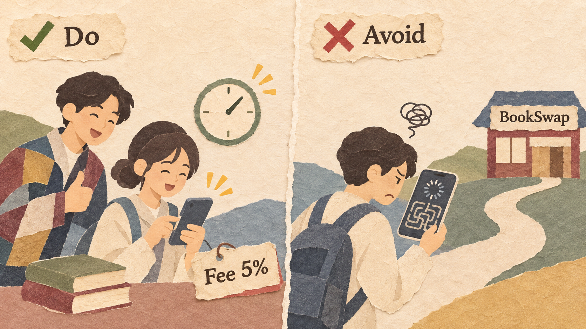

    * **Example:** In UniHub Market, a student can list a book in one minute with the login they already have. The fee is 5%, half of BookSwap's 10%.
    * **Common mistake:** Adding a weak feature, such as a market where finding a book is slow and hard. Students try it once and go back to BookSwap. Being in the same app does not save a bad product.
  * **Rule 4: Let users choose, and play fair.** Users must be free to use the new product or not, and you must not block the rival. Forced users get angry, and a big company that blocks rivals can break competition law.

    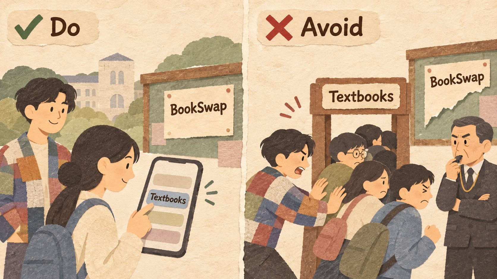

    * **Example:** UniHub Market is just one tab. Students who do not want it can ignore it. UniHub also keeps showing BookSwap posts on its notice board.
    * **Common mistake:** Making every student use UniHub Market, or deleting BookSwap posts from UniHub. Students complain, and the government may step in.

* **Good examples (real companies):**
  * **Good example 1: Microsoft Teams and Slack.** Slack was a popular standalone chat app for companies. In 2017, Microsoft launched Teams and included it in Office 365 business subscriptions at no extra cost. By October 2020, Teams had more than 115 million daily users. Slack spent about half of its revenue on sales and marketing (49.6% in the year ending January 2021), and in December 2020 it agreed to be bought by Salesforce for $27.7 billion.
    * **Why it is good:**
      * Millions of companies already paid for Office 365, so Teams reached Slack's customers at once (Rule 1).
      * Microsoft used its existing accounts, sales team, and Office files again, so each new Teams user cost almost nothing to win (Rule 2).
      * Teams was good enough for most companies and came at no extra price in the same bundle (Rule 3).
      * **Lesson for Rule 4:** In 2023, the European Commission opened an investigation into the bundle after a complaint by Slack, and Microsoft began selling Office without Teams in Europe. Even a successful envelopment must stay fair.
  * **Good example 2: Uber Eats.** Uber added food delivery to its ride-hailing business. Uber Eats uses the same Uber account and saved payment card, the same maps, and many of the same drivers. In the fourth quarter of 2020, when many people stopped taking rides, Uber's delivery orders were worth $10.1 billion, more than its rides ($6.8 billion).
    * **Why it is good:**
      * People who take Uber rides also order food, so Uber had the customers already (Rule 1).
      * Drivers, maps, and payments were shared parts that Uber used again (Rule 2).
      * One account and one saved card made ordering food easy for Uber riders (Rule 3).

* **Bad examples (real companies):**
  * **Bad example 1: Google+ and YouTube.** Google launched Google+, a social network, in 2011 to compete with Facebook, and linked it to its other services. In 2013, YouTube began requiring a Google+ profile to post comments. Users complained loudly. In 2015, Google removed the requirement, and it closed Google+ for consumers in April 2019.
    * **Why it is bad:**
      * Users were forced into the new product to keep using YouTube (Rule 4).
      * Google had many users, but not their friends. A social network is useful only when your friends are there (network effects, Session 1.2), so Google+ was not good enough compared with Facebook (Rule 3).
      * Forcing users damaged trust in YouTube, the product people already liked.
  * **Bad example 2: Amazon Fire Phone.** In 2014, Amazon entered the smartphone market with the Fire Phone. It had a button called Firefly that recognized products and let users buy them on Amazon. Sales were weak, and in October 2014 Amazon reported a charge of about $170 million, mainly for unsold Fire Phones.
    * **Why it is bad:**
      * Amazon shoppers could already shop on Amazon with any iPhone or Android phone, so the bundle gave them little new value (Rule 3).
      * The phone had fewer apps than iPhone and Android phones, so it did not do the main job of a smartphone well enough (Rule 3).
      * Amazon's shared parts (shopping accounts, Prime) helped Amazon sell more but did not make the phone better for users (Rule 2).

* **Before the exercises: four tools you will use:**
  * **Tool 1 - Overlap rate:**
    * Overlap rate = shared users / target's users x 100
    * **Example:** A music app has 40,000 users. A standalone podcast app has 10,000 users, and 3,000 of them also use the music app: 3,000 / 10,000 x 100 = 30%.
  * **Tool 2 - Customer acquisition cost (CAC):**
    * CAC = marketing spending / new customers. Compare the attacker's CAC with the target's CAC.
    * **Example:** The podcast app spends $50,000 on ads and wins 5,000 users: $50,000 / 5,000 = $10.00. The music app spends $3,000 on banners inside its own app and wins 6,000 podcast listeners: $3,000 / 6,000 = $0.50.
  * **Tool 3 - Profit over several periods:** A new product often loses money at first because it costs money to build.
    * Profit = revenue per period x number of periods - one-time cost - running cost per period x number of periods
    * **Example:** A gym app builds a meal-plan feature for $5,000. It earns $2,000 a month and costs $500 a month to run. After 4 months: 4 x $2,000 - $5,000 - 4 x $500 = $8,000 - $5,000 - $2,000 = $1,000.
  * **Tool 4 - Trade-off and decision rule (from Session 2.1):** A **trade-off** is what you give up to get something you value more. A **decision rule** is a promise, written before you start, about which result would make you change your decision. Example: "If fewer than 10% of our users try the new feature in the first semester, we will stop building it."

* **Exercise 1 - Easy: Envelopment or not? (20 min):**
  * **Scenario:** Six companies plan a move. (a) ChatLine, a messaging app with 30 million users, adds money transfers between friends, using the same account and the bank card users already saved. (b) A bakery opens a second shop in another city. (c) An email service adds a free calendar inside the same login and competes with standalone calendar apps. (d) A ride-hailing app cuts its ride prices by 20%. (e) A phone maker puts a free note-taking app on every new phone and competes with standalone note apps. (f) A shoe store starts selling video games on a separate website with separate customer accounts.
  * **Template:**

    ```text
    Move [letter]: [envelopment / not envelopment], because
    shared users: [yes / no], shared parts: [what is used again, or none],
    nearby market: [which market it enters, or none].
    ```

  * **Worked example (two other moves):**

    ```text
    Move: a banking app adds stock trading inside the same app.
    Envelopment, because shared users: yes, shared parts: the same login and
    bank account, nearby market: stock trading apps.
    Move: a coffee shop adds ten more tables.
    Not envelopment, because shared users: yes, shared parts: none new,
    nearby market: none (it grows in its own market).
    ```

  * **Your turn:** Fill in the template for all six moves.
  * **Check your answer:** (a) envelopment: same users, same account and saved card, enters money transfers. (b) not envelopment: the same product in a new place, no nearby market. (c) envelopment: same users and login, enters calendar apps. (d) not envelopment: a price cut in its own market. (e) envelopment: every phone buyer gets the app, enters note-taking apps. (f) not envelopment: no shared parts, and video games are not a market next to shoes.

* **Exercise 2 - Medium: Check an envelopment opportunity (30 min):**
  * **Scenario:** FitTrack is a running app with 50,000 users. MealMate is a standalone meal-planning app with 20,000 users; 9,000 of them also use FitTrack. Last year MealMate spent $60,000 on ads and won 10,000 new users. FitTrack plans to add meal plans inside its app. It would spend $5,000 on banners inside the app and expects 8,000 users to start using the meal plans in the first year.
  * **Step 1 - Calculate (Tools 1 and 2):** Overlap rate = 9,000 / 20,000 x 100 = ______ %. MealMate's CAC = $60,000 / 10,000 = $______. FitTrack's CAC = $5,000 / 8,000 = $______.
  * **Step 2 - Check the four rules:** Use the template.
  * **Template:**

    ```text
    Rule 1 (users already there): overlap rate = [number]%. [strong / weak], because [reason].
    Rule 2 (shared parts): we can use [parts] again. Our CAC is $[number] vs. their $[number].
    Rule 3 (good enough and easier): users will switch because [one reason]. The risk is [one weakness].
    Rule 4 (choice and fairness): we will keep [what users can still choose].
    Verdict: [go / do not go], because [one sentence].
    ```

  * **Worked example (CityMap, a map app with 80,000 users, plans to add parking payment; ParkPay, a standalone parking app, has 10,000 users, 6,000 of whom also use CityMap; ParkPay spent $40,000 to win 5,000 users; CityMap expects 10,000 users from a $4,000 in-app promotion):**

    ```text
    Rule 1 (users already there): overlap rate = 60%. Strong, because most
    ParkPay users already open CityMap while driving.
    Rule 2 (shared parts): we can use our maps, accounts, and saved cards again.
    Our CAC is $0.40 vs. their $8.00.
    Rule 3 (good enough and easier): drivers will switch because they can pay
    for parking in the app they already use to drive there. The risk is that
    some parking lots work only with ParkPay.
    Rule 4 (choice and fairness): we will keep showing ParkPay lots on our map.
    Verdict: go, because overlap is high and our CAC is 20 times lower.
    ```

  * **Your turn:** Fill in the template for FitTrack.
  * **Check your answer:** Overlap rate = 9,000 / 20,000 x 100 = **45%**. MealMate's CAC = **$6.00**. FitTrack's CAC = $5,000 / 8,000 = **$0.63** (about 10 times lower). Overlap is medium: almost half of MealMate users already use FitTrack. A strong answer names shared parts (accounts, workout data that can suggest meals, payment), one reason to switch (for example, meal plans that match today's run), one real risk (for example, MealMate's recipes may be better), and one way to keep choice (for example, users can still connect MealMate). A "go" verdict is reasonable; a "do not go" verdict can also be strong if it argues that the meal plans would not be good enough (Rule 3).

* **Exercise 3 - Hard: Should UniHub envelop BookSwap? (50 min, including 2-minute presentations):**
  * **Scenario:** Return to Jae and UniHub (18,000 users; BookSwap has 6,000 users, 4,200 shared; each active trader sells about $40 of books per semester). Jae has two options for the next four semesters (two years).
    * **Option A - Build UniHub Market (envelop):** Build a textbook market inside UniHub for $12,000 once (one developer for 3 months at $4,000 a month), plus $1,000 per semester to run. The fee is 5%, half of BookSwap's. The team expects 20% of UniHub users to trade each semester.
    * **Option B - Partner with BookSwap:** Show a BookSwap tab inside UniHub. BookSwap pays UniHub $2 for each new user who joins through UniHub. The team expects 1,400 new BookSwap users per semester. There is no building cost.
  * **Step 1 - Calculate (use Tools 1 and 3):**
    * Overlap rate = 4,200 / 6,000 x 100 = ______ %.
    * Option A: traders per semester = 18,000 x 20% = ______; fee revenue per semester = traders x $40 x 5% = $______.
    * Option A profit over 4 semesters = 4 x fee revenue - $12,000 - 4 x $1,000 = $______.
    * Option A, if only 10% of users trade: traders = ______; revenue per semester = $______; profit over 4 semesters = $______.
    * Option B: revenue per semester = 1,400 x $2 = $______; profit over 4 semesters = $______.
  * **Step 2 - Write a 3-bullet memo to the CEO (use Tool 4):**
  * **Template:**

    ```text
    To: [CEO name], [company]
    1. Decision and evidence: We should choose [option] because [the rule it follows]
       and [one number from your calculation].
    2. Biggest risk and trade-off: The weakest point is [risk]. We give up [what we lose]
       to gain [what we protect or win].
    3. Next step and decision rule: In the next semester we will [one action] and measure [one number].
       We will change this decision if [result].
    ```

  * **Worked example (CityMap from Exercise 2; the choice is between building parking payment and partnering with ParkPay):**

    ```text
    To: Sara Lin, CEO, CityMap
    1. Decision and evidence: We should build parking payment inside CityMap,
       because 60% of ParkPay users already use our app (Rule 1) and our CAC
       is $0.40 against ParkPay's $8.00 (Rule 2).
    2. Biggest risk and trade-off: The weakest point is that some parking lots
       work only with ParkPay. We give up a safe partnership fee to own a
       payment business that can grow with our map users.
    3. Next step and decision rule: In the next semester we will launch in one
       city and measure how many drivers pay through CityMap. We will change
       this decision if fewer than 5% of drivers in that city use it.
    ```

  * **Your turn:** Write the memo for UniHub. Then give a 2-minute presentation using your three bullets.
  * **Check your answer:**
    * Overlap rate = 4,200 / 6,000 x 100 = **70%**.
    * Option A: 18,000 x 20% = 3,600 traders; 3,600 x $40 x 5% = **$7,200** per semester. Profit over 4 semesters = 4 x $7,200 - $12,000 - 4 x $1,000 = $28,800 - $16,000 = **$12,800**.
    * Option A with only 10% trading: 1,800 traders; 1,800 x $40 x 5% = $3,600 per semester; profit = $14,400 - $16,000 = **-$1,600** (a loss).
    * Option B: 1,400 x $2 = $2,800 per semester; profit over 4 semesters = 4 x $2,800 = **$11,200**, with no building cost and no risk of a loss.
    * Where Option A stops winning: Option A beats Option B only if 4 x revenue per semester - $16,000 is more than $11,200, so revenue per semester must be more than $6,800. That needs more than $6,800 / ($40 x 5%) = 3,400 traders, about 19% of UniHub users. Option A avoids a loss only if revenue per semester is more than $16,000 / 4 = $4,000, which needs more than $4,000 / ($40 x 5%) = 2,000 traders, about 11% of users.
    * Option A earns $1,600 more than Option B, but only if about 19% or more of users trade; the team expects 20%, just above that line. Both choices can be strong. A memo for Option A should point to the 70% overlap and the shared student ID check (Rules 1 and 2), name the risk that fewer users trade, and give a decision rule such as "If fewer than 19% of UniHub users trade in the first semester, we will switch to the partnership." A memo for Option B should explain why the safer, certain income is worth giving up control of the textbook market.

* **Success check:** You can (1) explain platform envelopment with the words attacker, target, overlap, shared parts, and bundle, (2) check an opportunity with the overlap rate, the CAC, and the four rules, and (3) compare envelopment with a partnership over several periods and write a decision rule.

* **References:**
  * Eisenmann, T., Parker, G., & Van Alstyne, M. (2011). [Platform envelopment](https://doi.org/10.1002/smj.935). *Strategic Management Journal*, 32(12), 1270-1285.
  * Slack Technologies (2021). [Form 10-K for the fiscal year ended January 31, 2021](https://www.sec.gov/edgar/browse/?CIK=0001764925). SEC EDGAR.
  * European Commission (2023). [Antitrust: Commission opens investigation into possible anticompetitive practices by Microsoft regarding Teams](https://ec.europa.eu/commission/presscorner/detail/en/ip_23_3991).
  * Uber Technologies (2021). [Uber announces results for fourth quarter and full year 2020](https://investor.uber.com/news-events/news/press-release-details/2021/Uber-Announces-Results-for-Fourth-Quarter-and-Full-Year-2020/default.aspx).
  * YouTube (2015). [Official YouTube Blog, July 2015](https://youtube.googleblog.com/2015/07/). Google+ no longer required for YouTube.

---

<a id="session-3-2"></a>
### Session 3.2: The Cannibalization Strategy

**Strategy of this session: Cannibalization Strategy**


* **Lecture Presentation:** [Download Slides (PDF)](slides/session_3_2_lecture.pdf)

* **Duration:** 3 hours: 50-minute lesson, 10-minute break, Exercise 1 (20 min) and Exercise 2 (30 min), 10-minute break, Exercise 3 with short presentations (50 min), and 10-minute wrap-up.
* **Situation:** Mei runs StudyPrint, a print shop on campus. Each semester it sells printed course packs (paper books of class readings) to students. The business is profitable, but it is shrinking: NoteCloud, a digital notes app that costs $6 a month, takes about 300 of StudyPrint's buyers every semester. Mei could sell her own digital pass with all course packs on a phone or laptop. But many of her paper buyers would switch to it, and each digital student earns less profit than a paper buyer.

  | StudyPrint | Last semester | This semester |
  |---|---|---|
  | Students who buy paper course packs | 1,800 | 1,500 |
  | Money each buyer spends (2 packs x $20) | $40 | $40 |
  | Cost to print 2 packs | $16 | $16 |
  | Profit per buyer | $24 | $24 |
  | Total profit | $43,200 | $36,000 |

  The idea: a **StudyPrint Digital Pass** with every course pack for $24 per semester. It would cost $4 per student to run (servers and fees to authors), so it earns $20 profit per student. Building it would cost $10,000 once.

* **The strategy in one paragraph:** The cannibalization strategy means a company launches a new product even though the new product will take sales from its own old product. To **cannibalize** means to eat part of yourself: some of your own customers move from your old product to your new one. Companies do this on purpose when a new technology or a rival is already taking their customers. The choice is not "old sales or new sales"; it is "lose customers to yourself or lose them to a rival." Use this strategy when a new way of serving customers is clearly growing, when a rival will win your customers if you wait, and when the new product can earn enough over time to make up for the old sales it replaces.

* **Goal:** Apply the Cannibalization Strategy: measure how much of a new product's sales come from your own old product, compare the plan with what happens if you do nothing, and plan how to move customers to the new product.

* **Words you need first:**
  * **Cannibalization:** When a company's new product takes sales from its own old product. Example: 600 of StudyPrint's paper buyers switch to the Digital Pass.
  * **Profit per customer:** The money a company keeps from one customer after paying the costs of serving that customer. Example: a paper buyer pays $40 and costs $16 to serve, so profit per buyer = $40 - $16 = $24.
  * **Cannibalization rate:** The share of the new product's customers who came from your own old product. Cannibalization rate = old customers who switched / customers of the new product x 100. Example: 600 / 900 x 100 = 67%.
  * **Net gain:** What the company really gains after counting the profit it loses on the old product. Net gain = profit from the new product - profit lost on the old product. Example: a new product earns $9,000 but the old product loses $5,000 of profit: $9,000 - $5,000 = $4,000.
  * **"Do nothing" baseline:** What would happen if the company does not launch anything. A baseline is the result you compare your plan against. Example: if StudyPrint does nothing, NoteCloud keeps taking 300 buyers a semester.
  * **Rival:** A company that competes for the same customers. Example: NoteCloud is StudyPrint's rival.

* **The four rules of the Cannibalization Strategy (Hour 1 - 50 minutes):**
  * **Rule 1: Compare with the future, not with today.** Ask what will happen if you do nothing. If a rival is already taking your customers, today's profit will not stay.

    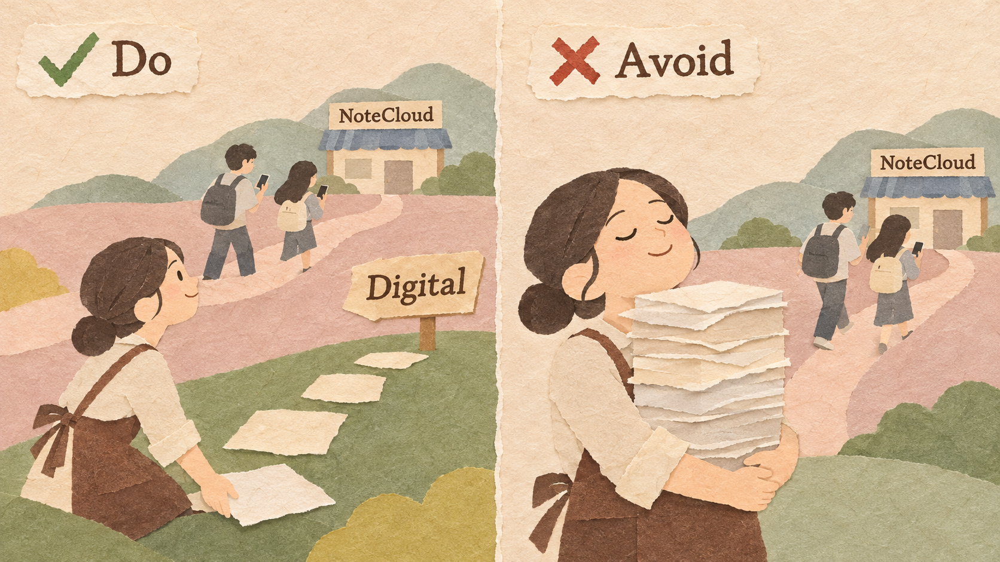

    * **Example:** StudyPrint earns $36,000 this semester. If Mei does nothing, NoteCloud keeps taking 300 buyers each semester, so profit will keep falling. The real choice is between the Digital Pass and a smaller business, not between the Digital Pass and $36,000.
    * **Common mistake:** Saying "the new product will hurt our sales" and stopping there. The old sales are already disappearing; the only question is who gets the customers.
  * **Rule 2: Count the net gain, not only the new sales.** New sales look good on their own. Always subtract the profit you lose on the old product.

    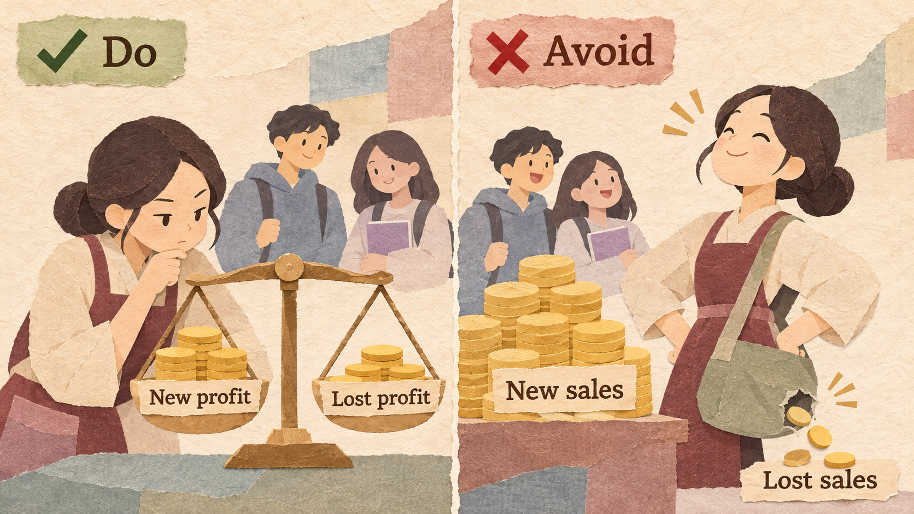

    * **Example:** The Digital Pass earns $20 from each student. But a paper buyer who switches earned $24, so each switcher costs StudyPrint $4. The pass helps mainly because of the new students it brings and the buyers it keeps from NoteCloud.
    * **Common mistake:** Reporting "900 Digital Pass users, $18,000 of new profit!" without saying that 600 of them were paper buyers who used to bring $14,400.
  * **Rule 3: Give the new product its own team and its own goals.** Managers of the old product often slow the new one down, because it takes their sales. A separate team with its own targets can move faster.

    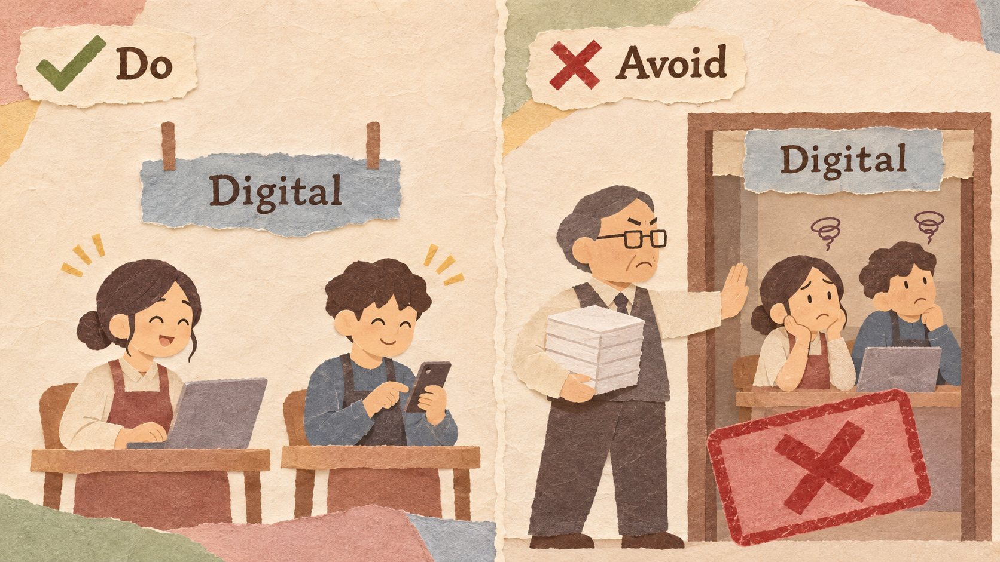

    * **Example:** Mei asks two staff members to run the Digital Pass. They are measured by digital users, not by paper sales.
    * **Common mistake:** Letting the paper team decide the price and features of the Digital Pass. They may make it weak so that paper sales stay high.
  * **Rule 4: Move customers step by step, and keep their trust.** Give customers time, help, and a good reason to switch. Do not force everyone overnight.

    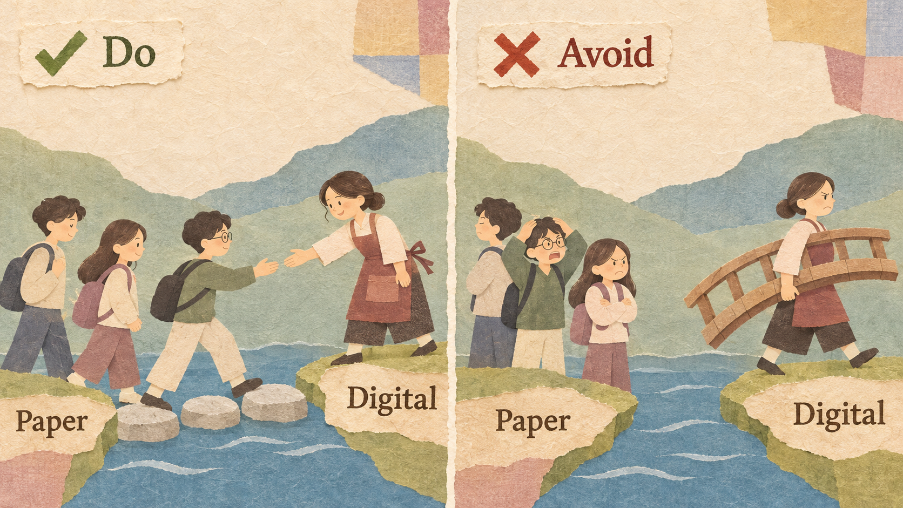

    * **Example:** For one year, StudyPrint keeps selling paper packs, offers the Digital Pass at a discount to paper buyers, and shows them how to use it in class.
    * **Common mistake:** Stopping paper sales overnight and telling students to "go digital." Students who are not ready leave for a rival.

* **Good examples (real companies):**
  * **Good example 1: Apple's iPhone and iPod.** In 2007, Apple launched the iPhone, which could also play music. It was clear that people would stop buying a separate music player. iPod sales peaked at about 54.8 million units in 2008 and fell to about 14.4 million in 2014. But by 2012, the iPhone brought in about half of Apple's revenue ($80.5 billion of $156.5 billion).
    * **Why it is good:**
      * Phone makers were adding music to phones; Apple saw that iPod sales would fall anyway (Rule 1).
      * The iPhone earned far more than the iPod sales it replaced (Rule 2).
      * Apple kept selling iPods for years while customers moved to the iPhone (Rule 4).
  * **Good example 2: Adobe Creative Cloud.** In 2013, Adobe stopped making new versions of Creative Suite, software customers bought once for about $1,300 to $2,600, and moved to Creative Cloud, a monthly subscription (about $50 a month for all apps). Adobe's revenue fell from $4.40 billion in 2012 to $4.06 billion in 2013. Then it grew to $4.80 billion in 2015 and $7.30 billion in 2017.
    * **Why it is good:**
      * Adobe accepted a short fall in revenue because it compared the plan with a future in which customers stopped paying for upgrades, not with its 2012 sales (Rule 1).
      * Monthly payments from millions of subscribers were worth more over time than the one-time sales they replaced (Rule 2).
      * Existing customers were offered a lower price in the first year to help them switch (Rule 4).

* **Bad examples (real companies):**
  * **Bad example 1: Kodak and digital photography.** In 1975, Kodak engineer Steve Sasson built one of the first digital cameras. But Kodak earned most of its profit from selling film, and its leaders were slow to move into digital photos because digital would replace film. Digital cameras and then phones replaced film anyway. Kodak filed for bankruptcy protection in January 2012.
    * **Why it is bad:**
      * Kodak compared digital with its profitable film business today, not with a future without film (Rule 1).
      * Film managers had strong power inside the company, so the digital business never had the freedom to grow (Rule 3).
      * Rivals such as Canon, Sony, and later phone makers took the customers that Kodak did not want to cannibalize.
  * **Bad example 2: Netflix's Qwikster.** Netflix wanted its customers to move from DVDs by mail to streaming. In September 2011, it announced that the DVD service would become a separate company, Qwikster, with its own website and account. Customers were angry: they would need two accounts for one service. In October 2011, only three weeks later, Netflix cancelled the plan.
    * **Why it is bad:**
      * Moving to streaming was the right idea, but Netflix tried to push customers overnight (Rule 4).
      * Customers got no new value from the change; they only got more work (two websites, two bills).
      * The change came just after a large price increase (Session 2.3), so customers' trust was already low.

* **Before the exercises: four tools you will use:**
  * **Tool 1 - Cannibalization rate:**
    * Cannibalization rate = old customers who switched / customers of the new product x 100
    * **Example:** A music school starts online lessons. 200 students take online lessons, and 50 of them used to take lessons at the school: 50 / 200 x 100 = 25%.
  * **Tool 2 - Net gain:**
    * Net gain = profit from the new product - profit lost on the old product
    * **Example:** The online lessons earn $10 profit per student: 200 x $10 = $2,000. Each switcher earned $30 at the school: 50 x $30 = $1,500 lost. Net gain = $2,000 - $1,500 = $500.
  * **Tool 3 - Compare with the "do nothing" baseline:**
    * Gain of the plan = result with the plan - result if we do nothing
    * **Example:** Without online lessons, a new online rival will take 60 school students: school profit falls by 60 x $30 = $1,800. Compared with doing nothing, the plan is worth $500 + $1,800 = $2,300, if online lessons keep those 60 students.
  * **Tool 4 - Trade-off and decision rule (from Session 2.1):** A **trade-off** is what you give up to get something you value more. A **decision rule** is a promise, written before you start, about which result would make you change your decision. Example: "If fewer than 300 students use the Digital Pass in the first semester, we will stop it."

* **Exercise 1 - Easy: Cannibalization or not? (20 min):**
  * **Scenario:** Six companies plan a new product. (a) A bakery that sells a $6 premium loaf adds a $3 basic loaf. (b) A newspaper puts all its articles on a free website. (c) A gym opens a branch in a city where it has no members. (d) A streaming service adds a cheaper plan with ads. (e) A car maker launches an electric version of its best-selling car. (f) A cafe starts selling umbrellas on rainy days.
  * **Template:**

    ```text
    Product [letter]: [cannibalization / not cannibalization], because
    [which old product of the same company could lose customers, or none]
    and [why customers might switch, or why they would not].
    ```

  * **Worked example (two other products):**

    ```text
    Product: a bookstore starts selling e-books of the same titles.
    Cannibalization, because its paper books could lose customers,
    and some readers will choose the cheaper, lighter e-book instead.
    Product: a bookstore starts selling coffee.
    Not cannibalization, because no old product loses customers;
    coffee is bought in addition to books.
    ```

  * **Your turn:** Fill in the template for all six products.
  * **Check your answer:** (a) cannibalization: some premium-loaf buyers will pay $3 instead of $6. (b) cannibalization: some readers stop buying the printed paper. (c) not cannibalization: no current members are in that city. (d) cannibalization: some customers on the full-price plan will move to the cheaper plan. (e) cannibalization: some buyers of the petrol car will choose the electric one. (f) not cannibalization: umbrellas do not replace coffee.

* **Exercise 2 - Medium: Calculate the real gain (30 min):**
  * **Scenario:** GoldCrust bakery sells 1,000 premium loaves a month with $3.00 profit each. It adds a basic loaf with $1.00 profit each and sells 800 basic loaves in the first month. Premium sales fall to 700. A discount bakery is opening next door; GoldCrust believes that without a basic loaf, it would lose 400 premium buyers to that bakery.
  * **Step 1 - Calculate (Tools 1 and 2):** Premium buyers who switched = 1,000 - 700 = ______. Cannibalization rate = switched / 800 x 100 = ______ %. Net gain compared with last month = 800 x $1.00 - switched x $3.00 = $______.
  * **Step 2 - Compare with the baseline (Tool 3):** Profit if GoldCrust does nothing = (1,000 - 400) x $3.00 = $______. Profit with the basic loaf = 700 x $3.00 + 800 x $1.00 = $______. Gain compared with doing nothing = $______.
  * **Step 3 - Explain:** Use the template.
  * **Template:**

    ```text
    Compared with last month, the new product [gains / loses] $[amount],
    because [number] customers switched from our [old product].
    Compared with doing nothing, it [gains / loses] $[amount],
    because [what would happen without it].
    So we should [keep / stop] the new product, because [Rule 1 or Rule 2].
    ```

  * **Worked example (the music school from Tools 1 to 3):**

    ```text
    Compared with last month, online lessons gain $500,
    because 50 students switched from our school lessons.
    Compared with doing nothing, they gain $2,300,
    because without them a rival would take 60 of our students.
    So we should keep online lessons, because the real choice is
    between them and a smaller school (Rule 1).
    ```

  * **Your turn:** Fill in the template for GoldCrust.
  * **Check your answer:** Switched = **300**. Cannibalization rate = 300 / 800 x 100 = **37.5%**. Net gain compared with last month = $800 - $900 = **-$100** (a small loss). Profit if GoldCrust does nothing = 600 x $3.00 = **$1,800**. Profit with the basic loaf = $2,100 + $800 = **$2,900**. Gain compared with doing nothing = **$1,100**. A strong answer says that the basic loaf looks like a loss compared with last month but is a clear gain compared with the future (Rule 1), and keeps the basic loaf, as long as the discount bakery really is a threat.

* **Exercise 3 - Hard: Should StudyPrint launch the Digital Pass? (50 min, including 2-minute presentations):**
  * **Scenario:** Return to Mei and StudyPrint (1,500 paper buyers this semester, $24 profit each, $36,000 profit). Mei compares two options for the next four semesters.
    * **Option A - Keep paper only:** NoteCloud keeps taking 300 buyers each semester. Paper buyers fall to 1,200, then 900, then 600, then 300.
    * **Option B - Launch the Digital Pass:** Building it costs $10,000 once. Each semester, 600 paper buyers switch to the pass, so 900 buy paper. Another 300 students who never bought paper join the pass, so the pass has 900 users. Each pass user brings $20 profit. The team believes the pass will stop students from leaving for NoteCloud.
  * **Step 1 - Calculate (use Tools 1 to 3):**
    * Option A profit over 4 semesters = (1,200 + 900 + 600 + 300) x $24 = $______.
    * Option B profit per semester = 900 x $24 + 900 x $20 = $______.
    * Option B profit over 4 semesters = 4 x profit per semester - $10,000 = $______.
    * Option B in the first semester only = profit per semester - $10,000 = $______. Is this more or less than today's $36,000? ______
    * Cannibalization rate of the pass = 600 / 900 x 100 = ______ %.
    * If NoteCloud stops growing and paper stays at 1,500 buyers, Option A over 4 semesters = 4 x $36,000 = $______.
  * **Step 2 - Write a 3-bullet memo to Mei (use Tool 4):**
  * **Template:**

    ```text
    To: [owner name], [company]
    1. Decision and evidence: We should choose [option] because [the rule it follows]
       and [one number from your calculation].
    2. Biggest risk and trade-off: The weakest point is [risk]. We give up [what we lose]
       to gain [what we protect or win].
    3. Next step and decision rule: In the next semester we will [one action] and measure [one number].
       We will change this decision if [result].
    ```

  * **Worked example (GoldCrust from Exercise 2):**

    ```text
    To: Tom Reyes, owner, GoldCrust
    1. Decision and evidence: We should keep the basic loaf, because the
       real choice is between it and losing 400 buyers to the discount bakery
       (Rule 1): it earns $2,900 a month against $1,800 if we do nothing.
    2. Biggest risk and trade-off: The weakest point is that more premium
       buyers may switch than the 300 we saw. We give up $900 of premium
       profit to keep customers away from the new bakery.
    3. Next step and decision rule: In the next month we will count premium
       and basic sales every week. We will change this decision if premium
       sales fall below 600 loaves.
    ```

  * **Your turn:** Write the memo for StudyPrint. Then give a 2-minute presentation using your three bullets.
  * **Check your answer:**
    * Option A = 3,000 x $24 = **$72,000**.
    * Option B per semester = $21,600 + $18,000 = **$39,600**; over 4 semesters = $158,400 - $10,000 = **$148,400**.
    * Option B in the first semester = $39,600 - $10,000 = **$29,600**, less than today's $36,000. Compared with today, the pass looks like a loss; compared with Option A's first semester (1,200 x $24 = $28,800), it is already ahead (Rule 1).
    * Cannibalization rate = **67%**: two of every three pass users were paper buyers (Rule 2).
    * If NoteCloud stops growing, Option A = **$144,000**, close to Option B's $148,400. So the choice depends on whether NoteCloud really keeps taking customers.
    * A strong memo usually chooses Option B, explains why today's $36,000 is the wrong comparison (Rule 1), names a real risk (for example, more paper buyers may switch than expected, or the pass may not stop students from leaving for NoteCloud), plans a step-by-step move such as a discount for paper buyers (Rule 4), and gives a decision rule such as "If fewer than 300 new students join the pass in the first semester, we will rethink the price."

* **Success check:** You can (1) explain cannibalization and why a company would cannibalize its own product on purpose, (2) calculate the cannibalization rate and the net gain, and (3) compare a plan with the "do nothing" baseline and write a decision rule.

* **References:**
  * Christensen, C. M. (1997). *The Innovator's Dilemma: When New Technologies Cause Great Firms to Fail*. Harvard Business School Press.
  * Apple Inc. (2008, 2012, 2014). [Form 10-K annual reports](https://investor.apple.com/sec-filings/default.aspx). iPod unit sales and iPhone net sales.
  * Adobe Inc. (2013-2017). [Form 10-K annual reports](https://www.adobe.com/investor-relations/financial-documents.html). Revenue by fiscal year.
  * Eastman Kodak Company (2012, January 19). [Eastman Kodak Company and its U.S. subsidiaries commence voluntary Chapter 11 business reorganization](https://www.sec.gov/edgar/browse/?CIK=0000031235). SEC EDGAR.
  * Hastings, R. (2011, October 10). [DVDs will be staying at Netflix.com](https://about.netflix.com/en/newsroom). Netflix.

---

<a id="session-3-3"></a>
### Session 3.3: The Disruption Strategy

**Strategy of this session: Disruption Strategy**


* **Lecture Presentation:** [Download Slides (PDF)](slides/session_3_3_lecture.pdf)

* **Duration:** 3 hours: 50-minute lesson, 10-minute break, Exercise 1 (20 min) and Exercise 2 (30 min), 10-minute break, Exercise 3 with short presentations (50 min), and 10-minute wrap-up.
* **Situation:** Linh runs TutorBite, a small tutoring app. Students book 15-minute video calls with senior students who explain one homework problem. On campus, the leader in tutoring is Apex Academy, which teaches weekly classes with expert teachers. Apex is expensive, so most students use no tutoring at all. An investor tells Linh to hire expert teachers and go after Apex's students. Linh is not sure.

  | | Apex Academy (the leader) | TutorBite (Linh's app) |
  |---|---|---|
  | What it offers | Weekly 2-hour classes with expert teachers | 15-minute video help from senior students |
  | Price | $160 a month | $5 a session |
  | Customers today | 2,000 students | 300 students |
  | Profit per customer | $60 a month | $2 a session |

  Another 8,000 students on campus use no tutoring, because Apex costs too much.

* **The strategy in one paragraph:** The disruption strategy is a way for a small company to beat a strong leader without fighting it head-on. The newcomer starts with customers the leader ignores: people who buy nothing today because the leader's product is too expensive or too hard to use, or customers who get more than they need from the leader. It offers a simpler, cheaper product that is good enough for them. The leader does not fight back, because these customers earn it little profit. Then the newcomer improves step by step until its product is good enough for the leader's own customers. Use this strategy when the leader's product is expensive or complex, many people are not served, and a simpler product can do the main job.

* **Goal:** Apply the Disruption Strategy: find customers the leader is not serving, check whether a simple product is good enough for them, test whether the leader will fight back, and plan how to move up step by step.

* **Words you need first:**
  * **Leader (incumbent):** The strong company that already serves most customers in a market. Example: Apex Academy.
  * **Disruption (disruptive innovation):** A simpler, cheaper product that starts with customers the leader ignores and later takes the leader's customers. Example: TutorBite's $5 sessions.
  * **Sustaining innovation:** Making a product better for the leader's best customers, such as more features at a higher price. Example: Apex adds a second weekly class for $240 a month.
  * **Non-consumers:** People who need a job done but buy nothing today, often because the product costs too much or is too hard to use. Example: the 8,000 students who use no tutoring.
  * **Over-served customers:** Customers who get more than they need and would happily pay less for less. Example: a student who only needs help with one homework problem but must pay for a full month of classes.
  * **Good enough:** A product that does the main job the customer needs, even if it is not the best. Example: a 15-minute explanation is good enough for one homework problem.

* **The four rules of the Disruption Strategy (Hour 1 - 50 minutes):**
  * **Rule 1: Start where the leader is not looking.** Begin with non-consumers or with the leader's least profitable customers. They are easy to win, and the leader will not miss them.

    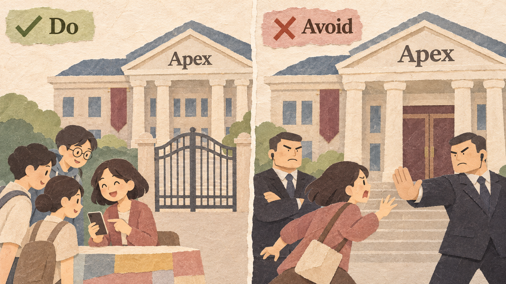

    * **Example:** TutorBite starts with the 8,000 students who use no tutoring. Apex does not serve them, so it will not fight for them.
    * **Common mistake:** Going straight after the leader's best customers. The leader is strongest exactly there, and it will fight hard to keep them.
  * **Rule 2: Make it simpler and cheaper, and good enough for the job.** Do not try to be better than the leader at everything. Be good enough at the main job, and much easier and cheaper.

    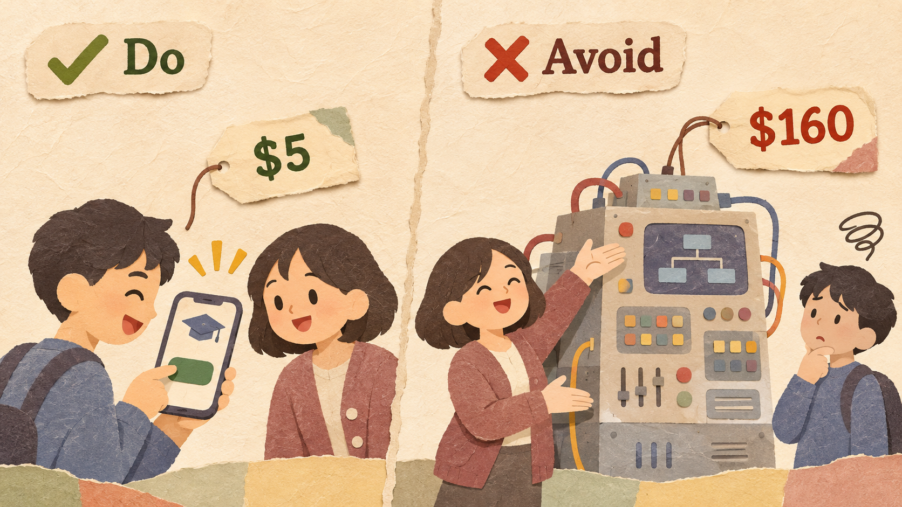

    * **Example:** A $5, 15-minute call answers one homework question. Students do not need a 2-hour class for that.
    * **Common mistake:** Adding expert teachers, long classes, and a high price to look like the leader. Then the product is neither cheap nor better.
  * **Rule 3: Choose a model the leader does not want to copy.** If copying you would earn the leader much less profit than its own product, the leader will ignore you, often until it is too late.

    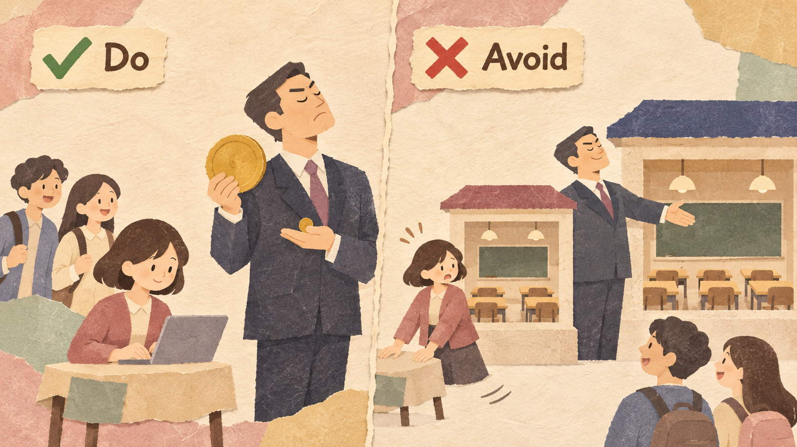

    * **Example:** Apex earns $60 a month from each student. Copying TutorBite would earn it about $2 a session. Apex's managers prefer to protect their $160 classes.
    * **Common mistake:** Choosing a model the leader can copy easily and profitably, such as the same classes at a slightly lower price. The leader can cut its price and win.
  * **Rule 4: Improve step by step, then move up to better customers.** Use what you learn from your first customers to improve. When your product becomes good enough for the leader's customers, they will come to you at a lower price.

    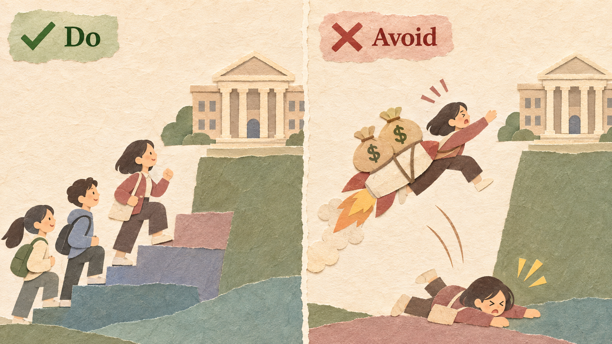

    * **Example:** After one year of sessions, TutorBite adds $40-a-month exam-prep plans with its best senior tutors. Some of Apex's students start to switch.
    * **Common mistake:** Spending a lot of money to grow very fast before the product works. A newcomer has little money and cannot survive big mistakes.

* **Good examples (real companies):**
  * **Good example 1: Netflix and Blockbuster.** Netflix started in 1998 by renting DVDs by mail, with no late fees. It was slower than walking into a Blockbuster store, but good enough for people who planned ahead and hated late fees. Blockbuster earned a large part of its profit from its stores and late fees. In 2000, Netflix offered to sell itself to Blockbuster for $50 million, and Blockbuster said no. Netflix started streaming in 2007 and kept improving. Blockbuster filed for bankruptcy in September 2010.
    * **Why it is good:**
      * Netflix started with customers that Blockbuster's stores did not care much about: people who did not mind waiting for a DVD (Rule 1).
      * A subscription without late fees was a model Blockbuster did not want to copy, because late fees were part of its profit (Rule 3).
      * Netflix improved step by step, from mail to streaming, until it was better for most customers (Rule 4).
  * **Good example 2: M-Pesa in Kenya.** In March 2007, the phone company Safaricom launched M-Pesa, which lets people send money with a simple text message on a basic phone. Customers put in and take out cash at small local shops. At that time, fewer than 20% of Kenyans had access to a bank. Safaricom hoped for 350,000 users in the first year; by November 2007, M-Pesa had more than 1 million active users. Later it added savings, loans, and bill payments.
    * **Why it is good:**
      * M-Pesa served non-consumers: millions of people that banks did not serve (Rule 1).
      * It worked on basic phones and at local shops, so it was simpler and cheaper than opening a bank account (Rule 2).
      * It started with sending money, then added savings, loans, and payments step by step (Rule 4).

* **Bad examples (real companies):**
  * **Bad example 1: Quibi.** Quibi launched in April 2020 with expensive short shows from famous Hollywood stars, made for watching on phones. It raised $1.75 billion and charged $4.99 to $7.99 a month. But people already watched free short videos on YouTube and TikTok. Quibi announced it would close in October 2020, about six months after launch.
    * **Why it is bad:**
      * Quibi went after viewers that strong leaders (YouTube, TikTok, Netflix) already served well, instead of people nobody served (Rule 1).
      * It was more expensive than free short videos, not simpler or cheaper (Rule 2).
      * It spent heavily before learning what viewers wanted, so it had no time to improve step by step (Rule 4).
  * **Bad example 2: Webvan.** Webvan was an online grocery delivery company in the United States. Before it had many customers, it built large high-tech warehouses (about $35 million each) and planned to enter many cities quickly. It lost more than $800 million and went bankrupt in July 2001.
    * **Why it is bad:**
      * Webvan tried to grow very fast before its service worked well and made money (Rule 4).
      * Its warehouses were expensive, so its costs were high, not low (Rule 2).
      * Later online grocery services grew slowly, city by city, and survived.

* **Before the exercises: four tools you will use:**
  * **Tool 1 - Size of the non-consumer market:**
    * Non-consumers = people who need the job done - people who buy from the leader
    * **Example:** 5,000 small shops in a city need a website. 1,000 pay a design agency. Non-consumers = 5,000 - 1,000 = 4,000 shops.
  * **Tool 2 - The leader's profit test:** Will the leader copy you?
    * Compare the leader's profit per customer today with the profit it would earn by copying you. If copying earns much less, the leader will probably not fight back.
    * **Example:** A design agency earns $1,500 profit per website. A simple website builder earns $10 a month per shop. The agency will not want to copy it.
  * **Tool 3 - Profit over several periods (from Session 3.1):**
    * Profit = profit per period x number of periods - one-time cost
    * **Example:** A website builder spends $6,000 on launch ads and earns $2,000 profit a month: after 12 months, 12 x $2,000 - $6,000 = $18,000.
  * **Tool 4 - Trade-off and decision rule (from Session 2.1):** A **trade-off** is what you give up to get something you value more. A **decision rule** is a promise, written before you start, about which result would make you change your decision. Example: "If fewer than 500 students use TutorBite in the first three months, we will change the price."

* **Exercise 1 - Easy: Disruption or not? (20 min):**
  * **Scenario:** Six companies plan a new product. (a) A startup sells a $300 basic 3D printer to schools that cannot afford $3,000 printers. (b) A car maker builds a faster, more expensive sports car to beat a rival's top model. (c) A startup offers a free, simple video-call app for families, while companies pay for expensive meeting systems. (d) A bank adds a metal credit card with airport lounge access for its richest customers. (e) A website offers $10 online courses in skills that colleges teach for $3,000. (f) A phone maker adds a fourth camera to its most expensive phone.
  * **Template:**

    ```text
    Product [letter]: [disruption / not disruption], because
    its first customers are [non-consumers / over-served customers / the leader's best customers],
    and it is [simpler and cheaper / better and more expensive] than what the leader sells.
    ```

  * **Worked example (two other products):**

    ```text
    Product: a $2 app that turns a phone into a simple scanner for students.
    Disruption, because its first customers are non-consumers who never bought a scanner,
    and it is simpler and cheaper than a $200 office scanner.
    Product: a scanner maker adds faster scanning to its $900 office model.
    Not disruption, because its customers are the leader's best customers,
    and it is better and more expensive (a sustaining innovation).
    ```

  * **Your turn:** Fill in the template for all six products.
  * **Check your answer:** (a) disruption: schools that bought no printer, much cheaper. (b) not disruption: better and more expensive for the best customers (sustaining). (c) disruption: families who would never buy a meeting system, free and simple. (d) not disruption: a better product for the richest customers (sustaining). (e) disruption: people who could not pay for college courses, much cheaper. (f) not disruption: more features for the top customers (sustaining).

* **Exercise 2 - Medium: Check a disruption plan (30 min):**
  * **Scenario:** QuickCut wants to open $8, 10-minute haircut kiosks in train stations. Hair salons in the city charge $40 for a 45-minute haircut with washing and styling, and earn $15 profit per haircut. A QuickCut haircut earns $3 profit. In the city, 50,000 men need a haircut every month; 20,000 go to salons, and the rest cut their hair at home.
  * **Step 1 - Calculate (Tools 1 and 2):** Non-consumers = 50,000 - 20,000 = ______. Salon profit per haircut = $______; QuickCut profit per haircut = $______. Copying QuickCut would earn a salon ______ times less per haircut.
  * **Step 2 - Check the four rules:** Use the template.
  * **Template:**

    ```text
    Rule 1 (where the leader is not looking): our first customers are [who], [number] people.
    Rule 2 (simpler, cheaper, good enough): we do [the main job] for $[price] instead of $[leader's price];
    we leave out [what we do not offer].
    Rule 3 (model the leader will not copy): the leader earns $[number] per customer; copying us earns $[number].
    Rule 4 (step by step): first we [first step]; later we [how we move up].
    Verdict: [go / do not go], because [one sentence].
    ```

  * **Worked example (SiteEasy, a $10-a-month website builder for small shops; agencies charge $2,000 per website):**

    ```text
    Rule 1: our first customers are the 4,000 small shops with no website.
    Rule 2: we give a simple one-page shop website for $10 a month instead of $2,000;
    we leave out custom design and meetings.
    Rule 3: the agency earns $1,500 per website; copying us earns $10 a month.
    Rule 4: first we offer one-page sites; later we add online ordering for bigger shops.
    Verdict: go, because 4,000 shops are not served and agencies will not fight for them.
    ```

  * **Your turn:** Fill in the template for QuickCut.
  * **Check your answer:** Non-consumers = **30,000** men who cut their hair at home. Salon profit = **$15**; QuickCut profit = **$3**; copying earns the salon **5 times** less per haircut. A strong answer: first customers are the 30,000 men who cut their own hair, plus over-served salon customers who only want a quick cut (Rule 1); the main job (a clean haircut) for $8, leaving out washing, styling, and booking (Rule 2); salons will not copy a $3-profit model (Rule 3); start in a few stations, then add more stations or simple extras such as beard trims (Rule 4). Verdict: go.

* **Exercise 3 - Hard: Head-on or disruption? (50 min, including 2-minute presentations):**
  * **Scenario:** Return to Linh and TutorBite. Linh compares two plans for the next 12 months.
    * **Option A - Go after Apex's students (head-on):** Hire expert teachers and sell weekly classes for $120 a month. Each student brings $20 profit a month. Marketing and hiring cost $20,000 once. The investor expects to win 300 of Apex's 2,000 students. But if Apex cuts its price, TutorBite would win only 100.
    * **Option B - Serve non-consumers first (disruption):** Keep $5 sessions with $2 profit each. Marketing costs $5,000 once. The team expects 10% of the 8,000 non-consumers to join, each using 3 sessions a month.
  * **Step 1 - Calculate (use Tools 1 to 3):**
    * Option A profit per month if 300 students join = 300 x $20 = $______. Profit over 12 months = 12 x monthly profit - $20,000 = $______.
    * Option A if Apex cuts its price and only 100 join: profit per month = $______; over 12 months = $______.
    * Option B students = 8,000 x 10% = ______; sessions per month = students x 3 = ______; profit per month = sessions x $2 = $______; over 12 months = 12 x monthly profit - $5,000 = $______.
    * Leader's profit test: Apex earns $60 a month per student. Would copying Option B earn Apex more or less? ______. Would copying Option A? ______
  * **Step 2 - Write a 3-bullet memo to the investor (use Tool 4):**
  * **Template:**

    ```text
    To: [name], [role]
    1. Decision and evidence: We should choose [option] because [the rule it follows]
       and [one number from your calculation].
    2. Biggest risk and trade-off: The weakest point is [risk]. We give up [what we lose]
       to gain [what we protect or win].
    3. Next step and decision rule: In the next three months we will [one action] and measure [one number].
       We will change this decision if [result].
    ```

  * **Worked example (QuickCut from Exercise 2):**

    ```text
    To: Omar Haddad, investor, QuickCut
    1. Decision and evidence: We should open $8 kiosks for the 30,000 men who
       cut their hair at home (Rule 1), because salons earn $15 a haircut and
       will not copy a $3-profit model (Rule 3).
    2. Biggest risk and trade-off: The weakest point is that men may keep
       cutting their hair at home. We give up the higher price of a salon
       service to win customers nobody serves.
    3. Next step and decision rule: In the next three months we will open two
       kiosks and count haircuts per day. We will change this decision if a
       kiosk does fewer than 40 haircuts a day.
    ```

  * **Your turn:** Write the memo for TutorBite. Then give a 2-minute presentation using your three bullets.
  * **Check your answer:**
    * Option A with 300 students: 300 x $20 = **$6,000** a month; over 12 months = $72,000 - $20,000 = **$52,000**.
    * Option A if Apex cuts its price: 100 x $20 = **$2,000** a month; over 12 months = $24,000 - $20,000 = **$4,000**.
    * Option B: 8,000 x 10% = 800 students; 800 x 3 = 2,400 sessions; 2,400 x $2 = **$4,800** a month; over 12 months = $57,600 - $5,000 = **$52,600**.
    * Leader's profit test: copying Option B earns Apex far less than its $60 a month per student, so Apex will probably ignore it. Option A is the same kind of class as Apex's, so Apex can fight back by cutting its price.
    * Both options earn about $52,000 if everything goes well. But Option A depends on Apex not fighting back; if it does, profit falls to $4,000. Option B does not depend on Apex at all. A strong memo usually chooses Option B (Rules 1 and 3), names a real risk (for example, fewer than 10% of non-consumers may join, or each student may use fewer than 3 sessions), plans how to move up later (Rule 4), and gives a decision rule such as "If fewer than 500 students use TutorBite in the first three months, we will change the price or the offer."

* **Success check:** You can (1) explain disruption and how it differs from sustaining innovation, (2) find non-consumers and use the leader's profit test, and (3) compare a head-on attack with a disruption plan and write a decision rule.

* **References:**
  * Christensen, C. M., Raynor, M. E., & McDonald, R. (2015). [What is disruptive innovation?](https://hbr.org/2015/12/what-is-disruptive-innovation) *Harvard Business Review*, 93(12), 44-53.
  * Newsweek (2021). [Fact check: Did Blockbuster turn down the chance to buy Netflix for $50 million?](https://www.newsweek.com/fact-check-did-blockbuster-turn-downchance-buy-netflix-50-million-1575557)
  * Safaricom (2017). [The M-PESA wonder: how it all began](https://newsroom.safaricom.co.ke/innovation/the-m-pesa-wonder-how-it-all-begun).
  * NBC News (2020, October 21). [Quibi is shutting down just months after launching](https://www.nbcnews.com/news/all/quibi-shutting-down-just-months-after-launching-n1244215).
  * TidBITS (2001, July 16). [Where Webvan went wrong](https://tidbits.com/2001/07/16/where-webvan-went-wrong/).

---

<a id="session-3-4"></a>
### Session 3.4: The Open Ecosystem Strategy

**Strategy of this session: Open Ecosystem Strategy**


* **Lecture Presentation:** [Download Slides (PDF)](slides/session_3_4_lecture.pdf)

* **Duration:** 3 hours: 50-minute lesson, 10-minute break, Exercise 1 (20 min) and Exercise 2 (30 min), 10-minute break, Exercise 3 with short presentations (50 min), and 10-minute wrap-up.
* **Situation:** Arjun runs ShopNest, a service that lets small shops build their own online store. Shops pay $50 a month. They keep asking for new features, such as delivery tracking, loyalty points, and gift cards. Arjun's team can build only a few features a year, so some shops leave for bigger store builders. Several small software companies have asked whether they could build add-ons for ShopNest shops.

  | ShopNest | Value |
  |---|---|
  | Shops using ShopNest | 400 |
  | Price per shop | $50 a month ($600 a year) |
  | Features shops have asked for | 30 |
  | Features the team can build in a year | 3 |
  | Shops that left last year, mostly because features were missing | 60 |
  | Small software companies asking to build add-ons | 12 |

* **The strategy in one paragraph:** The open ecosystem strategy means a company opens its product so that outside companies, called **partners**, can build on it. The company becomes a **platform**: it keeps the core of the product and sets the rules, and many partners add new features, apps, or ideas that the company could never build alone. Customers get more choice, partners get customers, and the platform becomes harder to leave. Use this strategy when customers want more features than your team can build, when outside companies are able and willing to build them, and when you can protect the core and the customers.

* **Goal:** Apply the Open Ecosystem Strategy: decide which parts to open and which to keep, design a deal that partners want to join, set rules that protect customers, and compare opening with building everything yourself.

* **Words you need first:**
  * **Ecosystem:** A group of companies that work around one platform and help each other's customers. Example: ShopNest plus the companies that build add-ons for ShopNest shops.
  * **Partner (outside developer):** An outside company that builds something on your platform. Example: a small company that builds a loyalty-points app for ShopNest shops.
  * **API (application programming interface):** A set of rules that lets one program safely use parts of another program. Example: through ShopNest's API, a delivery app can read a shop's orders.
  * **Core:** The central parts of the product that the platform keeps for itself, because they hold its value and its customers' trust. Example: ShopNest keeps payments and customer data.
  * **Revenue share:** The part of a partner's sales that the platform keeps. Example: if an app earns $1,000 and the platform keeps 20%, the platform gets $200 and the partner gets $800.
  * **Open innovation:** Using ideas and work from people outside the company, such as customers, fans, or partners. Example: a toy company lets fans send in designs for new sets.

* **The four rules of the Open Ecosystem Strategy (Hour 1 - 50 minutes):**
  * **Rule 1: Open the edges, keep the core.** Let partners add features around your product, but keep the parts that hold your value and customers' trust.

    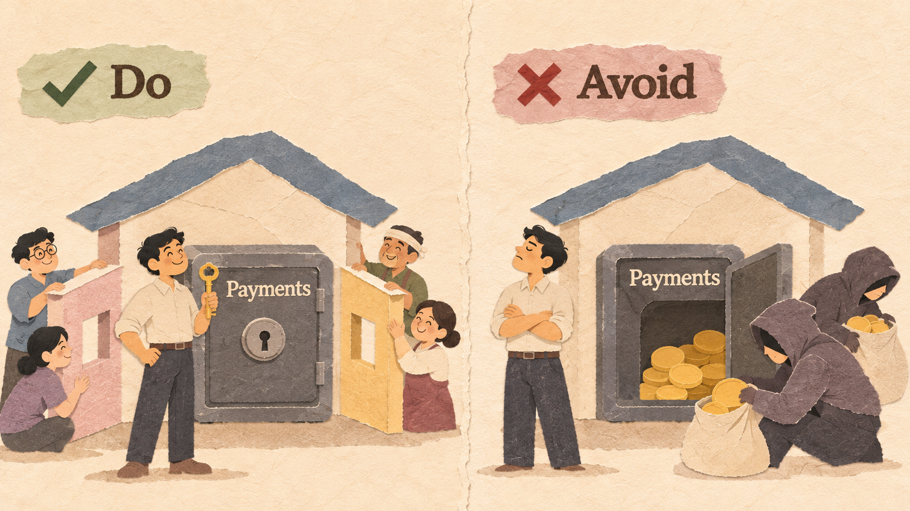

    * **Example:** ShopNest opens an API so partners can add delivery tracking, loyalty points, and gift cards. Payments and customer data stay with ShopNest.
    * **Common mistake:** Opening everything, including payments and customer data, with no control. Then partners can misuse it, and the platform loses its value.
  * **Rule 2: Make it worth it for partners to join.** Partners will build only if they can earn more than it costs them. Give them customers, tools, and a fair share of the money.

    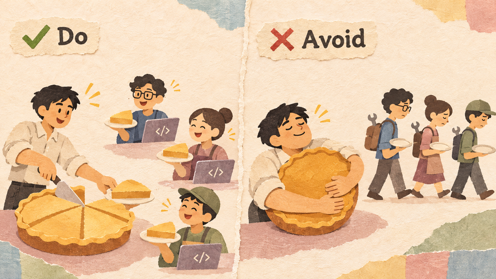

    * **Example:** ShopNest keeps 0% of the first $10,000 each partner earns in a year, and 15% after that. Partners also get free test stores.
    * **Common mistake:** Taking a large share of every sale, so partners cannot cover their costs. No partners join, and the app market stays empty.
  * **Rule 3: Set clear rules and check quality.** Customers trust the platform, not each small partner. Review apps before they go live, and protect customers' data.

    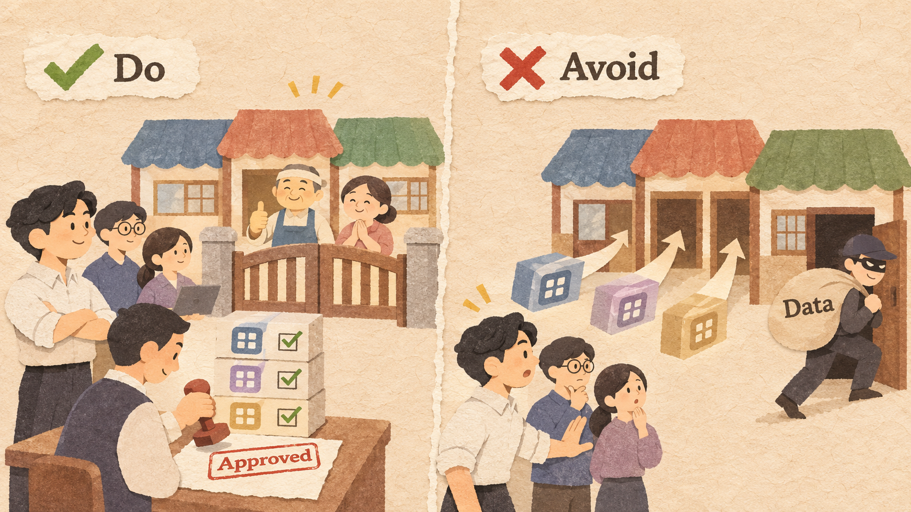

    * **Example:** Every app is tested before it appears in the ShopNest app market, and apps can read only the data that a shop allows.
    * **Common mistake:** Letting any app in without checks. One bad app that leaks data or breaks stores damages trust in the whole platform.
  * **Rule 4: Do not compete unfairly with your partners.** Partners invest time and money because they trust you. Do not copy their apps, change the rules suddenly, or push them out.

    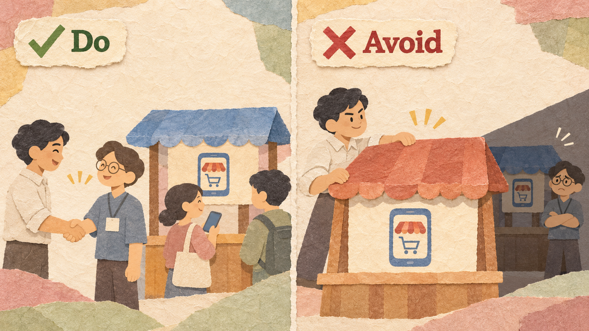

    * **Example:** When ShopNest plans a new feature, it tells partners six months ahead and does not copy any partner's app.
    * **Common mistake:** Copying the most popular partner app, or cutting partners off with no warning. Other partners stop building, and the ecosystem stops growing.

* **Good examples (real companies):**
  * **Good example 1: The Shopify App Store.** Shopify helps millions of businesses run online stores. Instead of building every feature itself, it lets outside developers sell apps to Shopify stores through its API and app store. In 2021, Shopify announced that developers would keep all of their first $1 million in app sales each year, and pay only 15% after that, instead of 20% before.
    * **Why it is good:**
      * Shopify keeps checkout and payments, and partners add thousands of features around them (Rule 1).
      * The low revenue share lets small developers earn enough to keep building (Rule 2).
      * Shopify reviews apps before they are listed in its app store (Rule 3).
  * **Good example 2: LEGO Ideas.** LEGO lets fans post designs for new LEGO sets online. If a design gets 10,000 supporters, LEGO reviews it. If LEGO makes the set, the fan designer receives a small share (1%) of its sales.
    * **Why it is good:**
      * LEGO gets new ideas from millions of fans, but keeps design checks, production, and the LEGO brand (Rule 1).
      * Fans are rewarded with public credit and a share of sales (Rule 2).
      * The 10,000-supporter step and LEGO's own review are clear rules that keep quality high (Rule 3).

* **Bad examples (real companies):**
  * **Bad example 1: Twitter and its developers.** For years, outside apps such as Tweetbot and Twitterrific gave people other ways to read Twitter. In January 2023, Twitter suddenly cut these apps off with no warning, then changed its rules to ban them. Twitterrific shut down. In 2023, Twitter also stopped free access to its API and began charging developers (from $100 a month).
    * **Why it is bad:**
      * Twitter changed the rules suddenly and pushed out partners who had helped it grow (Rule 4).
      * Developers who had spent years building lost their business overnight, so other developers stopped trusting the platform (Rule 2).
      * Users who liked these apps lost them too.
  * **Bad example 2: Facebook and Cambridge Analytica.** In 2014, a personality-quiz app on Facebook collected data not only from the people who used it but also from their friends, up to 87 million people. The data was passed to Cambridge Analytica, a political consulting company. After this became public in 2018, the U.S. Federal Trade Commission fined Facebook $5 billion in 2019, partly for failing to control what outside apps did with users' data.
    * **Why it is bad:**
      * Facebook let outside apps reach far more data than they needed (Rule 1).
      * It did not check well what apps did with the data (Rule 3).
      * Users lost trust in the whole platform, not only in one app.

* **Before the exercises: four tools you will use:**
  * **Tool 1 - Years to build alone:**
    * Years to build alone = features customers want / features your team builds per year
    * **Example:** A booking app's customers want 20 features, and its team builds 4 a year: 20 / 4 = 5 years.
  * **Tool 2 - Value of customers kept and won:**
    * Value = (customers who stay instead of leaving + new customers) x revenue per customer per year
    * **Example:** A booking app keeps 10 customers who would have left and wins 15 new ones; each pays $300 a year: (10 + 15) x $300 = $7,500.
  * **Tool 3 - Revenue share for the platform and the partner:**
    * Platform's share = partner's sales x share %; partner keeps = partner's sales - platform's share
    * **Example:** An app sells $12,000 a year and the platform keeps 20%: the platform gets $2,400 and the partner keeps $9,600.
  * **Tool 4 - Trade-off and decision rule (from Session 2.1):** A **trade-off** is what you give up to get something you value more. A **decision rule** is a promise, written before you start, about which result would make you change your decision. Example: "If fewer than 10 partner apps are live after six months, we will lower our revenue share."

* **Exercise 1 - Easy: Open ecosystem or not? (20 min):**
  * **Scenario:** Six companies plan a move. (a) A game console lets outside studios sell games in its online store. (b) A bank lets budgeting apps read a customer's spending, only with the customer's permission, through an API. (c) A restaurant hires one more cook. (d) A map company lets taxi apps use its maps for a fee. (e) A phone maker makes its phones work only with its own chargers. (f) A toy company invites fans to send in designs for new toys.
  * **Template:**

    ```text
    Move [letter]: [open ecosystem / not open ecosystem], because
    [who outside the company builds or adds something, or nobody]
    and [what the company keeps or controls].
    ```

  * **Worked example (two other moves):**

    ```text
    Move: an e-book store lets small publishers upload and sell their own books.
    Open ecosystem, because outside publishers add books,
    and the store keeps payments, pricing rules, and the reading app.
    Move: a bakery buys a bigger oven.
    Not open ecosystem, because nobody outside the company builds anything;
    the bakery only grows its own work.
    ```

  * **Your turn:** Fill in the template for all six moves.
  * **Check your answer:** (a) open ecosystem: outside studios add games; the console keeps the store and the rules. (b) open ecosystem: outside apps build on the bank's data through an API; the bank keeps control with the customer's permission. (c) not open ecosystem: the restaurant only grows its own work. (d) open ecosystem: taxi apps build on the maps; the map company keeps its maps. (e) not open ecosystem: the company closes its product to outsiders. (f) open ecosystem (open innovation): fans add ideas; the toy company keeps design checks and production.

* **Exercise 2 - Medium: Design a deal that partners want (30 min):**
  * **Scenario:** BookIt is a booking platform used by 2,000 hair salons. A small company wants to build a reminder app for BookIt salons. The app would cost $8 a month per salon, and the company expects 5% of salons to buy it. Building and running the app costs the company $8,000 a year. BookIt is choosing between three revenue-share rules: 30%, 15%, or 0% on the first $10,000 of a partner's sales each year (15% after that).
  * **Step 1 - Calculate (Tool 3):** Salons that buy = 2,000 x 5% = ______. App sales per year = salons x $8 x 12 = $______. Partner keeps at 30% = $______. Partner keeps at 15% = $______. Partner keeps with "0% on the first $10,000" = $______.
  * **Step 2 - Compare with the partner's cost:** For each rule, does the partner earn more than its $8,000 cost? ______
  * **Step 3 - Recommend:** Use the template.
  * **Template:**

    ```text
    Under [rule], the partner keeps $[amount], which is [more / less] than its cost of $[cost],
    so partners [will / will not] want to build for us.
    We should choose [rule], because [Rule 2 reason],
    even though we give up $[amount] a year from this app.
    ```

  * **Worked example (a recipe platform; a meal-planner app sells $20,000 a year and costs its maker $15,000 a year; the platform compares 30% and 10%):**

    ```text
    Under 30%, the partner keeps $14,000, which is less than its cost of $15,000,
    so partners will not want to build for us.
    Under 10%, the partner keeps $18,000, which is more than its cost.
    We should choose 10%, because partners must earn more than they spend (Rule 2),
    even though we give up $4,000 a year from this app ($6,000 - $2,000).
    ```

  * **Your turn:** Fill in the template for BookIt.
  * **Check your answer:** Salons that buy = **100**. App sales = 100 x $8 x 12 = **$9,600**. At 30% the partner keeps **$6,720**; at 15% it keeps **$8,160**; with "0% on the first $10,000" it keeps **$9,600**. Only the last two are above the $8,000 cost, and 15% leaves very little. A strong answer chooses "0% on the first $10,000", because small partners must earn more than they spend (Rule 2), and notes that BookIt gives up $2,880 a year compared with 30%, in return for more apps that keep salons on BookIt.

* **Exercise 3 - Hard: Build alone or open an app market? (50 min, including 2-minute presentations):**
  * **Scenario:** Return to Arjun and ShopNest (400 shops, $600 a year each, 30 features wanted, 3 built per year, 60 shops left last year). Arjun compares two plans for the next 12 months.
    * **Option A - Build more yourself:** Hire one more developer for $48,000 a year. The team builds 3 more features. Arjun expects 20 fewer shops to leave and 20 new shops to join.
    * **Option B - Open an app market:** Build an API and an app review process for $15,000 once, plus $500 a month to review apps. Arjun expects 20 partners to publish 25 apps. He expects 30 fewer shops to leave and 40 new shops to join. Also, 100 shops buy apps at $10 a month on average, and ShopNest keeps 20% of those sales.
  * **Step 1 - Calculate (use Tools 1 to 3):**
    * Years to build all 30 features alone today = 30 / 3 = ______; with one more developer = 30 / 6 = ______.
    * Option A: value of shops kept and won = (20 + 20) x $600 = $______. Result = value - $48,000 = $______.
    * Option B costs = $15,000 + 12 x $500 = $______.
    * Option B: value of shops kept and won = (30 + 40) x $600 = $______. Revenue share = 100 x $10 x 12 x 20% = $______. Result = value + revenue share - costs = $______.
    * Option B if only 5 partners join: 10 fewer shops leave, 10 new shops join, and only 20 shops buy apps. Result = (10 + 10) x $600 + 20 x $10 x 12 x 20% - costs = $______.
  * **Step 2 - Write a 3-bullet memo to Arjun (use Tool 4):**
  * **Template:**

    ```text
    To: [founder name], [company]
    1. Decision and evidence: We should choose [option] because [the rule it follows]
       and [one number from your calculation].
    2. Biggest risk and trade-off: The weakest point is [risk]. We give up [what we lose]
       to gain [what we protect or win].
    3. Next step and decision rule: In the next six months we will [one action] and measure [one number].
       We will change this decision if [result].
    ```

  * **Worked example (BookIt from Exercise 2):**

    ```text
    To: Grace Park, CEO, BookIt
    1. Decision and evidence: We should keep 0% of the first $10,000 each partner
       earns, because small partners must earn more than they spend (Rule 2):
       the reminder app keeps $9,600, above its $8,000 cost.
    2. Biggest risk and trade-off: The weakest point is that we earn almost
       nothing from small apps at first. We give up $2,880 a year from this app
       to attract more partners and keep salons on BookIt.
    3. Next step and decision rule: In the next six months we will invite 20
       small developers and count live apps. We will change this decision if
       fewer than 8 apps are live by then.
    ```

  * **Your turn:** Write the memo for ShopNest. Then give a 2-minute presentation using your three bullets.
  * **Check your answer:**
    * Years to build alone: **10 years** today; **5 years** with one more developer. Building alone is too slow for 30 features.
    * Option A: (20 + 20) x $600 = $24,000; result = $24,000 - $48,000 = **-$24,000**.
    * Option B costs = $15,000 + $6,000 = **$21,000**. Value = 70 x $600 = $42,000. Revenue share = **$2,400**. Result = $42,000 + $2,400 - $21,000 = **$23,400**.
    * Option B with only 5 partners: 20 x $600 + 20 x $10 x 12 x 20% - $21,000 = $12,000 + $480 - $21,000 = **-$8,520**.
    * Option B wins clearly if partners come, but it loses money if few partners join. So the key question is Rule 2: will partners want to build? A strong memo usually chooses Option B, protects the core (payments and data stay with ShopNest, Rule 1), plans a partner-friendly share and app reviews (Rules 2 and 3), and gives a decision rule such as "If fewer than 10 apps are live after six months, we will lower our share or help partners build."

* **Success check:** You can (1) explain an open ecosystem with the words platform, partner, API, core, and revenue share, (2) design a revenue share that partners want to join, and (3) compare building alone with opening an app market and write a decision rule.

* **References:**
  * Chesbrough, H. W. (2003). *Open Innovation: The New Imperative for Creating and Profiting from Technology*. Harvard Business School Press.
  * Parker, G. G., Van Alstyne, M. W., & Choudary, S. P. (2016). *Platform Revolution*. W. W. Norton.
  * CNBC (2021, June 29). [Shopify cuts app store fees for developers on first $1 million in revenue](https://www.cnbc.com/2021/06/29/shopify-cuts-app-store-fees-for-developers-on-first-1-million-in-revenue.html).
  * LEGO. [What happens to my product idea after I reach 10,000 supporters?](https://www.lego.com/en-be/service/help-topics/article/what-happens-to-my-product-idea-after-i-reach-10-000-supporters)
  * TechCrunch (2023, January 19). [Twitter's third-party apps, including Tweetbot and Twitterrific, stop working](https://techcrunch.com/2023/01/19/twitterrific-tweetbot-app-store-removal-twitter-api).
  * Federal Trade Commission (2019, July 24). [FTC imposes $5 billion penalty and sweeping new privacy restrictions on Facebook](https://www.ftc.gov/news-events/news/press-releases/2019/07/ftc-imposes-5-billion-penalty-sweeping-new-privacy-restrictions-facebook).

---

<a id="module-4"></a>
## Module 4: Real-World Case Studies & Strategic Synthesis

<a id="session-4-1"></a>
### Session 4.1: The Flywheel Strategy (Case Study: Amazon)

**Strategy of this session: Flywheel Strategy**


* **Lecture Presentation:** [Download Slides (PDF)](slides/session_4_1_lecture.pdf)

* **Duration:** 3 hours: 50-minute lesson, 10-minute break, Exercise 1 (20 min) and Exercise 2 (30 min), 10-minute break, Exercise 3 with short presentations (50 min), and 10-minute wrap-up.
* **Situation:** Sofia runs CampusMart, an online store that sells student goods such as notebooks, desk lamps, and phone chargers. CampusMart buys and stocks every product itself. It has loyal buyers, but it grows slowly, because it can only add a few products each month. Sofia has $20,000 to invest. Her marketing manager wants to spend it all on ads. Several small campus shops have asked whether they could sell their own products on CampusMart.

  | CampusMart (one month) | Value |
  |---|---|
  | Buyers | 4,000 |
  | Products for sale (all stocked by CampusMart) | 300 |
  | Average order | $25 |
  | Profit per order (10%) | $2.50 |
  | Orders per buyer per month | 1 |
  | Monthly profit (4,000 x $2.50) | $10,000 |
  | Delivery time | 3 days |
  | Money to invest | $20,000 |

* **The strategy in one paragraph:** The flywheel strategy builds a business as a loop in which each part pushes the next. A **flywheel** is a heavy wheel: it is hard to start, but once it turns, each push makes it spin faster. Amazon's famous loop is: lower prices and more choice bring more buyers; more buyers attract more sellers; more sellers add more choice; and growing sales lower costs, so prices can fall again. Instead of paying again and again for growth (for example, with ads), the company invests in the parts of the loop that keep turning on their own. Use this strategy when growth in one part of the business really does make another part better, and when the company has enough money to keep pushing until the wheel turns by itself.

* **Goal:** Apply the Flywheel Strategy: draw a business's loop, find the step that turns the whole wheel, compare a one-time push (such as ads) with an investment in the loop, and decide how to fund the wheel.

* **Words you need first:**
  * **Flywheel:** A loop of business steps in which each step makes the next one stronger. Example: more buyers, then more sellers, then more choice, then more buyers.
  * **Marketplace:** An online store where outside sellers sell their own products, and the store owner earns a fee. Example: small campus shops sell their own products on CampusMart.
  * **Seller fee (commission):** The share of each sale that the marketplace keeps. Example: an outside seller sells a $20 lamp and CampusMart keeps 10%, or $2.
  * **Economies of scale:** Lower cost per unit when a business grows. Example: shipping 100 boxes a day costs less per box than shipping 10.
  * **Cross-subsidy:** Using profit from one part of a business to pay for another part that is still losing money or growing. Example: Amazon used profit from its cloud business to support its online shops.
  * **Retention:** The share of customers who keep buying after their first purchase. Example: 600 of 2,000 new buyers order again next month: 600 / 2,000 x 100 = 30%.

* **The four rules of the Flywheel Strategy (Hour 1 - 50 minutes):**
  * **Rule 1: Draw your loop, and check each arrow.** Write the loop as arrows. For each arrow, ask: does more of this really lead to more of the next?

    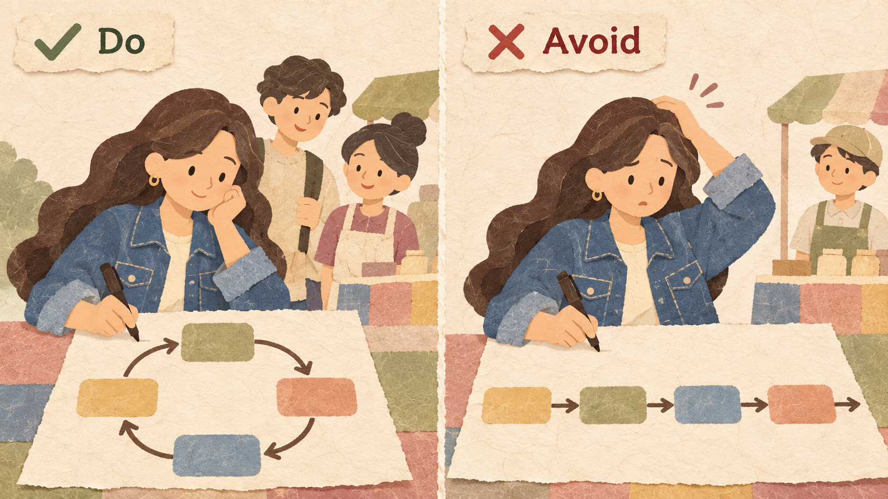

    * **Example:** More buyers bring more outside sellers to CampusMart, because sellers want customers. More sellers add more products. More products bring more buyers.
    * **Common mistake:** Drawing a loop with a weak arrow, such as "more buyers lead to lower prices" when the business is too small to get better prices from suppliers.
  * **Rule 2: Push the step that turns the whole wheel.** Usually this is what customers feel: lower prices, more choice, or faster delivery. Spending there helps every other step.

    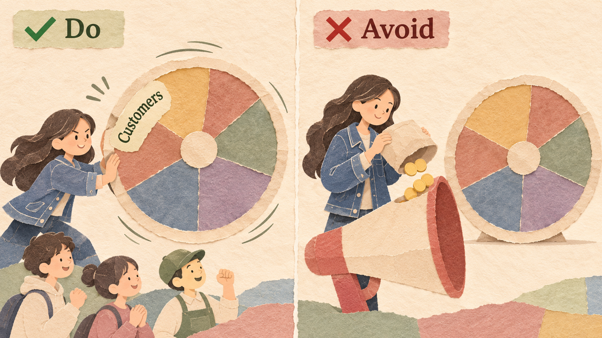

    * **Example:** Opening CampusMart to outside sellers adds hundreds of products without CampusMart buying any stock. More choice turns the whole loop.
    * **Common mistake:** Spending on ads that bring buyers for one month only. The wheel moves once and stops when the ads stop.
  * **Rule 3: Turn growth into lower costs, and give the savings back.** As the wheel spins, use the savings to lower prices or speed up delivery. That makes the wheel spin faster.

    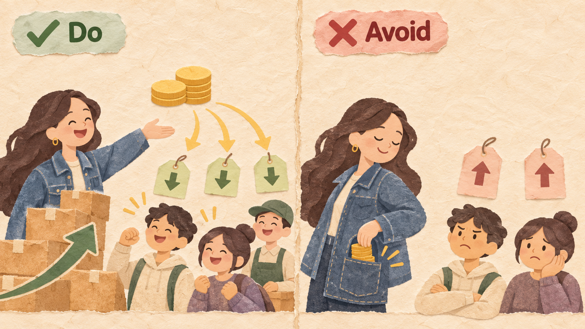

    * **Example:** When CampusMart ships 300 orders a day instead of 130, delivery costs less per order, so Sofia offers next-day delivery.
    * **Common mistake:** Keeping all the savings as profit too early. Customers see no improvement, and the wheel slows down.
  * **Rule 4: Pay for the wheel with steady profit.** A flywheel is slow at first. Fund it with money from a profitable part of the business, not only with borrowed money or discounts that cannot last, and know how long you can wait.

    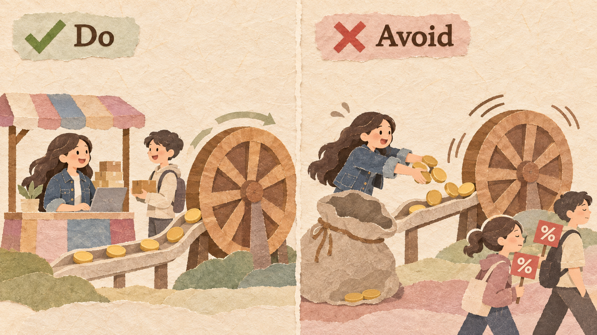

    * **Example:** CampusMart's own product sales earn $10,000 a month. Sofia uses part of this profit to support the marketplace until seller fees grow.
    * **Common mistake:** Paying for growth with huge discounts funded by investors. When the money runs out, the buyers leave, because they came only for the discounts.

* **Good examples (real companies):**
  * **Good example 1: Amazon.** In 2001, Jeff Bezos sketched Amazon's flywheel: lower prices and more choice lead to more customers, which bring more outside sellers, which add choice, while growth lowers costs. Amazon opened its store to outside sellers, and by 2023 they sold about 60% of the units on Amazon. It launched Prime in 2005 ($79 a year for free two-day shipping) to keep customers buying. In 2022, Amazon's online shops lost about $10.6 billion, but Amazon Web Services (AWS), its cloud business, earned about $22.8 billion of operating profit and kept the company profitable.
    * **Why it is good:**
      * Each step feeds the next: buyers bring sellers, and sellers bring choice (Rule 1).
      * Amazon invested in what customers feel: choice, price, and fast delivery through Prime (Rule 2).
      * Profit from AWS paid for the retail wheel in hard years (Rule 4).
  * **Good example 2: Costco.** Costco charges a yearly membership fee and keeps the prices of its products low. It limits how much it adds to the cost of most products (about 14 to 15%). Low prices keep members coming back: about 90% of members worldwide renew each year. Membership fees brought in about $5.3 billion in fiscal 2025.
    * **Why it is good:**
      * Low prices bring more members, more members give Costco more buying power, and buying power lowers prices again (Rule 1).
      * Costco gives savings back to members instead of raising its margins (Rule 3).
      * Steady membership fees pay for the low prices (Rule 4).

* **Bad examples (real companies):**
  * **Bad example 1: Jet.com.** Jet.com launched in 2015 as an online store that promised lower prices than Amazon. It spent heavily on discounts and marketing, funded by investors. Walmart bought Jet.com in 2016 for about $3.3 billion. Sales did not keep growing, and Walmart shut Jet.com down in 2020.
    * **Why it is bad:**
      * Low prices came from investor money, not from savings created by the loop (Rule 3).
      * Many buyers came for the discounts and did not stay when the discounts shrank (Rule 4).
      * Jet.com never built a strong loop of outside sellers and loyal members of its own (Rule 1).
  * **Bad example 2: ofo bike sharing.** ofo, a Chinese bike-sharing company, put millions of bikes on city streets and offered very cheap rides, paid for with investors' money. More bikes did not lower its costs: many bikes were broken or lost. In December 2018, more than 10 million users asked for their deposits back, and ofo could not pay them all.
    * **Why it is bad:**
      * More bikes created more costs, not lower costs, so the arrow "growth lowers costs" was broken (Rule 1).
      * Cheap rides were paid for with investors' money, not with steady profit (Rule 4).
      * When the money ran out, users lost trust and the wheel stopped.

* **Before the exercises: four tools you will use:**
  * **Tool 1 - The loop check:** Write each step of the loop, and for each arrow write "because ..." If you cannot finish the sentence, the arrow is weak.
    * **Example:** "More riders lead to more drivers, because drivers earn more where there are more riders." Strong. "More drivers lead to lower costs, because ..." If you cannot say why, this arrow is weak.
  * **Tool 2 - Value of buyers who stay:**
    * Extra profit = new buyers who stay x profit per buyer per month x number of months
    * **Example:** Ads bring 1,000 new buyers, and 20% stay. Each buyer brings $3 profit a month. Over 6 months: 1,000 x 20% = 200 buyers; 200 x $3 x 6 = $3,600.
  * **Tool 3 - Profit over several periods (from Session 3.1):**
    * Profit = extra profit per period x number of periods - one-time cost
    * **Example:** A $5,000 investment adds $1,500 profit a month. After 6 months: 6 x $1,500 - $5,000 = $4,000.
  * **Tool 4 - Trade-off and decision rule (from Session 2.1):** A **trade-off** is what you give up to get something you value more. A **decision rule** is a promise, written before you start, about which result would make you change your decision. Example: "If fewer than 50 outside sellers join in the first three months, we will lower the seller fee."

* **Exercise 1 - Easy: Is the loop real? (20 min):**
  * **Scenario:** Six companies describe one arrow of their loop. (a) A food delivery app: more restaurants lead to more customers. (b) A video site: more viewers lead to more video makers. (c) A bakery: more customers lead to lower flour prices from its supplier (it buys 20 kg a week). (d) A language app: more learners lead to more practice data, which makes lessons better. (e) A clothing shop: more ads lead to more loyal customers. (f) A marketplace: more sellers lead to lower prices, because sellers compete.
  * **Template:**

    ```text
    Arrow [letter]: [strong / weak], because [why more of the first step really leads,
    or does not lead, to more of the next step].
    ```

  * **Worked example (two other arrows):**

    ```text
    Arrow: a ride app: more riders lead to more drivers.
    Strong, because drivers earn more and wait less where there are more riders.
    Arrow: a small cafe: more customers lead to faster coffee.
    Weak, because more customers make the line longer, not faster.
    ```

  * **Your turn:** Fill in the template for all six arrows.
  * **Check your answer:** (a) strong: more choice brings more customers. (b) strong: video makers go where the viewers are. (c) weak: 20 kg a week is too little to get better prices; the bakery is too small. (d) strong: more practice data helps the app improve lessons (Session 2.1). (e) weak: ads bring visitors, but loyalty comes from good products and service, and the effect stops when the ads stop. (f) strong: competing sellers lower their prices to win buyers.

* **Exercise 2 - Medium: Draw a flywheel and find the step to push (30 min):**
  * **Scenario:** StayLocal is a website where students rent rooms from local home owners for short stays. Today it has 2,000 renters and 150 home owners. Renters complain that there are too few rooms. Home owners say they would list rooms if they could find renters easily. StayLocal can spend $6,000 on one of three things: (1) ads to renters, (2) free professional photos for new home owners' rooms, or (3) a 10% discount for every renter for one month.
  * **Step 1 - Draw the loop (Tool 1):** Write four steps and an arrow sentence ("because ...") for each.
  * **Step 2 - Choose the push:** Which of the three options turns the whole wheel? Use the template.
  * **Template:**

    ```text
    Our loop: [step 1] -> [step 2] -> [step 3] -> [step 4] -> back to [step 1].
    The weakest step today is [step], because [evidence from the scenario].
    We should spend on [option], because it [how it pushes the weakest step and then the whole loop] (Rule 2).
    We should not spend on [option], because [why its effect stops] (Rule 2 or Rule 4).
    ```

  * **Worked example (a homework-help app: students ask questions, tutors answer):**

    ```text
    Our loop: more students -> more questions -> more paid answers for tutors
    -> more tutors -> faster answers -> more students.
    The weakest step today is tutors, because students wait 2 hours for an answer.
    We should spend on a bonus for tutors' first 10 answers, because faster answers
    bring more students, and more students bring more tutors (Rule 2).
    We should not spend on student ads, because new students would wait even longer
    and leave (Rule 2).
    ```

  * **Your turn:** Fill in the template for StayLocal.
  * **Check your answer:** A good loop: more rooms -> more renters -> more income for home owners -> more home owners list rooms -> more rooms. The weakest step is the number of rooms (renters complain that there are too few). The best push is option (2), free photos for new home owners, because more and better rooms bring more renters, and more renters bring more home owners (Rule 2). Option (1) brings more renters to too few rooms, so they leave. Option (3) helps for one month and stops when the discount ends (Rule 4).

* **Exercise 3 - Hard: Ads or the flywheel? (50 min, including 2-minute presentations):**
  * **Scenario:** Return to Sofia and CampusMart (4,000 buyers, $2.50 profit per order, one order per buyer per month, $20,000 to invest). Sofia compares two plans for the next 6 months.
    * **Option A - Ads:** Spend $20,000 on ads. They bring 2,000 new buyers in the first month. Past data shows that 30% of new buyers keep ordering every month after that.
    * **Option B - Open a marketplace:** Spend $20,000 to build a marketplace for outside sellers. Sofia expects 100 sellers to add 3,000 products. Outside sellers' sales would be $30,000 a month, and CampusMart keeps a 10% fee. More choice brings 300 more buyers every month, so CampusMart has 300 more buyers in month 1, 600 more in month 2, and so on, up to 1,800 more in month 6.
  * **Step 1 - Calculate (use Tools 2 and 3):**
    * Option A: profit in month 1 = 2,000 x $2.50 = $______. Buyers who stay = 2,000 x 30% = ______. Profit in months 2 to 6 = buyers who stay x $2.50 x 5 = $______. Result over 6 months = month 1 + months 2 to 6 - $20,000 = $______.
    * Option B: seller fees = $30,000 x 10% x 6 = $______. Extra buyer-months = 300 + 600 + 900 + 1,200 + 1,500 + 1,800 = ______; profit from them = buyer-months x $2.50 = $______. Result over 6 months = fees + profit from buyers - $20,000 = $______.
    * Option B if only 20 sellers join: fees = $600 a month; extra buyers grow by only 100 a month (100, 200, ..., 600). Result over 6 months = $______.
    * In month 7, which plan still brings new buyers? ______
  * **Step 2 - Write a 3-bullet memo to Sofia (use Tool 4):**
  * **Template:**

    ```text
    To: [founder name], [company]
    1. Decision and evidence: We should choose [option] because [the rule it follows]
       and [one number from your calculation].
    2. Biggest risk and trade-off: The weakest point is [risk]. We give up [what we lose]
       to gain [what we protect or win].
    3. Next step and decision rule: In the next three months we will [one action] and measure [one number].
       We will change this decision if [result].
    ```

  * **Worked example (StayLocal from Exercise 2):**

    ```text
    To: Ben Ortiz, founder, StayLocal
    1. Decision and evidence: We should spend $6,000 on free photos for new home
       owners, because rooms are the weakest step of our loop (Rule 2): renters
       already complain that there are too few rooms.
    2. Biggest risk and trade-off: The weakest point is that home owners may not
       list rooms even with free photos. We give up a quick rise in renters from
       ads to fix the step that turns the whole wheel.
    3. Next step and decision rule: In the next three months we will offer photos
       to 100 home owners and count new rooms. We will change this decision if
       fewer than 40 new rooms are listed.
    ```

  * **Your turn:** Write the memo for CampusMart. Then give a 2-minute presentation using your three bullets.
  * **Check your answer:**
    * Option A: month 1 = **$5,000**; 600 buyers stay; months 2 to 6 = 600 x $2.50 x 5 = **$7,500**; result = $5,000 + $7,500 - $20,000 = **-$7,500**.
    * Option B: fees = $3,000 x 6 = **$18,000**; extra buyer-months = **6,300**; profit = **$15,750**; result = $18,000 + $15,750 - $20,000 = **$13,750**.
    * Option B with only 20 sellers: fees = $600 x 6 = $3,600; buyer-months = 2,100; profit = $5,250; result = $3,600 + $5,250 - $20,000 = **-$11,150**.
    * In month 7, only Option B still brings new buyers: the wheel keeps turning. Option A's effect stops when the ads stop.
    * A strong memo usually chooses Option B (Rules 1 and 2), names the real risk that too few sellers join, plans to support the marketplace with profit from CampusMart's own sales (Rule 4), and gives a decision rule such as "If fewer than 50 sellers join in the first three months, we will lower the seller fee or help sellers list products."

* **Success check:** You can (1) draw a business's flywheel and check each arrow, (2) find the step that turns the whole wheel, and (3) compare a one-time push with an investment in the loop and write a decision rule.

* **References:**
  * Collins, J. (2019). *Turning the Flywheel: A Monograph to Accompany Good to Great*. Harper Business.
  * Amazon.com, Inc. (2023). [Form 10-K for fiscal year 2022](https://ir.aboutamazon.com/annual-reports-proxies-and-shareholder-letters/default.aspx). Segment operating income.
  * Marketplace Pulse. [Amazon third-party seller share](https://marketplacepulse.com/articles/amazon-steers-third-party-seller-share-to-all-time-high).
  * Costco Wholesale Corporation (2025). [Form 10-K for fiscal year 2025](https://investor.costco.com/financial-information/annual-reports/). Membership fees and renewal rates.
  * Axios (2020, May 20). [Walmart grounds Jet.com, but the $3.3 billion acquisition still paid off](https://www.axios.com/2020/05/20/walmart-jet-com).
  * Caixin Global (2018, December 17). [Frustrated shared-bike riders go to ofo in search of refunds](https://www.caixinglobal.com/2018-12-17/frustrated-shared-bike-riders-go-to-ofo-in-search-of-refunds-101360332.html).

---

<a id="session-4-2"></a>
### Session 4.2: The Ecosystem Lock-In Strategy (Case Study: Apple)

**Strategy of this session: Ecosystem Lock-In Strategy**


* **Lecture Presentation:** [Download Slides (PDF)](slides/session_4_2_lecture.pdf)

* **Duration:** 3 hours: 50-minute lesson, 10-minute break, Exercise 1 (20 min) and Exercise 2 (30 min), 10-minute break, Exercise 3 with short presentations (50 min), and 10-minute wrap-up.
* **Situation:** Noah runs PulseFit, which sells fitness bands that count steps and track sleep. Customers like the band, but when it wears out after about two years, most of them buy a cheaper band from a rival. A teammate suggests a quick fix: make it impossible to move step and sleep history out of the PulseFit app, so that customers "cannot leave." Noah is not sure this is the right way to keep customers.

  | PulseFit | Value |
  |---|---|
  | Customers who own a PulseFit band | 10,000 |
  | Price of a band / profit per band | $60 / $20 |
  | Time until a band wears out | About 2 years |
  | Customers who buy their next band from PulseFit | 40% |
  | Customers who switch to a rival's band | 60% |
  | Other PulseFit products or services | None |

* **The strategy in one paragraph:** The ecosystem lock-in strategy keeps customers by making a company's products and services work better together than with anything else. An **ecosystem** here means a group of a company's own products and services that share one account, one set of data, and one design. Each extra product makes the others more useful, so leaving becomes costly: the customer would lose convenience, data, or benefits. Companies then earn steady money from services on top of the products. Apple is the best-known example: an iPhone, a Mac, an Apple Watch, and iCloud work smoothly together. The strategy works only when customers stay because of value; when a company traps customers or treats partners unfairly, customers and regulators push back. Use this strategy when you can offer several products or services that are clearly better together, and when customers will use them for years.

* **Goal:** Apply the Ecosystem Lock-In Strategy: design products that are better together, calculate the value of a customer who stays longer, tell value lock-in from trap lock-in, and choose a plan to keep customers.

* **Words you need first:**
  * **Ecosystem (of products):** A company's products and services that share one account, one set of data, and one design. Example: a PulseFit band, a PulseFit scale, and the PulseFit app.
  * **Lock-in:** When customers keep buying from one company because leaving would cost them something. Example: a customer stays with PulseFit because two years of sleep history are in the app.
  * **Switching cost:** What a customer loses by moving to a rival: money, time, data, or benefits. Example: buying a new scale, learning a new app, and losing rewards points.
  * **Services revenue:** Money that a company earns again and again from services, such as subscriptions, on top of selling products. Example: $5 a month for PulseFit Plus training plans.
  * **Customer lifetime value (CLV):** The total profit a company earns from one customer during all the years the customer stays. Example: $20 profit a year for 3 years = $60.
  * **Regulator:** A government body that makes sure companies follow the law and compete fairly. Example: the European Commission.

* **The four rules of the Ecosystem Lock-In Strategy (Hour 1 - 50 minutes):**
  * **Rule 1: Make each product better when it is used with the others.** The customer should feel a clear benefit every time two of your products work together.

    

    * **Example:** When a customer steps on a PulseFit scale, the band and the app automatically combine weight, steps, and sleep into one weekly health report.
    * **Common mistake:** Selling many products that only share a logo. If they do not work better together, customers buy each product from whoever is cheapest.
  * **Rule 2: Earn steady service revenue from the customers you already have.** Products are sold once; services earn money every month and keep customers using the ecosystem.

    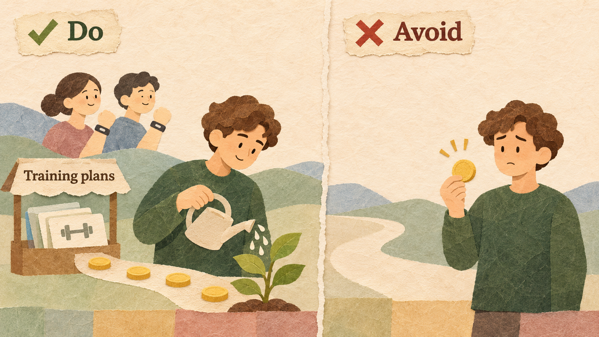

    * **Example:** PulseFit Plus costs $5 a month for training plans and sleep coaching that use the band's data.
    * **Common mistake:** Adding a service that customers do not value, just to charge a monthly fee. Customers cancel, and they feel tricked.
  * **Rule 3: Keep customers with value, not with traps.** Customers should stay because the ecosystem is better, not because leaving is made painful. Let them take their own data with them.

    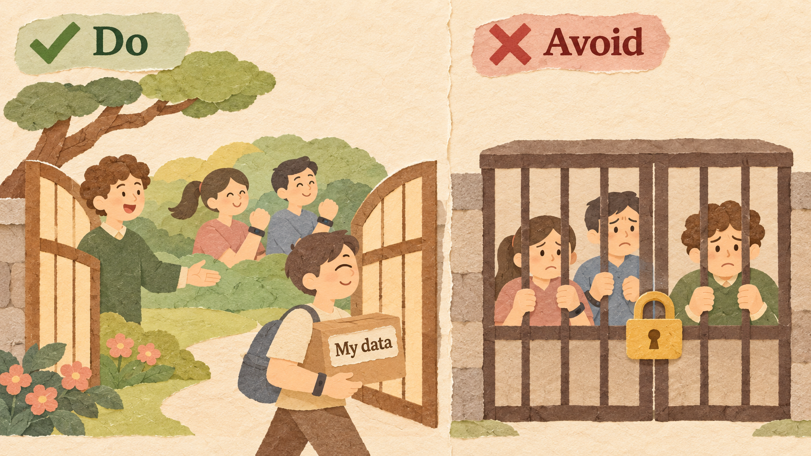

    * **Example:** PulseFit lets customers download their full history at any time, and still most stay, because the combined health report is useful.
    * **Common mistake:** Blocking data export or making other brands' accessories stop working. Customers feel trapped, write angry reviews, and new buyers stay away.
  * **Rule 4: Play fair with partners, and expect regulators to watch.** When many customers depend on your ecosystem, you have power over other companies. Using that power unfairly brings fines and new laws.

    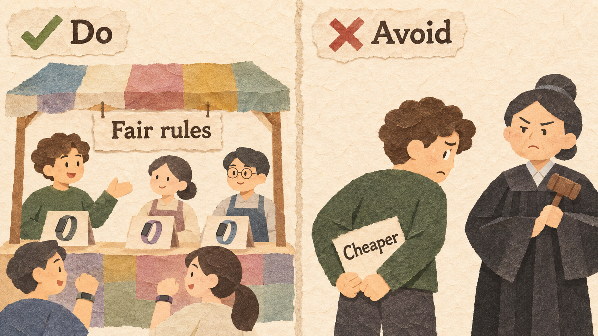

    * **Example:** PulseFit lets other workout apps read band data with the customer's permission, and charges them a small, clear fee.
    * **Common mistake:** Blocking partners from telling customers about cheaper offers, or charging partners very high fees because they have no other way to reach customers.

* **Good examples (real companies):**
  * **Good example 1: Apple.** An iPhone, a Mac, an iPad, an Apple Watch, and AirPods share one Apple account. Photos, messages, and files appear on every device through iCloud, and AirPods switch from phone to laptop by themselves. In early 2024, Apple said it had more than 2.2 billion active devices. In fiscal 2024, Apple's services (App Store, iCloud, Apple Music, and others) earned $96.2 billion, with a gross margin of about 74%, far higher than its hardware.
    * **Why it is good:**
      * Each Apple product works better with the others, so customers want more than one (Rule 1).
      * Services earn money every month from more than two billion devices (Rule 2).
      * Many customers stay because the products are easy to use together, not because they cannot leave (Rule 3).
      * **Lesson for Rule 4:** Apple's App Store rules have been challenged by regulators (see Bad example 2).
  * **Good example 2: Starbucks Rewards.** The Starbucks app combines ordering ahead, paying, and collecting stars for free drinks. At the end of 2023, Starbucks had 34.3 million active Rewards members in the United States, and payments through the program made up about 59% of sales in its U.S. company-operated stores.
    * **Why it is good:**
      * Ordering, paying, and earning rewards work together in one app (Rule 1).
      * Money loaded in the app and collected stars bring customers back again and again (Rule 2).
      * Customers stay for convenience and free drinks, which is value, not a trap (Rule 3).

* **Bad examples (real companies):**
  * **Bad example 1: HP printer ink.** In September 2016, a software update to some HP printers made ink cartridges from other companies stop working. Printers showed messages that the cartridges were "damaged." After many complaints, HP offered an optional update to remove the block. In the United States, a court approved a $1.5 million settlement in 2019, and later settlements followed in Europe.
    * **Why it is bad:**
      * HP tried to keep customers with a trap, not with better ink (Rule 3).
      * Customers felt tricked and lost trust in the brand.
      * Courts and consumer groups stepped in (Rule 4).
  * **Bad example 2: Apple and music streaming apps in Europe.** Apple's App Store rules stopped music streaming apps, such as Spotify, from telling iPhone users inside the app that they could pay less on the app's own website. In March 2024, the European Commission fined Apple more than €1.8 billion and ordered it to remove these rules.
    * **Why it is bad:**
      * Apple used its control over the iPhone to limit partners unfairly (Rule 4).
      * Customers were kept from finding better prices, which is a trap, not value (Rule 3).
      * Even a very successful ecosystem can face large fines and new laws when it treats partners unfairly.

* **Before the exercises: four tools you will use:**
  * **Tool 1 - Customer lifetime value (CLV):**
    * CLV = profit per customer per year x years the customer stays
    * **Example:** A phone-case customer brings $10 profit a year and stays 2 years: $10 x 2 = $20. A customer who also uses the company's $3-a-month case-care plan brings $40 a year and stays 4 years: $40 x 4 = $160.
  * **Tool 2 - Value of customers who come back:**
    * Profit from repeat buyers = customers x repeat rate x profit per purchase
    * **Example:** 5,000 customers, 50% buy again, $20 profit each: 5,000 x 50% x $20 = $50,000.
  * **Tool 3 - Profit over several periods (from Session 3.1):**
    * Profit = monthly profit x number of months - one-time cost
    * **Example:** A $30,000 app update adds $2,000 profit a month. After 24 months: 24 x $2,000 - $30,000 = $18,000.
  * **Tool 4 - Trade-off and decision rule (from Session 2.1):** A **trade-off** is what you give up to get something you value more. A **decision rule** is a promise, written before you start, about which result would make you change your decision. Example: "If fewer than 5% of band owners subscribe to PulseFit Plus in six months, we will change the plan."

* **Exercise 1 - Easy: Value or trap? (20 min):**
  * **Scenario:** Six companies try to keep customers. (a) A phone's photos appear on the same company's laptop automatically. (b) A printer stops working with other brands' ink. (c) A coffee app gives stars that customers trade for free drinks. (d) A gym charges $200 to cancel a membership. (e) A music app lets users export their playlists to other apps. (f) A cloud storage company hides the "delete account" button behind 12 steps.
  * **Template:**

    ```text
    Move [letter]: [lock-in by value / lock-in by trap], because customers stay
    [because they get a benefit: which one / because leaving is made hard: how].
    ```

  * **Worked example (two other moves):**

    ```text
    Move: a smartwatch unlocks the same company's laptop when the user sits down.
    Lock-in by value, because customers stay for a real benefit: they save time every day.
    Move: an airline makes frequent-flyer miles expire if a customer flies with another airline once.
    Lock-in by trap, because leaving is made hard: customers are punished for trying a rival.
    ```

  * **Your turn:** Fill in the template for all six moves.
  * **Check your answer:** (a) value: products work better together. (b) trap: other brands are blocked. (c) value: customers earn a real reward. (d) trap: leaving is made expensive. (e) value: the company lets customers leave easily, so customers who stay do so by choice. (f) trap: leaving is made hard on purpose.

* **Exercise 2 - Medium: What is a customer in the ecosystem worth? (30 min):**
  * **Scenario:** ChefBox sells kitchen blenders. A customer who owns only a blender brings $15 profit a year and stays 2 years. ChefBox also sells a recipe app that controls the blender ($4 a month). Customers who own the blender and use the app bring $40 profit a year and stay 5 years. ChefBox could give every blender owner a $25 coupon for the first year of the app.
  * **Step 1 - Calculate (Tool 1):** CLV of a blender-only customer = $15 x 2 = $______. CLV of a blender-and-app customer = $40 x 5 = $______. Gain from moving one customer into the ecosystem = $______ - $______ - $25 coupon = $______.
  * **Step 2 - Check the rules:** Is this lock-in by value or by trap? Which rule does the recipe app follow?
  * **Step 3 - Recommend:** Use the template.
  * **Template:**

    ```text
    A customer who uses [products] is worth $[CLV], against $[CLV] for [one product only].
    After the cost of $[cost], each customer we move gains us $[amount].
    This is lock-in by [value / trap], because [reason] (Rule [number]).
    We should [offer / not offer] the [plan], and measure [one number].
    ```

  * **Worked example (a phone-case company with a $3-a-month case-care plan; see Tool 1):**

    ```text
    A customer who uses the case and the care plan is worth $160, against $20 for the case only.
    After the cost of a $15 first-month discount, each customer we move gains us $125.
    This is lock-in by value, because the plan replaces broken cases quickly (Rule 1).
    We should offer the discount, and measure how many customers keep the plan after 3 months.
    ```

  * **Your turn:** Fill in the template for ChefBox.
  * **Check your answer:** CLV blender only = **$30**; CLV blender and app = **$200**; gain per customer = $200 - $30 - $25 = **$145**. It is lock-in by value: the app makes the blender more useful with recipes and settings (Rules 1 and 2), and customers can still use the blender without it (Rule 3). A strong answer offers the coupon and measures how many coupon users keep paying for the app after the first year.

* **Exercise 3 - Hard: Trap or ecosystem? (50 min, including 2-minute presentations):**
  * **Scenario:** Return to Noah and PulseFit (10,000 band owners, $20 profit per band, 40% buy their next band from PulseFit). Noah compares two plans for the next two years. Without any change, 40% x 10,000 = 4,000 customers buy a new band.
    * **Option A - Lock the data (trap):** Block customers from moving their history out of the app. The teammate expects 60% of customers to buy their next band from PulseFit. But angry reviews would cost PulseFit 2,000 new buyers (at $20 profit each) over the two years. No extra cost.
    * **Option B - Build the ecosystem (value):** Spend $50,000 to build PulseFit Plus ($5 a month, $4 profit) and a smart scale ($40, $15 profit) that works with the band, and let customers export their data. Noah expects 70% to buy their next band from PulseFit, 10% of owners (1,000) to subscribe to PulseFit Plus for 24 months, and 1,000 owners to buy a scale.
  * **Step 1 - Calculate (use Tools 2 and 3):**
    * No change: 10,000 x 40% x $20 = $______.
    * Option A: 10,000 x 60% x $20 = $______; minus lost new buyers 2,000 x $20 = $______; result = $______.
    * Option B: next bands = 10,000 x 70% x $20 = $______; PulseFit Plus = 1,000 x $4 x 24 = $______; scales = 1,000 x $15 = $______; result = bands + Plus + scales - $50,000 = $______.
    * Option B if only 300 subscribe, 300 buy a scale, and 50% buy their next band from PulseFit: result = $______.
  * **Step 2 - Write a 3-bullet memo to Noah (use Tool 4):**
  * **Template:**

    ```text
    To: [founder name], [company]
    1. Decision and evidence: We should choose [option] because [the rule it follows]
       and [one number from your calculation].
    2. Biggest risk and trade-off: The weakest point is [risk]. We give up [what we lose]
       to gain [what we protect or win].
    3. Next step and decision rule: In the next six months we will [one action] and measure [one number].
       We will change this decision if [result].
    ```

  * **Worked example (ChefBox from Exercise 2):**

    ```text
    To: Ana Ruiz, CEO, ChefBox
    1. Decision and evidence: We should give every blender owner a $25 coupon for
       the recipe app, because a customer who uses both is worth $200 against
       $30 for the blender alone (Rules 1 and 2).
    2. Biggest risk and trade-off: The weakest point is that many coupon users may
       stop paying after the first year. We give up $25 per customer now to
       build customers who stay five years.
    3. Next step and decision rule: In the next six months we will send the coupon
       to 1,000 owners and measure how many still pay after month 12. We will
       change this decision if fewer than 30% keep paying.
    ```

  * **Your turn:** Write the memo for PulseFit. Then give a 2-minute presentation using your three bullets.
  * **Check your answer:**
    * No change: **$80,000**.
    * Option A: $120,000 - $40,000 = **$80,000**: the trap earns no more than doing nothing, and it damages trust (Rule 3).
    * Option B: bands $140,000 + Plus $96,000 + scales $15,000 - $50,000 = **$201,000**.
    * Option B in the weak case: 10,000 x 50% x $20 = $100,000; 300 x $4 x 24 = $28,800; 300 x $15 = $4,500; result = $133,300 - $50,000 = **$83,300**, still slightly above doing nothing.
    * A strong memo chooses Option B (Rules 1, 2, and 3), names a real risk (for example, few owners may pay for PulseFit Plus), keeps data export open, and gives a decision rule such as "If fewer than 5% of owners subscribe in six months, we will improve the training plans or lower the price."

* **Success check:** You can (1) explain lock-in and switching costs, and tell value lock-in from trap lock-in, (2) calculate customer lifetime value inside and outside an ecosystem, and (3) compare a trap plan with an ecosystem plan and write a decision rule.

* **References:**
  * Shapiro, C., & Varian, H. R. (1999). *Information Rules: A Strategic Guide to the Network Economy* (Chapter 5, Recognizing lock-in). Harvard Business School Press.
  * Apple Inc. (2024). [Apple reports fourth quarter results](https://www.businesswire.com/news/home/20241031454158/en). Fiscal 2024 services net sales and cost of sales.
  * Starbucks Corporation (2024). [Q1 fiscal 2024 earnings call](https://s203.q4cdn.com/326826266/files/doc_events/2024/01/1/SBUX-Q1-2024-Earnings-Call.pdf). Starbucks Rewards members.
  * The Register (2018, September 21). [HP should pay out $1.5m for printer-bricking update](https://www.theregister.com/2018/09/21/hp_should_pay_out_15m_for_printer_bricking_update/).
  * European Commission (2024, March 4). [Commission fines Apple over €1.8 billion over abusive App store rules for music streaming providers](https://ec.europa.eu/commission/presscorner/detail/en/ip_24_1161).

---

<a id="session-4-3"></a>
### Session 4.3: The Super-App Strategy (Case Study: Grab)

**Strategy of this session: Super-App Strategy**


* **Lecture Presentation:** [Download Slides (PDF)](slides/session_4_3_lecture.pdf)

* **Duration:** 3 hours: 50-minute lesson, 10-minute break, Exercise 1 (20 min) and Exercise 2 (30 min), 10-minute break, Exercise 3 with short presentations (50 min), and 10-minute wrap-up.
* **Situation:** Ama runs CampusGo, an app that students use to book seats on campus shuttles. Students open it almost every day. Ama wants CampusGo to become the one app students use for daily campus life: food delivery, laundry pickup, printing, event tickets, and a wallet to pay for everything. An investor says: "Launch all five at once, with big discounts, before a rival does." Ama is worried about cost and quality.

  | CampusGo (one month) | Value |
  |---|---|
  | Students who use the app | 12,000 |
  | Shuttle rides per student per month | 10 |
  | Profit per ride | $0.20 |
  | Monthly profit (12,000 x 10 x $0.20) | $24,000 |
  | Other services | None |

* **The strategy in one paragraph:** The super-app strategy turns one app that people use very often into a single app for many daily services. A **super-app** starts with a "front door": one service people open many times a week, such as messaging or rides. It then adds more services for the same users, such as food delivery, payments, and loans, all under one account and one wallet. Each new service is cheaper to launch, because the users are already there (Session 3.1), and every service gives the others more data and more reasons to open the app. Grab in Southeast Asia and WeChat in China are the best-known examples. Use this strategy when your app is used very often, when your users need other services that fit naturally next to it, and when you can make each service pay for itself in time.

* **Goal:** Apply the Super-App Strategy: test whether a service can be a front door, choose which service to add next, check whether each service pays for itself, and decide how fast to add services.

* **Words you need first:**
  * **Super-app:** One app that offers many everyday services under one account and one wallet. Example: an app for rides, food delivery, and payments.
  * **Front door:** The service that brings people into the app many times a week. Example: CampusGo's shuttle booking, used 10 times a month.
  * **Usage frequency:** How often a person uses a service in a period. Example: 10 rides a month is high frequency; buying a laptop once in three years is low frequency.
  * **E-wallet:** Money stored in an app that can pay for any service in it. Example: a student adds $20 to the CampusGo wallet and pays for rides and food.
  * **Subsidy (incentive):** Money a company spends to make a service cheaper for users or more attractive for drivers or shops. Example: CampusGo pays $1 of every food order so food looks cheaper.
  * **Contribution:** What a service earns after its own direct costs and subsidies. Contribution = revenue - direct costs - subsidies. Example: $10,000 - $7,000 - $1,000 = $2,000.

* **The four rules of the Super-App Strategy (Hour 1 - 50 minutes):**
  * **Rule 1: Start with a service people use very often.** The front door must bring users back many times a week. Rarely used services cannot hold up a super-app.

    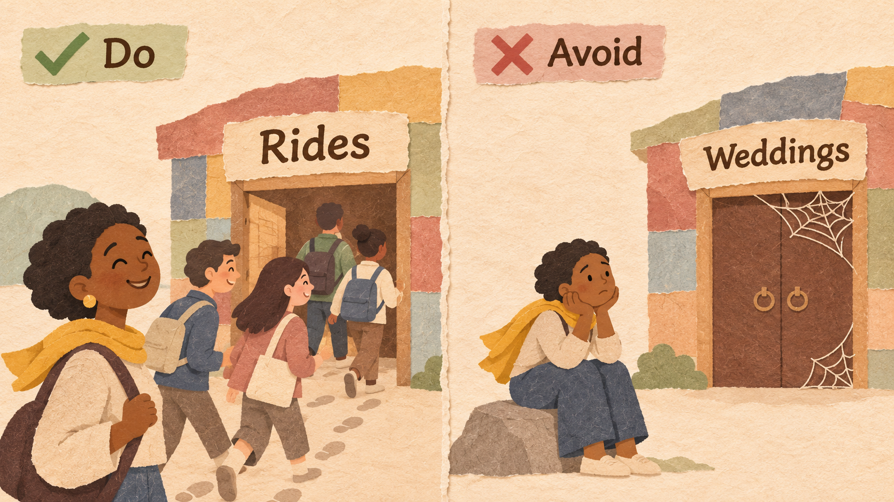

    * **Example:** CampusGo is opened 10 times a month by 12,000 students, so a new service inside it is seen by many students right away.
    * **Common mistake:** Building a super-app around something people use once a year, such as booking graduation photos. Users forget the app between uses.
  * **Rule 2: Add services the same users already need, one at a time.** Each new service should fit naturally next to the front door, and should be good before the next one is added.

    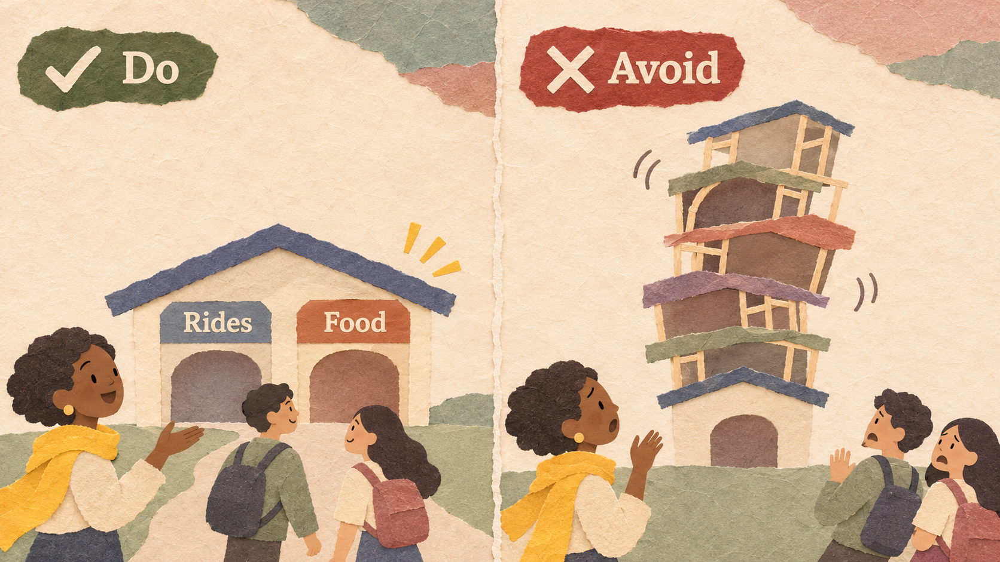

    * **Example:** Students take the shuttle to and from class, and many order lunch on the way. Food delivery is added first, and laundry only after food works well.
    * **Common mistake:** Launching many services at once. Each one is weak, users have bad experiences, and the whole app gets a bad name.
  * **Rule 3: Connect services with one safe wallet.** A wallet makes every service easier to use, but money and personal data need strong protection and must follow the law.

    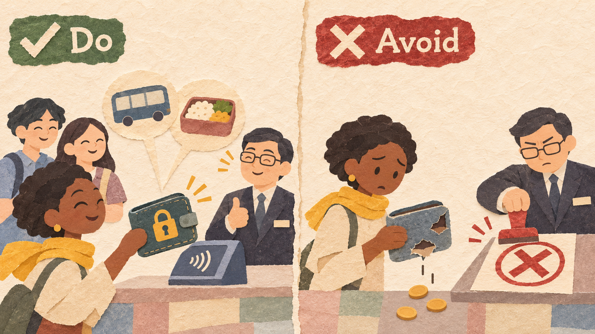

    * **Example:** The CampusGo wallet works with a licensed bank partner, checks each user's identity, and lets students pay for rides and food with one tap.
    * **Common mistake:** Holding users' money without the right licence or checks. Regulators can stop the service, and users stop trusting every part of the app.
  * **Rule 4: Make each service pay for itself in time.** Subsidies can start a service, but every service should reach a positive contribution on its own. Stop paying people to use it.

    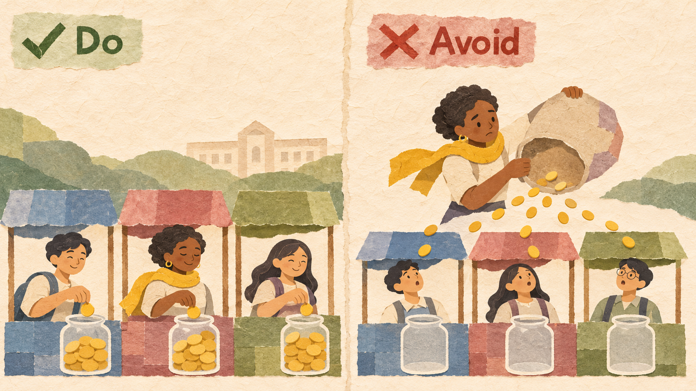

    * **Example:** CampusGo pays $1 of each food order for the first two months only, then checks whether food delivery earns money without it.
    * **Common mistake:** Using discounts forever to keep users in every service. The super-app grows in users but loses more money each month.

* **Good examples (real companies):**
  * **Good example 1: Grab.** Grab started in 2012 as a taxi-booking app in Malaysia. It became a super-app across Southeast Asia, adding food delivery, package delivery, payments, and loans for drivers and shops. For years it spent heavily on driver and customer incentives and lost money. As it cut incentives, it improved: in 2024, Grab's revenue grew 19% to $2.8 billion, and its adjusted EBITDA (a measure of operating profit) turned positive at $313 million, although it still reported a net loss of $158 million.
    * **Why it is good:**
      * Rides were a front door people used many times a week (Rule 1).
      * Food, delivery, and payments were added for the same users and drivers (Rule 2).
      * GrabPay connected the services and made paying easy (Rule 3).
      * **Lesson for Rule 4:** Grab's years of losses show how expensive subsidies are; it improved only when it cut them.
  * **Good example 2: WeChat.** WeChat started in 2011 as a messaging app in China. In 2013 it added WeChat Pay. In 2014, during Chinese New Year, it let users send digital red envelopes (gifts of money) to friends, and many users linked their bank cards for the first time. In 2017 it added mini programs: small apps from other companies that run inside WeChat. In early 2025, WeChat had about 1.4 billion monthly users.
    * **Why it is good:**
      * Messaging is used many times a day, the strongest possible front door (Rule 1).
      * Each new service, from payments to mini programs, fitted what users already did with friends (Rule 2).
      * Red envelopes gave users a fun reason to link a bank card to the wallet (Rule 3).

* **Bad examples (real companies):**
  * **Bad example 1: Paytm Payments Bank.** Paytm, a large Indian payments app, offered wallets, bank accounts, and many other services through Paytm Payments Bank. In January 2024, India's central bank, the Reserve Bank of India, ordered the bank to stop taking new deposits and top-ups after February 29, 2024, because audits found "persistent non-compliances" with its rules. Millions of users had to move their money and wallets elsewhere.
    * **Why it is bad:**
      * The wallet and bank did not follow the regulator's rules well enough (Rule 3).
      * When the money service stopped, users lost trust in other services in the app as well.
      * In a super-app, a problem in one service can hurt all the others.
  * **Bad example 2: Facebook's Libra (Diem).** In 2019, Facebook announced Libra, a new digital currency that people would use in Facebook's apps, such as Messenger and WhatsApp. Governments and central banks around the world worried about risks to money and privacy. After years of pushback, the project (renamed Diem) was shut down, and its technology was sold to Silvergate Bank in 2022 for about $182 million.
    * **Why it is bad:**
      * Facebook tried to add a very large money service before regulators trusted it (Rule 3).
      * It started with a whole new currency, instead of a small service that users already needed (Rule 2).
      * Years of work ended without a launched product.

* **Before the exercises: four tools you will use:**
  * **Tool 1 - The front-door test:**
    * Uses per month = users x times each user opens the service per month
    * **Example:** A bus-ticket app: 5,000 users x 20 trips = 100,000 uses a month. A car-buying app: 5,000 users x 0.03 purchases = 150 uses a month. Only the bus app can be a front door.
  * **Tool 2 - Users who try a new service:**
    * New service users = app users x share who try it
    * **Example:** 12,000 users, and 20% order food: 12,000 x 20% = 2,400 food users.
  * **Tool 3 - Contribution of each service:**
    * Contribution = revenue - direct costs - subsidies
    * **Example:** Food delivery earns $10,000 revenue, pays $7,000 to restaurants and riders, and spends $1,000 on discounts: $10,000 - $7,000 - $1,000 = $2,000.
  * **Tool 4 - Trade-off and decision rule (from Session 2.1):** A **trade-off** is what you give up to get something you value more. A **decision rule** is a promise, written before you start, about which result would make you change your decision. Example: "If food delivery does not reach a positive contribution by month 3 without discounts, we will not add laundry."

* **Exercise 1 - Easy: Can it be a front door? (20 min):**
  * **Scenario:** Six apps want to become super-apps. (a) A messaging app people use every day. (b) A wedding-planning app. (c) A bus-ticket app that commuters use twice a day. (d) A car-buying website. (e) A mobile payment app used for coffee and lunch. (f) A tax-filing app used once a year.
  * **Template:**

    ```text
    App [letter]: [good front door / weak front door], because people use it
    [how often], so [what this means for other services in the app].
    ```

  * **Worked example (two other apps):**

    ```text
    App: a food delivery app that students use three times a week.
    Good front door, because people use it three times a week,
    so a grocery or pharmacy service inside it would be seen often.
    App: an app for booking house movers.
    Weak front door, because people use it once every few years,
    so they would forget any other service in it.
    ```

  * **Your turn:** Fill in the template for all six apps.
  * **Check your answer:** (a) good: used every day. (b) weak: used once or twice in a lifetime. (c) good: used twice a day. (d) weak: used once in several years. (e) good: used several times a week. (f) weak: used once a year.

* **Exercise 2 - Medium: Which services pay for themselves? (30 min):**
  * **Scenario:** CityDay is a super-app in a mid-sized city. Its monthly numbers for four services are below.

    | Service | Revenue | Direct costs | Subsidies |
    |---|---|---|---|
    | Rides | $50,000 | $30,000 | $5,000 |
    | Food delivery | $40,000 | $30,000 | $15,000 |
    | Groceries | $20,000 | $16,000 | $2,000 |
    | Movie tickets | $5,000 | $2,000 | $6,000 |

  * **Step 1 - Calculate (Tool 3):** Contribution of each service = revenue - direct costs - subsidies. Rides = $______; food = $______; groceries = $______; movie tickets = $______; total = $______.
  * **Step 2 - Decide for each service:** keep, fix (cut subsidies), or stop. Use the template.
  * **Template:**

    ```text
    [Service]: contribution $[amount]. Without subsidies it would be $[amount].
    We should [keep / fix / stop] it, because [Rule 4 reason, or how it helps the front door].
    ```

  * **Worked example (a different super-app: laundry earns $8,000, costs $6,000, subsidies $3,000):**

    ```text
    Laundry: contribution -$1,000. Without subsidies it would be $2,000.
    We should fix it by cutting the subsidy step by step, because the service
    itself earns money and only the discounts make it lose (Rule 4).
    ```

  * **Your turn:** Fill in the template for each CityDay service.
  * **Check your answer:** Rides = **$15,000**; food = **-$5,000**; groceries = **$2,000**; movie tickets = **-$3,000**; total = **$9,000**. Without subsidies, food would earn $10,000 and movie tickets $3,000. A strong answer keeps rides (the front door) and groceries, fixes food by cutting its $15,000 subsidy step by step (Rule 4), and fixes or stops movie tickets: they are used rarely (Rule 1), and their subsidy is larger than their revenue.

* **Exercise 3 - Hard: All at once, or one at a time? (50 min, including 2-minute presentations):**
  * **Scenario:** Return to Ama and CampusGo (12,000 students, $24,000 monthly profit). Ama compares two plans for the next 6 months.
    * **Option A - Five services at once:** Build food delivery, laundry, printing, event tickets, and a wallet now for $80,000, and spend $10,000 a month on discounts. The investor expects 30% of students to use the new services, bringing $3 of profit each a month.
    * **Option B - One service at a time:** Build food delivery and a simple wallet first for $25,000, with discounts only in the first two months ($2,000 a month). Ama expects 25% of students to order food, bringing $2 of profit each a month. Laundry comes next only if food works.
  * **Step 1 - Calculate (use Tools 2 and 3):**
    * Option A: users = 12,000 x 30% = ______; extra profit over 6 months = users x $3 x 6 = $______; costs = $80,000 + 6 x $10,000 = $______; result = $______.
    * Option B: food users = 12,000 x 25% = ______; extra profit over 6 months = users x $2 x 6 = $______; costs = $25,000 + 2 x $2,000 = $______; result = $______.
    * Option B if only 10% of students order food: result = $______.
    * Option A if only 15% use the new services: result = $______.
  * **Step 2 - Write a 3-bullet memo to Ama (use Tool 4):**
  * **Template:**

    ```text
    To: [founder name], [company]
    1. Decision and evidence: We should choose [option] because [the rule it follows]
       and [one number from your calculation].
    2. Biggest risk and trade-off: The weakest point is [risk]. We give up [what we lose]
       to gain [what we protect or win].
    3. Next step and decision rule: In the next three months we will [one action] and measure [one number].
       We will change this decision if [result].
    ```

  * **Worked example (CityDay from Exercise 2):**

    ```text
    To: Victor Lam, CEO, CityDay
    1. Decision and evidence: We should cut the food subsidy from $15,000 to
       $5,000 a month over three months, because food earns $10,000 before
       subsidies and should pay for itself (Rule 4).
    2. Biggest risk and trade-off: The weakest point is that some users may
       order less food. We give up some food orders to stop losing $5,000 a month.
    3. Next step and decision rule: In the next three months we will lower
       discounts step by step and measure weekly food orders. We will change
       this decision if orders fall by more than 30%.
    ```

  * **Your turn:** Write the memo for CampusGo. Then give a 2-minute presentation using your three bullets.
  * **Check your answer:**
    * Option A: 3,600 users; extra profit = 3,600 x $3 x 6 = **$64,800**; costs = $80,000 + $60,000 = **$140,000**; result = **-$75,200**.
    * Option B: 3,000 food users; extra profit = 3,000 x $2 x 6 = **$36,000**; costs = $25,000 + $4,000 = **$29,000**; result = **$7,000**.
    * Option B with 10%: 1,200 x $2 x 6 = $14,400; result = $14,400 - $29,000 = **-$14,600**.
    * Option A with 15%: 1,800 x $3 x 6 = $32,400; result = $32,400 - $140,000 = **-$107,600**.
    * Even in its good case, Option A loses money in the first 6 months, mostly because of discounts. Option B risks much less, and it teaches CampusGo whether students want food before adding more. A strong memo usually chooses Option B (Rules 2 and 4), names a real risk (for example, fewer students may order food than expected), builds the wallet with a licensed partner (Rule 3), and gives a decision rule such as "If fewer than 15% of students order food by month 3, we will not add laundry."

* **Success check:** You can (1) explain a super-app and test whether a service can be its front door, (2) calculate the contribution of each service with and without subsidies, and (3) compare adding services all at once with adding them one at a time, and write a decision rule.

* **References:**
  * Grab Holdings (2025, February 20). [Grab reports fourth quarter and full year 2024 results](https://investors.grab.com/news-and-events/news-details/2025/Grab-Reports-Fourth-Quarter-and-Full-Year-2024-Results-2025-v9rBPVmWY5/default.aspx).
  * South China Morning Post (2018). [Tencent's WeChat hits 1 billion milestone as Lunar New Year boosts monthly active users](https://www.scmp.com/tech/apps-gaming/article/2135690/tencents-wechat-hits-1-billion-milestone-lunar-new-year-boosts).
  * Reserve Bank of India (2024, January 31). [Action against Paytm Payments Bank Ltd under Section 35A of the Banking Regulation Act, 1949](https://www.rbi.org.in/Scripts/BS_PressReleaseDisplay.aspx).
  * Banking Dive (2022, February 1). [Diem to end crypto project, sell its assets to Silvergate Bank for $182M](https://www.bankingdive.com/news/diem-to-end-crypto-project-sell-its-tech-to-silvergate-bank-for-200m-rep/617839/).

---

<a id="session-4-4"></a>
### Session 4.4: Final Review: Choosing the Right Strategy

**Strategy of this session: Choosing among the course strategies (Modules 1 to 4)**


* **Lecture Presentation:** [Download Slides (PDF)](slides/session_4_4_lecture.pdf)

* **Duration:** 3 hours: 50-minute review lesson, 10-minute break, Exercise 1 (20 min) and Exercise 2 (30 min), 10-minute break, Exercise 3 with short presentations (50 min), and 10-minute wrap-up.
* **Situation:** Riya runs StudySpace, an app that lets students book quiet study rooms in campus libraries and in nearby cafes. Students like it, but StudySpace loses a little money every month. Now there is a new threat: UniLife, a campus super-app that 15,000 students open every day, says it will add room booking within six months (an envelopment attack, Session 3.1). Riya's team proposes three plans, each from a different strategy. She must decide which one to use first.

  | StudySpace (one month) | Value |
  |---|---|
  | Students who use the app | 6,000 |
  | Study rooms (40 in libraries, 40 in cafes) | 80 |
  | Cafe room bookings | 6,000 |
  | Fee each cafe pays per booking | $2 |
  | Revenue (cafe fees $12,000 + library contract $8,000) | $20,000 |
  | Monthly costs | $22,000 |
  | Monthly loss | $2,000 |
  | Rival about to enter | UniLife (15,000 daily users) |

* **The strategy in one paragraph:** Choosing the right strategy means understanding your position and your problem first, and then using the strategy that fits them. In this course, you learned fourteen strategies. Some help a company **build a platform and win its first users** (Platform Model, 1.1; Network Effect, 1.2; Two-Sided Market, 1.3), and one tells it **when to race to become the leader** (Winner-Takes-All, 1.4). Some help a company **find out what customers want** (Data Feedback Loop, 2.1). Some decide **who pays and how much** (Asymmetric Pricing, 2.2; Up-Sell and Cross-Sell, 2.3). Some help a company **attack or defend** in competition (Envelopment, 3.1; Cannibalization, 3.2; Disruption, 3.3). And some help a company **grow and keep customers** (Open Ecosystem, 3.4; Flywheel, 4.1; Ecosystem Lock-In, 4.2; Super-App, 4.3). No strategy is good everywhere. A good manager checks the strategy's key condition with evidence, compares options with the same numbers, uses one strategy first, and plans the next.

* **Goal:** Diagnose a company's position and problem, choose the strategy that fits from the whole course, compare options with the same numbers, and decide which strategy to use first. This is also the method for Part C of your final project ("If I Ran This Company").

* **Words you need first:**
  * **Position:** Where a company stands against its rivals: leader or newcomer, attacker or target. Example: StudySpace is the leader in room booking, and the target of UniLife's attack.
  * **Diagnosis:** Naming the real problem before choosing a solution (Session 2.4). Example: "We have too few cafe rooms to stay better than a rival" is a diagnosis; "we need ads" is a solution.
  * **Key condition:** Something that must be true for a strategy to work. Example: a flywheel needs each arrow of the loop to be real.
  * **Time to result:** How long a plan takes before it changes the numbers. Example: new cafe rooms bring more bookings only after about three months.
  * **Defense:** A plan that makes it harder for a rival to take your customers. Example: having many more rooms than UniLife can add quickly.

* **The course strategies at a glance:**

  | Strategy (Session) | Use it when | Key condition | Main number |
  |---|---|---|---|
  | Platform Model (1.1) | Many people own something useful that sits idle | Strangers can trust each other; the match is easy | Take rate, cost to grow |
  | Network Effect (1.2) | Users get value from other users | One small group can reach critical mass | Density, weekly active rate |
  | Two-Sided Market (1.3) | You connect two groups who need each other | You can win the harder side first | Balance between sides, match rate |
  | Winner-Takes-All (1.4) | A rival is racing you for the same market | The market can tip (hard to use two platforms) | Market share, multi-homing, months of cash |
  | Data Feedback Loop (2.1) | You do not know what customers really want | Strong signals and customer permission | Churn or repeat rate |
  | Asymmetric Pricing (2.2) | You connect two groups and must decide who pays | One side comes for the other; the money side gains from the match | Money side revenue vs. subsidy cost |
  | Up-Sell and Cross-Sell (2.3) | Many customers, but they spend too little | A higher tier or related product customers value | Conversion and attach rates |
  | Platform Envelopment (3.1) | You have many users next to another market | High user overlap and shared parts | Overlap rate, CAC |
  | Cannibalization (3.2) | A new technology or rival is taking your customers | The new product earns enough over time | Cannibalization rate, net gain vs. baseline |
  | Disruption (3.3) | You are a newcomer and the leader ignores some customers | A simpler product is good enough; the leader will not copy | Non-consumers, leader's profit test |
  | Open Ecosystem (3.4) | Customers want more than your team can build | Partners can earn; you keep the core | Partner earnings vs. cost |
  | Flywheel (4.1) | Growth in one part of the business improves another | Each arrow of the loop is real | Loop check, retention |
  | Ecosystem Lock-In (4.2) | You have several products that are better together | Customers stay for value, not traps | Customer lifetime value |
  | Super-App (4.3) | Your app is used very often | A busy front door; each service pays for itself | Contribution per service |

* **The four rules for choosing a strategy (Hour 1 - 50 minutes):**
  * **Rule 1: Know your position first.** Are you the leader or a newcomer? Are you attacking or being attacked? The same strategy can be right for one position and wrong for another.

    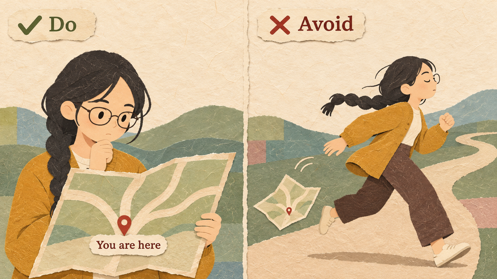

    * **Example:** StudySpace is the leader in room booking and the target of UniLife. Its first need is a defense that UniLife cannot copy quickly, not an attack on another market.
    * **Common mistake:** A newcomer using a leader's strategy, such as fighting a strong leader head-on with discounts (see Uber in China below).
  * **Rule 2: Check the key condition of the strategy with evidence.** Every strategy works only when its key condition in the table above is true.

    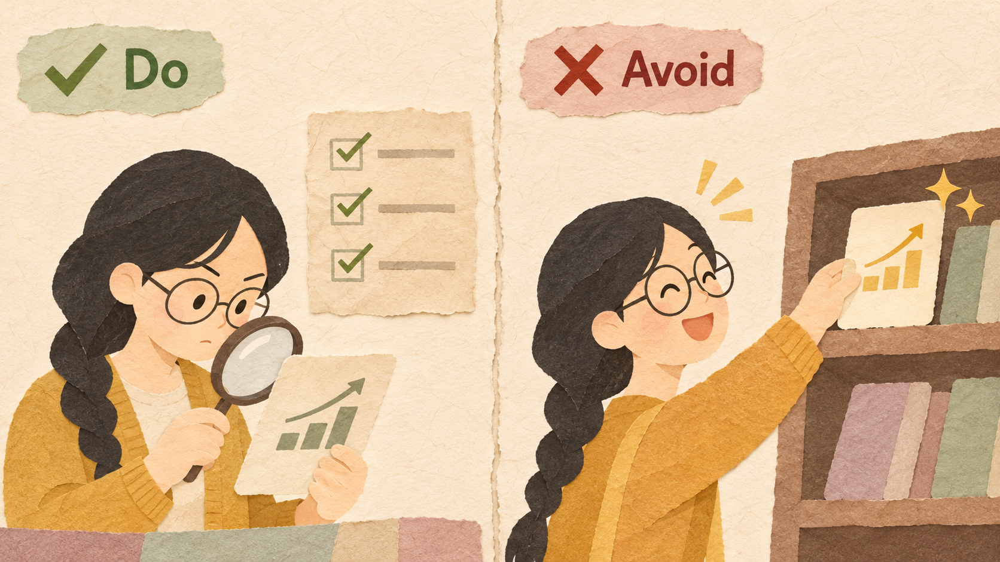

    * **Example:** The flywheel plan needs cafes to join when they see more students. Twelve cafes have already asked to be listed, so the condition is supported.
    * **Common mistake:** Choosing a strategy because a famous company used it. Apple's lock-in works because its products are truly better together; copying the words without that condition fails.
  * **Rule 3: Compare options with the same numbers over the same time.** For each option, write the result over the same period, the time to result, the main risk, and whether it helps against the rival.

    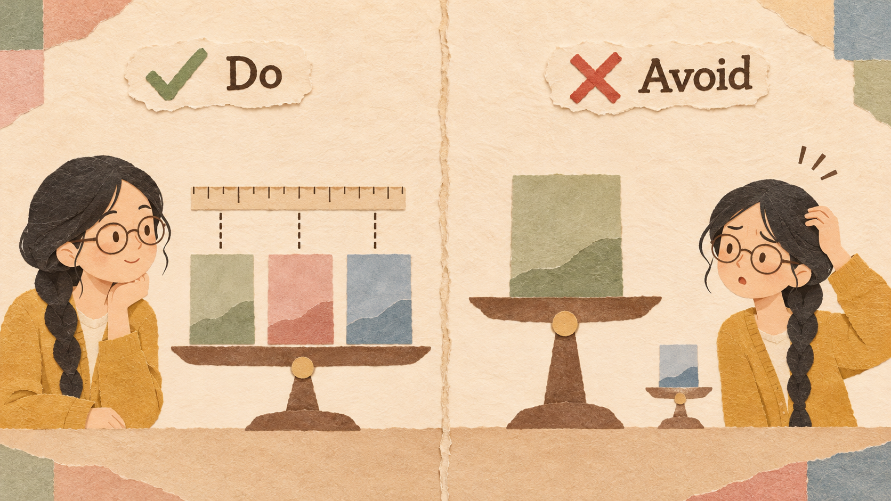

    * **Example:** Riya compares all three plans over the same six months, including what each costs at the start.
    * **Common mistake:** Comparing one option's best case with another option's worst case, or one option's first month with another's sixth month.
  * **Rule 4: Choose one strategy now, plan the next, and watch your rivals.** Start with the strategy that fixes the most urgent problem. Write which strategy comes next and what rival move would change your plan.

    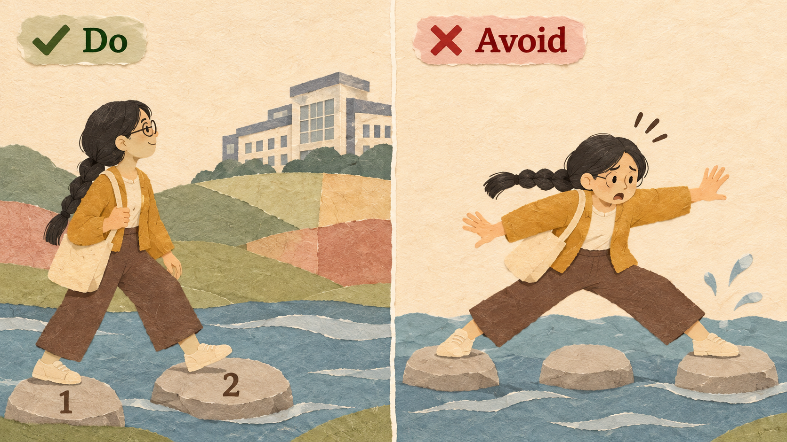

    * **Example:** First add cafe rooms (flywheel) to stay far better than UniLife; next, launch StudySpace Plus (lock-in) once there are enough rooms to make priority booking valuable.
    * **Common mistake:** Starting all three plans at once with a small team, so none is done well and nobody can tell which one worked.

* **Good examples (real companies):**
  * **Good example 1: Amazon used strategies in order.** Amazon first built a flywheel of low prices and choice in its own online store (Session 4.1). In 2000 it opened its store to outside sellers, an open ecosystem that added choice without buying stock (Session 3.4). In 2005 it launched Prime, which made customers buy more often from Amazon (lock-in, Session 4.2). In 2006 it launched Amazon Web Services, selling its computing skills to other companies (envelopment of a nearby market, Session 3.1).
    * **Why it is good:**
      * Each new strategy built on what the last one created: customers, sellers, and computing skills (Rule 4).
      * Each strategy's key condition was true when Amazon used it, for example many sellers wanted Amazon's customers (Rule 2).
      * Amazon always knew its position: the leader that keeps customers by being better (Rule 1).
  * **Good example 2: Netflix changed strategy when its position changed.** As a newcomer, Netflix used disruption: DVDs by mail with no late fees, which Blockbuster did not want to copy (Session 3.3). Once it led DVD rentals, it cannibalized its own DVD business with streaming, starting in 2007 (Session 3.2), even though its move in 2011 was badly handled (Qwikster).
    * **Why it is good:**
      * Netflix used disruption as a newcomer and cannibalization as a leader: the right strategy for each position (Rule 1).
      * It chose one main strategy at a time and planned the next (Rule 4).
      * It compared streaming with a future without DVDs, not with its DVD profits (Session 3.2, Rule 3).

* **Bad examples (real companies):**
  * **Bad example 1: Uber in China.** Uber entered China and fought the local leader, Didi, head-on, with large discounts for riders and bonuses for drivers. In 2016, Uber's CEO said it was losing more than $1 billion a year in China. In August 2016, Uber sold its China business to Didi in exchange for a share of Didi.
    * **Why it is bad:**
      * Uber was a newcomer in China but used a leader's head-on attack against a strong local leader (Rule 1).
      * The key condition for its flywheel, growth that lowers costs, was not true while Didi matched every discount (Rule 2).
      * Comparing the yearly losses with any realistic gain would have shown the problem early (Rule 3).
  * **Bad example 2: Microsoft's Windows Phone.** Microsoft tried to build a third smartphone ecosystem against Apple and Google. In 2014 it bought Nokia's phone business for about $7.2 billion. But app makers did not build enough apps for Windows Phone, because most customers were already on iPhone or Android. In July 2015, Microsoft wrote down $7.6 billion on the Nokia business and cut 7,800 jobs.
    * **Why it is bad:**
      * Microsoft chose an ecosystem strategy without its key condition: partners (app makers) willing to build (Rule 2, Session 3.4).
      * Customers were already locked in by Apple's and Google's ecosystems, so a late entrant faced high switching costs (Session 4.2).
      * Microsoft was a newcomer in phones but acted as if its position from computers would carry over (Rule 1).

* **Before the exercises: three tools you will use:**
  * **Tool 1 - Position and problem questions:** Answer four questions in order. (1) Are we the leader or a newcomer? (2) Is a rival attacking us, or are we attacking? (3) What is our most urgent problem, in one sentence with no solution? (4) Which strategy in the table fits this position and problem, and is its key condition true?
  * **Tool 2 - Option comparison table:** For each option, write the result over the same period ($), the time to result, the main risk, and whether it helps against the rival.
    * **Example:** A bike-rental app compares a lock-in membership (+$4,000 over 6 months, 1 month to start, few may join, helps a little against rivals) with a flywheel of more bike stations (+$9,000 over 6 months, 3 months, stations cost money, helps a lot).
  * **Tool 3 - Trade-off and decision rule (from Session 2.1):** A **trade-off** is what you give up to get something you value more. A **decision rule** is a promise, written before you start, about which result would make you change your decision.

* **Exercise 1 - Easy: Match the situation to the strategy (20 min):**
  * **Scenario:** Six businesses describe their situation. (a) A messaging app with 2 million daily users sees that most of its users also pay bills in a separate app. (b) A print shop sees students moving to digital notes from a rival app. (c) A new language-learning startup sees that private tutors cost too much for most students. (d) A booking platform for salons gets 40 feature requests, and outside developers want to help. (e) A campus marketplace finds that more sellers bring more buyers, and more buyers bring more sellers. (f) A smartwatch maker also sells a phone and a scale, but they do not share data.
  * **Template:**

    ```text
    Business [letter]: Our position is [leader / newcomer; attacker / target / neither].
    The best strategy is [strategy (session)], because [its key condition is true: evidence].
    ```

  * **Worked example (a campus bus app opened 10 times a month that wants to add food delivery):**

    ```text
    Our position is leader in campus transport; we are not under attack.
    The best strategy is the Super-App Strategy (4.3), because our app is a busy
    front door: students open it 10 times a month.
    ```

  * **Your turn:** Fill in the template for (a) to (f).
  * **Check your answer:** (a) Envelopment (3.1): high user overlap with bill paying. (b) Cannibalization (3.2): a rival is already taking customers; launch its own digital product. (c) Disruption (3.3): a newcomer serving people the leaders price out. (d) Open Ecosystem (3.4): more requests than the team can build, and willing partners. (e) Flywheel (4.1): each arrow of the loop is real. (f) Ecosystem Lock-In (4.2): products that could be better together, if they share data.

* **Exercise 2 - Medium: Diagnose and plan one strategy (30 min):**
  * **Scenario:** FitHub is a gym-booking app used by 9,000 members at 30 partner gyms. A large food-delivery super-app (25,000 daily users) has just added gym booking with a 20% discount. FitHub's members say they like FitHub's class reviews and personal workout history. FitHub also sells a $5-a-month coaching plan that 300 members use.
  * **Step 1 - Answer the four position and problem questions (Tool 1).**
  * **Step 2 - Plan:** Fill in the template.
  * **Template:**

    ```text
    Position: [leader / newcomer; attacker / target]
    Problem: [one sentence, no solution]
    Strategy: [one strategy (session)]
    Evidence the key condition is met: [what we know]
    First action: [one action, tested on a test group]
    Measure: [one number and a target]
    Next strategy: [which one, and why]
    ```

  * **Worked example (a campus bookshop whose students are moving to a rival e-book app):**

    ```text
    Position: leader in textbooks; target of a digital rival.
    Problem: students are moving to a rival's e-books, and our paper sales fall each term.
    Strategy: Cannibalization (3.2).
    Evidence the key condition is met: 300 students left last term; e-books earn $8 per
    student, enough to replace lost paper profit if we keep the students.
    First action: offer our own e-book pass to half of our customers next term.
    Measure: share of those customers who stay with us; target 70%.
    Next strategy: Lock-In (4.2), linking e-books with our note-taking app.
    ```

  * **Your turn:** Fill in the template for FitHub.
  * **Check your answer:** Position: leader in gym booking; target of an envelopment attack (Session 3.1). Problem: a super-app with many more users now offers gym booking at a discount. A good strategy is **Ecosystem Lock-In (4.2)**: members value class reviews and their workout history, and the coaching plan already works with 300 members, so FitHub can make booking, history, and coaching clearly better together (value, not traps). A good first action is to show each member a monthly progress report that links bookings and coaching, tested on half of the members, and to measure how many book through FitHub next month (target: fewer than 5% move to the super-app). A good next strategy is Flywheel (4.1): more gyms bring more members, and more members bring more gyms. Answers that choose a price war (matching the 20% discount) are weak: the super-app can pay for discounts longer (Rule 1).

* **Exercise 3 - Hard: Choose StudySpace's first strategy (50 min, including 2-minute presentations):**
  * **Scenario:** Return to Riya and StudySpace (monthly loss $2,000; UniLife plans to add room booking in six months). Compare the three plans over the next 6 months.
    * **Option A - Flywheel (4.1):** Let new cafes list rooms for free for three months and spend $3,000 on helping them join. Riya expects 30 new cafe rooms. From month 4, cafe bookings grow by 3,000 a month, at $2 each.
    * **Option B - Ecosystem Lock-In (4.2):** Build StudySpace Plus ($3 a month for priority booking and study statistics) for $4,000. From month 2, Riya expects 10% of the 6,000 students to subscribe.
    * **Option C - Open Ecosystem (3.4):** Build an API for tutoring and printing partners for $10,000. From month 5, StudySpace expects $2,500 a month from its revenue share.
  * **Step 1 - Calculate (use Tool 2):**
    * Option A: extra revenue in months 4 to 6 = 3 x 3,000 x $2 = $______; result over 6 months = extra revenue - $3,000 = $______.
    * Option B: subscribers = 6,000 x 10% = ______; extra revenue in months 2 to 6 = 5 x subscribers x $3 = $______; result = extra revenue - $4,000 = $______.
    * Option C: extra revenue in months 5 and 6 = 2 x $2,500 = $______; result = extra revenue - $10,000 = $______.
    * From month 4, which options cover the $2,000 monthly loss on their own? ______
    * Fill in a comparison table: result over 6 months, time to result, main risk, and how much each helps against UniLife.
  * **Step 2 - Write a 3-bullet memo to Riya (use Tool 3):**
  * **Template:**

    ```text
    To: [founder name], [company]
    1. Decision and evidence: We should start with [option] because [the rule it follows]
       and [one number from your calculation]. Next, we will use [second strategy] because [reason].
    2. Biggest risk and trade-off: The weakest point is [risk]. We give up [what we lose]
       to gain [what we protect or win].
    3. Next step and decision rule: In the next three months we will [one action] and measure [one number].
       We will change this decision if [result].
    ```

  * **Worked example (FitHub from Exercise 2):**

    ```text
    To: Lena Wu, CEO, FitHub
    1. Decision and evidence: We should start with lock-in by value (4.2), because
       members already value our reviews and history, and 300 coaching members show
       the services fit together. Next, we will push our flywheel by adding gyms (4.1).
    2. Biggest risk and trade-off: The weakest point is that the super-app's 20%
       discount may win price-sensitive members. We give up those members rather than
       start a price war we cannot afford.
    3. Next step and decision rule: In the next three months we will send monthly
       progress reports to half of our members and measure bookings. We will change
       this decision if more than 10% of them move to the super-app.
    ```

  * **Your turn:** Write the memo for StudySpace. Then give a 2-minute presentation using your three bullets.
  * **Check your answer:**
    * Option A: 3 x 3,000 x $2 = **$18,000**; result = $18,000 - $3,000 = **$15,000**. From month 4 it adds $6,000 a month, three times the $2,000 loss.
    * Option B: 600 subscribers; 5 x 600 x $3 = **$9,000**; result = $9,000 - $4,000 = **$5,000**. It adds $1,800 a month, almost covering the loss from month 2.
    * Option C: 2 x $2,500 = **$5,000**; result = $5,000 - $10,000 = **-$5,000** over the first 6 months.
    * Only Option A covers the loss on its own from month 4; Option B almost does. Option A also helps most against UniLife: with 110 rooms, StudySpace stays far better than any booking tab UniLife can add quickly (Session 3.1, Rule 3).
    * A strong memo usually starts with Option A (Rules 1 and 4), plans Option B next, when more rooms make priority booking more valuable, names a real risk (for example, cafes may not join, or UniLife may arrive sooner), and states a clear decision rule. A memo that starts with Option B can also be strong if it explains why fast, certain income comes first and when the flywheel will follow.

* **Success check:** You can (1) name a company's position and problem before choosing a strategy, (2) match a situation to the course strategy whose key condition is true, and (3) compare options with the same numbers and choose which strategy to use first and next. Use the same method in Part C of your [final project](Project.md).

* **References:**
  * Porter, M. E. (1996). [What is strategy?](https://hbr.org/1996/11/what-is-strategy) *Harvard Business Review*, 74(6), 61-78.
  * Amazon.com, Inc. (1997-2006). [Annual letters to shareholders](https://ir.aboutamazon.com/annual-reports-proxies-and-shareholder-letters/default.aspx).
  * TechCrunch (2015, July 8). [Microsoft writes down $7.6B of its Nokia acquisition, announces 7,800 layoffs](https://techcrunch.com/2015/07/08/microsoft-writes-down-7-6b-of-its-nokia-acquisition-announces-7800-layoffs).
  * Reuters (2016, August 1). China's Didi Chuxing to buy Uber's China business.

---
